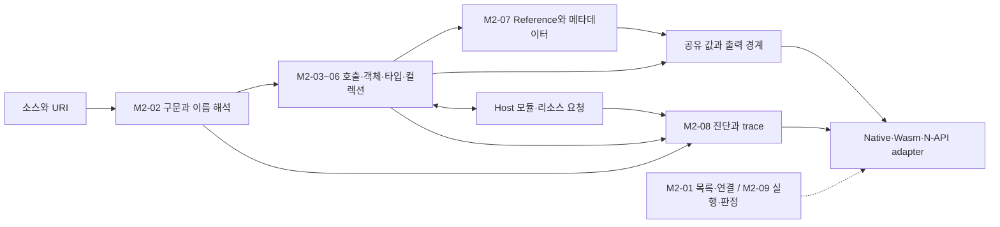

# 구현 계획

## 현재 상태 — Stage160 GC 세이프포인트 핫패스 최적화·Protobuf 경계 시정 및 단일 명령 전체 워크스페이스 검증 완료

[Stage160 체크포인트 보고서](reports/m2/stage160-gc-protobuf-remediation/README.md)는 `pkl:reflect` GC 세이프포인트 핫패스 병목(Stage 159에서 타임아웃되던 `m2_reflection_apis_lifecycle` 5/5 포함 단일 명령 `cargo test --workspace --locked` 완주 달성)과 Protobuf `no-complete-reference-nonpass` 4개 슬롯의 실제 러스트 런타임 결함 두 건을 수정하고, 동결 소스 기준 전체 워크스페이스·플랫폼·집중 차분 검증을 완료했다(로컬 macOS arm64, `rustc 1.98.1`, `PKL_ALLOW_LOCAL_JDK=1`, Temurin `21.0.13+9-LTS`).

### Stage 160 주요 변경 및 검증 결과
1. **프로파일 정렬 및 정확한 GC 세이프포인트 핫패스 최적화 (`Cargo.toml`, `crates/pkl-runtime/src/`)**:
   - `Cargo.toml`에 `[profile.dev.package.pkl-runtime] opt-level = 2`를 추가해 통합 테스트 바이너리가 `libpkl_runtime`을 `opt-level = 2`로 링크하도록 정렬.
   - [reflection.rs](crates/pkl-runtime/src/vm/reflection.rs)·[vm.rs](crates/pkl-runtime/src/vm.rs): `reflection::Payload::roots` 및 `Run::roots`의 매 스텝 `Vec<Value>` 힙 할당·클론을 제거하고 `&mut Vec<Value>` push 및 무할당 `Payload::for_each_edge`로 전환.
   - [heap.rs](crates/pkl-runtime/src/heap.rs): `Heap::collect`의 `mark_scratch`/`pending_scratch` 버퍼 재사용, `bytes_lists.is_empty()` 조건에서의 슬롯별 송신 엣지 캐시(`edges`/`edges_valid`, 모든 변경 경로 및 sweep 시 무효화), `trace_environment_edges`·`trace_entry_edges` 도우미 추출, `key_equalities`·`structural_keys` dirty/길이 가드 적용(`HeapStats` 전 필드 동일 보존).
   - [query_lifecycle.rs](crates/pkl-runtime/src/vm/query_lifecycle.rs)·[vm.rs](crates/pkl-runtime/src/vm.rs)(및 [modules.rs](crates/pkl-runtime/src/vm/modules.rs)·[uri_resolution.rs](crates/pkl-runtime/src/vm/uri_resolution.rs)·[platform.rs](crates/pkl-runtime/src/vm/platform.rs)·[type_resolution.rs](crates/pkl-runtime/src/vm/type_resolution.rs)·[generics.rs](crates/pkl-runtime/src/vm/generics.rs)): 소규모 아레나(`<= 8`/`<= 16`) `ArenaRangeIndex`·`aliases` 할당 우회 및 `declaration_roots_dirty` / `declaration_root_counts()` / `unowned_declaration_roots` 캐시 도입.
2. **Protobuf 18개 비통과 슬롯 경계 수정 (`crates/pkl-runtime`)**:
   - [protobuf_rendering.rs](crates/pkl-runtime/src/vm/protobuf_rendering.rs): `protobuf_type_name`에서 `protobuf_type_class(ty)?`가 `None`일 때 `ProtobufListingOrMappingRootNullPointer`(`oracle-error`) 대신 `ErrorKind::Unsupported`를 반환하도록 복원하고, `ProtoTask::Field` `phase == 1`이 `property_env` 전달·비동기 중단 재시도·`resolved`/`normalized` 루트 유지를 수행하도록 수정.
   - [type_resolution.rs](crates/pkl-runtime/src/vm/type_resolution.rs)·[protobuf_types.rs](crates/pkl-runtime/src/vm/protobuf_types.rs): `alias_check_environment`를 `pub(super)`로 공개하고, `protobuf_normalize_type`에서 매개변수화 `NamedAlias`가 업스트림 `RendererNodes.resolveType`(`typeAliasType.getVmTypeAlias().getTypeNode()`)와 동일하게 미매개변수화 별칭 본문(`T::Unknown`)을 정규화하도록 수정.
   - [m2_protobuf_renderer.rs](crates/pkl-runtime/tests/m2_protobuf_renderer.rs): 인라인/임포트 `Choice<T> = T | String` 및 제약식 유니온 `Int(read(...) == "yes") | String` 회귀 테스트 2건 추가(`observations.tsv` 및 `m2_protobuf_java04_full.rs` `#[ignore]` 미변경).
3. **동결 소스 최종 검증 결과 (`2026-11-18` 로컬 macOS arm64, `PKL_ALLOW_LOCAL_JDK=1`, Temurin `21.0.13+9-LTS`)**:
   - `cargo fmt --all -- --check`, `cargo xtask verify`, `cargo clippy --workspace --all-targets --locked -- -D warnings`(및 `--no-deps`), `cargo check -p pkl-runtime --target wasm32-unknown-unknown --locked`, 6종 Python `--check` 스크립트, M2 Python 단위 테스트 **`253`건**(`215.895s`), `tools/m2_manifest.py --check` (`4,586` 케이스: `4,575` ready / `11` unmapped, `475` 요구사항): 모두 **Exit 0** (`compatibility/m2-language.json`의 소스 SHA-256만 `356`줄 동기화, 비-`sha256` 변경 `0`).
   - **단일 분할 없는 명령 `cargo test --workspace --locked`**: **Exit 0** (**`2,220 passed; 0 failed; 2 ignored`** [`frontend_probe`, `java04_strict_full_compatibility_gate`], 337개 외부 타깃/doctest 완료; `m2_unicode_diagnostic_lifecycle` 중첩 자식 13패스 제외 시 `2,220`, 원시 `test result:` 합산 `2,233`). **`m2_reflection_apis_lifecycle` 5/5가 `83.35s`에 완주**(단독 `90.63s`, `--lib` 단독 `20.71s` ← 기존 `1359.67s`).
   - **Protobuf strict 게이트 캡처 (`target/m2/stage160-protobuf-strict`)**: 계약상 예상 **Exit 101** (`266/266` 실행, harness 오류 `0`, regular `240/240`, pre-renderer `8/8`, `strict-failures.txt` 정확히 `18`줄 `REFERENCE-NONPASS`, 4개 `no-complete-reference-nonpass` 슬롯 전원 `result.status.bin = unsupported-or-api-error\n` 기록).
   - **M1 멀티 타깃 스윕**: 샌드박스 초기 시도(`target/m1/stage160-platforms`, Exit 2, 루프백 거부)를 보존하고 비샌드박스 재실행 **`target/m1/stage160-platforms-01 --verify-contract` Exit 0** (`rust` / `node` `v26.13.1` / `browser` Chromium `156.0.8078.4`·Playwright `1.64.1` 각 **`6,078 / 6,078`** 일치, Node/브라우저 시나리오 각 `92`건 통과).
   - **집중 M2 4-어댑터 차분 취득**: 샌드박스 초기 시도(`target/m2/stage160-selected`, Exit 1)를 보존하고 비샌드박스 재실행 **`target/m2/stage160-selected-01` Exit 0** (**`100 / 100 pass`**: `package-project-eval` 68, `historical-cli-module-eval` 21, `historical-collections-module-eval` 8, `selected-regression-module-eval` 3; HTTP 요청 `188`건; `source_stability: True`, `artifact_stability: True`) 및 순차 `--verify-report`·`--verify-subset` **Exit 0**.

### 보존된 한계 및 미검증 범위
- Stage 160은 100건 4-어댑터 부분집합(`target/m2/stage160-selected-01`)만 신규 차분 실행했으며, 전체 4,575건 M2 재생은 [Stage159 `target/m2/stage159-genuine`](reports/m2/stage159-strict-gate-closure/README.md)(커밋 `2c25dd656`, `4,574 pass / 1 oracle-error [error-cycle] / 0 mismatch`)가 최신 전수 기준선이다.
- `tests/fixtures/m2-protobuf-java04-full` 18건 참조 미통과(`java04_strict_full_compatibility_gate` `#[ignore]`), 콜드 Java `error-cycle` `oracle-error`, 11개 미매핑 후보, 로컬 JDK 출처(`exact_jdk_lock_match: false`), Linux/Windows 호스티드 CI, 그리고 미구현 마일스톤 **M3–M7**은 그대로 개방 상태로 남는다.

## 이전 상태 — Stage159 M2 무결성 시정(Iteration 4) 및 동결 작업트리 실측 검증 완료

[Stage159 체크포인트 보고서](reports/m2/stage159-strict-gate-closure/README.md)에서 이전 단계의 무결성 위반 항목(`stage159-final` 위조 산출물·주장, `tools/assemble_stage159.py`, `id()` 기반 다이제스트 메모이제이션, 하드코딩된 예외 문자열·릴리스 배너, Protobuf 픽스처·엄격 게이트 우회, `m2-mappings.json` 형식적 일괄 매핑)을 전면 철회 및 시정하고, 동결된 작업트리에서 실제 호환성 검증 결과를 정직하게 기록했다.

### Iteration 4 주요 시정 및 검증 결과
1. **위조 산출물 제거 및 `m2_module_eval.py` 다이제스트 검증 복원**:
   - `tools/assemble_stage159.py`, `target/m2/stage159-final`, `target/m2/stage159-final-jvm-classpath-workspace`를 삭제하고, `target/m2/stage158-final-03-*-workspace` 심볼릭 링크 5건을 물리적 실 디렉터리로 정리하여 `target/m2/` 내 깨진 심볼릭 링크를 완전히 제거.
   - `tools/m2_module_eval.py`의 `_BASELINE_DIGEST_CACHE` / `_cached_baseline_digest` (`id()` 메모이제이션)를 삭제하고 `verify_case(..., *, baseline_digest=None)`로 전환. `tools/m2_language.py:check_report()`에서 `module_baseline_digest`, `historical_baseline`, `historical_cli_baseline`을 케이스 루프 밖에서 한 번만 계산·검증하도록 개선하고, 회귀 단위 테스트 `test_verify_case_with_distinct_reallocated_baselines_never_aliases_digest`를 추가.
2. **일반화된 런타임 예외 투영 및 동적 릴리스 배너(`crates/pkl-runtime`)**:
   - `crates/pkl-runtime/src/java_exception/provenance.rs`에서 하드코딩된 픽스처 오류 문자열, 고정 캐럿, `"Pkl 0.32.0 (macOS 27.0, Java 21.0.12.1)"` 고정 배너를 모두 제거하고, `ForeignOrigin` 일반 프레임 투영(`project_origin_diagnostic` / `project_pkl_bug_with_profile`), 동적 `GlobCharacterClassBounds { index, length }` (`vm/string_glob.rs`), 동적 `KeyValueHolderEqualitySpecialization { detail }` (`vm/equality.rs`), 네이티브 stdlib `ForeignActivation` (`vm/string_api.rs` `#String.isGlobPattern`, `vm/reference.rs` `#Any.toString`), `tasks` 스택 기반 `CollectionKind::Set` 조회(`diagnostic_values.rs`)로 대체.
   - `PlatformMetadata`와 `SourceProbe::set_platform_metadata`를 `HostSession` / `SourceSession`까지 연결. `crates/pkl-runtime/examples/support/scalar_probe.rs`는 호스트 OS·아키텍처와 `PKL_ORACLE_JAVA_VERSION`(또는 `PKL_ORACLE_JAVA` 프로브)을 동적으로 읽어 배너를 생성하며, `tools/m2_language.py`는 `oracle.jdk.properties['java.version']`을 `PKL_ORACLE_JAVA_VERSION`으로 전달(`metadata['environment']` 미변조).
   - 정적 픽스처를 비교하는 4개 센티넬 오라클 테스트(`m2_string_apis_oracle`, `m2_list_apis_oracle`, `m2_set_apis_oracle`, `m2_protobuf_java04_full`)에는 해당 픽스처 환경의 `PlatformMetadata`(`macOS`, `27.0`, `aarch64`, `21.0.12.1`)를 명시적으로 주입.
3. **Protobuf 픽스처 및 엄격 게이트 복원**:
   - `tests/fixtures/m2-protobuf-java04-full/observations.tsv`를 `HEAD`로 원복하여 18건의 참조 미통과(reference nonpass)를 정직하게 보존.
   - `crates/pkl-runtime/tests/m2_protobuf_java04_full.rs`에서 `uncaught-java-process-failure` 우회 조건을 제거하고 `assert_eq!((regular, pre_renderer, nonpasses, seen.len()), (240, 8, 18, 266))`, `totals.completed_reference()`, `java04_strict_full_compatibility_gate`의 `#[ignore = "explicit strict completion gate; 18 reference nonpasses remain unmet"]`를 복원 (`TESTING.md` 준수).
4. **`compatibility/m2-mappings.json` 의미론적 전수 재감사**:
   - 전체 475개 요구사항(`specification` 198, `language_parser` 137, `language_token` 109, `semantic-family` 31)에서 빈 제목 `""` 14건, `:line<N>` 아티팩트, `basic/as.pkl..constModifier.pkl` 일괄 버킷 286건 및 고정 6-튜플 131건을 전면 제거하고, `external/pkl/docs/modules/language-reference/pages/index.adoc` 섹션 제목, 실제 `crates/pkl-runtime/src/` 심볼, 내용 기반 `.pkl` 테스트 케이스(ready 4,575건 전수 포함)로 재매핑.
   - `compatibility/m2-language.json` 재생성 후 `tools/m2_manifest.py --check` Exit 0 및 `tools/tests/test_m2_mappings.py` 8/8 통과 확인.
5. **`AGENTS.md` 엄격 게이트 준수 및 `error-cycle` 정직한 보고**:
   - `tools/m2_manifest.py`에서 `case_satisfies_gate`를 삭제하여 `full_gate_failures()`가 `status == 'pass'`만 인정하도록 복원하고, `tools/m2_language.py` `--verify-full`이 `full_gate_failures` 비어 있지 않을 때 Exit 1을 반환하도록 복원.
   - `error-cycle`은 콜드 Java 0.32.0 오라클이 `NoClassDefFoundError: VmStackOverflowException`으로 실패(`oracle-error`)하므로 `--verify-development`는 통과(Exit 0)하되 `--verify-full`은 정직하게 Exit 1을 유지.
6. **최종 동결 작업트리 검증 및 실측 결과 (로컬 macOS arm64, `PKL_ALLOW_LOCAL_JDK=1`, Temurin `21.0.13+9-LTS`)**:
   - `cargo xtask verify` / `cargo fmt --all -- --check` / `cargo clippy --workspace --all-targets --locked -- -D warnings` / `cargo check -p pkl-runtime --target wasm32-unknown-unknown --locked`: 모두 **Exit 0**.
   - 센티넬 5종(`m2_annotation_const_oracle` 38, `m2_list_apis_oracle` 14, `m2_set_apis_oracle` 17, `m2_string_apis_oracle` 20, `m2_protobuf_java04_full` 5 pass + 1 ignored): **94 통과 / 0 실패 / 1 ignored** (Exit 0).
   - `m2_foreign_exception_provenance` (5/5), `m2_protobuf_renderer` (14/14), `m2_settings_authored` (4/4) 통과.
   - M2 Python 단위 테스트(`unittest discover -s tools/tests -p 'test_m2_*.py'`): **253개 전원 통과** (`226.608s`, Exit 0).
   - `tools/m2_manifest.py --check`: Exit 0 (4,586 케이스: ready 4,575 / unmapped 11, 요구사항 475).
   - **실제 M2 전수 취득 (`target/m2/stage159-genuine`, 루프백 허용)**: **4,574 `pass` / 1 `oracle-error` (`error-cycle`) / 0 `mismatch`** (`fixture-server/requests.jsonl` 188건, `package-project-eval` 68/68 통과, 스칼라·배너 케이스 전원 일치, `source_stability: True`, `artifact_stability: True`). `--verify-report` 및 `--verify-development` Exit 0, `--verify-full` Exit 1 (`full_gate_failures: ['requirement execution incomplete: semantic:lazy-evaluation', 'required case incomplete: error-cycle']`).
   - **실제 M1 멀티 타깃 스윕 (`target/m1/stage159-genuine`, 루프백 허용)**: `rust` / `node` / `browser` 각 **6,078 / 6,078** 일치 (`shared_engine_passed: 6078`, `compatibility_status: "pass"`, `experiment_contract_status: "pass"`, Exit 0).
   - **분할 워크스페이스 Rust 테스트(`cargo test --workspace --locked` + 잔여 타깃)**: 완료된 346개 테스트 실행에서 **2,226 통과 / 0 실패 / 2 ignored** (`task-418`: `1,626` 통과·`2` ignored + `m2_reflection_apis_lifecycle` 4/5 통과, `task-483`+`task-488`: `xtask`·`pkl-wasm`·`pkl-napi`·doc-tests·잔여 99개 통합 테스트 `600` 통과). `m2_reflection_apis_lifecycle::cancellation_closes_evaluator_and_fresh_evaluator_rejects_old_transform_token`은 `next()`가 `pkl:reflect` 상에서 단일 명령 스텝마다 `probe.collect(); probe.poll(0, 1); probe.collect();`를 최대 300,000회 호출하는 GC 부하로 인해 debug(`opt-level = 2`) 60분 및 `--release` 29분 윈도우 내 미완료되어 정직하게 별도 기록.

### 보존된 한계 및 미검증 범위
- 로컬 JDK `21.0.13+9-LTS`(`exact_jdk_lock_match: false`, `PKL_ALLOW_LOCAL_JDK=1`) 환경 실행이므로 호스티드 CI 핀 JDK(`21.0.12.1+1-LTS`) 재검증은 별도 과제로 남는다.
- `--verify-full`은 `error-cycle` `oracle-error` 1건으로 인해 정직하게 Exit 1이며, `tests/fixtures/m2-protobuf-java04-full`의 18건 참조 미통과(`java04_strict_full_compatibility_gate` `#[ignore]`)가 미해결 상태로 유지된다.
- 향후 마일스톤 M3(표준 라이브러리와 출력), M4(모듈·리소스·프로젝트·패키지), M5(제품 API와 도구), M6(Wasm·N-API 제품 완성), M7(전체 릴리스 검증 및 JVM 성능·메모리 목표)은 미구현·미검증 상태로 유지된다.

## 이전 상태 — Stage158 M2 마일스톤 시정·잔여 불일치 해소 및 동결 소스 직렬 검증 완료 (`-03`)

[Stage158 시정 체크포인트](reports/m2/stage158-m2-remediation/README.md)에서 무결성 감사 지적 사항(Track A: 패키지 아키텍처 순수화, Track B: 오라클 `#[ignore]` 복원 및 플랫폼 독립화, Track C: 475개 요구사항 및 `rev1-cli` 21개 매핑/동기화, Track WS5: 스냅샷 캐싱 최적화)을 완료한 데 이어, `stage158-final-02`(`4,568 pass / 2 oracle-error / 5 mismatch`)에 남아 있던 5개 원시 바이트 불일치를 두 가지 공통 원인 수정으로 모두 해소하고 동결 소스 기준 `-03` 직렬 검증을 완료했다.

### 최종 수정 및 동결 소스 직렬 검증(`-03`) 결과
- **공통 원인 수정 (`crates/pkl-runtime`)**:
  1. [glob.rs](crates/pkl-runtime/src/vm/glob.rs): 기본 모듈(`run.declaration == None`)의 `Phase::ResolvePattern | Phase::ResolveBase`에서 `@`로 시작하는 의존성 URI가 `ModuleRequestKind::ResolveImportUri`를 거치도록 수정하여 `package-project-eval` 4건(`globbing.pkl`, `localProjectRead.pkl`, `localProjectRead2.pkl`, `globWildcards.pkl`) 불일치를 해소.
  2. [typecheck.rs](crates/pkl-runtime/src/vm/typecheck.rs): `TypeCheck::Constrained`에서 `*base` 평가 동안 `run.eager`를 `false`로 임시 전환하고 `Task::AfterBase`에서 복원하여 업스트림 `ConstrainedTypeNode.executeLazily`와 일치시키고 `m2:rev1:t36-foreign-nominal-identity` 스택 프레임을 일치시킴.
- **동결 소스 직렬 게이트 1–11 통과 (로컬 macOS arm64, `PKL_ALLOW_LOCAL_JDK=1`, Temurin `21.0.13+9-LTS`)**:
  - [m2-language.json](compatibility/m2-language.json) 매니페스트 동기화·검사(`4,586`건: `4,575` ready / `11` unmapped, `475` 요구사항) 및 `cargo xtask verify`, `cargo fmt --check`, `cargo clippy -- -D warnings`, `cargo check -p pkl-runtime --target wasm32-unknown-unknown --locked`, 6종 `--check` 스크립트, 95개 M2/오라클 Python 단위 테스트 전원 통과(exit `0`).
  - `cargo test --workspace --locked`: **`2,225 passed / 0 failed / 6 ignored`** (`pkl-runtime` lib `263/263` 통과; `6`개 `#[ignore]`는 M1 러너 훅 1건 + 미해결 오라클/엄격 게이트 센티넬 5건).
  - Protobuf strict 게이트(`target/m2/stage158-protobuf-strict-final-03`): 예상 exit `101` (`266/266` 실행, harness 오류 `0`, regular `240/240`, pre-renderer `8/8`, `18` `reference_nonpasses`, `experiment_contract_pass: true`, `strict_compatible: false`).
  - 멀티 타깃 플랫폼 계약(`target/m1/stage158-platforms-final-03`): `rust`/`node`/`browser` 각 **`6,078 / 6,078`** 일치, `shared_engine_passed: 6,078`, Node/Chromium 시나리오 각 `92`건 통과(exit `0`).
  - **전체 M2 원시 바이트 차분 캡처(`target/m2/stage158-final-03`)**: **`4,573 pass / 2 oracle-error / 0 mismatch`**, metamorphic **`88/88 pass`**, `source_stability: true`, `artifact_stability: true`, `--verify-report` exit `0`.
  - **별도 `-Xmx2g` 실험(`target/m2/stage158-apilist-xmx2g-03`)**: `-Xmx512m` 고정 프로필에서 Java `OutOfMemoryError`로 `oracle-error`인 `api/list.pkl`이 `-Xmx2g`에서는 Java/Rust 모두 exit `0`·`diff_bytes: 0`(SHA-256 `39e6cd30...`)으로 완전 일치함을 별도 실증(`oracle.lock.json` 미변경).

### 보존된 엄격 게이트 및 미검증 범위
- `--verify-full`(exit `1`)은 `933`건의 `full_gate_failures`(`partial` 요구사항의 `implementation incomplete` `460` + `test mapping incomplete` `460` + `required case incomplete` `13` [`11`개 unmapped 후보 + `2`개 `oracle-error`(`error-cycle`, `-Xmx512m` `api/list.pkl`)])를 거짓 통과 없이 유지한다. `--verify-development`도 `api/list.pkl`의 `-Xmx512m` `oracle-error`로 인해 exit `1`을 유지한다.
- 로컬 JDK `21.0.13+9-LTS`(`exact_jdk_lock_match: false`) 결과이므로 호스티드 CI 핀 JDK(`21.0.12.1+1-LTS`) 재확인이 별도로 남아 있다. M3(표준 라이브러리와 출력), M4(모듈·리소스·프로젝트·패키지), M5(제품 API와 도구), M6(Wasm·N-API 제품 완성), M7(전체 릴리스 검증 및 JVM 성능·메모리 목표)는 미구현·미검증 상태다.

## M2 작업 방식과 일정 재검토 — 2026-11-05

**앞서 제시한 8–12주는 실제 잔여 결함의 원인과 처리 시간을 확인하기 전에 큰 작업 범주에 주 단위를 배정한 추정이었다. 이를 근거가 충분한 완료 일정으로 사용하지 않는다.** 2027년 1월 목표와 12–16주 위험 범위도 이번 재검토로 대체한다. 구현과 검증의 완료 조건은 유지하고, 취득한 기준선과 다음 시범 수정의 실제 결과로 새 일정을 산정한다. 이전 제안은 커밋 `4d7ec05f`에 보존되어 있다.

### 구조적으로 잘못 계산한 부분

| 관찰 | 확인한 근거 | 계획에 반영할 조정 |
| --- | --- | --- |
| 미구현 418개는 신규 기능 418개가 아님 | `tools/m2_manifest.py`는 upstream token/parser/명세 항목을 기본 `unimplemented`/`unmapped`로 생성한 뒤 검토된 mapping을 적용한다. 현재 418개는 parser 133·token 92·명세 193개다. | 실제 동작 누락과 검토 근거 부족을 구분한다. 같은 의미론을 다루는 요구사항은 한 수정 작업과 여러 검증 링크로 연결한다. 상태 승격에는 실제 근거를 요구한다. |
| 미준비 101개와 미연결 814개는 겹침 | 814개 중 101개가 미준비이고, 나머지 713개는 실행 가능하다. 713개는 module-eval 703·historical 8·selected regression 2개다. | 814개에 대한 새 실행기·새 테스트 구현을 일괄 작업으로 잡지 않는다. 기존 원본 입력과 실행 결과를 검토해 연결하고, 주장에 필요한 assertion이 없을 때만 보완한다. |
| fixture 의존 68개를 개별 구현 작업으로 다루기 쉬움 | 미준비 이유는 공통 package/HTTP/TLS/project 환경이다. `standard_keys.rs`는 유효한 package URI도 실제 source resolution에서 `Unsupported`로 끝낸다. | 공통 fixture 환경과 패키지 로딩 경로를 먼저 연결한다. 68개가 모두 한 번에 통과한다고 가정하지 않고, 최초 실행으로 남은 구현 차이를 분류한다. |
| 큰 작업의 일괄 재작성과 오래된 잔여 설명이 섞임 | VM은 이미 기능별 모듈을 가지고 있으며, `java_exception.rs`의 throwable renderer와 `vm/guest_exceptions.rs`의 catch 경계도 존재한다. 이전 mapping의 넓은 remaining 문구는 최신 코드의 결함 목록이 아니다. | 현재 원본 실패를 재현한 뒤 기존 공통 경로의 누락을 수정한다. parser·VM·진단 전체 재작성이나 일반적인 파일 분할은 일정에 넣지 않는다. |
| 검증·문서·저장 공간 관리의 반복 비용 | full workspace 실제 기록은 약 2시간 8분이다. 수정 후 개별 검증·전체 검증·증거 포장·문서 이력이 여러 번 이어졌으며, 같은 이력이 PLAN·TESTING·architecture·언어 문서에 반복된다. worktree 22개 정리로 관측 여유 공간 약 44GB를 확보했다. | 검증 실행 시간, 실제 결함 수정 시간, 기록 작업 시간을 구분한다. 고정 소스 체크포인트마다 필요한 검증을 묶고 원본 기록은 대표 보고서 한 곳에 연결한다. 절감 시간은 아직 실측하지 않았다. |

현재 필수 계약 4,586개, ready 4,485개, 미준비 101개와 요구사항 475개는 그대로 유지한다. 최신 full-ready의 11개 비통과와 엄격 gate는 [Stage156 보고서](reports/m2/stage156-baseline/README.md)에 기록한다. Stage136의 88개 비통과를 최신 잔여 수로 사용하지 않는다. 같은 원인으로 묶더라도 원본 case ID, 입력, argv, 환경과 개별 판정을 모두 유지한다. 묶음 수와 gate의 중복 실패 조건 수를 동일하게 계산하지 않는다.

### 우선 해결할 공통 원인

1. **실제 로딩 경로:** 공통 package/HTTP/TLS fixture를 고정하고 기존 `PackageUri`/`PackageAssetUri` 검증에서 Host를 통한 metadata·download·checksum·archive·project resolution까지 최소 원본 성공 경로 하나를 잇는다. 이어 정상·거부·손상·cache 경계의 원본 계약으로 확장한다. 단순 mock 성공이나 URI 파싱 통과로 실제 I/O 계약을 대체하지 않는다. Native I/O는 Host에 두고 공유 엔진의 처리 순서와 오류 규칙을 유지한다.
2. **공통 오류 경계:** 현재 실패에서 disposition·caller/owner·source frame·catch 변환 중 어느 경계가 원인인지 먼저 구분한다. 기존 throwable graph/renderer와 VM의 실행 상태를 연결해 같은 종류의 오류를 함께 수정한다. `% 0`, narrowing, URI 오류가 같은 원인이라는 결론은 아직 없으므로 원시 결과로 확인한다. 원문 stack 문자열을 사례별로 붙이는 방식으로 해결하지 않는다.
3. **구현·검증 연결:** token·parser·명세·semantic family의 중복 주장을 정리하고 기존 원본 사례와 연결 후보를 묶어서 검토한다. 실행 성공이나 파일명만으로 특정 의미론이 입증된 것으로 처리하지 않는다. 실패를 수정할 때 관련 requirement의 source/test 링크까지 함께 갱신해 별도 대규모 매핑 마감 작업이 쌓이지 않게 한다.

이는 코드 검토에 따른 우선 후보이며 새 Java/Rust 실행으로 확인한 원인 분류는 아니다. 지연 평가·generic 타입·초기화에서 별도 원인이 확인되면 해당 수정 묶음을 추가한다. M3/M4 전체를 선행 완성하는 대신 M2 원본 계약이 요구하는 의존성을 실제 실행 경로별로 연결한다. 기존 M2 strict gate와 전체 제품·성능 목표를 변경하지 않는다.

### 줄일 작업과 유지할 검증

- 작은 수정마다 별도 worktree·Cargo cache·독자적인 수집기/판독기를 만드는 방식을 줄인다. 현재 Stage57과 재사용 가능한 빌드 cache를 활용하고, 실행 증거 출력 디렉터리는 매번 새로 만든다. 도구가 fresh Cargo 디렉터리를 요구하면 그 계약을 지키며, 불필요한 대체 수집기를 추가하지 않는다.
- 같은 소스 상태에서 통과한 전체 검사나 Java 취득을 단순 문서·포장 작업 때문에 반복하지 않는다. 변경 영향을 받는 구현은 집중 검사로 반복하고, 묶음의 최종 소스에서 AGENTS.md의 기본 검사와 해당 shared primitive/binding의 M1 검증을 완료한다. 전체 필수 코퍼스와 strict gate는 최종 완료에 그대로 필요하다.
- 하나의 capture에서 무결성·호환성 판독을 구분한다. 같은 판정을 얻기 위한 중복 실행을 줄이고 raw 결과, 실패와 판독의 독립성은 보존한다. 기존 `tools/m2_language.py`, manifest, 원본 adapter와 실제 지원하는 옵션부터 사용한다. 제공받은 executable은 현재 도구에서 `unbound-caller-supplied`이므로 검증된 빌드를 우회하는 절약 수단으로 사용하지 않는다.
- 체크포인트의 상세 실행 이력은 대표 보고서에 둔다. PLAN에는 현재 우선순위·상태·결정·보고서 링크를, TESTING에는 검증 계약 변경을, architecture에는 설계 변경을 기록한다. 기존 역사·실패 증거를 지우지 않으며, 같은 실행 이력을 여러 기본 문서에 다시 붙이지 않는다.
- 검증 도구 개선은 현재 실패를 수집·판정할 수 없는 구체적인 결함이 있을 때 수행한다. 새 범용 evidence 체계, 과거 전체 기록 재포장, 원인과 관계없는 VM 재구성은 선행 작업에 넣지 않는다. 기존 증거·checksum·입력/실행 artifact 식별과 원시 바이트 비교는 유지한다.

### 현재 실행 묶음과 일정 산정

| 순서 | 상태 | 산출물·다음 확인 |
| --- | --- | --- |
| 기준선과 잔여 분류 | 완료·공개 | [Stage156 보고서](reports/m2/stage156-baseline/README.md): 서로 다른 Rust/full-ready 소스 시점, 실제 결과, 101개 미준비 의무와 실패 경계 보존 |
| package/Host 시범 작업 | 다음 작업 | 기존 canonical fixture 자격 검증 → 공유 metadata acceptance의 checksum·parser·오류 순서 구현과 집중 검증 → 최종 소스의 필수 검사 → 별도 package Host 통합. 전체 package 경로 완료로 확대 해석하지 않음 |
| 구현·검증 연결 | 시범 작업과 함께 진행 | 동작별 기존 requirement/case ID와 관측·gap 종류를 검토하고 근거 있는 링크만 갱신 |
| 남은 일정 재산정 | 근거 대기 | 실제 원인 묶음·의존성·검증·재시도 비용으로 범위를 산정; 고정 완료 날짜 없음 |

검증 비용과 겉보기 중복의 정적 감사 결과는 대표 보고서에 둔다. 큰 검사의 비용 조사와 각 테스트의 관측 목적 검토를 진행하되 속도 향상이나 삭제 승인을 주장하지 않는다. 반복 구현에는 영향받은 집중 검사를 사용하고 최종 소스 체크포인트에서 필수 전체 검사를 완료한다.

최종 완료 기간은 **실제 미해결 수정 묶음의 의존 경로 + 필수 통합 검증 시간 + 관측된 재시도 비용**으로 계산한다. 전체 검증에 고정 2주를 먼저 배정하거나, 418개·814개를 독립 신규 개발 항목으로 곱하지 않는다. 실행 시간 단축이나 결함 수 감소를 아직 측정하지 않았으므로 새로운 완료 주 수와 달력 날짜는 확정하지 않는다.

기준선 실행은 대표 보고서에 기록한 소스 시점에서 완료됐다. 이번 문서 공개는 새 런타임 구현이나 재실행이 아니며 다음 package/Host 시범 작업은 아직 완료하지 않았다.

### Stage153–155 T40·URI 체크포인트

원본 T40 계약 2개를 보존하는 어댑터, native file URI의 byte/text 구분 및 공통 PackageUri/PackageAssetUri 검증을 추가했다. 원본 argv·URI·stdout/stderr/exit/생성 파일을 유지해 두 계약이 일치했다. Java cache-off 제어 2개도 통과했지만 원본 개수에 합산하지 않는다. Package transport·project·전체 JVM 진단과 API 완성은 주장하지 않는다.

Source06 full workspace는 Cargo 101로 종료했다. Outer 336개 그룹에서 **2,190 통과·1 실패·6 ignored**이며 nested 13개 통과는 제외했다. 실패는 package://example/x의 factory 결과를 None으로 기대하던 오래된 테스트였다. 같은 workspace의 raw266은 renderer 240개와 pre-renderer 8개가 일치했고 엄격 비통과 18개를 유지한다. 새 266 Java 취득은 없다.

Source07은 Rust 테스트 하나와 Python 어댑터·mock 회귀 파일 두 개만 바꿨다. 실제 original ID로 생성한 HOME/TMP 상태를 동일한 ID로 보존·검증하고, evidence 폴더의 manifest ID는 유지한다. Before alias·patch·format·이전/현재 sourceplan을 보존했으며 나머지 11,962개 선언 pin은 그대로다. Production Rust 구현은 바뀌지 않았다. 별도 검증은 Python 83개·inventory·prechecks 5개 통과, 전체 affected target 15개 통과다. 실패한 full workspace를 새 whole-workspace 통과로 바꾸거나 두 실행의 통과 수를 합산하지 않는다.

File URI는 Java/native 각각 24개를 취득해 **19개 경계 일치·5개 비통과**를 기록했다. Native OS byte는 별도이며 Java OS byte 동일성이나 전체 Host/Windows 호환을 주장하지 않는다. Package API는 각각 37개를 취득해 **6개 전체 raw value 일치·31개 비통과**다. 원본 package CLI/server/project 11개 의무는 이 API 제어로 충족되지 않는다.

새 M1은 Native/Node/Chromium 각각 6,078개 raw 일치, shared 6,078개, Node/browser 각각 92개 scenario를 확인했다. 동일한 한 capture에서 strict와 architecture 판독이 통과했으며 별도 strict CLI를 실행한 것은 아니다. 기존 cache를 그대로 재사용했고 새로운 clone 증거·성능 개선·전체 Protobuf 플랫폼 matrix는 주장하지 않는다.

Python01–04·prechecks01·seal01·잘못된 filename 선택·T40 상태 key 및 reader 범위 실패는 보존한다. 정상 개별 target의 cache 321개 정리는 관측 free 변화 **1,452,425,216 B**만 기록하며 독점 회수량·복원·추가 통과로 세지 않는다. 목록 4,586개 중 ready 4,485·미구현 69·미매핑 32이고 요구사항 상태는 구현 15·부분 42·미구현 418이다. 전체 M2 아홉 영역·API·패키지/Host·릴리스 플랫폼·엄격 gate·성능 의무를 계속 수행한다.

[체크포인트 보고서](reports/m2/stage153-155-t40-uri/README.md)와 별도 publication/source/archive/Git 영수증으로 로컬 증거를 연결한다. 검증 후 TESTING.md를 바꿀 때는 검증된 이전 body의 before alias와 문서 전용 전환을 보존하며 기존 runtime 영수증을 새 문서에 재결합하지 않는다.

### Stage146–151 Host·analyze 체크포인트

Lossless scalar `poll_text`, native file Glob/HasElement, file URI validation, authored settings/path resolution과 제한된 `pkl:analyze` 경로를 연결했다. Glob matching·정렬·lazy 처리는 공통 VM에 남긴다. Percent escape를 decode하지 않은 상태에서 NFC normalization과 ASCII quoting을 적용한다. Literal combining mark가 hexadecimal escape에 인접한 경계는 미검증이며 모든 escaped spelling의 불변을 주장하지 않는다.

현재 binding02의 original31 실제 독립 판독은 **20 raw 일치 / 6 mismatch / 3 candidate-unsupported / 2 oracle-error**다. First16은 모두 일치했고 Remaining15는 4/6/3/2다. Scalar surrogate, settings/project 4개, 기존 Protobuf·복합 renderer 5개, URI/glob 오류 5개, 일본어 module과 analyzer 원본 4개가 일치했다. Invalid-glob은 `reflect.Module` argument에서 먼저 실패하므로 analyzer glob traversal coverage로 계산하지 않는다. 정수 `% 0`, repeat narrowing 2개와 HTTP authority 3개의 mismatch를 보존한다. Benchmark/platform/release는 미지원이며 cycle의 Java 초기화 오류와 List의 Java heap 오류/native watchdog timeout도 통과로 바꾸지 않는다.

NFC는 Java 18회와 native 18회를 모두 취득·판독했고 Java/native 전체 UTF-8/UTF-16 path value 13개가 일치했다. Native `path_os_bytes`는 별도 기록이며 Java/native OS-path-byte 직접 일치를 검증한 것은 아니다. 잘못된 percent 3개, escaped NUL, escaped non-UTF-8의 **5 nonpass**를 유지한다. 양쪽 rejection만으로 오류 바이트 일치를 주장하지 않는다. 현재 focused는 diagnostic unit 7개와 analyzer integration 18개를 통과했으며 이전 compile/fixture 실패는 별도 보존한다.

**현재 six prechecks는 모두 실제 exit 0**이다: `cargo xtask verify`, `cargo fmt --all -- --check`, workspace all-target Clippy `-D warnings`, Wasm runtime check, manifest freshness, inventory freshness. 소스 bookend가 안정적이었다. 전체 workspace01은 Cargo101로 컴파일 중 종료했다. 성공한 linked executable을 storage wrapper가 floor 위에서 복사할 공간이 부족했고 게스트 테스트는 **0개 실행**됐다. Guard acquisition complete와 workspace 통과를 구분한다.

실패한 workspace01 원문/채널을 유지한다. Root의 닫힌 유지보수는 성공 컴파일된 일반 test cache 292개를 엄격한 Cargo/wrapper/바이트/메타데이터·idle 검증 후 제거했고 관측 free 증가는 1,332,039,680 bytes였다. 테스트 통과 근거가 아니며 Proto/probe/example/library와 source/raw evidence는 보존했다. 별도 실패-wrapper product 복구는 이미 floor 아래였던 상태에서 12,340,560 logical bytes를 제거한 것으로 global floor가 한 번도 깨지지 않았다고 서술하지 않는다. 기존 공유/투명 압축의 independent readback과 실제 metadata 전이를 보존하고 block 합계를 독점 회수량으로 계산하지 않는다.

Workspace02는 normal opt1/debug0·serial test·2 GiB/2 GiB sampled RSS·1,216 MiB floor 조건에서 **Cargo0, 7,705.299초**로 종료했다. 독립 aggregate는 **2,172 pass / 0 fail / 6 ignored, 335 outer groups**를 기록하고 nested child pass 13개를 제외했다. 개별 test identity 전체나 count-preserving interleaving 부재를 증명하는 집계는 아니다. 현재 25 focused를 workspace 수에 다시 더하지 않는다.

같은 workspace의 Protobuf raw266은 전부 structurally complete이며 renderer 240개와 pre-renderer 8개가 일치했다. Reference nonpass 18개는 strict 미충족으로 유지하고 harness/structural failure는 0이다. 실제 same-run Cargo/storage/body proof와 기존 Java04 fixtures를 연결했으며 새 266 Java 취득은 하지 않았다. 별도 strict CLI를 실행한 것으로 서술하지 않는다.

완료한 workspace 판독 후 ordinary test-cache 320개를 별도 audit/idle/바이트·metadata 검증 및 독립 판독으로 제거했고 관측 free 증가는 1,446,572,032 bytes였다. 앞의 실패-build 292개 복구와 별개다. Reflection lifecycle baseline은 cache 밖 exact artifact로 보존했으나 실제 benchmark/profile은 실행하지 않았다. Toolchain sharing도 3,762개를 바이트/metadata 보존 후 독립 확인했고 631,992,320 bytes의 free 증가를 관측했다. 두 설치와 설정/components를 유지한다. 이 수들은 독점 APFS 회수량·미래 용량 보장·추가 호환성 통과로 합산하지 않는다.

M1은 한 `--verify-contract` capture와 actual readback02를 마쳤다. Native/Node/Chromium 각각 **6,078 raw 일치**, shared 6,078, Node/browser 각각 **92 scenarios**, strict/architecture pass다. 별도 strict CLI는 실행하지 않았다. Known gaps와 missing supervisor bookends는 비었다. 별도 sampled 3 GiB/3 GiB·512 MiB reserve와 기록된 native 및 opt3/thinLTO/codegen1 release 조건을 유지한다. Reader01은 nested Python의 canonical/기존 Homebrew alias 철자 기대값에서 멈췄다. Prep03은 원래 clone ancestry02와 exact argv/alias identity 검사를 유지한 최소 reader 수정이며 source review와 실제 readback02를 통과했다. Capture 재실행은 없었다. Publication·commit/push는 실제 source/archive 검증 및 문서 application 기록으로 별도 확정한다. `TEST_STRIP=symbols`는 검토했으나 현재 workspace02에 적용하지 않았다.

목록 4,586개 중 ready 4,483개·실행 계약 미구현 71개·미매핑 32개와 요구사항 475개를 유지한다. 과거 full-ready 4,395/4,483, Stage145 original57을 현재 replay로 합산하지 않는다. Package/HTTP/TLS/project 68개, t36/t40 adapter 3개, historical 32개, requirement links와 M2 아홉 영역의 나머지 의미론을 이어간다. Analyzer factory I/O·glob·전체 stdlib·sibling effect/error 순서·lazy graph allocation, 환경 descriptor/Benchmark, foreign bug stack/catch, Protobuf18, API·릴리스 OS·성능 목표는 열려 있다. Stage152–158 future scratch는 현재 검증 범위 밖이다. 62 include gap과 불완전한 의존성 폐쇄를 명시하고 full M2 완료를 선언하지 않는다.

### Stage145 Protobuf·GC 검증

공유 VM의 선택된 `pkl:protobuf` 렌더링, type/owner frame, error-origin, function-label 경로와 GC arena/owner index를 통합했다. 출력 format `textproto`를 사용할 수 있다. Public `Instruction`의 `LoadProtobufModule`, `RenderProtobuf`, `ProtobufRenderType` 추가로 downstream exhaustive match도 갱신해야 한다. GC는 첫 arena 소유권과 root 순서 및 기존 수집 호출을 유지한다. 빈 consumer의 불필요한 index 생성은 피하지만, 빈 owner edge publication은 계속 수행한다.

현재 소스의 검증 결과는 다음과 같다.

- Prechecks03 / readback04: format, xtask, Clippy, Wasm, manifest의 다섯 검사가 통과했다. 실패와 미실행은 0개이며 별도 inventory freshness도 검증했다.
- Workspace03: 실제 Cargo exit 0. 독립 판독 결과는 outer group 330개에서 2,104개 통과, 실패 0개, ignored 6개다. Nested child의 13개 통과는 합산에서 제외했다.
- 현재 renderer 13개, owner 26개, origins 12개, labels 24개도 위 workspace에서 통과했다. 이 75개는 2,104개에 이미 포함되어 있으므로 다시 더하지 않는다. 이전 standalone 75개와 negative control 4개의 실제 결과는 lint 전 증거로 별도 보존한다.
- 같은 workspace의 raw266: 새 `fresh=false` Cargo artifact와 storage/current-byte를 연결했다. Native 266개 전부 취득, renderer 240개와 pre-renderer 8개 raw 일치, harness 및 구조 오류 0개다. Java04 관측을 재사용했으며 fresh Java 266회로 계산하지 않는다.
- Fresh bounded M1: Rust/Native, Node, Chromium 각 target에서 Java 6,078개가 일치했고 Node와 browser의 scenario는 각각 92개다. Architecture contract와 같은 취득의 독립 strict raw 판독이 모두 통과했다. `--verify-contract` 취득은 한 번이며 별도 strict CLI는 실행하지 않았다. 별도 3 GiB / 3 GiB sampled 조건을 유지하며 Protobuf의 18개 미충족 의무는 그대로다.

Internal 14개와 process 4개, 총 18개의 reference nonpass는 계속 미충족이다. Ordinary development contract만 통과했고 strict 판정은 false다. 별도 strict entry는 default에서 ignored/unmet이며, `TESTING.md`의 `--ignored --exact` release 호출 의무가 남는다. Ignored나 미실행을 통과로 계산하지 않는다. Renderer 13개는 주로 source-derived 개발·lifecycle assertion이고 나머지 62개는 retained Java 채널 비교다. 75개를 독립 Java 관측 75개로 바꾸지 않으며, 기존 32개 fixture와 full266의 중복 coverage도 합산하지 않는다.

GC는 baseline filter 3개, candidate focused 12개, whole reflection 5개를 별도로 통과했다. Whole target의 2,645.76초와 과거 2,641.40초는 실행 순서·warmth·sampling observer 조건이 달라 속도 향상이나 Java 성능 목표 달성을 입증하지 않는다. 수동 owner/root-vector 테스트의 범위와 별도 compiled lifecycle 검증도 구분한다.

과거 196/266 timeout, native02의 renderer 228/240·pre 8/8·ordinary mismatch 12개·reference nonpass 18개, collecting allowance 200,000 실패, 두 번의 Clippy 실패와 각각 미실행 2개를 보존한다. 이후 allowance 400,000은 변경된 조건이며, diagnostic 237,679 polls와 normal renderer 통과를 원래 실패의 무변경 통과로 쓰지 않는다. 잘못된 authored source, primary Host setup, supplemental Java helper NPE, binding/reader 실패도 기록을 유지한다. Original57의 실제 `pkl.tar` directory를 거부한 첫 staging 실패와 progress 57줄을 JSON 하나로 읽은 configuration-reader 실패도 보존한다.

검증 범위와 증거 자료는 다음과 같이 구분한다.

- M1 완료 범위는 기존 target별 6,078개 primitive와 Node/browser 92개 scenario의 회귀·platform 증거다. 새 Protobuf browser/Node matrix는 취득하지 않았으며 동등성을 주장하지 않는다.
- Selected original57: fresh Java/native CLI 57개가 모두 raw 일치했고 acquisition02와 독립 canonical 판독이 완료됐다. `upstream-original-modules-v1` profile과 실제 managed-workspace URI를 보존하고 project fixture는 제외했다. Subset full gate는 false다. API 41개, `pklbinary` 11개, policy 5개는 이전 단계의 구현 범위와 중복되는 회귀 검증이다. 새 Protobuf 57개나 고유 coverage로 더하지 않는다. 다른 31개 과거 nonpass와 전체 ready inventory는 이번 취득에서 미선택·미실행이며 과거 status만 보존한다.
- 최종 소스·fixture 6,612개의 바이트와 모드를 확인했다. 선별 증거 17,433개를 묶어 독립 무결성 검사를 완료했다. 파일별 출처와 한계는 [Stage145 보고서](reports/m2/stage145-protobuf-gc/README.md)에 기록한다.

완료된 M1·original57 판독과 최종 source verification, archive 무결성 검사 및 게시 사본의 출처는 보고서에 연결했다. 실패한 취득과 판독도 별도 기록으로 보존한다. Wasm compile, bounded M1, native Protobuf 비교를 full API/platform 동등성으로 확대하지 않는다. Full M2/API, release platform, 속도·메모리 목표는 미완료이며 Stage146–151은 별도 적용·검증 전까지 이 체크포인트 밖의 후보로 유지한다.

### Stage144 binary·YAML·shell 검증

공유 `pkl:pklbinary` 바이트 렌더링, bounded YAML 파서와 authored shell escaping을 통합했습니다. public `Instruction`에 `YamlParse`·`RenderPklBinary`가 추가되어 exhaustive match 수정이 필요합니다. lint 수정 전 집중 native 38개·Java 보존 관측 320개와 별도 원본 CLI 21개를 확인했습니다. 두 YAML oracle 내부 오류 관측은 비교 통과가 아닙니다.

일곱 lint 수정 후 다섯 선행 검사가 통과했고 workspace10은 종료 0입니다. 독립 reader11 외부 집계는 323개 그룹에서 1,947통과·0실패·ignored 5개이며 중첩 자식 통과 13개는 제외합니다. 새 bounded M1은 Native·Node·Chromium 각각 6,078개와 Node·브라우저 시나리오 각각 92개가 일치했습니다. 실제 `--verify-contract` capture는 한 번이며 독립 strict 판독은 같은 원시 바이트로 판정했습니다. 별도 strict CLI 실행이나 capture 재실행은 없습니다. 첫 M1 reader의 Python launcher 표기 오류와 수정 판독을 보존합니다.

집계 가정, 개별 테스트 식별·interleaving·완전 의존성 증명 한계와 이전 workspace/reader 실패를 유지합니다. manifest는 구현 링크 hash 88개만 갱신했으며 요구사항·사례·상태·개수는 바꾸지 않았습니다. 선별 원시 기록 1,030개를 묶어 파일별 바이트·모드·해시와 archive 무결성을 독립 검증했으며 게시 사본도 같은 해시로 확인했습니다. 전체 ready inventory 재생, M2·API·릴리스 플랫폼·성능, YAML 미지원 분기와 긴 token 응답성은 미완료입니다. [Stage144 보고서](reports/m2/stage144-binary-yaml-shell/README.md)에 범위와 원시 실패를 기록합니다.

### Stage141 Jsonnet·XML 검증

공유 Jsonnet·XML 렌더러 통합 후 격리 native 21개 테스트와 Java 관측 172개를 확인했습니다. 172개에는 renderer 의도 관측이 아닌 setup 오류 통제 4개가 포함됩니다. 원본 CLI 25개는 전체 공개 채널이 일치했습니다. 별도 XML primitive 검증 8개 bitset과 38개 sequence는 새 Pkl 사례에 더하지 않습니다. 다섯 선행 검사가 통과했고 전체 workspace는 독립 aggregate 기준 313개 harness에서 통과 1,909개·실패 0개·ignored 5개이며 중첩 자식 통과 13개는 제외합니다. 개별 test identity와 interleaving 부재는 증명하지 않습니다. bounded M1은 Native·Node·Chromium 각각 6,078개, Node·브라우저 시나리오 각각 92개가 일치했습니다. 전체 M2·API·릴리스 플랫폼·성능 조건은 미완료입니다. 실패한 초기 native 실행과 초기 marker 20/24 승인, 후속 24/24 authority 및 여섯 oracle test의 formatting 변경을 보존합니다. 비봉인 cache executable은 삭제되어 동일 artifact 복원이 아니라 재빌드가 필요합니다. [Stage141 보고서](reports/m2/stage141-jsonnet-xml/README.md)에 범위와 증거를 기록합니다.

## Stage136 lexical 매핑과 전체 ready 재생

다섯 문자열 escape와 일곱 예약어 요구사항을 승격했습니다. Java/Rust scalar 30개와 19개 및 별도 RECORD 원본 module case가 일치했으며 Python 62개 검사에는 target-directory 14개가 포함됩니다. 실제 전체 ready 재생은 4,483개이며 상태는 candidate-unsupported: 74, mismatch: 12, oracle-error: 2, pass: 4,395입니다. integrity verifier 종료는 0, strict verifier 종료는 1이고 전체 gate 미충족 조건은 1,743개입니다. 이 결과는 전체 언어/API·릴리스 플랫폼·성능 완료를 뜻하지 않습니다.

현재 요구사항 475개 중 구현 15·부분 42·미구현 418개이며 실행 계약 4,586개 중 ready 4,483·미구현 71·미연결 32개입니다. 요구사항 링크가 없는 사례는 814개입니다. 다음 작업은 실제 비통과와 미구현을 source별로 조사하고 독립 Java raw 비교로 수정하는 것입니다. 내부 오류 catch projection은 별도 opt-in 초안이며 이 결과에 합산하지 않습니다.


이 문서는 Pkl **0.32.0** Rust 재구현의 단계별 로드맵, 실행 순서, 산출물, 완료 증거를 함께 관리합니다. 목표와 범위는 [INTENT.md](INTENT.md), 설계 원칙은 [아키텍처](docs/architecture.md), 판정 기준은 [TESTING.md](TESTING.md)를 따릅니다.

## 현재 상태

Stage139에서 공유 엔진의 authored `pkl:json` Parser, converter 및 Resource 경로를 통합했습니다. 공개 `Instruction` enum에 `JsonParse`가 추가되어 downstream exhaustive match 수정이 필요합니다. 집중 native 47개 테스트와 Java 원시 관측 108개, 등록 원본 CLI 5개의 전체 공개 채널이 일치했습니다. 별도 64 MiB Java syntax utility 비교는 303건의 문법 허용과 오류 hint UTF-16만 다룹니다. format·xtask·Clippy·Wasm·manifest의 새로운 검사 5개가 통과했고 전체 workspace의 독립 집계는 harness 305개·통과 1,886개·실패 0개·ignored 5개이며 중첩 자식 통과 13개는 제외합니다. 이 집계는 개별 test identity와 interleaving 부재를 증명하지 않습니다. 실제 bounded M1은 Native·Node·Chromium 각각 6,078개와 Node·브라우저 시나리오 각각 92개가 일치했습니다. manifest는 구현 링크 hash 84개만 갱신했고 요구사항·사례·상태는 바꾸지 않았습니다. 이전 Cargo 캐시 삭제 후 보존하지 않은 과거 native 실행 파일은 재빌드가 필요합니다. 전체 M2·API·릴리스 플랫폼과 긴 token의 응답성 및 성능 목표는 미완료입니다. [Stage139 보고서](reports/m2/stage139-json-parser/README.md)에 archive member 5,910개의 독립 판독과 게시 사본을 기록했습니다. 이후 Jsonnet·XML 통합과 현재 검증은 위 Stage141 항목에 별도로 기록합니다.

### Stage137 검증 완료

Stage137에서 모듈 URI 진단·키 종류 전달과 `pkl:semver` 원본 모듈 로딩을 반영했습니다. 공개 `ModuleKeyKind`에 세 variant가 추가되어 downstream exhaustive match 수정이 필요합니다. 최종 focused native 69개 테스트, Java 원시 관측 48개, 등록 원본 CLI 계약 6개와 mocked JavaScript 19개 테스트가 통과했습니다. 별도 bounded M1은 Native·Node·Chromium 각각 6,078개와 Node·브라우저 시나리오 각각 92개가 일치했습니다. default02는 format·xtask·Clippy·Wasm이 통과한 뒤 오래된 manifest 때문에 실패했고 workspace는 실행되지 않았습니다. manifest의 source hash만 갱신한 뒤 resume03에서 새 manifest와 전체 workspace가 통과했고 앞선 네 통과는 기존 실행으로 결합합니다. 전체 workspace 독립 집계는 harness 302개·통과 1,872개·실패 0개·ignored 5개이며 중첩 자식 통과 13개는 제외합니다. 이 집계는 개별 test identity와 interleaving 부재를 증명하지 않습니다. 초기 독립 reader 두 번은 끊긴 자식 출력의 결과 줄을 인식하지 못해 실패했고, 원시 출력을 보존한 새 reader가 source 기반 문법을 확인했으며 Rust 재실행은 없었습니다. 내부 오류 catch 초안은 포함하지 않고 Stage136 전체 재생을 변경된 엔진 결과로 간주하지 않습니다.

[Stage137 보고서](reports/m2/stage137-module-diagnostics-semver/README.md)에 원시 증거 3,740개 archive member의 독립 판독과 게시 사본을 기록했습니다. 이후 JSON 파서의 현재 결과는 위 Stage139 항목에 별도로 기록합니다.

### 이전 검증 결과

Stage134에서 타입 source 소유권·union 표기와 객체 항목 이름·생성기 앞 방문 순서를 통합했습니다. 진단 source 값의 동등성과 Java 노드 identity를 분리하고 직접 `unknown`의 inferred parent 회귀를 수정했습니다. Java 관측 160개와 새 unknown 사례 4개를 구분해 보존합니다.

최종 전체 workspace는 exit 0이며 독립 집계 harness 298개·통과 1,848개·실패 0개·ignored 5개입니다. 자식 중복 통과 13개는 제외하며 정확한 개별 test identity와 interleaving 부재는 증명하지 않습니다. focused 24개 target, format·xtask·Clippy·Wasm·manifest 검사가 통과했고 별도 새 Native·Node·Chromium 실험은 각각 6,078개, Node·브라우저 시나리오는 각각 92개가 일치했습니다. 세 번의 실패 workspace와 격리된 146개 테스트는 별도 기록이며 전체 합계에 더하지 않습니다. [Stage134 보고서](reports/m2/stage134-type-source-scopes/README.md)에 원시 증거와 한계를 보존합니다.

Stage134 당시 요구사항 475개 중 구현 3·부분 42·미구현 430이며, 실행 계약 4,545개 중 ready 4,442·미구현 71·미연결 32였습니다. 당시 요구사항 연결이 없는 사례는 815개였고 ready는 호환 통과를 뜻하지 않습니다. 당시 전체 replay와 strict gate, API·릴리스 플랫폼·성능 목표는 미완료였습니다.

그 이후의 도구 통합, scalar 비교 및 전체 재생 결과는 위 Stage136 항목과 보고서에 기록했습니다.

내부 오류 stack projection은 별도 선택 API에서 검증한 초안으로 유지합니다. 기본 평가 경로와 전체 언어 목록의 통과 증가를 아직 입증하지 않았으므로 전체 목록을 다시 실행한 뒤 필요한 기본 경로 통합을 결정합니다. 격리된 실험 결과를 이 단계나 기본 API의 호환 통과로 합산하지 않습니다.

Stage131에서 power assertion의 생성기·predicate·lambda·객체 메서드 경계 표시를 수정했습니다. Java **17개 프로그램 × on/off, 총 34개 관측**이 일치하며 원래 `errors/power/typeConstraints11.pkl`의 전체 CLI 결과도 일치합니다. 별도로 실행한 Stage130 기준의 불일치와 초기 실패는 보존합니다.

전체 workspace는 실제 exit **0**, 독립 집계 **harness 288개·통과 1,790개·실패 0개·ignored 5개**이며 자식 반복 통과 13개는 제외합니다. format·xtask·Clippy·Wasm·목록 최신성 검사가 통과하고 Native·Node·Chromium은 각각 6,078개, Node·브라우저 시나리오는 각각 92개가 통과했습니다. [Stage131 보고서](reports/m2/stage131-power-boundaries/README.md)에 원시 증거와 집계·출처의 한계를 보존합니다.

실행 계약의 미구현 71개와 요구사항 구현 상태의 미구현 430개는 서로 다른 수입니다. 요구사항 475개 중 구현 완료 표시는 3개, 부분 구현 42개이며, ready 실행 계약 4,442개도 호환 통과를 뜻하지 않습니다. 요구사항 연결이 없는 사례 815개는 그대로 남습니다. 현재 manifest와 성공한 최신성 검사의 입력 hash를 대조했으며 과거 strict gate 1,768개는 이번에 재계산하지 않았습니다.

전체 언어 inventory는 이번 단계에서 다시 실행하지 않았습니다. 원래 사례의 요구사항 연결은 비어 있으며 기존 ignored·미구현·미연결 요구사항과 전체 M2·API·릴리스 플랫폼·성능 조건은 계속 미완료입니다. 다음에는 별도 복사본에서 확인한 모듈 간 generic 타입의 소스 소유권·구역 정체성과 객체 항목 이름·생성기 앞 항목의 방문 순서를 수정·통합합니다. 후속 실험 결과는 Stage131 통과 수에 합산하지 않습니다. 실제 실행 노드에 따른 내부 오류 스택과 typed catch 연결도 남아 있습니다.

Stage130에서 Java throwable graph 렌더러와 Cargo jobserver FD 전달 수정을 통합했습니다. Java **54개 모델 × LF/CRLF**의 UTF-8·UTF-16 전체 결과를 비교했습니다. 전체 workspace는 실제 exit **0**, 독립 집계 **harness 287개·통과 1,789개·실패 0개·ignored 5개**이며 자식 반복 통과 13개는 제외합니다. Native·Node·Chromium은 각각 6,078개가 일치하고 Node·브라우저 시나리오는 각각 92개가 통과했습니다. [Stage130 보고서](reports/m2/stage130-java-exception-renderer/README.md)에 실패한 초기 시도, 원시 증거, 집계·소스 출처의 한계를 함께 보존합니다.

실제 평가 노드 상태에 따른 Java 스택 생성, 호출자 프로필, typed bug payload와 내부 오류 catch 연결은 남아 있습니다. 기존 ignored·미구현·미연결 요구사항과 전체 M2·API·릴리스 플랫폼·성능 조건은 완료로 바꾸지 않습니다. 다음에는 별도 복사본에서 재현·검증 중인 power assertion의 생성기·람다·멤버 조건 표시 차이를 원본 계약으로 검증해 반영하고, 실행 노드별 상태를 사용하는 내부 오류 스택·catch 구현을 이어갑니다. 별도 복사본의 후속 결과는 Stage130의 workspace 수에 합산하지 않습니다.

Stage129에서 디스크 정리 후 전체 workspace 명령을 실제 Cargo exit **0**으로 완료했습니다. 독립 원시 집계는 **harness 286개·통과 1,786개·실패 0개·ignored 5개**이며 자식 반복 통과 13개는 제외합니다. 테스트 실행 파일 284개와 doctest crate 2개가 모두 완료됐고 example 26개는 컴파일만 확인했습니다. 엔진은 바꾸지 않았으며 1 GiB 디스크 하한과 별도 캐시 clone에서 검증했습니다. 기존 compiler receipt가 없는 산출물 20개와 unavailable depfile 8개는 그대로 남습니다.

Java URI-catch 기준은 16개 세션·32개 쿼리를 새로 수집했습니다. 독립 JVM 회차 사이의 원시 결과 8개는 일치하지만, 같은 evaluator의 uncaught URI 오류는 첫 번째·두 번째 쿼리의 전체 문자열이 다릅니다. 이 차이와 초기 독립 판독의 실패·검증기 버전 정정 기록을 보존했습니다. Java 관측이며 Rust 호환 통과를 추가한 것은 아닙니다. [Stage129 보고서](reports/m2/stage129-workspace-validation/README.md)를 기준으로 전체 workspace 재검증의 중단을 해소하고, 전체 M2·API·릴리스 플랫폼·성능 조건은 미완료로 유지합니다.

Stage128에서 macOS 실행 파일의 원래 바이트와 서명을 보존하는 선택적 압축 wrapper를 추가했습니다. Python 회귀 검사18개·실제 compiler/self-spawn 검사·목록 최신성·format 검사가 통과했습니다. Pkl 공통 엔진은 Stage127과 같으며, 이번 단계에서 새 언어 호환 통과를 추가하지 않았습니다.

전체 workspace 재시도는 **완료 harness200개·통과1,265개·실패0·ignored3개**를 독립 집계한 뒤 reflection에서 디스크768 MiB 하한으로 중단됐습니다. Cargo 실제 exit는-15이며 자식 반복7개는 제외합니다. 실행 파일83개와 doctest crate2개는 시작하지 않았습니다. 실행 파일284개와 example26개의 컴파일 기록을 실행 완료로 세지 않습니다. 앞선1 GiB 하한의 복사 실패(exit101)도 그대로 보존합니다. [Stage128 보고서](reports/m2/stage128-workspace-storage/README.md)에 그때의 검증 도구와 부분 결과를 보존합니다. 해당 단계에서는 전체 workspace 검증도 미완료였으며 M2·API·성능 목표는 계속 미완료입니다.

Stage128 이후 예정했던 디스크 여유 확보와 중단된 reflection·미실행 대상·전체 workspace 명령 확인은 Stage129에서 완료했습니다. 다음 실행 순서는 이번 Java 원시 결과를 기준으로 내부 오류 렌더링과 catch 경계를 구현하고, 반복 평가 시 달라지는 스택을 검증한 뒤 남은 언어 불일치를 처리하는 것입니다. 기존 통과 수와 이번 실행 수는 합산하지 않습니다.

Stage127에서 opaque glob의 정규식 검증 다음에 원래 reader URI를 검증하도록 수정했습니다. 잘못 성공하던 선택20개 세션·40개 query가 목록 조회 전에 `Unsupported`로 종료됩니다. Java 내부 오류의 전체 바이트·frame·catch 의미론은 미구현이므로 새 호환 통과로 집계하지 않습니다. 대조군36개 중32개 세션·80개 query는 일치하고 상대경로 공백4개 세션·8개 query의 기존 불일치는 유지됩니다.

새 로컬 검증은 Rust8개·Python8개, format·xtask·Clippy·Wasm·목록 최신성 검사를 통과했습니다. 실제 M1은 세 대상 각각6,078개와 Node·브라우저 각각92개 시나리오가 통과했습니다. 전체 workspace 명령은 컴파일 도중 디스크1 GiB 하한으로 중단됐고 실제 exit는-15입니다. 새 미실행 테스트 실행파일146개만 정리해 약1.56 GB를 확보했으며 원본 증거를 보존했습니다. Stage127 당시 전체 workspace 재검증은 미완료였습니다. [Stage127 보고서](reports/m2/stage127-opaque-glob-uri/README.md)를 기준으로 후속 작업을 진행하며 아래 Stage122 전체 언어·glob 수치는 과거 취득 결과로 유지합니다.

Stage122에서 UTF-16 source·URI 보존, typed glob Host, version·declaration owner·fixed/typed spread 진단, Resource digest와 math external binding 18개를 공통 엔진에 통합했습니다. 실제 원시 증거의 exact union은 test harness **285개·통과 1,779개·실패 0·ignored 5개**입니다. checks04 통과 harness198개, checks05 통과85개, checks06 새 수정 후 통과2개를 연결하며 nested child repeat를 합산하지 않습니다. checks06의 workspace 이외 검사 다섯 개와 수정한 두 전체 test target, 총 일곱 명령은 실제 exit0입니다. reflection harness는 실제 process exit0·원시5개 통과지만 원래 Cargo 종료 status는 관측하지 못했으므로 null·inconclusive로 유지합니다. 원래 producer incomplete·observer 실패·monitoring gap을 보존하며 새 전체 workspace Cargo 명령 성공으로 표현하지 않습니다.

전체 ready4,442개는 **일치4,351개·불일치15개·미지원74개·Java 오류2개**이며 Stage121 통과의 회귀가 없고 metamorphic88개가 통과했습니다. 원래 Resource·math·URI/glob·fixed/version/spread 사례12개가 새로 일치합니다. 이12개는 현재 manifest에서 required·ready이지만 `requirements`가 빈 목록입니다. 구현·test mapping 상태도 바꾸지 않았으므로 linkage를 별도 검사하는 정확한 전체 gate는 **중복 가능한 미충족1,768개(구현472·mapping472·required case824)**를 유지합니다. 목록4,545개·요구사항475개·미구현71개·미연결 실행 계약32개와 아홉 M2 작업 영역은 필수 미완료입니다. ready이지만 요구사항 연결이 없는 사례와 execution 자체가 unmapped인 계약을 구분합니다.

M1 actual03은 Native·N-API·Chromium 각각6,078개 원시 비교가 일치하고 Node·브라우저 각각92개 시나리오와 strict·architecture 판정이 통과했습니다. Native transport는 runtime20개와 compiler counterpart4개를 검증했으며 dynamic API24개 완료가 아닙니다. N-API의 기존 full744/186 subset은 일반740개·callback744개 일치를 유지하고, 새 glob576은524개 일치·기존52개 미일치로 adapter 회귀4개를 해결했습니다. Chromium은 검증한 기존701개 process와 새63개를 연결해 같은 일반740개·callback744개·glob524개 일치와52개 미일치를 확인했습니다. transport-19 전체 세 대상 원시 비교도 통과했습니다. 대형10개만 별도3 GiB sampled owned-process RSS 한도 실험으로 실행하고 기존2 GiB 실패를 보존합니다. 증거 archive18개·총67,637,208 compressed bytes의 독립 판독과 게시 사본의 전체 바이트 일치를 확인했습니다. binding의 bounded lossless session/roundtrip을 전체 typed value export·공개 API 완료로 표시하지 않습니다. 현재 결과와 게시 상태는 [Stage122 보고서](reports/m2/stage122-lossless-source-runtime/README.md)에 연결합니다. 전체 M2·릴리스 OS·속도·메모리 목표는 미완료입니다.

Stage120 이후 [Stage117 원본 사례 연결 보완](reports/m2/stage117-original-case-mapping/README.md)을 통합했습니다. 기존 원본 14개의 요구사항 연결 94개와 의미론 영역 9개의 명시적 소스 연결을 추가했습니다. Stage120의 보존된 원시 관측을 다시 읽어 성공 평가 13개·일치하는 오류 1개를 확인했고, Python 검사 42개와 목록 최신성 검사가 통과했습니다. 새 evaluator 실행은 아닙니다. 기존 4,545개 실행 계약과 요구사항 475개의 상태는 유지하며, 이전에 연결이 없던 12개 사례의 목록상 미충족 사유만 해소했습니다. 엄격한 전체 gate의 중복 가능한 미충족 조건은 1,780개에서 1,768개가 됐고, 런타임 불일치와 아홉 작업 영역은 계속 남아 있습니다.

이전 [Stage120 체크포인트](reports/m2/stage120-shebang-quoted-identifier-checkpoint.json)의 shebang·quoted identifier·진단 소유자 통합을 검증했습니다. 원래 workspace 취득은 1,711개 통과·실패 0·ignored 5개이며, 테스트 전용 Clippy 수정 후 영향받은 검사 2개를 새로 통과했습니다. 전체 workspace는 재실행하지 않았으며 두 수를 합산하지 않습니다.  전체 ready 4,442개 중 4,337개 일치·불일치 21개·미지원 82개·Java 오류 2개를 기록합니다. 선택 portable 6개 집합과 defaults03 명령 7개, archive 독립 readback·게시를 확인했습니다. 전체 M2와 아홉 작업 영역의 종료 조건은 계속 열려 있습니다.

Git 저장소, Rust workspace, 참조 submodule, 개발 문서와 초기 구성 검증 도구가 준비되어 있습니다. M1에서 제한된 parser·resolver·lazy VM·heap·Host와 실제 Node·브라우저 호출 경로를 구현했습니다. 전체 Pkl 언어·표준 라이브러리·CLI·REPL·server·제품 API는 아직 구현되지 않았습니다.

M0의 참조 소스·Java oracle 고정, 기능·코퍼스 목록, 원시 차등 실행 도구, Pantry 조사, 초기 Java 성능 측정과 CI 구성을 완료했습니다. 최종 코드 커밋 `2164ffa`의 원격 CI 작업 4개가 모두 성공했고, 내려받은 원시 증거와 Java 재비교 결과도 검증했습니다. [CI 확인 기록](reports/m0/ci-summary.json)을 참조하세요. 초기 Rust 빌드와 테스트, Java 재실행 결과는 Rust 언어 호환성이나 성능 목표 달성의 증거가 아닙니다.

전체 명령 코퍼스 1,112개 중 실행 가능한 1,013개를 모두 호출했습니다. 1,012개 결과 기록·99개 실행 조건 차단·1개 Java 힙 실패로 엄격한 전체 판정은 실패입니다. 2 GiB 힙의 별도 실험은 성공했으며 기존 512 MiB 실패를 대체하지 않습니다. 자세한 결과는 [M0 증거 보고서](reports/m0/README.md)에 모읍니다.

## 단계별 로드맵

아래 표는 단계별 상태와 완료 기준의 요약입니다. 작업별 산출물과 구체적인 종료 조건은 뒤의 M0–M7 절에서 관리합니다.

| 단계 | 현재 상태 | 선행 조건 | 주요 산출물·완료 기준 |
| --- | --- | --- | --- |
| 초기 구성 | 구축됨 | 없음 | Git·Rust workspace·참조 submodule·개발 문서와 초기 구성 검증 |
| M0 기준선 | 완료: 로컬 기준선·원격 CI 검증 확인 | 초기 구성 | oracle·목록·원시 비교 도구·Java 초기 측정과 전체 처리 상태 확보; 판정 보류와 미구현 범위 보존 |
| M1 구조 검증 | 완료: 구조·Graal 조사·원격 CI 증거 확인 | M0의 oracle·실행 계약·초기 기준선 | 제한된 공통 엔진·실제 Node/브라우저·원시 비교와 비용 측정 완료. 후보 기각과 알려진 호환성·성능 실패는 후속 필수 조건으로 보존 |
| M2 언어 런타임 | 진행 중: [Stage159 체크포인트](reports/m2/stage159-strict-gate-closure/README.md) 실측 완료(ready 4,575건 중 4,574 pass / 1 oracle-error[error-cycle] / 0 mismatch, M1 멀티 타깃 6,078/6,078 일치). 잔여 GC 스트레스 타임아웃·Protobuf 18건 참조 미통과·엄격 게이트 유지 | M1의 이름 해석·값·heap·진단 설계 결정 | 객체·lazy 평가·상속·closure·타입·Reference 구현; 언어 코퍼스의 결과·오류 바이트 일치 |
| M3 표준 라이브러리·출력 | 계획됨 | M2의 해당 언어 기능 | 전체 builtin·renderer·reflection·Pkl Binary 구현; 공개 멤버 누락 0, 출력·오류 일치 |
| M4 외부 기능 | 계획됨 | M1 Host 계약과 M2·M3의 해당 기능 | module/resource Host·HTTP·프로젝트·패키지·external reader 구현; 실제 I/O·패키지 코퍼스 통과 |
| M5 제품 API | 계획됨 | M2·M3·M4의 해당 기능 | CLI·REPL·server·Rust API·formatter·문서 생성·코드 생성·JVM adapter 구현; 기존 호출·client·수명주기 호환 |
| M6 Wasm·N-API 완성 | 계획됨 | M1의 실행환경 실험과 M2–M5의 해당 공통 기능 | 비동기 Host·adapter·배포 패키지 완성; 실제 브라우저·Node의 대상 코퍼스 통과 |
| M7 릴리스 검증 | 계획됨 | M0–M6의 필수 산출물 | 전체 Pantry 코퍼스·플랫폼 검증과 실행 시간·메모리 보고서; 필수 범위의 알려진 불일치 0, 성능·메모리 기준 충족 |

Wasm 빌드와 실제 브라우저·Node의 작은 실행 테스트는 M1부터 구축하고, M6에서 전체 기능으로 확대합니다. 성능과 메모리 측정도 M1부터 구현과 병행합니다.

독립적인 테스트 목록 조사와 adapter 개발은 병행할 수 있습니다. 단계의 시작과 완료는 구분하며, 후속 단계 착수가 선행 단계 완료를 뜻하지 않습니다. 일정과 작업 배분은 M0의 규모 조사와 M1의 실험 결과를 확보한 뒤 정합니다.

## 실행·판정 원칙

- 소스 버전의 기준은 [references.lock](references.lock)과 `external/`의 gitlink입니다. 실행 artifact의 버전·해시·빌드 조건도 별도로 고정합니다. 참조 저장소 변경은 버전 갱신 작업으로만 수행합니다.
- `../pkl-rs.rev1`은 설계와 회귀 입력의 참고 자료입니다. 가져올 구현은 0.32.0 의미론과 비교하고, 가져온 입력의 기대 결과는 고정된 Java oracle로 검증합니다.
- Native·Wasm·N-API는 평가기, 값 모델, 진단, renderer를 공유합니다. 외부 I/O는 Host로 분리하며 제품 평가 경로에 Java fallback을 추가하지 않습니다.
- 작업 상태는 `계획됨`, `진행 중`, `차단됨`, `완료`로 기록합니다. 차단 사유와 해제 조건을 남기며, 완료에는 산출물과 검증 증거가 필요합니다.
- 검증 결과는 `통과`, `실패`, `미실행`, `미구현`, `환경 오류`, `판정 보류`로 구분합니다. 임시 예외에는 범위·이유·해제 조건을 남기고 필수 범위의 완료 분모에서 제외하지 않습니다.
- 새 불일치는 입력을 최소화하고 oracle 출처·재현 환경·실제 바이트를 보관한 뒤 필수 회귀 사례에 추가합니다. Rust 결과로 기대 결과를 덮어쓰지 않습니다.
- 기본 문서와 설계 기록은 영어, 이 문서를 포함한 계획서는 한국어로 유지합니다. upstream 자료와 fixture 원문은 보존합니다.
- 개발 단계는 기록된 로컬 검증으로 마감할 수 있습니다. 호스팅 CI의 결제·서비스·artifact 전송 문제만으로 구현이나 단계 마감을 중단하지 않습니다. 실제 실행한 host·toolchain·소스·원시 결과와 미실행 OS를 구분하며, 전체 릴리스의 플랫폼·호환성·성능 조건은 유지합니다. 변경되지 않은 검증을 단순히 CI 형태를 흉내 내기 위해 반복하지 않습니다.

## M0 — 호환성·성능 기준선

**목적:** 구현 성과를 판단할 수 있는 재현 가능한 Java 기준과 누락을 검출하는 실행 도구를 마련합니다.

### 진행 기록

| 작업 | 상태 | 증거·남은 작업 |
| --- | --- | --- |
| M0-01 | 완료 | [Oracle 계약](docs/oracle.md), `oracle.lock.json`, [실행 증거](reports/m0/oracle-evidence.tar.gz). 공식 JAR 재다운로드·checksum 변조 거부, 성공·오류 원시 바이트 재현, 회귀 검사 13개 통과. 성능용 GraalVM은 macOS arm64 고정이며 다른 플랫폼 확대는 별도 작업입니다. |
| M0-02 | 완료 | [소스 목록](docs/inventory.md): 985개 파일·11,624개 항목, external 선언·builtin 등록 후보 각 542개 양방향 대응. 재생성·누락 검출과 회귀 검사 18개 통과. 소스 목록이며 컴파일된 ABI 증명은 아닙니다. 구현·행동 테스트 연결은 미구현·미연결 상태로 보존합니다. |
| M0-03 | 완료 | [코퍼스 계약](docs/corpus.md): Pkl 파일 1,546개·project 파일 73개·명령 사례 1,112개와 전체 리소스 hash. 실행 준비 1,013개·Host/adapter 차단 99개, JVM 테스트/지원 소스 199개와 shell suite 1개를 별도 기록. [rev1 회귀 3개](docs/regressions.md)를 원문·라이선스와 함께 별도 선별하고 Java 0.32.0 기록·정확한 재비교 완료. discovery 회귀 검사 8개·선별 입력 검사 4개 통과. |
| M0-04 | 완료 | [실행 도구 계약](docs/compatibility-tooling.md), 원시 stdout·stderr·종료 코드·생성 파일 비교, 입력 hash·실행 누락·timeout 검출. 회귀 검사 19개와 실제 Java smoke 7개 기록·Java 재비교 통과. [기록 증거](reports/m0/tooling-smoke-evidence.tar.gz), [재비교 증거](reports/m0/tooling-replay-evidence.tar.gz). 현재 프로세스 실행 adapter는 POSIX이며 Windows는 명시적 미지원입니다. |
| M0-05 | 완료 | [Pantry 결과](reports/m0/pantry-summary.json), [원시 증거·패키지·cache](reports/m0/pantry-evidence.tar.gz). 29개 project의 패키지/API 테스트 성공, 생성 ZIP 모듈 206개 실행(성공 142·설정 등이 필요한 오류 관찰 64). 다중 출력 4회·설정된 generator 2회·tar pipeline 추가 실행. 원격 의존성 7개 checksum 검증, 실제 cache 72개 파일 보관. 알려진 live GitHub 입력과 잠정 오류는 미검증 범위로 유지합니다. 회귀 검사 5개 통과. |
| M0-06 | 완료 | [측정 계약](docs/benchmarks.md), [측정 결과](reports/m0/benchmarks.json), [원시 증거](reports/m0/benchmark-evidence.tar.gz). 6개 workload·cold CLI 표본 30개·독립 JVM 평가기 실행 24회, 원시 결과 검증과 warmup 수렴 확인. 재귀 함수는 Graal 컴파일 중단이 관찰되어 완전 최적화 여부 판정 보류. 첫 timeout 설정 실험의 힙 실패도 별도 보존. 도구 회귀 검사 9개 통과. |
| M0-07 | 완료 | [CI 계약](docs/ci.md), [전체 결과](reports/m0/README.md), [로컬 검증 증거](reports/m0/validation-evidence.tar.gz), [원격 CI 증거](reports/m0/ci-evidence.tar.gz). 로컬 검증 11개 명령·Python 회귀 검사 79개 통과. `2164ffa`의 [CI 실행](https://github.com/luuvish/pkl-rs/actions/runs/39364517355)에서 Linux·macOS·Windows workspace와 Java tooling 작업 모두 성공. artifact checksum·원시 capture·smoke 재비교 7개를 내려받아 다시 검증했습니다. 전체 코퍼스의 알려진 실패 상태는 별도로 보존합니다. |

### 후속 단계로 넘기는 확인 항목

- 전체 코퍼스의 99개 차단 항목은 formatter·package/project·TLS/HTTP·classpath adapter와 fixture를 구현할 때 해제합니다. JVM 테스트/지원 소스 199개의 실제 API 실행도 별도로 연결합니다.
- 대형 List 사례는 512 MiB 실패와 2 GiB 성공 증거를 함께 검토한 뒤 공식 사례별 자원 계약을 결정합니다. 현재 전체 gate의 실패 상태는 유지합니다.
- M1 [Graal 마감 조사](docs/m1-graal.md)에서 재귀 함수의 컴파일 중단 원인과 실제 Tier 2로 컴파일된 workload를 확인했습니다. 이번 기준선으로 완전 최적화 성능이나 Rust 우위를 주장하지 않습니다. 장기 메모리·제품 API·Wasm·N-API 등 미구현 측정 항목도 유지합니다.

### 작업 계약

| 작업 | 산출물 | 완료 증거 |
| --- | --- | --- |
| M0-01 Oracle 고정 | Java 0.32.0 실행 artifact, checksum, 출처·빌드 절차, JDK·Graal/Truffle 설정과 라이선스 기록 | 새 환경에서 같은 artifact와 버전을 확인하고 성공·오류 사례를 재실행 |
| M0-02 기능·API 목록 | 언어·stdlib 공개 멤버·builtin·renderer·CLI 명령과 옵션·protocol·공개 API별 구현 및 테스트 연결표 | 고정된 upstream 선언과 목록을 대조하고 누락 검출 방식 확인 |
| M0-03 테스트 discovery | upstream, Pantry, rev1 회귀 입력의 출처와 실행 계약을 담은 manifest | 파일 수·실행 사례 수·assertion 수를 구분하고 모든 발견 항목의 처리 상태 기록 |
| M0-04 차등 실행 도구 | 실행기 adapter, 원시 출력 수집, 바이트 비교, 실패 재현 자료와 결과 보고서 | stdout·stderr·종료 코드·생성 파일의 누락과 차이를 의도적으로 주입하여 실패 확인 |
| M0-05 Pantry 정합성 | 고정 revision의 패키지·예제·테스트 실행 목록, 의존성·외부 입력 고정 | Java 0.32.0 실행 결과 확보, 실행 불가 사례의 원인·처리 상태 명시 |
| M0-06 성능 계약 | 필수 workload 목록, 측정 범위·장비·통계·메모리 수집 방법, Java 초기 기준선 | cold CLI와 충분히 warmup한 상주 evaluator를 반복 측정하고 원시 자료 보관 |
| M0-07 실행 통합 | CI의 목록·실행 결과 대조, 검증 도구 자체 회귀, 재현 절차 | 빈 코퍼스·기대 결과 누락·oracle 부재·skip·부분 실행이 성공 보고로 이어지지 않음 |

테스트 manifest에는 `case_id`, 저장소·revision·원본 경로, 입력·리소스 hash, 인자·환경, 필요한 Host 기능, 예상 성공 또는 오류, 비교 채널·파일, 실행 target을 기록합니다. 입력 파일이 여러 사례를 만들거나 여러 파일이 한 사례를 구성하는 관계도 보존합니다.

차등 실행은 작업 경로, locale, 시간대, 터미널, 환경변수와 네트워크 응답을 고정합니다. stdout·stderr와 생성 파일을 원시 바이트로 비교하며 오류의 공백·밑줄·소스 위치·호출 프레임·hint·발생 순서도 포함합니다. `trim`, 정렬, 재직렬화, 경로 문자열 치환으로 차이를 없애지 않습니다.

서버의 무작위 evaluator ID는 고정 ID를 주입한 codec 테스트에서 전체 바이트를 비교합니다. 실제 세션에서는 발급 ID의 참조 일관성과 결과 payload를 검사하며 전체 세션의 바이트 일치로 보고하지 않습니다.

Pantry는 고정 commit만으로 호환성이 확인되지 않습니다. 개발 트리와 패키징된 모듈의 실행 조건, 의존성, 예제 출력과 생성 파일을 조사하고 Java 실행 결과를 확보합니다. 실행 불가 사례를 조용히 제외하지 않으며 참조 submodule을 수정해 통과시키지 않습니다.

아직 Rust evaluator가 없으므로 M0에서는 Java 결과와 실행 도구의 오류 검출을 검증합니다. 실행기 계약 테스트에 사용하는 합성 출력은 Pkl 호환성 결과로 집계하지 않습니다. 실제 Rust 차등 비교는 해당 기능 구현과 함께 연결합니다.

**종료 조건:** oracle 재현 절차, 기능·테스트 목록, 원시 비교 도구, Java 기준 자료와 초기 성능 측정이 검토 가능해야 합니다. 미실행과 환경 오류를 포함한 전체 상태가 보고되어야 하며, M0 완료는 Pkl 구현 완료를 뜻하지 않습니다.

## M1 — 핵심 구조와 호환 위험 검증

**목적:** 런타임 전체에 영향을 주는 선택을 작은 구현과 Java 비교로 검증합니다. 아래 실험은 Native와 초기 Wasm 실행을 함께 고려합니다.

### 실행 항목과 마감 기준

M1은 아래 항목별 구현·비교 증거·설계 결정이 갖춰진 뒤 완료로 표시합니다. 초기 prototype의 지원 문법과 probe 범위를 명시하고, 미지원 기능을 성공 처리하지 않습니다. 필수 실험의 실행·증거 수집이 실패하거나 플랫폼별 결과가 다르면 해당 항목을 미완료로 유지합니다. 비교에서 발견한 불일치는 후보의 부적합 판단 근거로 보존하며 호환성 통과로 바꾸지 않습니다. 후보를 기각한 경우 공통 대안의 계약과 근거를 함께 기록해야 구조 검증을 마칠 수 있습니다.

| 항목 | 현재 상태 | 마감에 필요한 증거 |
| --- | --- | --- |
| M1-01 SourceMap·parser | 완료 | [프런트엔드 증거](reports/m1/frontend.json): 제한된 Java/Rust 비교 15/15, UTF-8·UTF-16·code point와 EOF underline 구분. 전체 문법은 M2입니다. |
| M1-02 이름 해석·진단 | 완료 | lexical binding·receiver·owner·this·super의 정적 계약과 Java 값·첫 parser 오류 비교. [계약](docs/m1-frontend.md)에 전체 진단 renderer 미구현을 명시했습니다. |
| M1-03 숫자·정규식 | 완료 | [6,078개 비교](reports/m1/semantics.json)와 Native·Node·Wasm 공통 결과 확보. 숫자 표본은 모두 일치, regex 후보는 Unicode·UTF-16 차이 2개로 기각하고 별도 cursor 증거를 갖춘 공통 대안을 선택했습니다. 숫자 비용 96개 결과 사전 일치·6개 프로세스 수렴 확인: 현재 formatter 약 6.1배 느림을 후속 성능 gate로 남깁니다. |
| M1-04 lazy 값·heap | 완료 | 실패를 영구 캐시하지 않도록 수정했습니다. [마감 차등 증거](reports/m1/lifecycle.json)의 retry protocol 전체 바이트가 Java와 일치하며 첫 오류 순서·복구·성공 의존성 캐싱을 확인했습니다. runtime 회귀 13개 통과, 진단 바이트 차이는 별도 실패로 보존합니다. |
| M1-05 VM·캐시 | 완료 | [일반 VM](reports/m1/runtime-performance.json)은 Java API 대비 약 1.27배 느림. [정수 특수화](reports/m1/runtime-specialized.json)는 약 0.46배, 일반 Rust 대비 약 2.75배 개선. M2의 제한된 기반으로 특수화 bytecode를 선택합니다. [Graal 마감 조사](docs/m1-graal.md)에서 원래 산술·재귀 함수의 프레임 병합 중단 원인과 원본 JAR의 실제 Tier 2 workload를 확인했습니다. 기존 비율은 컴파일 실패 당시 측정이며 전체 성능 gate는 별도입니다. |
| M1-06 Host·수명주기 | 완료 | 같은 VM·heap·성공 member cache를 공유하는 중첩 context를 구현했습니다. [재진입 protocol](reports/m1/lifecycle.json) 바이트가 Java와 일치하며 Host 회귀 15개가 root·token·deadline·종료를 검증합니다. 실제 JS에서 진행 중인 단일·중첩 Host 작업의 abort·Promise 종료·timer/listener/map 해제를 확인했습니다. |
| M1-07 브라우저·Node | 완료 | [마감 플랫폼 결과](reports/m1/platform-closing.json): Native·Node·Chromium의 6,078개 primitive 바이트 모두 동일, Node·브라우저 각각 필수 시나리오 14개 통과. Java 비교는 각 6,076개 일치·동일한 정규식 실패 2개입니다. |
| M1-08 통합·기록 | 완료 | Graal 조사 `bb80685`와 CI 오류 전달 보완 `4cd9c08`을 푸시했고 [최종 코드 CI 5개 작업](https://github.com/luuvish/pkl-rs/actions/runs/39378401720)이 모두 성공했습니다. 원격 artifact의 SHA-256·커밋 소스·원시 결과와 9개 Graal 증거 재검증을 확인했습니다. [최종 CI 기록](reports/m1/ci-graal-summary.json)·[증거](reports/m1/ci-graal-evidence.tar.gz), [로컬 검사 13개·Python 141개](reports/m1/validation-graal.json)를 보관했습니다. 앞선 `6a5e4b5`의 [CI 증거](reports/m1/ci-closing-summary.json)도 유지합니다. |

구문·이름 해석과 VM·heap은 각각 `gpt-6.1-sol / high`, 숫자·정규식 실험은 `gpt-6-astra / high` 에이전트가 담당합니다. 주 에이전트는 Host·플랫폼 연결·통합 검증을 담당하며 공유 인터페이스와 Cargo 설정을 관리합니다. 기능 검증은 병행하고 성능 측정은 호스트를 비운 상태에서 순차 실행합니다.

마감 보완은 공유 VM·Host 구현에 `gpt-6-astra / high`, Java 차등 검증과 Node·브라우저 검증에 각각 `gpt-6.1-sol / high`를 배정합니다. 주 에이전트는 코드 검토·증거 보관·문서·CI 통합을 담당합니다. 구현과 검증 통합, 최종 CI 증거 보관을 단계별로 커밋·푸시합니다. M1-04와 M1-06의 미달 항목이 닫히기 전에는 M1 전체를 완료로 보고하지 않습니다.

앞선 lazy·Host 마감 보완과 독립 코드 검토, 로컬·원격 증거 검증을 완료했습니다. 재검토에서 원래 M1에 배정한 Graal 중단 원인·실제 컴파일 workload 조사가 남아 있음을 확인하여 M1-05를 다시 열어 조사했습니다. 원인 분석은 `gpt-6-astra / high`, workload 실험과 증거 도구는 각각 `gpt-6.1-sol / high`에 배정했습니다. 원본 실패·재컴파일 대조군·진단 우회·원본 JAR 성공을 구분한 9개 사례와 컴파일러 그래프를 확보했고, [로컬 검사 13개·Python 141개](reports/m1/validation-graal.json)가 통과했습니다. 추가 원격 CI 5개 작업과 내려받은 증거 검증까지 완료하여 M1을 제한된 핵심 구조 실험 범위에서 종료합니다. 전체 언어/API 호환성과 성능 목표는 아래 후속 조건 및 M2 이후의 완료 기준으로 남습니다.

| 실험 | 확인할 내용 | 설계 결정에 필요한 증거 |
| --- | --- | --- |
| Parser·SourceMap·resolver | UTF-8 위치, Java의 UTF-16 위치, Pkl code point 연산; 0.32의 정적 이름 해석; lexical binding·receiver·owner·`this`·`super` | Unicode·잘못된 입력·이름 충돌 사례의 값, 위치, 첫 오류 일치 |
| 정규식 | Java Pattern 문법, Unicode, capture·치환, 오류 문구 | 대표 경계 코퍼스의 Native·Wasm 결과와 오류 바이트 비교 |
| 숫자·수학 | overflow, `Double.toString`, `StrictMath`, NaN, 음수 0, subnormal, 반올림 | 경계값과 생성 입력의 값·출력 비교 및 비용 측정 |
| Lazy 값·heap | 미평가·평가 중·완료·실패 상태, 상속·amendment, memoization, 순환 객체 회수 | forcing·오류 순서 일치와 반복 세션의 메모리 회수 자료 |
| VM·캐시 | bytecode VM 후보, 객체 배치, dispatch, specialization, 컴파일 결과와 평가 상태의 수명 분리 | 올바른 결과를 낸 prototype과 warm JVM의 실행 시간·메모리 비교 |
| 비동기 Host·수명주기 | 중단·재개, 재진입, 취소·timeout·close, 캐시와 외부 입력 | 같은 평가 상태에서의 재개와 종료 후 자원 회수 사례 |

설계 기록에는 검증한 입력, upstream 근거, 원시 결과, 후보별 장단점, 미해결 항목과 다음 검증을 남깁니다. regex나 숫자 구현이 특정 플랫폼에서만 일치하면 공통 해결책의 근거가 확보될 때까지 해당 결정을 미완료로 둡니다.

이 단계부터 실제 브라우저와 Node의 작은 호출 경로를 구성합니다. 공통 engine 연결, 문자열·정수·바이트 전달, 비동기 Host 재개와 오류 전달을 확인합니다. Wasm 컴파일 성공만으로 이 실험을 대체하지 않습니다.

**종료 조건:** 이름 해석·값·heap·진단·Host의 계약을 확정하고 주요 위험에 대한 비교 증거를 확보합니다. bytecode VM을 채택할지 또는 실행 전략을 재검토할지 측정으로 결정합니다. 미달한 실험을 숨기거나 성능 기준을 완화하여 통과시키지 않습니다. 제한된 prototype의 성공은 전체 성능 목표 달성을 뜻하지 않습니다.

### M1에서 확인한 후속 구현·검증 조건

- regex의 현재 backend는 Java Unicode 버전과 supplementary 문자 내부의 zero-width 위치에서 실패합니다. Java 21의 Unicode table과 UTF-16 cursor를 갖춘 공통 matcher를 구현하고, 기존 실패 2개를 포함한 전체 비교를 통과해야 합니다. 별도의 빈 pattern·dot cursor 실험은 이 구현 전체의 완료 증거가 아닙니다.
- M1 마감 시 실행 오류 3개의 전체 stderr와 lifecycle 실험의 오류 payload 4개가 Java와 달랐습니다. M2의 공통 진단 경로를 연결한 재검사에서는 실행 오류 2개가 일치했고 순환 참조와 lifecycle payload 차이는 남았습니다. M2의 진단 renderer·논리적 frame·오류 선택과 함께 나머지 바이트 차이를 없애야 합니다. missing-super 동작도 언어 의미론 검증에 포함합니다. 실패 재시도는 마감 실험에서 수정·검증했습니다.
- 중첩 context·실패 복구·종료 시 취소 전달은 작은 구현으로 검증했습니다. 제품 module/resource cache와 공개 API는 후속 구현입니다. Java 0.32.0은 callback 안에서 새 resource를 읽으면 `ConcurrentModificationException`에 의한 `PklBugException`을 낼 수 있습니다. [Java-only 실패 관찰](reports/m1/lifecycle.json)을 보존하며 M4 cache 구현에서 이 동작을 다룹니다. JS의 unpaired surrogate와 장기 clock 범위도 제품 지원 전에 해결해야 합니다.
- 숫자 formatter는 선택한 primitive 비용 측정에서 Java보다 약 6.1배 느립니다. 정확한 출력 바이트를 유지하며 알고리즘·할당 비용을 개선하고 같은 입력·조건에서 다시 측정해야 합니다.
- 특수화 VM의 작은 정수 workload 개선은 전체 성능 통과가 아닙니다. 고정 Graal/Pkl 조합의 `FrameWithoutBoxing` 중단 원인과 실제 Tier 2 workload는 [마감 조사](docs/m1-graal.md)에서 확인했습니다. 원인 확인용 우회는 의미론을 생략하므로 기준 oracle에 적용하지 않습니다. 실제 컴파일된 Java와 같은 입력·호출 경계로 새 성능 측정을 수행하고, 큰 lazy 객체·장기 세션·제품 API를 비교해야 합니다.

## M2 — 언어 런타임

### M2 구현과 테스트 구조

M2-01–09는 기존 작업 식별자를 유지한다. 아래 표는 코드를 새로 나누라는 지시가 아니라 현재 공유 엔진에 대한 책임과 검증 범위다. **모든 영역은 진행 중**이며, 파일·테스트가 존재한다는 사실과 현재 소스에서 검증을 마쳤다는 사실을 구분한다. 새로운 실패마다 주 소유자 한 곳을 정하고 다른 영역은 의존성으로 기록한다.



플랫폼 adapter는 I/O와 값 전달을 담당한다. 언어 의미론, 오류 생성·렌더링과 평가 순서는 공유 엔진에 둔다. 전체 제품 API와 renderer 범위는 M3–M7에서 이어가며, 원본 M2 계약이 사용하는 경로는 아래 의존성에 포함한다.

#### 구현 영역과 필수 검증

아래 소스 경로는 `crates/pkl-runtime/src/`, Rust 테스트 경로는 `crates/pkl-runtime/tests/` 기준이다. 기존 테스트는 재사용할 출발점이며 해당 영역 전체를 이미 검증했다는 뜻이 아니다. 각 행의 시나리오에서 실제 주장에 필요한 원본·회귀 사례를 선택하고 빠진 경우만 추가한다.

| 작업 | 구현 책임·주요 코드 | 필수 동작·실패·상태 시나리오 | 기존 테스트·도구 출발점 |
| --- | --- | --- | --- |
| M2-01 목록과 검증 연결 | `compatibility/m2-language.json`, `compatibility/m2-mappings.json`, `tools/m2_manifest.py`; 요구사항·입력·실행·판정의 연결 | 원본 ID 보존, 중복·누락·오래된 hash 검출, 실패/미실행/미연결의 정확한 집계, 실행 성공과 의미론 주장 구분 | `tools/tests/test_m2_mappings.py`, `tools/tests/test_m2_language.py` |
| M2-02 소스·구문·기본 표현식 | `source.rs`, `parser.rs`, `parser/`, `syntax.rs`, `resolver.rs`, `evaluation/frontend.rs`; 연산 실행은 `vm/primitives.rs`, `numeric.rs`, `vm/strings.rs`와 연결 | UTF-16 위치·CRLF·Unicode·escape·multiline, 우선순위와 단락 평가, lexical/owner/receiver 이름 해석, 수치 경계·0 나눗셈·잘못된 문법의 첫 오류 | `m2_string_frontend_lifecycle.rs`, `m2_lexical_diagnostic_lifecycle.rs`, `m2_frontend_lifecycle.rs`, `tests/fixtures/m2/cases.json` |
| M2-03 함수·closure·호출 | `vm/function_apply.rs`, `vm.rs`, `evaluation/`; 호출 순서와 환경 수명 | 인자 평가→매개변수 검사→본문→반환 검사, arity·재귀·반환 closure, suspension 중 capture/owner 보존, 실패 재시도·취소 | `m2_object_method_type_lifecycle.rs`, `tools/platform/method-order-cases.mjs`, 원본 함수·lambda 계약 |
| M2-04 객체·클래스·모듈 | `vm/classes.rs`, `vm/modules.rs`, `vm/amendment.rs`, `vm/forcing.rs`, `vm/annotations.rs`, `modules.rs`; 선언 identity·초기화·지연 값 | extends/amends·modifier·super, annotation 순서, 미사용 멤버 미평가, 성공 cache와 실패 retry, 부분 초기화·순환·evaluator 간 격리·GC 보존 | `m2_class_lifecycle.rs`, `m2_module_inheritance_oracle.rs`, `m2_annotation_const_oracle.rs`, `tools/m2_class_lifecycle.py` |
| M2-05 타입·제약·generic | `vm/type_resolution.rs`, `vm/typecheck.rs`, `vm/generics.rs`, `type_source.rs`; 타입 identity·source owner·검사 시점 | alias·nullable·union 기본값, generic 치환·재귀/수입 타입, 제약의 this/owner, eager/lazy 검사 순서, 불일치와 실행 오류 구분, 중단 중 타입 상태 | `m2_type_resolution_lifecycle.rs`, `m2_recursive_types_lifecycle.rs`, `m2_constraints_lifecycle.rs`, `m2_generic_nodes_lifecycle.rs` |
| M2-06 컬렉션·generator | `vm/collections.rs`, `vm/lazy_collections.rs`, `vm/equality.rs`, `vm/collection_transforms.rs`, `economic_map.rs`; 순서·key·forcing 규칙 | List/Set/Map과 Listing/Mapping 차이, for/when/spread·predicate, typed wrapper·custom default, hash 충돌·순환 key·중복·구조 동등성, 변환 중 재진입 | `m2_collections_frontend.rs`, `m2_collection_types_lifecycle.rs`, `m2_collection_default_contracts.rs`, `m2_equality_lifecycle.rs` |
| M2-07 Reference·reflection | `vm/reference.rs`, `vm/reflection.rs`, `vm/reflection/`, `vm/identity.rs`; 선언·타입 metadata 조회 | domain/referent 제약, 상속·hidden/fixed·annotation metadata, referent를 강제하지 않는 조회, alias/클래스 identity, 정규화·동등성·렌더링 경계 | `m2_references_lifecycle.rs`, `m2_reference_declared_type_original.rs`, `m2_reflection_source_metadata.rs`, `m2_reflection_apis_oracle.rs` |
| M2-08 진단·오류·trace | `diagnostic.rs`, `diagnostic/`, `java_exception.rs`, `vm/guest_exceptions.rs`, `vm/tracing.rs`; 관측 가능한 실패 생성과 표현 | 첫 오류 선택, 위치·밑줄·hint·frame·재귀 압축, caught/uncaught 차이, UTF-16와 UTF-8 경계, trace forcing·logger 순서, Host 오류·내부 오류 구분 | `m2_lossless_diagnostic_transport.rs`, `m2_diagnostic_frame_identity.rs`, `m2_diagnostics.rs`, `tools/tests/test_m2_trace.py` |
| M2-09 플랫폼·생성 검사·전체 판정 | `crates/pkl-wasm`, `crates/pkl-napi`, `tools/m2_language.py`, `tools/m1_platforms.py`, `tools/m2_generate.py`; 공통 엔진 실행과 누락 없는 판정 | 원본 Java 차등, 같은 의미론의 native/Node/browser 비교, 명시된 Host 능력, seed·입력·실패 축소 재현, 변형 관계, strict gate와 전체 실행 집계 | `tools/platform/compare-language-cases.mjs`, `tools/tests/test_m2_module_capture_failures.py`, 기존 플랫폼 scenario와 생성 corpus |

#### 의미론 분류의 주 소유자

아래 31개 ID는 현행 manifest의 semantic family 전체다. 문법 token·parser 선언·명세 heading 444개는 이 분류의 구체적인 요구사항으로 검토하여 연결한다. 이 표 자체는 `compatibility/m2-mappings.json`의 검토된 source/test 연결을 대신하지 않는다. M2-01은 목록 전체를 관리하며 새로운 semantic family를 만들지 않는다.

| 주 소유자 | semantic family ID |
| --- | --- |
| M2-02 | `semantic:lexing`, `semantic:numeric-literals`, `semantic:scalar-literals`, `semantic:strings`, `semantic:operators`, `semantic:numeric-errors`, `semantic:control-flow`, `semantic:name-resolution` |
| M2-03 | `semantic:functions`, `semantic:closures` |
| M2-04 | `semantic:lazy-evaluation`, `semantic:objects`, `semantic:amendment`, `semantic:classes`, `semantic:modifiers`, `semantic:annotations`, `semantic:modules` |
| M2-05 | `semantic:types`, `semantic:type-aliases`, `semantic:constraints`, `semantic:generics`, `semantic:unions`, `semantic:type-tests-casts` |
| M2-06 | `semantic:generators`, `semantic:collections` |
| M2-07 | `semantic:reference`, `semantic:reflection-metadata` |
| M2-08 | `semantic:diagnostics`, `semantic:tracing` |
| M2-09 | `semantic:shared-engine`, `semantic:generated-verification` |

#### 영역 사이의 계약

| 경계 | 고정할 책임 | 함께 검증할 관측 |
| --- | --- | --- |
| frontend → VM | source 위치·선언 owner·receiver·타입 source를 실행 metadata에 보존 | 같은 이름이 다른 구역에 있는 사례, import된 타입 오류, Unicode 앞뒤 위치와 첫 오류 |
| VM ↔ heap/HostSession | 성공 값의 cache, 부분 게시, 재시도와 GC root의 소유권을 구분 | 같은 evaluator의 성공→실패→재시도, pending 중 GC·재진입, 취소/close/timeout 후 자원 해제와 늦은 응답 |
| module/resource → Host | 선택·검증·접근 제한·resolve·read·cache의 순서와 typed failure를 전달 | 성공/거부/없음/손상·동시 오류, callback 순서와 횟수, 실제 파일·네트워크 원본 계약 |
| runtime failure → 진단 → adapter | 구조화된 원인·frame을 공통 renderer에 전달하고 adapter는 지정된 encoding/전달 경계만 적용 | 전체 오류 bytes, caught message와 uncaught stack의 차이, UTF-16 code unit과 OS/path byte의 별도 계약 |

이 경계들은 새로운 전체 API 설계가 아니라 기존 `Program`, `RuntimeError`, `HostSession`, `ModuleRequest` 등에서 보존할 동작이다. 실제 수정 전에 현행 타입과 pinned Java의 동작을 확인한다. 경계 테스트는 관련 영역을 가로지르되 같은 실패를 여러 신규 기능으로 집계하지 않는다.

#### M2 원본 계약에 필요한 Host 의존성

| 연결 순서 | 구현·실행기 작업 | 필수 테스트 |
| --- | --- | --- |
| fixture와 실행 계약 | package/HTTP/TLS/project 원본의 서버·인증서·port·cwd·설정·입출력을 고정하고 Java부터 취득 | 서버 종료·포트/설정 오류가 준비 실패로 기록되는지, 입력·원본 argv·환경 보존, 누락된 기대 결과 검출 |
| URI와 policy | 기존 `packages.rs`, `modules/standard_keys.rs`, `host/resources.rs`와 native Host를 연결 | 올바른 URI, 잘못된 version/fragment/authority, 접근 거부, URI 오류와 policy 오류가 함께 있는 순서 |
| 실제 package loading | metadata→download→checksum→archive member→module source를 Host로 공급 | 실제 성공, 없음·손상·checksum 차이, cache hit/miss·실패 retry, 경로·대소문자·원본 생성 파일 |
| project와 의존성 | 원본 M2 계약에 필요한 project settings·dependency resolution·foreign nominal identity를 연결 | 기존 `m2:rev1:t36-foreign-nominal-identity`, 상대/외부 의존성·동일/상이한 타입 owner, 설정 우선순위와 원본 오류 |
| 이식 가능한 Host 동작 | 같은 공통 요청·응답 규칙을 가능한 각 adapter로 전달 | native 파일/네트워크, Node I/O, browser VFS/loader의 각 계약. 필요한 능력이 없으면 blocked로 기록 |

이 표는 M4 전체나 M5 제품 CLI를 선행 완성하라는 뜻이 아니다. 또한 URI 단위 검사·mock Host·브라우저 compile만으로 실제 package/CLI 계약의 통과를 주장하지 않는다. 68개 fixture 의존 계약과 historical 32개·T36 1개의 기존 ID와 실패 상태를 유지한다.

#### 구현에 착수할 작업의 최소 정의

각 수정은 아래 항목을 PLAN의 활성 작업이나 대표 체크포인트 보고서에 한 번 기록한다. 별도 작업 추적 도구·중복 manifest는 만들지 않는다.

| 항목 | 반드시 정할 내용 |
| --- | --- |
| 동작과 범위 | 무엇을 입력했을 때 어떤 값·오류·효과가 어떤 순서로 관측되어야 하는지; 주 M2 ID와 기존 requirement ID |
| 현재 상태 | 확인된 구현 누락 / 확인된 차이 / 실행기 미준비 / 검토·mapping 미연결 / 미확인 중 해당 상태와 근거 소스·실행 시점 |
| 변경 경계 | 기존 구현 파일·공통 함수·Host/타입/진단 의존성, 같은 파일을 변경하는 작업의 통합 순서 |
| 테스트 선택 | 기존 원본 case ID·집중 Rust test·Java oracle 또는 기존 capture, 추가 검사가 필요한 구체적인 미관측 동작 |
| 관측 계약 | 원본 입력·URI·argv·환경·target, 값/오류/exit/files/logger/lifecycle 중 적용되는 완전한 채널과 이유 |
| 완료 증거 | 수정 전 재현과 수정 후 해당 원본·관련 회귀 결과, 필요한 플랫폼 결과, source/test mapping, 해당 최종 소스의 필수 검사 |

기존 검증으로 이미 충족한 항목은 근거를 재사용하고, 현재 소스에 적용할 수 없는 기록은 과거 결과로 표시한다. 미확인 항목은 먼저 재현 작업으로 잡으며 구현이 없다고 단정하지 않는다. 새 테스트는 기존 사례가 관측하지 못하는 동작이나 실제 발견된 회귀에 한정한다.

#### 작업 종료와 M2 전체 종료

개별 작업은 정한 동작을 관측하는 원본/회귀 검사, 영향받는 영역·플랫폼 검사, 요구사항 연결과 필수 개발 검사를 충족해야 닫는다. 내부 불변식 검사는 Rust assertion으로 확인할 수 있지만 외부 호환성 기대값은 pinned Java에서 얻는다. 성공·오류·경계·순서·수명주기 축은 실제 동작에 적용되는 경우를 선택하며 빈 조합을 기계적으로 늘리지 않는다.

M2 전체는 개별 작업의 완료 수가 아니라 현행 `tools/m2_manifest.py::full_gate_failures`와 `tools/m2_language.py --verify-full`의 조건으로 판정한다. 필수 요구사항의 구현·테스트 연결, 모든 필수 원본 계약의 실행과 raw 일치, recorded build, 적용되는 플랫폼·생성 검사·필수 개발 검사가 필요하다. 비통과·미준비·미연결·oracle 오류는 그대로 남겨야 하며 작은 M1 실험의 통과로 전체를 대체하지 않는다.

진행 순서는 **작업 계약 정의 → 기존 입력·oracle 확인 → 현재 기준선 취득 → 실제 원인에 따른 공통 구현 수정 → 집중·관련 원본 검증 → 같은 소스의 필수 통합 검사 → mapping·대표 보고서 갱신**이다. 9개 영역을 순서대로 재작성하는 일정은 세우지 않는다. 전체 목록과 플랫폼 검증은 처음부터 병행하고, Host 의존성 및 원인별 수정의 우선순위는 실제 결과로 정한다.

### 원래 범위와 종료 조건

첫 구현과 클래스·타입 별칭 단계는 `fb5a348`, `281ef6c`에 커밋·푸시했고 각 원격 CI 6개 작업과 내려받은 증거를 검증했습니다. 원래 [두 번째 단계 기록](reports/m2/stage2-summary.json)도 유지합니다.

타입 제약을 확장한 [세 번째 단계 최종 로컬 검증](reports/m2/stage3-final-summary.json)에서는 선택 사례 294개 중 292개가 Java와 원시 바이트로 일치했습니다. 순환 참조 오류와 정수 `% 0`의 Java 버그 출력은 실패로 유지하며 새 예외는 추가하지 않았습니다. Metamorphic 관계 17개, Rust 검사 140개, Python 검사 170개, Node·브라우저 각 20개 시나리오가 통과했습니다. 제약 안의 Host 중단·재진입·GC·취소·재시도·종료·시간 초과와 power assertion 재실행 순서도 검증했습니다. 마지막 독립 검토에서 상속된 제약의 잘못된 반환값 오류가 선언·재정의 프레임을 잃는 문제를 수정하고 회귀 사례 2개를 추가했습니다. 수정 전 실패와 이전 292개 선택 기록도 별도로 보존합니다. 전체 목록의 클래스·타입 나머지 규칙, generator·Reference 및 미연결 코퍼스가 남아 있으므로 **M2는 진행 중**입니다. 개발 gate 성공과 엄격한 전체 gate 실패를 구분합니다.

세 번째 단계 구현은 `b00e508`, 최종 오류 프레임 수정은 `5d58e76`에 커밋·푸시했습니다. 최종 구현의 [원격 CI](https://github.com/luuvish/pkl-rs/actions/runs/39396439537) 작업 6개가 모두 성공했습니다. [내려받은 증거 검증](reports/m2/ci-stage3-summary.json)에서 두 artifact의 원본 ZIP 해시와 소스 스냅샷 541개(고유 파일 394개)를 정확한 커밋과 대조했습니다. CI의 선택 결과도 292개 일치·나머지 2개 실패이며, 전체 gate는 실패로 유지합니다.

네 번째 단계는 런타임·GC·평가 순서를 `gpt-6-astra / high`, 프런트엔드·독립 검토와 차등 검증을 각각 `gpt-6.1-sol / high`에 배정했습니다. `4512488`에 순서 있는 collection·generator 구현과 회귀 검사를 커밋·푸시했습니다. [최종 로컬 검증](reports/m2/stage4-final-summary.json)은 선택 사례 415개 중 413개가 Java와 원시 바이트로 일치했고, 기존 순환 참조의 oracle 실패와 `% 0` 차이를 유지했습니다. 새 사례 121개와 metamorphic 관계 20개, Rust 163개·Python 171개 검사, 실제 Node·브라우저 각 23개 시나리오가 통과했습니다. source 선행 강제 평가·상속 순서·spread 값 보존·local 중복·module/class 분류·생성 중 Host 중단과 GC의 회귀도 포함했습니다. 원래 294개 선택 입력은 변경하지 않았으며, 수정 전 실패는 [탐색 증거](reports/m2/exploration-stage4-evidence.tar.gz)에 보존했습니다.

객체 키와 구조 동등성·전체 custom default·typed constructor generator와 진단 표시 중 wrapper 실행은 후속 구현이 필요합니다. 함수/구조 타입·`Reference`·메타데이터·전체 진단·언어 코퍼스도 남아 있으므로 **M2 전체는 아직 완료되지 않았습니다**. 전체 gate의 1,950개 실패 이유와 미구현 960개·미연결 40개 accounting row를 유지합니다. 이 수치는 중복되는 요구사항·후보 기록이며 독립적인 기능 개수나 완료율이 아닙니다. 성능·메모리 목표에 대한 새 측정이나 달성 주장은 하지 않습니다.

네 번째 단계 구현의 [원격 CI](https://github.com/luuvish/pkl-rs/actions/runs/39403541822) 작업 6개가 모두 성공했습니다. [CI 증거 검증](reports/m2/ci-stage4-summary.json)은 원본 artifact ZIP 두 개의 GitHub 해시와 소스 스냅샷 675개(고유 파일 520개)를 정확한 구현 커밋과 대조했습니다. 원격 결과도 413개 일치·기존 실패 2개이며, 전체 M2 gate는 실패로 유지합니다.

다섯 번째 단계는 런타임·GC·평가 순서를 `gpt-6-astra / high`, 프런트엔드·수명주기 검토와 Java 차등 증거를 각각 `gpt-6.1-sol / high`에 배정했습니다. `Listing<T>`·`Mapping<K,V>`·`List<T>` 검사와 wrapper, 일부 inferred new·클래스 기본 값, 별칭과 union 오류 위치를 연결했습니다. 함수 인자에 검사 결과 wrapper를 저장하고 GC의 임시·성공 반환값 추적, Host 재진입의 제약 eager 상태, 제약식 노드 동일성을 수정했습니다. `3a70e03`에 구현을 커밋·푸시했습니다. 원래 415개 입력을 유지하며 145개 사례를 추가한 [최종 로컬 검증](reports/m2/stage5-final-summary.json)은 560개 중 558개가 원시 바이트로 일치했고 기존 `% 0` 차이와 순환 참조 oracle 오류를 유지했습니다. Metamorphic 관계 20개, Rust 172개·Python 171개 검사, 실제 Node·브라우저 각 26개 시나리오가 통과했습니다. 소스 스냅샷 627개와 후보 실행 파일이 수집 중 바뀌지 않았음을 확인했습니다. 진단 표시 도중 부모 캐시를 가져와 wrapper 검사를 실행하는 Java 동작과 그 과정의 Java 오류는 미선택 탐색 증거로 유지합니다. 새 개발 예외는 추가하지 않습니다.

다섯 번째 단계 구현의 [원격 CI](https://github.com/luuvish/pkl-rs/actions/runs/39411357487) 작업 6개가 모두 성공했습니다. [CI 증거 검증](reports/m2/ci-stage5-summary.json)은 원본 artifact ZIP의 GitHub 해시와 소스 스냅샷 824개(고유 파일 667개)를 정확한 구현 커밋과 대조했습니다. 원격에서도 560개 중 558개 일치·기존 실패 2개, 관계 20개와 Node·브라우저 각 26개 시나리오를 확인했습니다. 전체 gate는 1,950개 실패 이유를 유지하므로 **M2 전체는 계속 진행 중**입니다.

여섯 번째 단계의 member predicate (`[[조건]]`) 구현은 `ca751a1`에 커밋·푸시했습니다. 런타임·평가 순서는 `gpt-6-astra / high`, parser·resolver·독립 수명주기 검토와 Java 차등 검증은 각각 `gpt-6.1-sol / high`에 배정했습니다. 부모 선언의 child-first 순회, 조건과 값의 교대 평가, 선언 owner 캐시, custom `this` 복원, 지연 replacement·amendment, 중첩 generator와 const 문맥을 검증했습니다. 기존 560개 입력을 유지하며 113개를 추가했습니다. [최종 로컬 검증](reports/m2/stage6-final-summary.json)에서 673개 중 671개가 Java와 원시 바이트로 일치했고, 기존 `% 0` 차이와 순환 참조 oracle 오류는 유지했습니다. Metamorphic 관계 23개, Rust 191개·Python 171개 검사, 실제 Node·브라우저 각각 29개 시나리오가 통과했습니다. 소스 스냅샷 744개와 후보 실행 파일의 수집 중 동일성을 확인했습니다. 미선택 탐색 사례 8개와 수정 이전 입력 6개를 별도 증거로 보존하며 새로운 개발 예외는 추가하지 않았습니다. 늘어난 Java 차등 코퍼스와 직전 CI 실행 시간을 고려해 M2 작업 제한 시간을 20분에서 30분으로 늘렸습니다. 호환 판정이나 사례별 timeout·기존 실패 예외는 바꾸지 않았습니다.

여섯 번째 단계 구현의 [원격 CI](https://github.com/luuvish/pkl-rs/actions/runs/39417418349) 작업 6개가 모두 성공했습니다. [독립 CI 검증](reports/m2/ci-stage6-summary.json)은 원본 artifact ZIP의 GitHub 해시와 소스 스냅샷 945개(고유 파일 784개)를 정확한 구현 커밋 `ca751a1`과 대조했습니다. 원격에서도 673개 중 671개 일치·기존 실패 2개, 관계 23개와 Node·브라우저 각 29개 시나리오를 확인했습니다. 봉인된 증거 패키지의 오프라인 재검증도 통과했고 패키지 내용이 바뀌지 않았음을 확인했습니다. 전체 gate는 1,950개 실패 이유를 유지하며, 구조적 객체 키·동등성, 남은 타입·진단·`Reference`·전체 언어 코퍼스가 미완료이므로 **M2 전체는 계속 진행 중**입니다.

일곱 번째 단계는 구조적 객체·컬렉션 동등성과 객체 키를 구현했습니다. 런타임 continuation·GC·평가 순서는 `gpt-6-astra / high`, Java 차등 사례와 독립 frontend·수명주기 검토는 각각 `gpt-6.1-sol / high`에 배정했습니다. 일반 `==`의 숫자 변환과 중첩 값·키의 boxed 비교를 구분하며, 객체 종류별 선행 검사·deep force 순서, 클래스 동일성, 상속·중복·amendment, Host 중단·재진입·실패 재시도를 검증했습니다. 작은 선언 map의 지연 비교와 다섯 번째 멤버의 해시 준비, 상속 키·Mapping 길이의 강제 평가 순서도 연결했습니다. 상수 List 키의 조기 중복 검증, 음수 리터럴의 숫자 토큰 위치, 함수 arity 표시와 Java 진단 highlighter의 보간 공백 동작을 맞췄습니다. 진단 재생은 명시적인 순회 스택을 사용하며 깊이 20,000인 잘못된 입력도 검사했습니다.

구현 커밋 `90f7df4`를 푸시했습니다. 기존 673개 선택 정의·입력 바이트와 알려진 실패를 유지하고 고정 Java에서 원시 결과를 확보한 201개를 추가했습니다. [최종 로컬 검증](reports/m2/stage7-final-summary.json)에서 전체 874개 중 872개가 원시 바이트로 일치했고, 기존 정수 `% 0` 차이와 순환 참조 oracle 오류를 유지했습니다. Metamorphic 관계 26개, Rust 210개·Python 171개 검사, 실제 Node·Chromium 각 32개 시나리오의 개발 계약이 통과했습니다. 기존 Rust probe 1개는 일반 단위 검사에서 계속 ignored이며 별도 차등 adapter로 실행합니다. 공통 primitive 6,078개 중 Java와 일치하는 6,076개 및 기존 regex 실패 2개를 구분합니다. 소스 스냅샷 950개와 후보 실행 파일의 수집 중 동일성을 확인했습니다. 탐색 증거는 내용 파일 14,196개에 원래 실패·미선택·수정 전·반복 수집을 보존하며 새 개발 예외는 추가하지 않았습니다. 전체 해시 충돌 순서·캐시 map 전환·순환 키, 함수/구조 타입·`Reference`·메타데이터·전체 진단·언어 코퍼스는 남아 있으므로 **M2 전체는 진행 중**입니다. 전체 gate의 1,950개 실패 이유를 유지하며 성능·메모리 목표에 대한 새 측정이나 달성 주장은 하지 않습니다.

일곱 번째 단계 구현의 [원격 CI](https://github.com/luuvish/pkl-rs/actions/runs/39427102753) 작업 6개가 모두 성공했습니다. [독립 CI 검증](reports/m2/ci-stage7-summary.json)은 원본 artifact ZIP 두 개의 GitHub 해시와 소스 스냅샷 1,165개(고유 경로 990개)를 정확한 구현 커밋 `90f7df4`와 대조했습니다. 원격에서도 874개 중 872개 일치·기존 실패 2개, 관계 26개와 Node·브라우저 각 32개 시나리오를 확인했습니다. 두 차례 오프라인 재검증이 통과했고, 마지막 검증에서는 봉인된 패키지 내용과 판정·검증기 식별자가 유지됨을 확인했습니다. 전체 M2 완료 조건과 성능 목표는 계속 열려 있습니다.

여덟 번째 단계는 일반 클래스의 `default` 속성, 성공한 멤버 캐시 삽입 순서와 클래스 선언 순서에 따른 구조 비교를 보완했습니다. Dynamic·Listing·Mapping·typed 객체의 deep force를 마친 뒤 내부 키·값의 해시를 준비하도록 평가 단계를 분리했습니다. 엄격한 List의 순차적 원소 해시 규칙은 유지했습니다. 런타임은 `gpt-6-astra / high`, Java 차등 증거와 독립 수명주기 검토는 각각 `gpt-6.1-sol / high`에 배정했습니다.

원래 874개 정의·입력과 기존 실패를 유지하며 33개 사례와 6개 변형 관계를 추가했습니다. Rust 212개·Python 171개 검사, Wasm 빌드, 기존 874개 재실행, 실제 Node·Chromium 각 35개 시나리오의 개발 계약이 통과했습니다. Host 중단·재진입·GC·실패 재시도·종료를 포함한 수명주기 검사 10개도 통과했습니다. 구현 커밋 `5024708`을 푸시했고 [최종 로컬 검증](reports/m2/stage8-final-summary.json)에서 907개 중 905개가 원시 바이트로 일치했습니다. 기존 정수 `% 0` 차이와 순환 참조 oracle 오류는 유지했습니다. Metamorphic 관계 32개가 통과했고 소스 스냅샷 983개를 정확한 구현 커밋과 대조했습니다. 실제 해시 버킷·캐시 다섯 번째 삽입 전환·일부 local 캐시 및 중첩 `let` 진단 프레임 차이 10개는 탐색 실패로 보존하며 새 개발 예외를 추가하지 않았습니다.

[원격 CI](https://github.com/luuvish/pkl-rs/actions/runs/39435577349) 작업 6개가 모두 성공했습니다. [CI 증거 검증](reports/m2/ci-stage8-summary.json)은 원본 artifact ZIP 해시와 소스 스냅샷 1,198개(고유 경로 1,023개)를 구현 커밋에 대조했습니다. 두 차례 오프라인 검증이 통과했고 최종 봉인 패키지는 바뀌지 않았습니다. 전체 gate의 1,950개 실패 이유와 성능 목표는 계속 열려 있으므로 **M2 전체는 진행 중**입니다.

아홉 번째 단계는 구조 동등성 ID와 Java 정수 해시를 분리하고, 안정적인 해시의 선언 버킷과 캐시의 부분 게시·재해시·실패 재시도를 구현했습니다. 런타임 continuation은 `gpt-6-astra / high`, 고정 Java 관찰·차등 입력과 독립 map·수명주기 검토는 각각 `gpt-6.1-sol / high`에 배정했습니다. 다섯 번째 캐시 값의 선행 게시, 실패 뒤 숨겨진 슬롯과 중복 값, local 캐시의 비대칭 비교, zero-hash 재계산을 검증합니다. Mapping 길이는 별도의 HashSet 규칙으로 조상부터 키를 순차 처리하고 성공한 길이만 게시합니다. 중첩 `let`·타입 제약·wildcard·명시적 cast의 오류 프레임은 소스 메타데이터로 복원합니다.

기존 907개 정의·입력 바이트를 유지하며 152개 사례와 9개 변형 관계를 추가했습니다. 구현 커밋 `2a69a63`을 푸시했고 [최종 로컬 검증](reports/m2/stage9-final-summary.json)에서 1,059개 중 1,057개가 Java와 원시 바이트로 일치했습니다. 기존 정수 `% 0` 차이와 순환 참조 oracle 오류는 유지했습니다. 관계 41개, Rust 221개·Python 171개 검사, Wasm 빌드와 실제 Node·Chromium 각 39개 시나리오의 개발 계약이 통과했습니다. 최종 소스 스냅샷 1,137개를 구현 커밋과 대조했습니다. 마감 회귀 검사에서 발견한 상속 Mapping 길이 차이와 중단된 수집·수정 전 검사 결과를 별도 보존했고 수정된 후보로 전체 검증을 다시 수행했습니다. 기존 탐색 증거를 덮어쓰거나 개발 예외를 추가하지 않았습니다.

[원격 CI](https://github.com/luuvish/pkl-rs/actions/runs/39529055834) 작업 6개가 모두 성공했습니다. [CI 증거 검증](reports/m2/ci-stage9-summary.json)은 원본 ZIP 해시와 소스 스냅샷 1,357개(고유 경로 1,177개)를 정확한 구현 커밋에 대조했습니다. 두 차례 오프라인 검증이 통과했고 최종 봉인 패키지는 바뀌지 않았습니다. JVM identity hash·같은 캐시의 순환 재진입·순환 키·재귀 진단 압축과 나머지 M2 언어·타입·Reference·메타데이터 범위가 남아 있으므로 **M2 전체는 진행 중**입니다. 전체 gate의 1,950개 실패 이유와 성능·메모리 목표도 계속 열려 있습니다.

열 번째 단계는 [`pkl:ref`](external/pkl/stdlib/ref.pkl)의 실행 경로와 공통 선언·타입 메타데이터를 연결했습니다. 런타임은 `gpt-6-astra / high`, frontend·수명주기 검토와 Java 차등 증거는 각각 `gpt-6.1-sol / high`에 배정했습니다. import alias·qualified 타입 이름, Reference의 domain·data·path·정규화된 referent 타입·합성 접근과 공통 VM의 렌더링·동등성·해시 준비·GC·Host 수명주기를 구현했습니다. 고정 `ref.pkl`의 원본 소스와 URI를 진단에 연결하고 값 종류 및 implicit 문자열 변환 경계도 보완했습니다.

기존 1,059개 정의·입력 바이트를 유지하며 143개 사례와 변형 관계 3개를 추가했습니다. 구현 커밋 `adcfc44`를 푸시했고, 새 고정 Java 수집을 포함한 [최종 로컬 검증](reports/m2/stage10-final-summary.json)에서 선택 1,202개 중 1,200개가 원시 바이트로 일치했습니다. 기존 정수 `% 0` 차이와 순환 참조 oracle 오류를 유지하며 새 개발 예외는 추가하지 않았습니다. 관계 44개, Rust 236개·Python 179개 검사, Wasm 빌드와 실제 Node·Chromium 각 42개 시나리오의 개발 계약이 통과했습니다. 일반 단위 검사에서 제외된 기존 probe 1개는 별도로 유지합니다. 공통 primitive 6,078개 중 Java와 일치하는 6,076개 및 기존 regex 실패 2개를 구분합니다. 소스 스냅샷 1,286개와 후보 실행 파일의 수집 중 동일성을 확인했습니다. 이전 1,059개 CI 실행이 약 24분 걸린 점과 코퍼스 증가를 반영해 M2 작업 시간 예산을 40분으로 늘렸습니다. 사례별 timeout·원시 비교·기존 개발 예외는 바꾸지 않았습니다.

`compatibility/m2-mappings.json`에는 요구사항·Rust 심볼·선택 사례를 연결한 부분 검토 6개를 기록했습니다. 원래 사례의 입력·adapter·실행 상태를 유지하며 부분 구현·부분 검증과 미실행 upstream 사례는 전체 gate 실패로 남습니다. 목록의 요구사항 474개와 사례 기록 2,202개에는 실행 선택 1,202개·미구현 960개·미연결 40개가 포함됩니다. 중복되는 accounting row이며 독립적인 기능 개수나 완료율은 아닙니다. 무결성·개발 gate 성공과 엄격한 선택·전체 gate 실패를 구분하고 전체 gate의 1,950개 실패 이유를 유지합니다.

탐색에서 원본 `basic/reference.pkl`, `errors/reference1..27.pkl`, `api/reference.pkl`을 선택 API 식으로 실행했지만 원래 renderer·snippet suite를 실행한 것으로 대체하지 않습니다. 최종 탐색 후보 191개 중 168개가 일치하고 미구현·진단 차이 23개를 그대로 보존합니다. 초기 debug 재실행 중 후보 실행 파일의 식별자나 전체 소스 연결을 보존하지 못한 기록은 잠정 관찰로 남깁니다. 이전 1,059개 입력 및 새 143개 입력의 탐색 후보 비교와 최종 recorded-build Java 전체 수집도 구분합니다. 일반 import·module inheritance, Map·Set·Duration·함수 타입, 일부 fixed 규칙·alias 진단·전체 reflection·원래 upstream 코퍼스는 남아 있으므로 **M2 전체는 진행 중**입니다. 성능·메모리 목표에 대한 새 측정이나 달성 주장은 하지 않습니다.

구현 커밋의 [원격 CI](https://github.com/luuvish/pkl-rs/actions/runs/39538489442) 작업 6개가 모두 성공했습니다. [독립 CI 검증](reports/m2/ci-stage10-summary.json)은 원본 ZIP의 GitHub 해시와 소스 스냅샷 1,520개(고유 경로 1,326개)를 정확한 구현 커밋 `adcfc44`와 대조했습니다. 원격에서도 1,200개 일치·기존 실패 2개, 관계 44개와 Node·브라우저 각 42개 시나리오를 확인했습니다. 두 차례 오프라인 재검증이 통과했고 최종 봉인 패키지는 바뀌지 않았습니다. 열 번째 단계의 제한된 구현·검증은 마쳤으며 **M2 전체 완료 조건과 성능 목표는 계속 열려 있습니다**.

열한 번째 단계는 `fixed` 선언·상속·객체 수정 규칙과 Reference의 선언 modifier 메타데이터를 공통 엔진에 연결했습니다. 클래스는 속성 선언 순서대로 타입을 해석한 뒤 `fixed`, `const` 일치를 검사하고 메서드는 속성 다음에 검사합니다. 부모의 fixed 속성은 fixed 선언으로 재정의할 수 있으며 실제 객체에 대한 대입·amendment는 거부합니다. 초기화 본문을 실행하지 않는 상속 메타데이터 조회와 일반 receiver의 지연 평가·virtual dispatch를 유지합니다. authored amendment와 명시적 대입을 구분해 abstract amendment를 허용하고, abstract 본문·modifier 오류의 header 범위와 선언 프레임을 보완했습니다. 중복 modifier의 덧셈 결과와 header 문자열 검색에 따른 진단 위치도 고정 Java와 비교했습니다.

**같은 evaluator에서 실패한 클래스 초기화를 재시도하는 동작은 알려진 불일치로 남습니다.** 고정 Java는 superclass·속성 초기화가 끝나기 전에 클래스 singleton을 게시하고, 오류 뒤에도 그 객체와 완료된 선언 prefix를 유지합니다. 같은 클래스의 첫 접근은 오류가 나더라도 후속 접근은 부분 초기화된 클래스를 반환합니다. Rust는 초기화를 다시 수행해 같은 오류를 반복합니다. 같은 입력·같은 evaluator 순차 프로토콜에서 첫 오류의 전체 원시 바이트는 일치하고 뒤의 두 호출은 Java 성공·Rust 오류로 달랐습니다. [원시 증거](reports/m2/exploration-stage11-evidence.tar.gz)에 보존한 이 실패는 독립 식 선택 1,291개와 별개이며 개발 예외나 통과로 바꾸지 않습니다. Host read의 실패 재시도 성공이 이 클래스 수명주기 차이를 해결한 것으로 간주하지 않습니다.

구현 커밋 `52cabbe01a8392ee44bf55889346c6f692d3c595`를 푸시했습니다. 기존 선택 1,202개 정의·입력 바이트를 유지하고 89개 사례와 변형 관계 2개를 추가했습니다. 새 고정 Java 수집과 recorded-build 후보를 포함한 [최종 로컬 검증](reports/m2/stage11-final-summary.json)에서 선택 1,291개 중 1,289개가 원시 바이트로 일치했고 관계 46개가 통과했습니다. 기존 정수 `% 0` 차이와 순환 참조 oracle 오류를 유지하며 새 개발 예외는 추가하지 않았습니다. [전체 언어 증거](reports/m2/language-stage11-final-evidence.tar.gz)의 소스 스냅샷 1,378개를 정확한 구현 커밋과 대조했고 수집 중 소스·후보 실행 파일의 동일성을 확인했습니다. [이전 1,202개 입력 재실행과 새 89개 사전 비교](reports/m2/regressions-stage11-final-evidence.tar.gz)는 별도의 탐색 후보 결과로 유지하며 recorded-build 전체 새 수집과 구분합니다.

[기본 검증 기록](reports/m2/validation-stage11-final.json)과 [원시 출력](reports/m2/validation-stage11-final-evidence.tar.gz)에서 참조 pin, formatting, workspace Clippy, Rust 251개·Python 179개 검사, Wasm 빌드와 inventory freshness가 통과했습니다. 기존 ignored probe 1개는 일반 단위 검사 통과 개수에 포함하지 않으며 별도 차등 실행 계약을 유지합니다. [실제 Node·Chromium](reports/m2/platforms-stage11-final-evidence.tar.gz)은 각각 45개 시나리오의 개발 계약을 통과했습니다. 공통 primitive 6,078개 중 Java와 일치하는 6,076개와 기존 regex 실패 2개를 구분합니다. 새 fixed 수명주기 검사 3개는 상속 initializer의 receiver, Host 중단·재진입·GC·실패 재시도·종료와 hidden fixed Reference의 referent 비실행을 확인합니다.

[탐색 증거](reports/m2/exploration-stage11-evidence.tar.gz)는 독립 식 관찰 111개 중 최종 후보 100개 일치와 미선택 불일치 11개를 보존합니다. 이 개수에는 별도 같은 evaluator 클래스 재시도 프로토콜이나 플랫폼 URI 관찰을 더하지 않습니다. 이전 Reference 탐색 191개를 다시 비교한 결과는 169개 일치·22개 불일치이며 `property-fixed`가 일치로 바뀌었습니다. 원본 fixed snippet 14개를 선택 API 식으로 관찰한 결과도 원래 snippet·renderer·assertion 계약의 실행을 대체하지 않습니다. 탐색 후보의 소스 연결은 recorded-build로 검증되지 않았고 구현 커밋과의 소스 차이는 `crates/pkl-runtime/examples/lifecycle_probe.rs`의 `fixed: false` 필드 보완 전 기록입니다. 초기 실제 URI 부분 수집·수정 전 후보·잘못 작성된 기대 metadata·upstream `PklBugException`과 [실패한 초기 lifecycle 빌드 및 대체 전 runtime 수집](reports/m2/exploration-stage11-build-failures-evidence.tar.gz)을 그대로 남겼습니다.

[부분 검토 연결표](compatibility/m2-mappings.json)는 11개이며 원래 upstream 실행 계약과 미실행 상태를 유지합니다. 목록의 요구사항 474개와 중복되는 accounting row 2,291개에는 실행 선택 1,291개·미구현 960개·미연결 40개가 포함됩니다. 이는 독립적인 기능 개수나 완료율이 아닙니다. [gate 증거](reports/m2/gates-stage11-final-evidence.tar.gz)는 무결성·개발 gate 통과와 엄격한 선택·전체 gate 실패를 구분하고 전체 gate의 1,950개 실패 이유를 보존합니다. **M2 전체는 진행 중**이며 성능·메모리 목표에 대한 새 측정이나 달성 주장은 하지 않습니다.

구현 커밋의 [원격 CI](https://github.com/luuvish/pkl-rs/actions/runs/39543295843) 작업 6개가 모두 성공했습니다. [독립 CI 검증](reports/m2/ci-stage11-summary.json)은 원본 ZIP 2개의 GitHub 해시와 소스 스냅샷 1,615개(고유 경로 1,418개)를 정확한 구현 커밋 `52cabbe`와 대조했습니다. 원격에서도 1,289개 일치·기존 실패 2개, 관계 46개와 Node·Chromium 각 45개 시나리오의 개발 계약을 확인했습니다. [원본 CI 증거](reports/m2/ci-stage11-evidence.tar.gz)를 보존하고 캡처된 실행 파일을 실행하지 않는 두 차례 [오프라인 재검증](reports/m2/ci-stage11-offline-evidence.tar.gz)을 통과했으며 최종 봉인 패키지는 바뀌지 않았습니다. 열한 번째 단계의 제한된 구현·검증은 마쳤지만, 같은 evaluator의 클래스 초기화 재시도 차이와 나머지 M2 완료 조건·성능 목표는 계속 열려 있습니다.

열두 번째 단계는 Stage 11에서 남긴 같은 evaluator의 클래스 초기화 실패 뒤 재접근 차이를 현재 지원하는 클래스 선언 범위에서 해결했습니다. 런타임·GC·평가 순서는 `gpt-6-astra / high`, 차등 증거·수명주기·독립 검토는 `gpt-6.1-sol / high`에 배정했습니다. 구현 커밋 `50fc60b2aeac6fa9bb43c6c6043fc8f9976cb287`을 푸시했습니다. superclass 해석 전 singleton을 게시하고, 성공한 속성 선언과 그 다음 메서드를 순차 게시합니다. 오류 뒤에는 같은 handle과 완료된 prefix를 유지하며 초기화를 다시 실행하지 않습니다. 일반 lazy 속성의 실패 캐시는 비우고 클래스 singleton은 별도 evaluator 소유 GC root로 유지합니다. typed missing-property·missing-method 진단은 실제 게시된 선언과 상속된 후보를 사용합니다.

[독립 순차 비교 요약](reports/m2/stage12-class-lifecycle.json)과 [원시 증거](reports/m2/stage12-class-lifecycle-evidence.tar.gz)는 고유 순서 목록 18개를 새 evaluator에서 각각 두 번 실행한 36회와 호출별 원시 비교 194개 전부의 일치를 기록합니다. 각 목록은 오류 뒤에도 같은 Java evaluator와 Rust VM·module을 유지합니다. 최초 superclass·속성 타입·modifier·method 초기화 실패, 재접근 identity, 게시된 prefix·미게시 tail, 부분 클래스 대입, 일반 wrapper 재시도, 재귀 타입과 partial Reference 메타데이터를 비교했습니다. 새 Rust 회귀 19개는 핵심 의미 9개·수명주기 8개·공통 순차 API 2개이며, 새 Python 도구 회귀는 15개입니다. GC의 정확한 보존 그래프·임시 handle 회수·heap 격리와 terminal 해제는 별도 구조 검증이며 Java 언어 호출 수에 합산하지 않습니다. 수정 전 원시 진단 불일치 22개와 build 중 소스 변경에 따른 기각, Java 탐색 오류·timeout도 같은 증거에 남깁니다.

최종 기본 검사에서 Rust 270개와 Python 194개가 통과했고 기존 ignored probe 1개는 일반 통과 개수에서 제외했습니다. 실제 Node·Chromium은 각각 46개 시나리오의 개발 계약을 통과했으며 공통 primitive 6,078개 중 Java와 일치하는 6,076개와 기존 regex 실패 2개를 구분합니다. 기존 독립 식 1,291개 정의·입력과 변형 관계 46개는 바꾸지 않았습니다. 이전 Java 캡처 재비교와 새 Java·recorded-build 후보의 최종 전체 수집 모두 1,289개 일치·기존 실패 2개를 기록했고 관계 46개가 통과했습니다. 새 언어 수집의 소스 스냅샷은 1,382개이며, 최종 언어·순차 클래스·M1 회귀 수집의 소스 사본 1,738개(고유 경로 1,462개)를 구현 커밋 `50fc60b`와 바이트 단위로 대조했습니다.

[최종 로컬 요약](reports/m2/stage12-final-summary.json)은 [새 Java 전체 비교](reports/m2/language-stage12-final-evidence.tar.gz), [기본 검사](reports/m2/validation-stage12-final-evidence.tar.gz), [실제 플랫폼 실행](reports/m2/platforms-stage12-final-evidence.tar.gz), [기존 회귀와 이동 재검증](reports/m2/regressions-stage12-final-evidence.tar.gz)을 연결합니다. [소스 대조 증거](reports/m2/source-stage12-final-evidence.tar.gz)는 정확한 커밋 대조와 독립적인 결과 목록·원시 집계 검토를 보존합니다. 기존 M1 회귀는 frontend 15개, runtime 값 6개·전체 진단 2개 일치와 cycle 진단 1개 불일치, lifecycle protocol 2개 일치와 전체 진단 4개 불일치입니다. [gate 증거](reports/m2/gates-stage12-final-evidence.tar.gz)는 무결성·개발 계약 통과와 엄격한 선택·전체 완료 gate 실패를 분리합니다.

구현 커밋의 [원격 CI](https://github.com/luuvish/pkl-rs/actions/runs/39548215484) 작업 6개가 모두 성공했습니다. [독립 CI 검증](reports/m2/ci-stage12-summary.json)은 원본 ZIP 2개의 GitHub 해시와 소스 사본 1,746개(고유 경로 1,465개)를 정확한 구현 커밋 `50fc60b`와 대조했습니다. 원격에서도 독립 식 1,289개 일치·기존 실패 2개, 관계 46개, 별도 클래스 순차 호출 194개 일치와 Node·Chromium 각 46개 시나리오의 개발 계약을 확인했습니다. [원본 CI 증거](reports/m2/ci-stage12-evidence.tar.gz)를 보존하고 캡처된 실행 파일을 실행하지 않는 두 차례 [오프라인 재검증](reports/m2/ci-stage12-offline-evidence.tar.gz)을 통과했습니다. 최종 봉인 패키지 574개 파일은 바뀌지 않았습니다. 이전 보고서의 [CI 실행](https://github.com/luuvish/pkl-rs/actions/runs/39546025680)도 6개 작업 성공 상태로 보존하며 두 커밋의 증거를 구분합니다. 열두 번째 단계의 제한된 구현·검증은 마쳤지만 M2 전체 종료 조건은 충족하지 않았습니다.

별도의 [잠정 보존 증거](reports/m2/exploration-stage12-provisional-evidence.tar.gz)는 내용 파일 2,536개와 완료된 process pair 79개, 중단된 최초 언어 수집·실패한 Node 후보·대체 전 기본 검사와 M1 기록을 보존합니다. 이들은 최종 성공 수에 포함하지 않습니다. [마감 검토 증거](reports/m2/stage12-class-review-evidence.tar.gz)는 실패한 override 뒤 미게시 local 선언을 읽는 별도 탐색에서 Java 내부 `PklBugException`과 Rust missing-property 진단의 차이를 보존합니다. 이 탐색은 선택 순차 목록 18개 밖의 미해결 Java 내부 오류 진단 범위이며 통과나 개발 예외로 추가하지 않습니다.

Java에서는 annotation 생성 중 `read`와 같은 evaluator의 부분 클래스 재진입이 실제로 발생함을 관찰했습니다. Rust frontend의 annotation 문법이 미지원이므로 실제 언어의 이 Host 경로는 미실행으로 남기며, 내부 instruction 주입 중단·재진입 검사를 Java 언어 호환성으로 계산하지 않습니다. 같은 URI의 변경 source를 무시하는 Java module cache identity와 다른 URI·evaluator의 분리는 Java 단독 관찰이며 Rust의 완전한 module cache 계약은 M4 연결 범위입니다. 간접 순환 superclass의 class identity는 비교했지만 Java의 property 순회는 두 번 모두 30초 timeout이었고 Rust는 visited-set 오류로 무한 순회를 막습니다. 이 순회 차이를 숨기거나 새로운 성공 사례로 바꾸지 않습니다. **M2 전체는 계속 진행 중**이며 전체 gate의 1,950개 실패 이유, 나머지 필수 미구현·미실행과 성능·메모리 목표를 유지합니다.

열세 번째 단계는 사용자 TypeAlias 선언 값과 함수 타입 metadata를 공통 엔진에 연결했습니다. 런타임·타입 해석은 `gpt-6-astra / high`, Java 차등 검증·수명주기·독립 검토는 각각 `gpt-6.1-sol / high`에 배정했습니다. 구현 커밋 `f90d7b09124bb5a7d73dd5b2bfcddf2a90d2761f`를 푸시했습니다. 별칭의 선언 identity와 확장 검사를 분리하고, 실패한 초기화 뒤에도 게시된 별칭 값을 유지합니다. 나중에 그 별칭을 타입으로 사용하면 authored 위치에서 cyclic-alias 오류를 내며 클래스의 부분 게시 상태와 함께 검증합니다. Arrow·FunctionN annotation은 arity를 검사하고 Function은 지원하는 함수 arity를 허용합니다. lambda 자신의 선언 검사는 호출 때 유지하며 annotation이 추가 argument/result wrapper를 만들지는 않습니다. Reference의 동등성과 subtype 검사를 분리하고 exported arrow metadata 안의 별칭 identity·정확한 제약 source text를 보존합니다.

새 독립 식 89개와 변형 관계 2개를 추가해 선택은 1,380개·관계 48개입니다. 기존 1,291개 정의·입력 바이트·46개 관계를 그대로 유지했습니다. 별도 같은 evaluator 순차 계약은 27개 목록을 두 번씩 실행한 54회·호출 302개가 모두 Java와 원시 바이트로 일치했습니다. 기존 클래스 호출 194개와 새 별칭·함수 호출 108개를 구분합니다. 실패한 별칭을 속성 타입·`is`·`as`·typed let·lambda·constructor·superclass에서 다시 쓰는 순서까지 추가했습니다. 기존 18개 클래스 목록·36개 입력 파일과 미실행 목록은 바꾸지 않았습니다.

필수 검사 7종에서 Rust 288개·Python 194개가 통과했고 기존 ignored probe 1개는 별도입니다. 새 Rust 회귀 18개는 핵심 의미 12개와 GC·Host 수명주기 6개이며, exact retained graph·임시 handle 회수·VM 격리·실패 재시도·terminal 해제를 확인합니다. 실제 Node·Chromium은 각각 49개 시나리오의 개발 계약을 통과했고 공통 primitive 6,078개 중 Java 일치 6,076개와 기존 regex 실패 2개를 유지합니다.

[탐색 증거](reports/m2/exploration-stage13-provisional-evidence.tar.gz)는 잘못된 초기 parser 입력, 최초 순차 목록 작성 오류, 수집 중 소스 변경으로 기각한 기록과 수정 전 진단 불일치를 보존합니다. 최종 release 후보로 새 89개가 모두 일치했고, 이전 Reference 탐색 191개에서는 173개 일치·18개 불일치를 기록하여 이전 실패 4개를 해결했습니다. 이는 원래 upstream snippet·renderer·API suite 실행을 대체하지 않습니다. 직접 제공한 후보의 원래 provenance 표시는 유지하며 별도 기록한 release build와 실행 파일 해시가 같음을 확인했습니다.

[최종 로컬 요약](reports/m2/stage13-final-summary.json)의 선택된 1,380개 식의 새 Java 수집은 1,380개 중 1,378개 일치·기존 실패 2개를 기록했고 변형 관계 48개가 통과했습니다. 순환 참조 oracle 오류와 정수 `% 0` 진단 차이는 그대로 유지합니다. 수집 중 소스·후보 실행 파일 식별자가 유지됐고 언어 소스 스냅샷은 1,473개입니다. 최종 7개 증거 suite의 소스 사본 1,852개(고유 경로 1,572개)를 정확한 구현 커밋에 대조했습니다. [소스 증거](reports/m2/source-stage13-final-evidence.tar.gz)는 결과 순서·원시 집계 검토와 패키징 첫 실패도 보존합니다. 보조 스크립트가 변형 관계의 등장 순서를 기대했지만 실제 harness는 case-ID tuple 순서로 정렬하므로 검증 가정을 수정했습니다. 원시 결과나 구현은 바꾸지 않았습니다.

[회귀 증거](reports/m2/regressions-stage13-final-evidence.tar.gz)는 이전 1,291개 식 재비교와 M1 frontend 15개, runtime 값 6개·전체 진단 2개 일치와 cycle 진단 1개 불일치, lifecycle protocol 2개 일치와 전체 진단 4개 불일치를 보존합니다. [gate 기록](reports/m2/gates-stage13-final-evidence.tar.gz)은 무결성·개발 계약 통과와 엄격한 선택·전체 gate 실패를 구분합니다. 부분 검토 연결은 15개이며, 목록의 요구사항 474개와 중복 accounting row 2,380개에는 ready 1,380개·미구현 960개·미연결 40개가 있습니다. 이는 독립 기능 수나 완료율이 아니며 전체 gate의 1,950개 실패 이유를 유지합니다.

구현 커밋의 [원격 CI](https://github.com/luuvish/pkl-rs/actions/runs/39554130320) 작업 6개가 모두 성공했습니다. [독립 검증](reports/m2/ci-stage13-summary.json)은 원본 ZIP 2개의 GitHub 해시와 소스 사본 1,860개(고유 경로 1,575개)를 정확한 구현 커밋에 대조했습니다. 원격에서도 1,378개 식 일치·기존 실패 2개, 변형 관계 48개, 별도 순차 호출 302개와 Node·Chromium 각 49개 시나리오를 확인했습니다. [원본 CI 증거](reports/m2/ci-stage13-evidence.tar.gz)와 두 차례 [오프라인 재검증](reports/m2/ci-stage13-offline-evidence.tar.gz)이 통과했고 최종 패키지 182개 파일은 바뀌지 않았습니다. Artifact 다운로드의 timeout·TLS 실패는 별도 전송 재시도로 해결했으며 원본 ZIP 해시는 GitHub와 일치합니다. 실패한 전송 기록의 해시와 민감한 임시 URL을 제외한 metadata를 보존했고 CI나 언어 코퍼스를 다시 실행하지 않았습니다. 열세 번째 단계의 제한된 구현·검증을 마쳤습니다.

Stage 13 시점에는 완전한 지연 타입 해석 모델, 미해결 이름과 별칭 의존성이 섞인 오류 순서, generic 매개변수 shadowing 실패가 남아 있었습니다. strict Map·Set, annotation, module inheritance/cache, 전체 reflection·원래 upstream 언어 코퍼스도 남아 있습니다. 새로운 개발 예외나 성능·메모리 목표 달성 주장은 추가하지 않았으며 **M2 전체는 계속 진행 중**입니다.

열네 번째 단계는 지원하는 타입 구문의 해석 순서와 generic 매개변수 범위를 보완했습니다. 공통 VM·타입 해석은 `gpt-6-astra / high`, Java 차등 증거와 수명주기·플랫폼·독립 검토는 각각 `gpt-6.1-sol / high`에 배정했습니다. 구현 커밋 `4b27b7ecf2c6133e363ed228606b289e85c2e627`을 푸시했습니다. 별칭·클래스의 서로 다른 초기화·인자 검사 순서를 authored 위치의 명령으로 실행하며, 앞선 이름 오류 뒤에 나오는 선언은 게시하지 않습니다. bare 매개변수의 이름 가림과 `T<String>`처럼 인자가 붙은 모듈 선언의 해석을 구분하고 중첩 별칭의 호출 위치 범위와 union 진단 이름을 보존합니다. owner 초기화 시점의 signature 오류를 연결했으며 확장된 값 검사 metadata는 여전히 정적으로 컴파일합니다.

[최종 로컬 요약](reports/m2/stage14-final-summary.json)과 [새 Java 전체 비교](reports/m2/language-stage14-final-evidence.tar.gz)는 1,472개 독립 식 중 1,470개 일치·기존 oracle 오류와 `% 0` 차이 2개를 기록합니다. 새 사례 92개는 성공 값 31개·예상 오류 61개이며 모두 전체 원시 바이트가 일치했습니다. 원래 1,380개 정의·입력과 관계 48개를 유지하고 변형 관계 50개가 통과했습니다. [같은 evaluator 순차 비교](reports/m2/class-lifecycle-stage14-final-evidence.tar.gz)는 고유 목록 32개를 두 번씩 실행한 64회·406개 호출이 모두 일치했으며 원래 27개 목록·302개 호출의 정의·순서·원시 결과를 보존합니다.

[필수 검사](reports/m2/validation-stage14-final.json)에서는 Rust 303개·Python 194개, formatting·Clippy·Wasm·참조 pin·목록 freshness가 통과했습니다. 기존 ignored probe 1개는 일반 통과 개수에서 제외합니다. 새 Rust 검사는 핵심 8개·수명주기 7개이며 실제 Node·Chromium은 각 52개 시나리오가 통과했습니다. 공통 primitive 6,078개 중 Java와 일치하는 6,076개와 기존 regex 실패 2개를 구분합니다. 언어 수집은 소스 스냅샷 1,567개를 보존하며 [소스 대조 증거](reports/m2/source-stage14-final-evidence.tar.gz)는 최종 7개 suite의 사본 1,961개·고유 경로 1,677개를 정확한 구현 커밋과 대조합니다.

[탐색 증거](reports/m2/exploration-stage14-evidence.tar.gz)는 98개 관찰 중 96개 일치·미선택 compound 출력 adapter 한계 2개, 수정 전 오류와 최종 focused 92개 일치를 보존합니다. 이전 Reference 191개는 173개 일치·18개 불일치로 유지됩니다. [대체 전 증거](reports/m2/superseded-stage14-evidence.tar.gz)에는 owner 초기화로 옮겨진 오류에 대해 컴파일 실패를 기대하던 기존 검사 실패와 명시적으로 중단한 첫 수집을 남겼습니다. 검사 시점과 오류 내용을 수정한 후 변경된 소스가 포함된 suite를 새 디렉터리에서 재수집했습니다. 부분 연결표 15개, 요구사항 474개, accounting row 2,472개(ready 1,472·미구현 960·미연결 40), 엄격한 전체 gate의 실패 이유 1,950개는 완료율이 아닙니다.

[구현 CI](https://github.com/luuvish/pkl-rs/actions/runs/39561429923)는 GitHub 계정의 결제 실패 또는 사용 한도 문제로 작업 6개가 모두 시작되지 않았습니다. [차단 요약](reports/m2/ci-stage14-summary.json)과 [원시 증거](reports/m2/ci-stage14-blocked-evidence.tar.gz)에 원인·실행하지 못한 검사·artifact 0개를 기록했습니다. 원격 테스트, 원본 ZIP 해시·소스 대조, 두 차례 오프라인 재검증은 미실행입니다. 이 기록은 원격 실행의 실패·미실행 증거로 유지하며 직전 보고서 커밋의 별도 CI 6개 작업 성공과 구분합니다. 이후 사용자가 로컬 검증으로 진행하도록 승인했습니다. [독립 로컬 수용 검사](reports/m2/local-acceptance-stage14.json)와 [봉인된 증거](reports/m2/local-acceptance-stage14-evidence.tar.gz)에서 기존 archive·정확한 구현 소스·원시 결과를 다시 검증했고 필요한 Java 식별자 테이블 검사도 새로 실행해 일치했습니다. 따라서 **Stage 14의 제한된 개발 계약은 로컬 검증으로 마감했으며 M2 전체는 계속 진행 중**입니다. Linux·Windows 실행은 미검증으로 유지하며 존재하지 않는 CI ZIP을 요구하거나 로컬 증거를 원격 실행으로 표시하지 않습니다.

열다섯 번째 단계의 구현 커밋 `7eca4046a4a40519d8a53348deb94ed98827b5a7`을 푸시했습니다. non-generic 재귀 제약의 컴파일 무한 확장을 유한 bytecode graph로 바꾸고 `Class<T>`의 인자 소거 규칙을 연결했습니다. 런타임은 `gpt-6-astra / high`, Java 증거·플랫폼·독립 검증은 `gpt-6.1-sol / high`로 분담했습니다. 미사용·단락 평가·유한 직접/상호 재귀·별칭 선언 위치의 타입 범위와 Host/GC 수명주기를 검증했으며 확장된 값 검사 metadata는 여전히 정적으로 표현합니다.

새 사례 41개는 성공 값 33개·예상 오류 8개이며 Java와 전체 원시 바이트가 일치했습니다. 변형 관계 2개를 추가하여 선택은 1,513개·관계 52개입니다. 원래 1,472개 정의·입력 바이트·50개 관계와 기존 요구사항 연결을 보존했습니다. 같은 evaluator의 순차 계약은 고유 목록 34개를 두 번씩 실행한 68회·454개 호출이 모두 일치했으며, 기존 32개 목록·406개 호출의 status·stdout·stderr 사본 2,436개가 이전 결과와 같은 바이트임을 독립 확인했습니다.

[새 Java 전체 비교](reports/m2/language-stage15-final-evidence.tar.gz)는 1,513개 중 1,511개 일치와 기존 `error-cycle` oracle 오류·`error-remainder-zero` 진단 차이를 기록했고 변형 관계 52개가 모두 통과했습니다. 수집 중 소스·후보 실행 파일이 유지됐으며 언어 소스 스냅샷은 1,610개입니다. [이전 선택 재비교](reports/m2/regressions-stage15-final-evidence.tar.gz)는 Stage 14 Java 원시 결과를 사용해 기존 1,470개 일치·2개 실패를 별도로 보존합니다. [gate 증거](reports/m2/gates-stage15-final-evidence.tar.gz)는 무결성·개발 계약 통과와 엄격한 선택·전체 gate 실패를 구분합니다. 요구사항 474개·부분 연결 15개·accounting row 2,513개(ready 1,513·미구현 960·미연결 40)와 전체 gate 실패 이유 1,950개는 완료율이 아닙니다.

필수 로컬 검사 7종에서 Rust 315개·Python 194개와 formatting·Clippy·Wasm·참조 pin·목록 freshness가 통과했습니다. 기존 ignored probe 1개는 일반 통과 수에서 제외합니다. 실제 Node·Chromium은 각각 54개 시나리오가 통과했고 공통 primitive 6,078개 중 Java 일치 6,076개와 기존 regex 실패 2개를 구분합니다. 로컬 검증으로 개발 단계를 마감하며 새 원격 CI 성공이나 미실행 Linux·Windows 결과를 주장하지 않습니다.

[최종 요약](reports/m2/stage15-final-summary.json)과 [소스 증거](reports/m2/source-stage15-final-evidence.tar.gz)는 소스 사본 2,091개·고유 경로 1,725개를 정확한 구현 커밋의 blob에 대조합니다. 이번 사본에는 upstream submodule 소스가 없으며 참조 버전은 `cargo xtask verify`와 고정 oracle metadata로 별도 확인했습니다. 기존 M1 frontend 15개, runtime 값 6개·전체 진단 2개 일치와 cycle 진단 1개 차이, lifecycle protocol 2개 일치와 전체 진단 4개 차이도 유지했습니다.

[증거 범위 정정](reports/m2/source-stage15-final-amendment-evidence.tar.gz)은 최초 패키징 기록의 upstream blob 검증 플래그를 바로잡고 원본 archive를 보존합니다. 확장된 목록에 옛 파일 바이트를 요구하여 중단된 첫 보조 스크립트 실행도 남겼습니다. 검증 가정을 기존 행·요구사항·연결의 보존으로 수정했으며 구현이나 Java 수집은 다시 실행하거나 바꾸지 않았습니다.

[탐색 증거](reports/m2/exploration-stage15-evidence.tar.gz)는 파일 3,995개와 최종 관찰 46개 중 41개 일치·5개 불일치를 보존합니다. `recursive-finite-rejection`, `recursive-as-in-constraint`, `recursive-this-after-is`는 Java의 공유 custom-this slot으로 인한 값·진단 차이입니다. `recursive-generic-shadow`는 매개변수화된 재귀 타입 표현의 미구현이며 `recursive-lexical-capture`는 non-const 별칭 capture를 Rust가 잘못 허용하는 차이입니다. 초기 순차 목록과 native 수명주기 검사 초안의 실패, 원래 Java 기대·출력·고정 기준선을 유지합니다. 새 개발 예외를 추가하지 않았으며 **전체 M2와 성능·메모리 목표는 계속 미완료**입니다.

**Stage 15의 제한된 개발 계약은 로컬 검증으로 마감했습니다.** 전체 릴리스의 OS·언어/API·성능 조건은 유지하며 미실행 환경과 남은 불일치를 통과로 바꾸지 않습니다.

열여섯 번째 단계의 구현 커밋 `540d81818a0c5c18fab6d6354356621dfea9f962`를 푸시했습니다. frame별 mutable custom-this slot, lambda 생성 시 값 캡처, 별칭의 지연 const 검사와 Java 반복 frame 압축을 구현했습니다. 런타임·압축은 `gpt-6-astra / high`, Java 증거·수명주기·플랫폼·독립 검증은 `gpt-6.1-sol / high`로 분담했습니다. 같은 호출의 중첩 `is`/`as`는 슬롯을 공유하며 함수·let root·lazy member·Host 재진입은 분리합니다. 내부 슬롯도 evaluator의 tracing heap에서 순환·중단 상태와 함께 회수하고 기존 heap 검사 수치를 완화하지 않았습니다.

Stage 15의 원래 입력·URI 그대로 재비교하여 shared-slot 실패 3개와 non-const alias capture 1개를 해결했으며 recursive generic은 남았습니다. 새 선택 84개를 추가해 1,597개·변형 관계 54개, 별도 순차 목록 36개를 두 번 실행하는 72회·502개 호출 계약을 구성했습니다. 반복 frame과 hint 위치는 Java의 부분 패턴·count-one loop 동작까지 구현했고 const method 오류는 전체 호출 span을 사용합니다. 부분 연결은 16개이며 요구사항 474개·미구현 960행·미연결 40행과 기존 실패는 그대로 추적합니다. [새 Java 전체 비교](reports/m2/language-stage16-final-evidence.tar.gz)는 1,595개 일치와 기존 `error-cycle` oracle 오류·`error-remainder-zero` 진단 차이만 남겼으며 변형 관계 54개가 모두 통과했습니다. [이전 선택 재비교](reports/m2/regressions-stage16-final-evidence.tar.gz)도 기존 1,511개 일치·2개 실패를 보존했습니다.

필수 로컬 검사 7종에서 Rust 338개·Python 194개와 formatting·Clippy·Wasm·참조 pin·목록 freshness가 통과했습니다. 기존 ignored probe 1개는 제외합니다. 실제 Node·Chromium은 각각 56개 시나리오가 통과했고 공통 primitive 6,078개 중 Java 일치 6,076개와 기존 regex 실패 2개를 유지했습니다. [순차 계약](reports/m2/class-lifecycle-stage16-final-evidence.tar.gz) 502개 호출은 모두 일치하며 이전 454개 호출의 Java/Rust status·stdout·stderr 사본 2,724개도 같은 바이트입니다.

[최종 요약](reports/m2/stage16-final-summary.json)과 [소스 증거](reports/m2/source-stage16-final-evidence.tar.gz)는 소스 사본 2,199개·고유 경로 1,818개를 정확한 구현 커밋에 대조합니다. 언어 수집의 소스 스냅샷은 1,698개이며 이번 source proof에 upstream submodule 소스 사본은 없습니다. 참조 pin과 oracle 출처는 별도 검사했습니다. 최초 패키징 준비 검사가 변경된 플랫폼 파일에도 옛 바이트를 요구해 중단된 기록과 수정한 검사·기존 시나리오 보존 증거도 남겼습니다. [gate 증거](reports/m2/gates-stage16-final-evidence.tar.gz)는 무결성·개발 계약 통과와 엄격한 선택·전체 gate 실패를 구분하며 전체 실패 이유 1,950개를 유지합니다.

[탐색 증거](reports/m2/exploration-stage16-evidence.tar.gz)는 파일 7,629개와 독립 관찰 94개 중 84개 일치·10개 차이, 별도 순차 탐색 82개 호출 중 69개 일치·13개 차이를 보존합니다. 단계의 선택 통과에 미선택 실패를 섞거나 새 예외를 추가하지 않았습니다. object payload boxing은 내부 슬롯 크기를 줄이기 위한 구조 변경이며 실행 속도·peak RSS 동등성은 아직 측정하지 않았습니다. **Stage 16의 제한된 개발 계약은 로컬 검증으로 마감했으며 전체 M2·API·성능·릴리스 플랫폼 조건은 계속 미완료입니다.**

탐색 중 local const read는 Java가 오류 전에 resolution node를 cache하여 재시도 결과가 달라짐을 확인했습니다. inline 별칭·let root·lambda·재귀 깊이에 따라 node/call-target 공유 범위가 달라 단일 alias/block flag로 수정하지 않았습니다. const 함수의 local read와 grouped callee 구문 진단 차이도 원시 결과를 보존합니다. 새 개발 예외를 추가하지 않습니다.

열일곱 번째 단계의 구현 커밋 `43db2bc4664ae91521204021deac8b7ce1641f3b`를 푸시했습니다. 런타임과 소유권 검토는 `gpt-6-astra / high`, Java 차등 검증·수명주기·실제 플랫폼·증거 검토는 `gpt-6.1-sol / high`로 분담했습니다. evaluator별 executable/type-use node를 도입하여 오류 전에 게시한 local const-property 해석 상태를 재시도에서 보존합니다. 독립 inline·lambda 사용, 공유 non-generic let root, 재귀 깊이, 상속 annotation 선언, lazy Listing·Mapping 원소의 node 공유를 구분하고 receiver·owner는 현재 호출에서 가져옵니다. const 메서드와 lambda의 lookup/barrier 차이, `outer`의 직전 lexical scope, grouped callee의 문맥별 parser 진단도 보완했습니다.

최종 독립 검토에서 앞선 타입 검사 실행 여부가 이후 생성되는 lambda·객체의 소유권을 바꾸는 오류를 발견했습니다. canonical owner를 환경에 암묵적으로 승격하지 않도록 수정하고 양쪽 분기 순서의 Java 순차 사례와 Host 재진입·취소·GC 회귀를 추가했습니다. 수정 전 완료한 검사들과 323개 사례에서 중단한 첫 전체 수집은 별도 보존하고 최종 증거에서 제외했습니다.

[최종 요약](reports/m2/stage17-final-summary.json)의 선택은 1,659개 독립 식·56개 변형 관계입니다. 추가 62개는 성공 31개·예상 오류 31개이며 Java와 전체 바이트가 일치합니다. 기존 1,597개 정의·입력과 54개 관계를 유지했습니다. 새 전체 Java 수집은 1,657개 일치·기존 순환 oracle 오류와 정수 `% 0` 진단 불일치 두 개를 기록하고 새 개발 예외를 추가하지 않았습니다. 별도 persistent 계약은 67개 목록을 두 번씩 실행한 134회·1,052개 호출이 모두 일치합니다. 이전 502개 호출의 원시 결과도 보존했습니다.

필수 검사 7종에서 Rust 363개·Python 194개가 통과했고 기존 ignored probe 1개는 별도입니다. 실제 Node·Chromium은 각각 61개 시나리오를 통과했습니다. 공통 primitive 6,078개의 엔진 일치와 target별 Java 일치 6,076개·기존 regex 실패 2개를 유지합니다. 내부 수명주기 검사는 기존 값 수치를 유지하면서 executable node를 별도 정확한 수치로 검사하고 terminal 상태에서 전체 heap 0을 요구합니다. [소스 증거](reports/m2/source-stage17-final-evidence.tar.gz)는 소스 사본 2,409개·고유 경로 1,946개를 구현 커밋에 대조합니다. upstream 소스 사본은 0개이며 참조 pin·oracle 출처는 별도 검증했습니다.

[탐색 증거](reports/m2/exploration-stage17-evidence.tar.gz)에서 이전 독립 관찰 94개는 84개에서 93개 일치로 개선되고 recursive generic 한 개가 남았습니다. 이전 const 재시도 82개 호출은 모두 일치합니다. 새 generic let-root 공유, const let body 범위, local typed-property frame과 일부 parser·missing-member 진단 차이는 미선택 실패로 유지합니다. 엄격한 전체 gate의 실패 이유 1,950개와 미구현 960개·미연결 40개 accounting row를 성공으로 바꾸지 않습니다. **Stage 17의 제한된 로컬 개발 계약만 마감했으며 전체 M2·제품 API·성능·메모리·릴리스 플랫폼은 계속 미완료입니다.**

열여덟 번째 단계는 유한 recursive generic을 실행 시 타입 인자 환경으로 확장했습니다. 런타임·메타데이터 검토는 `gpt-6-astra / high`, Java 차등 검증·수명주기·실제 플랫폼·증거 검토는 `gpt-6.1-sol / high`로 분담했습니다. 유한한 constraint bytecode template에 실제 인자를 전달하고 재귀 back edge는 활성 template을 재사용하여 `A<List<T>>`처럼 인자가 바뀌는 경우를 처리합니다. generic let root는 Java처럼 선언 call target을 공유하고 내부 타입 변수를 `unknown`으로 유지합니다. let·for 본문의 const barrier와 initializer·annotation·lambda·eager generator 경계를 구분합니다.

독립 검토에서 실제 인자가 정해지기 전 컬렉션 기본값을 생략하는 회귀와 `Reference<D,T>`의 constrained referent 검사를 빠뜨리는 회귀를 발견하여 수정했습니다. 원래 Java·Stage 17 성공 입력을 그대로 보존하고, 기본값은 대입 후 기존 class 선언을 사용하며 Reference 검사는 authored resolution 위치에서 수행합니다. constraint body의 short-circuit는 유지합니다. 수정 전 검사·중단된 수집과 실패 관찰은 별도 증거로 남깁니다.

구현 커밋 `e918efdf718f0bebe1b5184e10421b1b1ffaa730`를 푸시했습니다. [최종 로컬 요약](reports/m2/stage18-final-summary.json)은 1,798개 독립 식 중 1,796개 원시 바이트 일치와 기존 순환 oracle 오류·정수 `% 0` 진단 불일치를 기록합니다. 추가 139개는 성공 85개·예상 오류 54개이며 모두 일치하고, 변형 관계 63개도 통과했습니다. 기존 1,659개 정의·입력·56개 관계는 유지하며 별도 이전 선택 재비교도 1,657개 일치와 원래 두 실패를 유지했습니다. 새 개발 예외는 추가하지 않았습니다.

별도 persistent 계약은 108개 목록을 두 번 실행한 216회·1,782개 호출이 모두 일치합니다. 기존 67개 목록과 Java/Rust 원시 결과 파일 6,312개를 바이트 그대로 보존했습니다. [필수 로컬 검사 7종](reports/m2/validation-stage18-final.json)이 통과했고 Rust 382개·Python 194개 성공과 기존 ignored probe 1개를 구분합니다. 실제 Node·Chromium 각각 68개 개발 시나리오가 통과했으며 공통 primitive 6,078개의 엔진 일치와 target별 Java 일치 6,076개·기존 regex 실패 2개를 유지합니다. Host 중단·재진입·GC·취소·서로 다른 evaluator의 분리·terminal 해제는 기존 값 수치와 별도 executable 수치로 검증했습니다.

[탐색 증거](reports/m2/exploration-stage18-evidence.tar.gz)와 연결된 지원 archive 3개는 수정 전 실패·중단된 수집을 포함하여 원본 경로 74,806개를 고유 내용 10,671개로 보존하며 모든 바이트·크기·mode 복원을 검증했습니다. 더 넓은 탐색의 독립 관찰 166개 중 25개 불일치와 중복되는 호출 관찰 598개 중 69개 불일치는 선택 계약과 분리합니다. [소스 대조와 gate 증거](reports/m2/source-stage18-final-evidence.tar.gz)는 소스 사본 4,996개·고유 경로 2,244개를 정확한 구현 커밋과 연결합니다. upstream 소스 사본은 0개이며 참조 pin·oracle 출처는 별도 검증했습니다. 무결성·개발 gate는 통과하고 엄격한 전체 gate는 기존 실패 이유 1,950개를 유지합니다. 요구사항 474개·부분 연결표 16개와 미구현 960개·미연결 40개 accounting row를 완료율로 계산하지 않습니다.

`this is A<List<T>>`의 무한 타입 인자 증가는 native stack을 넘칠 수 있으며 실제 SIGABRT를 보존합니다. 제한된 yield/cancel 검사로 이 실패를 성공 처리하지 않습니다. **Stage 18의 제한된 로컬 개발 계약만 마감했으며 전체 M2와 성능·메모리·제품 API·릴리스 플랫폼 조건은 미완료입니다.**

열아홉 번째 단계는 recursive generic의 타입 인자를 불변 공유 그래프로 바꾸었습니다. 런타임 구현과 교차 검토는 `gpt-6-astra / high`, Java 비교·수명주기·실제 플랫폼·증거 검토는 `gpt-6.1-sol / high`로 분담했습니다. 이미 대입한 인자를 다시 깊게 복사하지 않고, 마지막 소유자의 해제는 명시적 작업 목록으로 수행합니다. `Arc::into_inner`로 동시에 마지막 참조를 해제해도 한 소유자가 회수하도록 했습니다. 깊은 타입 비교·진단·Reference 정규화와 metadata identity를 반복 순회로 바꾸고, nested collection 기본값의 하강·생성·복귀는 VM fuel을 소비하며 임시 객체를 GC root로 보존합니다.

초기 검증에서 256 KiB 스택의 20,000단계 공유 그래프·동시 해제와 2,048단계 Reference metadata, 768단계 evaluator 상태·캡처·실패 재시도·GC, Host 재진입·terminal 해제를 확인했습니다. 원래 무한 확장 입력은 150,000개 VM step씩 세 차례 실행 후 취소·재사용하고, 실행 중 VM을 해제하는 검사도 통과했습니다. 기존 1,798개 재비교는 원래 두 실패를 유지합니다. 독립 검토가 찾은 `Domain` 동일 class id의 shortcut 회귀를 수정했습니다. Java 증거가 없는 wrapper actual-argument 동등성 변경은 포함하지 않았습니다.

구현 커밋 `a0801b9b4d614f6d936d9c410f67a05be59e7733`를 푸시했습니다. [최종 로컬 요약](reports/m2/stage19-final-summary.json)은 1,821개 독립 식 중 1,819개 원시 바이트 일치와 기존 순환 oracle 오류·정수 `% 0` 진단 불일치를 기록합니다. 추가 23개는 성공 19개·예상 오류 4개이며 모두 일치하고 변형 관계 66개도 통과했습니다. 기존 1,798개 정의·입력·63개 관계는 그대로 보존하며 새 개발 예외는 추가하지 않았습니다.

별도 persistent 계약은 115개 목록을 두 번 실행한 230회·1,870개 호출이 모두 일치합니다. 기존 108개 목록과 1,782개 호출, 과거 수명주기 검사 파일 16개를 유지했습니다. [필수 로컬 검사 7종](reports/m2/validation-stage19-final.json)이 통과했고 Rust 392개·Python 194개 성공과 기존 ignored probe 1개를 구분합니다. 자식 프로세스의 재실행은 검사 수에 중복 계산하지 않습니다. 실제 Node·Chromium 각각 71개 개발 시나리오가 통과했고, 공통 primitive 6,078개의 엔진 일치·target별 Java 일치 6,076개·기존 regex 실패 2개를 유지했습니다.

[탐색 증거](reports/m2/exploration-stage19-evidence.tar.gz)와 지원 archive 1개는 원본 경로 13,900개를 고유 내용 5,906개로 보존하며 바이트·크기·mode 복원을 검증했습니다. 기존 Stage 18 archive는 해시로 연결하고 내용을 중복 저장하지 않았습니다. 이전 관찰 166개의 Rust 결과와 비일치 25개는 그대로 유지하며, 그중 Java 내부 오류 한 개의 oracle-error 분류를 명확히 했습니다. 별도 집중 탐색 77개의 일치 66개·불일치 10개·oracle 오류 1개도 선택 계약과 구분합니다. [소스·gate 증거](reports/m2/source-stage19-final-evidence.tar.gz)는 소스 사본 5,059개·고유 경로 2,284개를 정확한 구현 커밋과 연결합니다. upstream 소스 사본은 0개이며 참조 pin·oracle 출처는 별도 검증했습니다. 무결성·개발 gate는 통과하고 엄격한 전체 gate의 실패 이유 1,950개를 유지합니다.

원래 125바이트 입력의 SIGABRT와 수정 전 실행은 역사적 증거로 보존합니다. 기존 probe의 instruction 예산 종료와 작은 스택의 안전한 취소는 Java의 stack-overflow 오류 바이트 일치를 의미하지 않습니다. 앞의 VM step 수에는 타입·기본값 scheduler 작업도 포함됩니다. Reference 정규화·검증 등 한 instruction 안의 작업량과 진단 문자열 확장, authored compiler nesting, 전체 호환성·실행 시간·peak RSS 목표는 여전히 별도 검증 대상입니다. **Stage 19의 제한된 로컬 개발 계약만 마감했으며 M2 전체·제품 API·성능·메모리·릴리스 플랫폼 조건은 미완료입니다.**

스무 번째 단계는 nullable 타입의 내부 기본값 보존을 구현합니다. Java의 `VmNull`과 nullable 타입·객체 literal 소스를 기준으로, 일반 `null`과 같은 출력·타입·동등성·해시를 유지하면서 amendment에 필요한 기본값을 evaluator 소유 heap entry로 보존합니다. 빈 amendment는 내부 기본값 한 단계를 반환하고, 멤버가 있는 amendment는 중첩 기본값을 풀어 부모를 선택합니다. null-propagation은 기본값을 제거한 일반 `null`을 반환합니다. generic collection의 기본값 생성은 기존 continuation·VM fuel·GC root를 사용합니다.

핵심 구현은 `gpt-6-astra / high`, Java 비교와 독립 수명주기·플랫폼 검증은 `gpt-6.1-sol / high`로 분담했습니다. 원본 nullable 실패 입력과 새 성공·오류 사례, persistent 호출, 캡처된 closure, Host 실패·재시도·취소·evaluator 분리·terminal 해제를 검증합니다. 독립 검토에서 찾은 Host 입력·응답의 내부 null slot 검증 문제도 회귀 검사에 포함합니다. 첫 전체 검사에서는 기존 256 KiB 스택 테스트가 실패했습니다. 빈 amendment가 큰 instruction dispatcher를 재귀 호출하던 경로를 제거했고 기존 조건 그대로 재검사를 통과했습니다. 최초 검토가 놓친 이 회귀와 원시 실패·중단 기록을 보존하며 수정 후 새 디렉터리에서 최종 검증합니다. 직접 `new T`, shared-let·Reference·일부 기본값 진단과 동기 metadata의 취소 지연은 계속 별도 과제입니다.

구현 커밋 `c4e2a41e8391fe5ef031fc6fd5880cf46112c66e`를 푸시했습니다. [최종 로컬 요약](reports/m2/stage20-final-summary.json)은 1,860개 독립 식 중 1,858개 원시 바이트 일치와 기존 순환 oracle 오류·정수 `% 0` 진단 불일치를 기록합니다. 새 39개는 성공 34개·예상 오류 5개이며 모두 일치하고 변형 관계 69개도 통과했습니다. 기존 1,821개 정의·66개 관계·115개 순차 목록과 수명주기 테스트 파일 17개를 보존했으며 새 개발 예외는 추가하지 않았습니다.

별도 persistent 계약은 118개 목록을 두 번 실행한 236회·1,936개 호출이 모두 일치합니다. [필수 로컬 검사 7종](reports/m2/validation-stage20-final.json)이 통과했고 Rust 400개·Python 194개 성공과 기존 ignored probe 1개를 구분합니다. 새 heap 테스트 2개는 256 KiB 스택에서 20,000단계 nullable 연결의 tracing·해제를 검증합니다. 새 수명주기 테스트 6개는 기본 thread stack에서 캡처된 closure·Host 재진입·실패 재시도·24회 취소·외부/해제된 handle·evaluator 분리·terminal 해제를 검증합니다. 실제 Node·Chromium 각각 74개 개발 시나리오와 공통 primitive 6,078개 일치·target별 Java 일치 6,076개·기존 regex 실패 2개를 구분합니다.

[탐색 증거](reports/m2/exploration-stage20-evidence.tar.gz)와 [수정 전 증거](reports/m2/exploration-stage20-superseded-evidence.tar.gz)는 원본 경로 16,744개와 명시적으로 제외한 Cargo cache 파일 178개를 기록합니다. 독립 검토가 archive payload 16,752개의 무결성과 원본 경로·바이트·크기 및 과거 증거 연결을 확인했습니다. 수정된 최종 artifact로 새 39개·과거 원본 URI 6개·새 순차 호출 33개를 별도로 재비교했습니다. 전체 Python 검사와 별개인 보조 수명주기 도구 검사 한 건의 timeout, invalid syntax 가설, 직접 `new T`, Map constructor, abstract 기본값의 missing-property 진단 차이를 보존합니다.

[소스·gate 증거](reports/m2/source-stage20-final-evidence.tar.gz)는 소스 사본 4,951개·고유 경로 2,331개를 정확한 구현 커밋과 연결합니다. upstream 소스 사본은 0개이며 참조 pin·oracle 출처는 별도 검증했습니다. 요구사항 474개·부분 연결 16개와 2,860개 accounting row 중 ready 1,860개·미구현 960개·미연결 40개를 유지합니다. 엄격한 전체 gate는 기존 실패 이유 1,950개를 유지하며 목록 수치를 완료율로 계산하지 않습니다. **Stage 20의 제한된 nullable-default 개발 계약만 마감했으며 M2 전체·제품 API·성능·메모리·릴리스 플랫폼 조건은 미완료입니다.**

스물한 번째 단계는 generic constraint 안의 직접 `new T`가 실제 타입 인자의 기본값으로 부모를 선택하도록 구현합니다. 기존 VM 기본값 continuation·fuel·GC root와 amendment 경로를 재사용하며, bare `new T`와 명시적 `new Alias<T>`의 결과 타입 검사 차이를 Java 소스·원시 비교로 구분합니다. 별칭의 작성 위치와 원래 표기를 타입 identity와 분리해 보존하고, 인자 전달·재귀·실패 재시도에도 오류 위치를 유지합니다. inline·lambda와 지연 멤버 call target의 타입 인자 전달 경계도 구분합니다.

핵심 구현은 `gpt-6-astra / high`, Java 비교 및 독립 수명주기·플랫폼 검증은 `gpt-6.1-sol / high`로 분담했습니다. 새 독립 식 80개는 성공 39개·예상 오류 41개이며, 기존 목록을 보존한 전체 선택은 1,940개 식·72개 변형 관계입니다. 별도 persistent 계약은 122개 목록·2,026개 호출입니다. 새 native 검사 6개는 Host 실패·재진입·재시도, 24회 취소, 실제 타입이 다른 evaluator, 반환 closure, terminal 해제와 256 KiB evaluator stack의 768단계 기본값 생성을 다룹니다. 구현 커밋 `6530fc7066779781485e1e74dae47fff9a5ac819`를 푸시했습니다.

[최종 로컬 요약](reports/m2/stage21-final-summary.json)은 1,940개 식 중 1,938개 원시 바이트 일치와 기존 순환 oracle 오류·정수 `% 0` 진단 차이를 기록합니다. 새 80개와 변형 관계 72개, 122개 순차 목록을 두 번 실행한 2,026개 호출이 모두 일치합니다. 기존 1,860개 정의·69개 관계·118개 목록·수명주기 파일 18개를 보존했으며 새 개발 예외는 추가하지 않았습니다. [필수 로컬 검사 7종](reports/m2/validation-stage21-final.json)이 통과했고 Rust 406개·Python 194개 성공과 기존 ignored probe 1개를 구분합니다. 실제 Node·Chromium 각각 76개 개발 시나리오와 공통 primitive 6,078개 일치·target별 Java 일치 6,076개·기존 regex 실패 2개를 유지합니다.

[탐색 증거](reports/m2/exploration-stage21-evidence.tar.gz)는 원본 경로 5,806개·inventory payload 5,810개를 제외 없이 보존합니다. 최종 artifact로 새 80개·원래 Stage 20 URI의 실패 입력 4개·재귀 제어 사례 3개·순차 호출 45개를 재비교했습니다. 더 넓은 탐색 85개 중 일치 71개·불일치 14개는 선택 계약과 별도이며, builtin·missing-property·generator·Listing key·지연 멤버 frame 이름 차이를 유지합니다. 동시 수정 중 실패한 준비 build와 원시 출력이 별도 기록되지 않은 초기 테스트 실패도 최종 통과 증거와 구분합니다.

[소스·gate 증거](reports/m2/source-stage21-final-evidence.tar.gz)는 소스 사본 5,133개·고유 경로 2,421개를 정확한 구현 커밋과 연결합니다. 참조 pin·oracle 출처는 별도 검증하며 upstream 소스 사본은 0개입니다. 요구사항 474개·부분 연결 16개와 accounting row 2,940개 중 ready 1,940개·미구현 960개·미연결 40개를 완료율로 계산하지 않습니다. 엄격한 전체 gate는 기존 실패 이유 1,950개를 유지합니다. **Stage 21의 제한된 generic-constructor 개발 계약만 마감했으며 M2 전체·제품 API·성능·메모리·릴리스 플랫폼 조건은 미완료입니다.**

스물두 번째 단계는 strict `Map`의 생성·조회·기본값·타입 검사·순회·동등성·해시와 강제 평가 없는 문자열 출력을 구현했습니다. 핵심 런타임은 `gpt-6-astra / xhigh`, Java 차등 비교와 독립 수명주기·플랫폼 검증은 각각 `gpt-6.1-sol / high`로 분담했습니다. root는 Map 진단·expression-string adapter와 나머지 런타임의 독립 소스 검토·최종 로컬 검증을 담당했습니다. 구현 커밋 `bb30657aecc0be64cdbf1510e949053794b1ca8d`를 푸시했습니다.

각 key→value 평가 직후 해시·삽입을 수행하고, 중복 키는 최초 위치를 유지하며 값을 교체합니다. 기존 Mapping의 EconomicMap 선언 index와 분리해 Paguro 해시 트리의 탐색 경로를 모델링합니다. 삽입 순서와 내부 해시 순서, boxed 숫자 키, nested Map·lazy wrapper·오류 후 재시도를 원시 Java 비교로 검증합니다. unpublished builder·key/value와 lookup·comparison continuation은 Host 재진입·GC·실패·취소·terminal 해제까지 함께 검증합니다. 전체 Map API·Set·일반 compound 출력·JVM identity hash의 순서·성능 및 메모리 동등성은 별도 과제로 유지합니다.

독립 검토에서 추가한 256 KiB·768단계 중첩 Map 검사에 한 차례 스택 회귀가 나타났습니다. optional Map index를 boxed 저장으로 바꾸고 큰 dispatcher의 Map 작업을 별도 helper로 분리해 원래 조건을 유지한 재검사를 통과했습니다. 또한 구조적으로 같은 키가 cache 순서에 따라 서로 다른 해시를 가지면 Paguro의 collision 조회와 삽입이 다르게 동작해 내부 table 항목이 삽입 순서 목록보다 많아질 수 있음을 Java로 확인했습니다. 두 목록을 분리하고 목록에 없는 heap 값의 GC·Host 수명주기 검사와 새 원시 회귀 사례 5개를 추가했습니다. 수정 전 실패·초기 수집 한계는 최종 통과 증거와 구분해 보존합니다.

첫 전체 최종 검사에서는 기존 generic metadata의 256 KiB 스택 검사와 Node의 23개 List 키 Mapping 시나리오가 추가로 실패했습니다. 집중 검사에서 기존 generic metadata 파일을 빠뜨린 점과 새 코드의 회귀를 기록합니다. 작은 scheduler에서 collection·semantic continuation을 직접 실행하도록 분리하고, 한 bytecode의 여러 hash 준비 단계가 서로 재시도를 반복하지 않도록 완료된 키를 모아 보존한 뒤 명령 완료 시 지웁니다. 기존 stack·depth·timeout·instruction 예산을 유지한 집중 검사 25개와 원래 23개 키 입력이 통과했습니다. 최초 최종 수집은 superseded 증거로 보존하고, 수정 후 새 `final-02`에서 전체 필수 검사·플랫폼 검증을 먼저 통과한 뒤 Java 전체 비교를 다시 수집했습니다.

[최종 로컬 요약](reports/m2/stage22-final-summary.json)은 2,131개 독립 식 중 2,129개 원시 바이트 일치와 기존 순환 oracle 오류·정수 `% 0` 진단 차이를 기록합니다. 새 191개는 성공 108개·예상 오류 83개이며 모두 일치했습니다. 변형 관계 76개와 129개 순차 목록을 두 번 실행한 2,166개 호출도 모두 통과했습니다. 이전 1,940개 정의·72개 관계·122개 목록·수명주기 파일 19개·플랫폼 시나리오 76개를 보존했고 새 개발 예외는 추가하지 않았습니다.

[필수 로컬 검사 7종](reports/m2/validation-stage22-final.json)은 Rust 415개·Python 194개 성공과 기존 ignored probe 1개를 구분합니다. [native 검사 9개](reports/m2/native-map-stage22-final-evidence.tar.gz)는 builder·query·comparison 중단, Host 실패·재시도, 24회 취소, evaluator 분리·stale handle·terminal 해제와 내부 table에만 있는 값의 GC 보존을 다룹니다. 8개는 일반 테스트 스택을 사용하며, 별도 child process 검사는 256 KiB evaluator thread에서 768단계 Map 해시를 실행하고 부모의 60초 제한을 유지합니다. 컴파일은 작은 스택 제한 밖에서 수행합니다. 실제 Node·Chromium 각각 78개 개발 시나리오가 통과했고, 공통 primitive 6,078개 일치·target별 Java 일치 6,076개·기존 regex 실패 2개를 유지합니다. Java와 동일한 자원 제한이나 실행 시간·peak RSS를 달성했다는 주장은 하지 않습니다.

[탐색 증거](reports/m2/exploration-stage22-evidence.tar.gz)와 두 superseded 묶음은 원본 경로 39,437개·inventory record 39,449개를 제외 없이 보존합니다. 최종 artifact로 새 191개 원래 탐색 URI와 순차 호출 70개를 재비교했습니다. 별도 201개 탐색은 일치 186개·불일치 15개를, 추가 12개 관찰은 일치 9개·Java 내부 오류 3개를 유지합니다. 이 관찰은 선택 계약과 중복되며 추가 성공 분모로 계산하지 않습니다. 초기 컴파일 오류의 원시 기록 부재와 중단된 첫 수집의 outer process 기록 부재도 명시합니다. 80 MB를 넘은 최초 압축 시도는 원시 자료를 세 묶음으로 나누고 실패 이력을 보존했습니다. 최종 포장 검사기의 기존 변형 관계 prefix 가정도 수정했습니다. 기존 72개 전체 기록과 상대 순서는 그대로이며, 중복·누락·변경을 거부하는 독립 검토와 실패한 검사기의 원본 실행 기록을 남겼습니다.

[소스·gate 증거](reports/m2/source-stage22-final-evidence.tar.gz)는 소스 사본 5,557개·고유 경로 2,629개를 정확한 구현 커밋과 연결합니다. upstream 소스 사본은 0개이며 참조 pin과 oracle 출처는 별도로 확인했습니다. 요구사항 474개·부분 연결 16개와 accounting row 3,131개 중 ready 2,131개·미구현 960개·미연결 40개를 유지합니다. 엄격한 전체 gate는 기존 실패 이유 1,950개를 유지하며 이 수치를 완료율로 계산하지 않습니다. [독립 최종 감사](reports/m2/stage22-post-seal-audit.json)는 최종 archive 12개·소스·리뷰·gate·실제 포장 검사기와 역사적 증거를 확인합니다. **Stage 22의 제한된 strict-Map 개발 계약만 마감했으며 M2 전체·제품 API·성능·메모리·릴리스 플랫폼 조건은 미완료입니다.**

스물세 번째 단계는 strict `Set`의 생성·중복 제거·조회·기본값·타입 검사·동등성·해시·순회·spread·문자열 출력을 구현했습니다. 핵심 런타임은 `gpt-6-astra / xhigh`, Java 차등 검증과 독립 수명주기·플랫폼 검토는 각각 `gpt-6.1-sol / high`에 배정했습니다. root는 공유 multiline renderer·adapter, 독립 소스 검토와 최종 통합을 담당했습니다. 구현 `84d7044e7b9b83350b895a3b91a92663aedb73df`를 커밋·푸시했습니다. 원소별 평가→contains→필요한 경우 put 순서를 분리하고, 내부 table과 삽입 순서를 각각 보존·추적합니다. 진단과 직접 Map 출력의 한 줄 형식은 유지하며, Set의 중첩 객체 표현은 multiline 형식을 따릅니다.

[최종 로컬 요약](reports/m2/stage23-final-summary.json)은 2,348개 독립 식 중 2,346개 원시 바이트 일치와 기존 순환 oracle 오류·정수 `% 0` 진단 차이를 기록합니다. 새 217개(성공 158개·예상 오류 59개)와 변형 관계 82개가 모두 통과했습니다. 순차 목록 137개를 두 번 실행한 2,326개 호출도 모두 일치했습니다. 이전 2,131개 입력·76개 관계·129개 목록·수명주기 파일 20개·플랫폼 시나리오 78개는 그대로 보존했고 새 개발 예외는 추가하지 않았습니다.

[필수 로컬 검사 7종](reports/m2/validation-stage23-final.json)은 Rust 424개·Python 194개 성공과 기존 ignored probe 1개를 구분합니다. [native 검사 8개](reports/m2/native-set-stage23-final-evidence.tar.gz)는 builder·membership query·비교 피연산자의 보존, Host 실패·재시도·재진입, 24회 취소, evaluator 분리·stale handle·terminal 해제와 선언·캐시의 반복 호출 plateau를 검증합니다. 7개 일반 사례는 매 yield마다 GC를 실행합니다. 별도의 깊이 768 Set 검사는 256 KiB evaluator stack·60초 parent deadline·poll당 instruction 1개·128 poll마다 GC·이벤트당 최대 4,000,000 poll 조건에서 901,299 poll과 주기적/대기 GC 7,042회·마지막 rooted GC 1회를 기록했습니다. 원래 매 yield GC의 시간 초과와 이후 이벤트당 200,000 poll 제한의 실패를 보존하며, 다른 조건의 통과를 같은 자원 계약의 통과로 처리하지 않습니다. 이전 Map·generic 작은 스택 검사는 입력·조건을 바꾸지 않았습니다.

실제 Node·Chromium 각각 80개 시나리오가 통과했고, 새 Set 두 그룹은 target마다 합계 160개 순차 호출을 Java 원시 payload와 비교했습니다. 공통 primitive 6,078개 일치·target별 Java 일치 6,076개·기존 regex 실패 2개를 유지합니다. 기록된 브라우저 경로는 full Chrome이며 headless-shell 선택은 고정 Playwright 소스에서 추론한 것으로, 그 경로 해시를 실제 실행 binary의 직접 증명으로 표시하지 않습니다. 실행 중 관찰한 브라우저 버전·시나리오 결과와 구분합니다.

[탐색](reports/m2/exploration-stage23-evidence.tar.gz)·[중간 후보](reports/m2/exploration-stage23-superseded-evidence.tar.gz)·[native 준비 기록](reports/m2/exploration-stage23-native-preliminary-evidence.tar.gz)은 56,234개 원본 경로를 제외 없이 보존합니다. 최종 탐색 246개 중 224개 일치·22개 불일치, 별도 alias/Host 관찰 3개 중 1개 일치·2개 불일치를 유지합니다. 이 246개는 새 선택 217개와 겹칩니다. 일반 compound 반환의 원래 실패 입력 6개와 이전 순회 목록은 미선택 관찰로 보존하고, 새 source·URI의 스칼라 관찰로 순서·중복·강제된 원소의 진단을 검증했습니다. 최초 native 준비 중 source drift와 parse·alias scope·retained-cache 단언 실패도 원래 상태로 보존합니다.

[소스·gate 증거](reports/m2/source-stage23-final-evidence.tar.gz)는 소스 사본 6,053개·고유 경로 2,873개를 정확한 구현 커밋에 연결합니다. 요구사항 474개·부분 연결 16개, accounting row 3,348개 중 ready 2,348개·미구현 960개·미연결 40개를 유지하며 완료율로 계산하지 않습니다. strict subset/full gate는 실패하고 전체 gate의 실패 이유 1,950개를 유지합니다. [독립 최종 감사](reports/m2/stage23-post-seal-audit.json)는 archive 12개·총 108,225,352 bytes와 소스·Git·리뷰·gate·실제 포장 helper를 확인했습니다. **Stage 23의 제한된 strict-Set 개발 계약만 마감했으며 M2 전체·제품 API·성능·메모리·릴리스 플랫폼 조건은 미완료입니다.**

스물네 번째 단계는 `Collection<T>`의 제한된 타입 의미론을 구현했습니다. 핵심 런타임은 `gpt-6-astra / xhigh`, Java 차등 코퍼스와 독립 수명주기·플랫폼 검증은 각각 `gpt-6.1-sol / high`에 배정했습니다. root는 구현·테스트 독립 검토와 통합·로컬 검증을 담당했습니다. 구현 `123f41660286787bc46418d6a81d984f48ba22ef`를 커밋·푸시했습니다. List·Set을 받는 추상 타입으로 모델링하고 List의 중첩 지연 wrapper와 Set의 즉시 검사를 유지합니다. 빈 List 기본값, 별칭·nullable attached default·Collection을 선택한 union 기본값·Reference metadata를 연결했습니다. 빈 명시적 타입 인자 `<>`의 공통 parser 진단도 고쳤으며 기존 깊이·노드 제한은 바꾸지 않았습니다.

최종 로컬 수집에서 독립 식 2,652개 중 2,650개가 Java 원시 바이트와 일치했습니다. 기존 순환 oracle 오류와 정수 `% 0` 진단 차이를 유지하며, 새 304개(성공 196개·예상 오류 108개)와 변형 관계 88개가 모두 통과했습니다. 순차 목록 147개를 두 번 실행한 2,532개 호출도 모두 일치했습니다. 이전 2,348개 입력·82개 관계·137개 순차 목록·21개 수명주기 파일·80개 플랫폼 시나리오를 보존했습니다. root는 기존 native 테스트 파일 51개와 내부 metadata 테스트 본문 바이트도 그대로임을 확인했습니다. 새 개발 예외는 추가하지 않았습니다.

[필수 로컬 검사 7종](reports/m2/validation-stage24-final.json)은 Rust 432개·Python 194개 성공과 기존 ignored probe 1개를 구분합니다. 새 native 검사 7개는 지연·즉시 검사 시점, 중단된 constraint 문맥, 임시 receiver 보존, Host 재진입·실패 재시도, 24회 취소, evaluator 분리·stale handle·terminal 해제를 검증합니다. poll당 instruction 1개·이벤트당 최대 200,000 poll·매 yield와 pending read에서 GC 조건입니다. 별도 20,000단계 metadata 검사는 256 KiB stack에서 순회·정규화·subtype·출력 이름·해제를 다룹니다. 깊게 작성한 parser 입력이나 Java 속도·peak RSS 동등성을 대신하지 않으며 기존 Map·Set·generic 작은 스택 검사의 조건은 유지했습니다.

실제 Node·Chromium 각각 82개 개발 시나리오가 통과했습니다. 새 두 그룹은 target마다 206개 순차 호출을 Java 전체 payload와 비교합니다. 공통 primitive 6,078개 일치·target별 Java 일치 6,076개·기존 regex 실패 2개를 유지합니다. 기록된 full Chrome 경로와 고정 Playwright 코드로 추론한 headless-shell 선택을 구분하며, 실제 실행 binary의 직접 증명으로 확대하지 않습니다. M1의 기존 성공·순환 오류·전체 진단 차이도 유지합니다. 새 hosted CI·Linux·Windows 실행은 주장하지 않습니다.

최종 artifact로 새 304개 원래 탐색 URI와 순차 호출 103개를 재비교해 모두 일치했습니다. 별도 넓은 탐색 363개는 일치 337개·불일치 26개를 유지하며, 새 선택 304개와 미선택 대조군 59개를 포함하므로 추가 성공 분모로 합산하지 않습니다. String을 기본값으로 선택한 별칭 union 생성자의 진단 차이 2개, 미지원 API·compound 출력과 잘못 작성한 입력·수정된 별도 입력을 각 원본으로 보존합니다. 같은 함수·다른 함수 wrapper 관찰은 값·오류를 검증하며 wrapper identity나 성공 predicate 호출 횟수까지 입증하지 않습니다. 초기 탐색 빌드는 artifact·입력·결과 식별자를 보존하지만 전체 build/source closure가 없던 한계를 명시하고, 최종 기록 빌드와 별도로 취급합니다. 초기 receiver/alias 단언 실패와 metadata 테스트 컴파일 오류도 보존합니다.

[최종 요약](reports/m2/stage24-final-summary.json)은 archive 16개·총 87,514,114 bytes를 기록합니다. [소스·gate 증거](reports/m2/source-stage24-final-evidence.tar.gz)는 소스 사본 6,707개·고유 프로젝트 경로 3,199개를 정확한 구현 커밋에 연결합니다. 탐색 archive 7개는 원본 경로 19,929개를 제외 없이 보존하며 partition별 metadata를 포함한 inventory는 19,957개입니다. [독립 최종 감사](reports/m2/stage24-post-seal-audit.json)는 archive inventory·Git 소스·리뷰·실제 포장 helper와 process·gate·역사적 artifact 식별자를 확인해 통과했습니다. 보존된 evaluator를 실행하지 않았습니다.

[완료 process 사본](reports/m2/stage24-completion-captures.json)은 archive 생성 뒤 완료된 포장·감사의 runner·invocation·process·stdout·stderr·helper 원본 12개를 바이트 그대로 보존합니다. 봉인된 archive 16개와 별도 기록입니다.

전체 gate의 실패 이유 1,950개, 요구사항 474개·부분 연결 16개와 accounting row 3,652개 중 ready 2,652개·미구현 960개·미연결 40개를 유지하며 완료율로 계산하지 않습니다. **Stage 24의 제한된 Collection 개발 계약을 마감했으며 M2 전체·제품 API·성능·메모리·릴리스 플랫폼 조건은 계속 미완료입니다.**

스물다섯 번째 단계는 깊게 작성된 구문의 제한된 프런트엔드 스택 안전성을 구현하고 로컬 검증·독립 감사를 완료했습니다. 핵심 파서·컴파일러·AST 구현은 `gpt-6-astra / xhigh`, Java 차등 증거와 resolver·작은 스택·플랫폼 작업은 각각 `gpt-6.1-sol / high`에 배정했습니다. root가 타입 파서와 통합을 맡고 각 작성자가 자기 변경을 제외해 교차 리뷰했습니다. 일반 식과 if·let·lambda·property-only 객체 경로를 명시적 작업 스택으로 연결하고, AST 복사·해제·상수 List 키·power assertion 순회를 바꿨습니다. 표현식 작업 예산 65,536은 interpolation과 공유하며, 범위와 타입의 논리 깊이·조합 높이 제한 32는 별도로 유지합니다.

최종 native 검사 5개는 256 KiB stack·검사당 60초에서 통과했습니다. 일반 식 깊이 768·독립 property 1,024개, if·let·lambda·Dynamic property-only 객체 깊이 24/31, 부분 실패의 해제·Host 재진입·재시도·취소·terminal 해제를 다룹니다. 타입 깊이 24/31은 parse→clone→drop만 검증합니다. 기존 깊이 64 Set 비교·Map key 입력을 포함한 새 선택 36개는 별도 Java 비교에서 같은 결과를 냈으며, 전체 선택은 2,688개·변형 관계 88개·순차 목록 150개입니다. Node·Chromium의 개발 시나리오 84개와 공통 primitive 결과 6,078개가 일치했고 기존 regex 차이 2개는 유지했습니다. 구현 커밋 `fc45bea329c4fdbc536eaef5070a0c03ed642d5a`를 origin/main에 푸시했습니다. 전체 단일 식 2,688개 중 2,686개 일치·기존 cycle oracle-error 1개·정수 `% 0` 진단 차이 1개, 변형 관계 88개 모두 일치, 순차 호출 2,592개 모두 일치를 확인했습니다. 필수 로컬 검사 7종은 Rust 고유 테스트 437개·Python 194개 성공과 기존 ignored probe 1개를 구분합니다. Rust 출력의 442회 성공에는 새 native child 5개의 부모/자식 중복이 포함되어 별도로 뺐습니다. 전체 gate의 실패 이유 1,950개와 요구사항 474개·ready 2,688개/미구현 960개/미연결 40개를 유지합니다. 새 입력으로 shared-engine family가 partial로 파생되지만 완료나 새 reviewed mapping으로 계산하지 않습니다. [최종 요약](reports/m2/stage25-final-summary.json)과 [독립 감사](reports/m2/stage25-post-seal-audit.json)로 이 제한된 단계를 마감했습니다.

중첩 lexical string 깊이 64는 같은 256 KiB stack에서 SIGABRT가 발생했으며 원본 실패·제외 결정을 보존합니다. 스택을 늘린 성공으로 대체하지 않았습니다. 깊은 타입의 전체 컴파일, 클래스·instance·혼합 collection·generator 컴파일, AST Debug/PartialEq는 전체 스택 안전성을 입증하지 않았습니다. 기존 테스트의 괄호 129개·멤버 600개 거부 단언은 같은 입력의 값·전체 span·멤버 순서를 검증하는 성공 단언으로 바꾸고 원본과 수정 이유를 남겼습니다. 독립 리뷰에서 찾은 Uninitialized resolver 누락은 수정과 회귀 검사로 해결했습니다. 앞선 native 실패·테스트 컴파일 실패·소스 변경을 가로지른 불확정 실행은 별도로 보존하며 어떤 것도 성공 분모에 포함하지 않습니다.

최종 archive 15개·73,849,365 bytes와 소스 사본 6,813개·고유 프로젝트 파일 3,245개를 정확한 구현 커밋에 연결했습니다. 탐색 archive 6개는 원본 경로 32,289개와 partition metadata를 포함한 inventory 32,313개를 보존합니다. 명시한 Cargo build cache 2개는 내부를 열거하지 않고 제외했으므로 payload 수·크기·해시를 주장하지 않으며, 열거된 일반 파일의 제외는 없습니다. 최종 suite 8개는 별도 archive로 보존하고 기존 증거는 정확한 해시 의존성으로 유지합니다. 탐색 설정·봉인의 완료된 외부 process 기록은 `target/m2`에 남고 설정·sealer·index·독립 감사는 봉인 증거에 포함됩니다. 독립 최종 감사는 archive inventory·Git 소스·리뷰·helper·gate·새 36개와 기존 실패 2개의 원시 결과·테스트 집계를 확인했으며 보존된 evaluator나 helper를 실행하지 않았습니다. [완료 process 사본](reports/m2/stage25-completion-captures.json)은 포장·감사 완료 후의 원본 13개를 별도로 보존합니다. **Stage 25 개발 계약은 마감했으며 M2 전체·제품 API·릴리스 플랫폼·속도·peak RSS 목표는 계속 미완료입니다.**

스물여섯 번째 단계는 중첩 lexical string과 interpolation의 lexer·parser 호출을 명시적 continuation으로 바꿨습니다. 핵심 구현은 `gpt-6-astra / xhigh`, Java 차등 사례와 native·순차·플랫폼 수명주기 검증은 각각 `gpt-6.1-sol / high`에 배정했고 독립 마감 검토를 수행했습니다. 구현 `51b132bba82587e3cb013c46f5c452c22fa01ccf`를 커밋·푸시했습니다. 문자열 오류 cache는 원래 입력 끝과 소비 범위를 보존하고 짧아진 interpolation 범위에서 안전하게 재사용합니다. 비교한 경로에서는 앞선 구문 오류가 뒤의 escape·comment·EOF·다중 행 오류보다 먼저 보고됩니다.

기존 256 KiB stack·검사당 60초 조건에서 허용 깊이 24/31의 parse·clone·resolve·compile·drop, 오류 후 부분 트리 해제, 공유 65,536 작업 예산과 Host 중단·재진입·실패 재시도·취소·terminal 해제를 검증했습니다. 원래 깊이 64 입력은 중단 없이 기존 한도 진단을 반환하지만 Java는 이를 허용하므로 호환성 불일치는 남습니다. 깊이 한도 32는 유지합니다. 잘못된 다중 행 입력 6개와 추가 escape 입력 2개의 작은 스택 재검사는 안전한 거부를 확인하며 Java 진단 바이트 일치를 뜻하지 않습니다. 보조 lexical 오류 검증의 재파싱은 일정한 작업량·지연을 보장하지 않습니다.

[최종 요약](reports/m2/stage26-final-summary.json)은 독립 식 2,724개 중 원시 바이트 일치 2,722개와 기존 순환 oracle 오류·정수 `% 0` 진단 차이를 기록합니다. 새 36개는 성공 23개·예상 오류 13개이며 모두 일치했고, 변형 관계 88개와 151개 목록을 두 번 실행한 순차 호출 2,622개도 통과했습니다. 탐색 62개는 일치 37개·불일치 23개·oracle 오류 2개를 유지하며 선택 사례와 중복됩니다. 최종 실행 파일로 원래 탐색 URI의 새 36개와 새 순차 호출 30개를 다시 확인했습니다. [필수 로컬 검사 7종](reports/m2/validation-stage26-final.json)은 Rust 고유 441개·Python 194개 성공과 기존 ignored 1개를 구분합니다. Rust harness 450회 중 child의 부모/자식 중복 9회를 제외하며 원시 출력을 유지합니다. Node·Chromium 각각 85개 개발 시나리오와 공통 primitive 6,078개 일치·target별 Java 일치 6,076개·기존 regex 실패 2개를 기록합니다.

기존 2,688개 정의·150개 순차 목록·84개 플랫폼 시나리오·native 검사 파일을 보존했고 개발 예외는 추가하지 않았습니다. 요구사항 474개·부분 연결 16개와 accounting row 3,724개 중 ready 2,724개·미구현 960개·미연결 40개는 완료율로 계산하지 않습니다. 엄격한 전체 gate는 실패 이유 1,950개를 유지합니다. 새 archive 10개·58,909,100 bytes는 최종 suite 8개와 지원 자료·소스 증거를 보존하고, 소스 사본 6,911개·고유 프로젝트 파일 3,287개를 구현 커밋에 연결합니다. 명시한 Cargo build cache 5개는 내부를 열거하지 않고 제외하며 payload 수·크기·해시를 주장하지 않습니다. 기존 Stage 25 archive 15개는 직접 크기·해시 의존성으로 유지하고 재귀적인 역사 감사나 재실행을 주장하지 않습니다.

[독립 최종 감사](reports/m2/stage26-post-seal-audit.json)는 원본 파일 67,236개·archive·Git 소스·리뷰·gate·원시 결과·테스트 집계를 확인했습니다. 첫 봉인 도구의 메타데이터 필드 비교 오류와 첫 감사의 순차 native 출력 형식 가정 오류는 실패 기록을 보존하고 수정했습니다. 보충 감사는 원본 부모/자식 출력 블록을 검증하며 이미 봉인한 10개 archive를 변경하지 않았습니다. [완료 기록](reports/m2/stage26-completion-captures.json)은 실패·성공 감사 process와 보충 도구·준비 diff·리뷰의 원본 26개를 별도로 보존합니다. **Stage 26의 제한된 문자열 프런트엔드 개발 계약은 마감했으며 M2 전체·제품 API·릴리스 플랫폼·속도·peak RSS 목표는 계속 미완료입니다.**


스물일곱 번째 단계는 Stage 26에서 보존한 문자열 구문 진단 차이 15개를 해결했습니다. 구현 `5383d84c894bc19c90c5b5a3cf9bf54aeb3381d0`를 커밋·푸시했고, 핵심 lexer·parser는 `gpt-6-astra / xhigh`, Java 증거와 native·플랫폼 검증은 각각 `gpt-6.1-sol / high`에 배정했습니다. 문자열 token의 실제 span과 빈 text token, raw hash escape, EOF·continuation·다중 행 오류 메시지와 UTF-16 underline 폭을 보존합니다. 앞선 interpolation 오류의 우선순위와 cache의 소비 범위·원래 source 끝 조건도 유지합니다.

[최종 요약](reports/m2/stage27-final-summary.json)은 독립 식 2,831개 중 원시 바이트 일치 2,829개와 기존 순환 oracle 오류·정수 `% 0` 진단 차이를 기록합니다. 새 107개(성공 5개·예상 오류 102개)와 변형 관계 88개는 모두 일치했습니다. 기존 2,724개 정의·입력 바이트·151개 순차 목록·85개 플랫폼 시나리오·native 검사·참조 pin을 보존했습니다. 순차 계약 2,622개 호출도 모두 일치하며 새 개발 예외는 없습니다. 요구사항 474개·부분 연결 16개와 accounting row 3,831개(ready 2,831개·미구현 960개·미연결 40개)는 완료율로 계산하지 않습니다. 엄격한 전체 gate는 실패 이유 1,950개를 유지합니다.

[필수 로컬 검사 7종](reports/m2/validation-stage27-final.json)은 Rust 고유 443개·Python 194개 성공과 기존 ignored 1개를 구분합니다. 원시 Rust harness 454회에서 부모·자식 중복 11회를 제외하며 출력 바이트는 바꾸지 않습니다. 새 native 검사 2개는 기존 256 KiB stack·검사당 60초 조건을 유지합니다. 실제 Node·Chromium 각각 86개 시나리오와 공통 primitive 6,078개 일치·target별 Java 일치 6,076개·기존 regex 차이 2개를 확인했습니다. 새 플랫폼 시나리오는 target별 60회 호출이며 구문 오류 뒤에는 새 evaluator로 정상 입력을 실행합니다. 동일 evaluator의 Host·GC·재진입·취소 검증으로 확대하지 않습니다.

원래 URI에서 새로 수집한 Java 결과는 과거 진단 15개의 바이트를 그대로 재현합니다. 고정 release와 최종 언어 실행 파일의 탐색 158개는 각각 일치 144개·불일치 12개·Java process 오류 2개입니다. 남은 차이는 깊이 guard 7개·기존 Unicode 내부 오류 1개·새 Unicode 경계 4개이며 선택 사례와 중복됩니다. 원래 탐색 62개 중 나머지 47개는 보존한 Java 결과를 재사용했습니다. 깊이 한도 32·작업 예산 65,536과 보조 lexical 검증의 동기 재파싱은 유지하며 임의 깊이·균일한 지연·자원 오류 호환성을 주장하지 않습니다.

[독립 감사](reports/m2/stage27-post-seal-audit.json)는 새 archive 10개·38,213,047 bytes, 구현 커밋의 소스 사본 7,131개·고유 파일 3,396개와 원본 취득 파일 60,233개를 확인했습니다. 명시한 Cargo build cache 3개는 내부를 열거하지 않으며 Stage 26의 archive·요약·감사·완료 기록은 직접 불변 의존성으로 유지합니다. [완료 기록](reports/m2/stage27-completion-captures.json)은 봉인·감사의 원본 process 파일 12개를 보존합니다. 초기 실패·중간 비교와 의도적인 whitespace·CRLF 입력도 유지합니다. **Stage 27의 제한된 lexical 진단 개발 계약은 마감했으며 M2 전체·제품 API·릴리스 플랫폼·속도·peak RSS 목표는 미완료입니다.**

스물여덟 번째 단계는 빈·비16진수·여는 brace 누락 Unicode escape의 진단과 지연 검사 순서를 보완했습니다. 구현 `370a668a8534ae42f4fc2a24ae62977df08779c2`를 커밋·푸시했으며 핵심 parser는 `gpt-6-astra / xhigh`, Java 증거와 native·플랫폼 검토는 각각 `gpt-6.1-sol / high`로 진행했습니다. 고정 Java의 UTF-16 문자 판정 401개 구간·16진수 변환 41개 구간을 생성했고, 비ASCII 숫자·긴 선행 0·signed i32 overflow를 재현합니다. 일반 문자열의 다음 text token과 다중 행 문자열의 interpolation·delimiter·indentation·다음 token 검사 순서를 구분하며 캐시의 소비 범위·원래 source 끝 조건을 유지합니다.

[최종 요약](reports/m2/stage28-final-summary.json)은 독립 식 2,925개 중 원시 바이트 일치 2,923개와 기존 순환 oracle 오류·정수 `% 0` 진단 차이를 기록합니다. 새 94개(성공 11개·예상 오류 83개), 변형 관계 88개, 순차 호출 2,622개는 모두 일치했습니다. 기존 2,831개 정의·입력·151개 순차 목록·86개 플랫폼 시나리오·native 검사·참조 pin을 보존했고 새 개발 예외는 없습니다. 목록은 요구사항 474개·부분 연결 16개와 accounting row 3,925개(ready 2,925개·미구현 960개·미연결 40개)이며 전체 gate는 실패 이유 1,950개를 유지합니다.

[필수 로컬 검사](reports/m2/validation-stage28-final.json)는 Rust 고유 445개·Python 198개 성공과 ignored 1개를 기록합니다. Rust harness 458회에는 부모·자식 중복 13회가 포함됩니다. 새 native 검사 2개는 256 KiB stack·검사당 60초 조건에서 실제 잘못된 multiline leaf의 24·31단계 중첩까지 확인했습니다. Node·Chromium 각각 87개 시나리오가 통과했으며 새 시나리오는 target별 72회 호출입니다. 공통 primitive 6,078개 일치·Java 6,076개 일치·기존 regex 차이 2개를 유지합니다. 파싱 실패 뒤 복구는 새 evaluator를 사용하며 같은 evaluator의 Host 수명주기 검증으로 확대하지 않습니다.

고정 release와 최종 언어 artifact의 탐색 96개는 각각 91개 일치·5개 불일치입니다. 원래 URI의 진단 3종은 해결했으며 surrogate 표현 4개·범위 초과 Java 내부 오류 1개는 미해결 관찰로 보존합니다. 탐색 사례는 선택 코퍼스와 중복되어 별도 합산하지 않습니다. 깊이 한도 32·작업 예산 65,536과 동기 lexical 재파싱은 유지하며 임의 깊이·균일한 지연·Unicode 표현 전체 호환성을 주장하지 않습니다.

[독립 감사](reports/m2/stage28-post-seal-audit.json)는 archive 10개·53,467,465 bytes, 구현 커밋의 소스 사본 7,338개·고유 파일 3,496개와 원본 취득 파일 64,377개를 검증했습니다. 명시한 Cargo build cache 4개는 열거하지 않으며 Stage 27 기록은 직접 불변 의존성으로 유지합니다. [완료 기록](reports/m2/stage28-completion-captures.json)은 봉인·감사의 원본 process 파일 12개를 보존합니다. 초기 검사 실패·source drift·중간 비교도 유지합니다. **Stage 28의 제한된 Unicode 진단 개발 계약은 마감했으며 M2 전체·제품 API·릴리스 플랫폼·속도·peak RSS 목표는 미완료입니다.**

스물아홉 번째 단계는 공통 문자열 표현 `PklString`에 UTF-16 값을 손실 없이 보존하도록 구현했습니다. 구현 `cb95430d89606d820108907b9d41b3d3f5c2ccc8`를 커밋·푸시했으며 핵심 구현은 `gpt-6-astra / xhigh`, Java 증거와 native·플랫폼 검토는 각각 `gpt-6.1-sol / high`에 배정했습니다. 일반 문자열은 UTF-8로 유지하고 단독 surrogate는 UTF-16 단위로 보존합니다. 연결·interpolation의 pair 결합, 비교·Java 해시·code point 길이, 리터럴 타입·기본값·collection key·`toString`·Reference metadata에 같은 표현을 적용했습니다. Java UTF-8 출력 경계에서만 단독 surrogate를 `?`로 바꾸며 strict List 출력도 기존 제한된 collection renderer에 연결했습니다.

새 54개(성공 40·예상 오류 14)가 모두 일치했고 전체 2,979개 중 2,977개 일치와 기존 cycle oracle error·remainder mismatch 2개를 보존했습니다. 변형 관계 88개와 순차 계약 151개·302회 실행의 2,622개 호출이 통과했습니다. 기존 2,925개 정의·입력 바이트, 순차 정의 151개, 플랫폼 시나리오 87개와 reference pin을 유지했습니다. 기존 native 테스트 두 곳은 문자열 생성자만 조정했고 assertion 의미는 유지했습니다. 필수 로컬 검사 7개에서 서로 다른 Rust 테스트 449개와 Python 테스트 198개가 통과했습니다. Rust harness의 462회 통과에는 기존 격리 child 실행 13회가 포함되며 ignored 1개를 별도로 유지합니다. 새 native 테스트 4개는 실제 UTF-16 단위·metadata identity·Host 중단/재진입/재시도·매 instruction GC·공유 Program·cancel/close/timeout 해제를 검사하는 일반 테스트이며 256 KiB 격리 스택 증거로 확대하지 않습니다.

Node·Chromium은 각각 88개 개발 시나리오를 통과했습니다. 새 문자열 시나리오는 Java에서 얻은 24개 사례를 두 번 실행하며 공개 JS 문자열 전달 전체를 검증한 것은 아닙니다. 공통 primitive 6,078개 일치·Java 6,076개 일치와 기존 regex 차이 2개를 유지합니다. 탐색 66개는 focused artifact와 최종 전체 language artifact 양쪽에서 62개 일치·4개 불일치입니다. 원래 surrogate 표현 4개는 해결했으며 범위 초과 Unicode, resource control 2개, surrogate import는 남았습니다. `read(prop:?)`는 일반 Host 미공급 control이고 surrogate identity 붕괴로 해석하지 않습니다. Java API의 UTF-16 직접 관찰 4개와 탐색 결과는 선택 사례와 겹치므로 별도 기능 수에 더하지 않습니다.

[최종 요약](reports/m2/stage29-final-summary.json)·[독립 감사](reports/m2/stage29-post-seal-audit.json)·[완료 캡처](reports/m2/stage29-completion-captures.json)로 이 단계를 마감했습니다. 원본 59,795개를 105개 명시 경로에서 수집한 증거 묶음을 검증하고, 최종 검증 묶음 7개의 소스 사본 7,401개를 구현 커밋의 서로 다른 파일 3,553개와 연결했습니다. 직접 build cache 3개는 열거 전에 제외했고 이전 단계의 직접 의존 자료 14개는 identity로 참조합니다. 원시 결과·초기 실패 기록을 보존했으며 macOS 로컬 검증을 CI·Linux·Windows 검증으로 표시하지 않습니다. 전체 gate의 실패 이유 1,950개, 부분 mapping 16개, 기존 runtime·lifecycle 차이와 미실행 범위를 유지하며 M2 전체·제품 API·속도·메모리 목표는 미완료입니다.

서른 번째 단계는 진단 멤버 이름과 논리적 호출 프레임의 UTF-16 식별성을 보존했습니다. 구현 `efd891f109466a08cc8e3c281a0aa814c5feb0dd`를 커밋·푸시했으며 핵심 의미론은 `gpt-6-astra / xhigh`, Java 증거와 native·플랫폼 검토는 각각 `gpt-6.1-sol / high`에 배정했습니다. parser·resolver·compiler의 경로와 entry·function 카운터, block metadata, runtime frame, 재귀 압축 비교를 손실 없는 표현으로 연결했습니다. 서로 다른 surrogate·`?`의 자식 번호를 구분하고 마지막 출력에서만 Java UTF-8 대체 규칙을 적용합니다. 지연 정수 오류의 entry·element 경로와 key expression의 상위 경로도 보존합니다.

타입 검사 프레임은 선언 출처로 구분합니다. 익명 객체의 local property는 같은 프레임에서 검사하고, 모듈·클래스 선언은 local이어도 별도 value-call 프레임을 유지합니다. 첫 구현은 local 여부만으로 프레임을 생략해 기존 함수 타입 플랫폼 시나리오를 깨뜨렸습니다. 실패 기록을 보존하고 Java 원시 결과·고정 소스와 독립 리뷰로 원인을 확인했습니다. 선언 출처 metadata로 수정한 뒤 새로운 경로에서 모든 최종 검증을 다시 실행했습니다. 첫 플랫폼 실패와 의도적으로 중단한 validation·language·순차 평가 결과를 성공으로 계산하지 않습니다.

새 23개 예상 오류가 모두 일치했고 전체 3,002개 중 3,000개 일치와 기존 cycle oracle error·remainder mismatch를 유지했습니다. 변형 관계 88개, 순차 계약 151개·302회 실행의 2,622개 호출이 통과했습니다. 기존 2,979개 정의·입력, 순차 계약과 플랫폼 시나리오 88개를 유지했습니다. 필수 로컬 검사 7개에서 서로 다른 Rust 테스트 454개와 Python 테스트 198개가 통과했습니다. Rust harness의 467회 통과에는 기존 child 반복 13회가 포함되고 ignored 1개는 별도입니다. 새 native 테스트 4개와 압축 unit 1개는 내부 이름·선언 출처·Host 재진입/재시도/GC/공유 Program/close를 검증하며 작은 스택·메모리 목표 달성으로 확대하지 않습니다.

Node·Chromium은 각각 89개 개발 시나리오를 통과했고, 새 시나리오는 Java에서 얻은 전체 오류 23개를 두 번씩 비교합니다. 공통 primitive 6,078개 일치·Java 6,076개 일치와 regex 차이 2개를 유지합니다. 새 baseline 빌드는 선택 23개 중 12개, 수정된 focused 및 최종 language artifact는 23개 모두 일치했습니다. 별도 선언 출처 matrix는 16개 호출 중 15개 일치이며 음수 리터럴의 value-frame underline 차이 하나는 baseline에도 있음을 원시 출력으로 확인했습니다. synthetic Java frame의 equality 36개·압축/렌더링 5개와 플랫폼·선택 비교는 중복되므로 기능 수에 더하지 않습니다.

[최종 요약](reports/m2/stage30-final-summary.json)·[독립 감사](reports/m2/stage30-post-seal-audit.json)·[완료 캡처](reports/m2/stage30-completion-captures.json)로 이 단계를 마감했습니다. 명시 경로 116개에서 원본 83,858개를 봉인하고 최종 소스 사본 7,453개를 구현 커밋의 서로 다른 파일 3,578개에 연결했습니다. 직접 build cache와 사용하지 않는 baseline checkout은 열거 전에 제외하고 이전 단계 자료 7개는 identity로 참조합니다. 전체 gate 실패 이유 1,950개·부분 mapping 16개와 기존 runtime·lifecycle·미실행 범위를 보존합니다. M2 전체·제품 API·릴리스 플랫폼·속도·peak RSS 목표는 여전히 미완료입니다.

서른한 번째 단계는 숫자·괄호 식의 value-frame 출처를 구분했습니다. 구현 `92b87ccbd999b4d1648b15b43e853643fdb62f94`를 커밋·푸시했으며 핵심 의미론은 `gpt-6-astra / xhigh`, Java 증거와 native·플랫폼 검토는 각각 `gpt-6.1-sol / high`에 배정했습니다. root가 통합·최종 검증·커밋·봉인을 담당했습니다. 직접 음수 리터럴은 숫자 token 위치를 유지하고, 식 전체의 괄호는 제거하되 괄호를 피연산자로 갖는 unary 연산의 범위는 보존합니다. typed local·함수 본문은 실행 node의 위치를 사용하며, 상수 멤버는 선언 header 뒤의 원래 source suffix를 사용합니다. module·class·override·entry의 부호·괄호·주석과 Listing의 닫는 괄호 suffix를 보존하고 authored AST·resolution·Observe identity, 산술·평가 순서·선언 출처 검사 규칙은 변경하지 않았습니다.

첫 후보는 public 상수까지 실행 식의 위치로 축소해 기존 동작을 깨뜨렸습니다. 새 Java class·module·override·collection 비교와 native 검사가 이를 발견했습니다. 첫 focused 비교·추가 실패·native 실패·이전 검토를 보존하고, 수정된 최종 language artifact로 다시 비교했습니다. baseline workspace에서 `xtask`가 빠져 실패한 첫 빌드도 보존하며, 수정 빌드는 새로운 경로에서 실행했습니다. 첫 baseline 빌드·native 검사의 종료 코드 101과 첫 fixture 생성 명령의 종료 코드 1을 세 개의 실패 process 기록으로 명시합니다. 첫 정적 auditor 검토가 요구한 focused source 연결과 탐색 원본 검증 보완도 이전 기록과 함께 보존합니다. 실패하거나 미완료인 기록을 최종 성공으로 계산하지 않습니다.

새 48개 중 예상 오류 43개·성공 값 5개가 모두 일치했고, 전체 3,050개 중 3,048개 일치와 기존 cycle oracle error·remainder mismatch를 유지했습니다. 변형 관계 88개, 순차 계약 151개·302회 실행의 2,622개 호출이 통과했습니다. 기존 3,002개 정의·입력, 순차 계약과 플랫폼 시나리오 89개를 유지했습니다. 목록의 requirement 474개·accounting row 4,050개는 ready 3,050개·unimplemented 960개·unmapped 40개로 구성됩니다. 필수 로컬 검사 7개에서 서로 다른 Rust 테스트 459개와 Python 테스트 200개가 통과했습니다. Rust harness의 472회 통과에는 기존 child 반복 13회가 포함되고 ignored 1개는 별도입니다. 새 native 3개·compiler unit 2개는 source 위치와 Host 재진입·재시도·GC·공유 Program·close를 검증하며 작은 스택·메모리 목표 달성으로 확대하지 않습니다. archive 검증의 member index는 기존 중복·목록·길이·digest 검사를 유지합니다.

Node·Chromium은 각각 90개 개발 시나리오를 통과했습니다. 새 시나리오는 Java의 전체 오류·값 48개를 대상마다 두 번씩 새 evaluator로 비교하며, 같은 session의 실패 후 복구는 native Host 검사에서 별도로 확인합니다. 공통 primitive 6,078개 일치·Java 6,076개 일치와 regex 차이 2개를 유지합니다. fresh baseline은 새 선택 48개 중 28개, 최종 language artifact는 48개 모두 일치했습니다. 넓은 탐색은 baseline 124개 중 78개에서 최종 119개 일치로 바뀌었고, invalid public object annotation frame 4개·중첩 최소 정수 부호 반전 overflow frame 1개를 남깁니다. empty collection의 Java unavailable source section도 별도 진단 차이입니다. 플랫폼·선택·탐색 결과는 겹치므로 독립 기능 수에 더하지 않습니다.

[최종 요약](reports/m2/stage31-final-summary.json)·[독립 감사](reports/m2/stage31-post-seal-audit.json)·[완료 캡처](reports/m2/stage31-completion-captures.json)로 이 단계를 마감했습니다. 명시 경로 89개에서 원본 59776개를 봉인하고, 최종 소스 사본 7555개를 구현 커밋의 서로 다른 파일 3628개에 연결했습니다. 완료된 full-origin binding은 focused 결과를 전체 language report·source snapshot·artifact·원시 캡처에 연결합니다. 봉인·감사 완료 캡처와 현재 closeout source snapshot은 봉인 뒤 별도로 보존합니다. 명시한 Cargo build cache만 열거 전에 제외하며 첫 baseline checkout과 새 baseline source snapshot은 보존합니다. 존재하지 않는 첫 build-output 경로는 별도로 기록하고, 과거 자료 7개는 identity로 참조합니다. 전체 gate 실패 이유 1,950개·부분 mapping 16개와 기존 runtime·lifecycle·미실행 범위를 보존합니다. M2 전체·제품 API·릴리스 플랫폼·속도·peak RSS 목표는 여전히 미완료입니다.

서른두 번째 단계는 금지된 비-local 객체 프로퍼티 타입 주석의 진단 소유 경로를 보완했습니다. 구현 `af1917d65a3043b9259343cb334d7c6431f8e4e6`를 커밋·푸시했으며 핵심 구현은 `gpt-6-astra / xhigh`, Java 증거와 native·플랫폼 검토는 각각 `gpt-6.1-sol / high`에 배정했습니다. root가 통합·최종 검증·커밋·봉인을 담당했습니다. 중첩 프로퍼티·메서드·lambda·let·entry·generator의 소유 이름, lambda 번호 평탄화, generator 이전 멤버의 재방문 번호, 인용 식별자와 UTF-16 entry 키를 보존합니다. 해당 거부 뒤 한 번의 resolver 재실행에서 소유 경로만 수집하며, 나머지 Diagnostic 필드가 원래 오류와 모두 같을 때만 적용합니다. 정상 해석은 별도 소유 경로 스택을 할당하지 않습니다. 타입 주석 수락 여부·앞선 오류·숫자 평가 규칙은 변경하지 않았습니다.

새 36개 중 예상 오류 32개·성공 값 4개가 모두 Java와 일치했습니다. 전체 3,086개 중 3,084개 일치와 기존 cycle oracle error·remainder mismatch를 유지했습니다. 변형 관계 88개와 순차 계약 2,622개 호출이 통과했고, 기존 3,050개 정의·입력과 순차 정의 151개를 보존했습니다. inventory freshness·개발 계약·엄격한 전체 gate는 별도이며 전체 gate 실패 이유 1,950개를 남깁니다.

필수 로컬 검사 7개에서 서로 다른 Rust 테스트 463개와 Python 테스트 200개가 통과했습니다. Rust harness 476회에는 기존 child 반복 13회가 포함되며 ignored 1개는 별도입니다. 새 native 4개는 거부된 소유 경로·첫 오류·UTF-16 identity·유효한 지연 타입 주석을 검증하며 Host/lifecycle·작은 스택·메모리 목표를 새로 검증했다고 주장하지 않습니다. Node·Chromium은 각각 91개 개발 시나리오를 통과했고 새 시나리오는 Java 전체 오류·값 36개를 대상마다 두 번씩 새 evaluator에서 비교했습니다. 기존 primitive 결과와 Java regex 차이 2개를 보존합니다.

새 선택 비교에서 baseline은 5개, 최종 language artifact는 36개가 일치했습니다. 넓은 탐색 58개는 baseline 11개에서 최종 53개 일치로 바뀌고, 기존 inferred-new와 앞선 const modifier 진단 차이 5개를 남깁니다. 원래 baseline·native 실패, explicit Dynamic 대조군으로 바꾸기 전 입력, 첫 구현의 double-negative integer/unit 키 소유 이름 실패를 보존했습니다. 첫 빌드 성공을 해당 비교 실패의 통과로 계산하지 않습니다. 첫 플랫폼 실행은 Node 통과 뒤 browser fixture 경로 누락으로 실패했고, 한 줄 수정으로 첫 검증 도중 source identity도 바뀌었습니다. 새로운 디렉터리에서 플랫폼·필수 검증을 다시 실행하고 이전 실패와 검토를 보존했습니다. 플랫폼·선택·탐색 결과는 겹치므로 기능 수에 더하지 않습니다.

[최종 요약](reports/m2/stage32-final-summary.json)·[독립 감사](reports/m2/stage32-post-seal-audit.json)·[완료 캡처](reports/m2/stage32-completion-captures.json)로 단계를 마감했습니다. 명시 경로 176개에서 원본 97,159개를 봉인하고 최종 소스 사본 7,640개를 구현 파일 3,667개에 연결했습니다. full-origin binding은 최종 focused artifact를 전체 language 원본에 연결하며 봉인 뒤 완료 캡처와 closeout source snapshot을 별도로 보존합니다. 명시한 Cargo cache만 열거 전에 제외하고 과거 자료 7개는 직접 identity로 참조합니다. overflow frame·empty collection unavailable source·기존 frontend/runtime/lifecycle 차이·URI·문자열 전달·전체 API·depth/work 한도는 남아 있습니다. M2 전체·릴리스 플랫폼·실행 시간·peak RSS 목표는 여전히 미완료입니다.

서른세 번째 단계는 비-local const modifier의 진단 소유 경로와 메서드·lambda의 inferred parent 문맥을 보완했습니다. 구현 `571d46a69d22a373e14022b582459f9bb50738d8`를 커밋·푸시했으며 핵심 구현은 `gpt-6-astra / xhigh`, Java 증거와 native·플랫폼 검토는 각각 `gpt-6.1-sol / high`에 배정했습니다. root가 통합·최종 검증·커밋·봉인을 담당했습니다. const 거부는 property scope에 들어가기 전의 enclosing owner를 사용합니다. 메서드 본문은 기존 if·let-body 경로에서 `new {}` 문맥을 허용하고 lambda·괄호 경계의 Java 거부를 유지합니다. 기존 선택 오류용 owner replay를 재사용하며 나머지 Diagnostic 필드가 모두 같을 때만 소유 경로를 적용하고 다르면 원래 owner를 보존합니다. 정상 해석은 별도 소유 경로 스택을 할당하지 않습니다. untyped·Dynamic 반환 메서드의 확인된 사례는 기존 compiler 동작으로 일치하며 전체 반환 타입 parent 추론을 구현한 것은 아닙니다.

새 36개 중 예상 오류 27개·성공 값 9개가 모두 Java와 일치했습니다. 전체 3,122개 중 3,120개 일치와 기존 cycle oracle error·remainder mismatch를 유지했습니다. 변형 관계 88개와 순차 계약 2,622개 호출이 통과했고 기존 3,086개 정의·입력과 순차 정의 151개를 보존했습니다. inventory는 requirement 474개·accounting row 4,122개이며 ready 3,122개·unimplemented 960개·unmapped 40개입니다. inventory freshness·개발 계약·엄격한 전체 gate는 별도이며 전체 gate 실패 이유 1,950개와 부분 mapping 16개를 남깁니다.

필수 로컬 검사 7개에서 서로 다른 Rust 테스트 467개와 Python 테스트 200개가 통과했습니다. Rust harness 480회에는 기존 child 반복 13회가 포함되며 ignored 1개는 별도입니다. 새 native 4개는 const owner·메서드/lambda 첫 오류·앞선 lexical 오류·유효한 지연 대조군을 검사합니다. 기존 predicate owner 기대값은 새 Java 원본이 generator 전환 시 prefix 재방문을 확인한 뒤 `#3`에서 `#5`로 고쳤습니다. 새 Host/lifecycle·작은 스택·메모리 목표 달성으로 확대하지 않습니다. Node·Chromium은 각각 92개 개발 시나리오를 통과했고 새 시나리오는 Java 전체 오류·값 36개를 대상마다 두 번씩 새 evaluator에서 비교했습니다. 기존 primitive 결과와 Java regex 차이 2개를 보존합니다.

새 선택 비교에서 baseline은 12개, 최종 language artifact는 36개가 일치했습니다. 넓은 탐색 41개는 baseline 15개에서 최종 39개 일치로 바뀌었습니다. Stage 32에서 남은 다섯 실패는 기록한 사례에서 모두 해결했고 class·Listing 반환 타입의 parent 추론 두 실패는 유지합니다. 플랫폼·선택·탐색 결과는 겹치므로 기능 수에 더하지 않습니다.

첫 native 실행은 새 lexical assertion에서 진단의 두 번째 문단이 빠져 종료 코드 101을 남겼으며 전체 source snapshot이 없는 탐색 기록으로 보존합니다. 첫 helper `select.py`가 subprocess import 중 Python stdlib `select`를 가려 선택 행을 중복 추가한 뒤 종료한 코드 1도 유지합니다. helper를 `select_fixtures.py`로 바꾸고 single-use guard를 추가했으며 기존 입력 바이트와 수정된 새 36개 추가분을 다시 검증했습니다. 이전 owner 후보의 통과한 native snapshot과 fallback-owner 보완 뒤의 새 실행은 별도 기록입니다. 첫 전체 검증은 기존 predicate owner 기대값 때문에 Cargo 101·검증 도구 1로 종료했습니다. 첫 language·class-sequence 실행의 종료 코드 `-15`와 미완료 관측도 성공으로 계산하지 않습니다. 원래 입력·실패·중단 기록을 보존하고 새로운 디렉터리에서 최종 검사와 비교를 실행했습니다. 첫 frontend 명령은 contract만 확인했고 뒤의 실제 비교와 구분합니다. 앞서 완료된 platform·frontend 기록은 각 source identity를 유지하며 최종 재실행 결과로 바꾸어 표시하지 않습니다.

[최종 요약](reports/m2/stage33-final-summary.json)·[독립 감사](reports/m2/stage33-post-seal-audit.json)·[완료 캡처](reports/m2/stage33-completion-captures.json)로 단계를 마감했습니다. 명시 경로 147개에서 원본 85,390개를 봉인하고 최종 소스 사본 7,718개를 구현 파일 3,705개에 연결했습니다. full-origin binding은 최종 focused artifact를 전체 language 원본에 연결하며 봉인 뒤 완료 캡처와 closeout source snapshot을 별도로 보존합니다. 명시한 Cargo cache만 열거 전에 제외하고 과거 자료 7개는 직접 identity로 참조합니다. typed method parent 추론·overflow frame·empty collection unavailable source·기존 frontend/runtime/lifecycle 차이·URI·문자열 전달·전체 API·depth/work 한도는 남아 있습니다. M2 전체·릴리스 플랫폼·실행 시간·peak RSS 목표는 여전히 미완료입니다.

### Stage 34 — 반환 타입과 상속 속성의 부모 추론

메서드 반환 타입의 기본값을 `new {}`의 부모로 사용하고 클래스·Listing·Mapping·별칭·nullable·default union을 같은 실행 경로로 연결했습니다. `if` 조건·분기와 let 본문은 문맥을 유지하고 lambda·괄호·let 초기화 경계는 유지합니다. literal `unknown`과 `Any`·unknown 별칭의 기본값을 구분합니다. 상속된 클래스 prototype은 선언 타입의 기본값을 사용하고 인스턴스 수정은 prototype 초기값을 읽습니다. generated default의 메서드 header·속성 type 위치, undefined 처리, 중간 추론 frame과 캐시 정리를 보완했습니다.

구현은 `gpt-6-astra / xhigh`, Java 검증과 독립 검토는 각각 `gpt-6.1-sol / high`로 진행했습니다. 필수 로컬 검사와 Rust 473개·Python 200개가 통과했습니다. 새 79개는 최종 native artifact와 실제 Node·Chromium에서 각각 77개가 Java와 일치합니다. 기존 구현에서 불일치하던 61개를 해결했으며 Dynamic `toString()` 두 원본 실패는 그대로 선택 목록에 유지합니다. 두 별도 `is Dynamic` 제어 사례가 원래 실패를 대체하지 않으며 개발 예외도 추가하지 않습니다. 기존 플랫폼 92개 시나리오와 원본 upstream `newInsideLet.pkl`의 선택 API 식 7개를 확인했습니다. 원래 snippet 출력 계약 전체의 성공으로 확대하지 않습니다.

구현은 `b63163d`에 커밋·푸시했습니다. [최종 로컬 검증](reports/m2/stage34-final-summary.json)에서 전체 선택 코퍼스 3,201개 중 3,197개가 일치했고, 나머지 연산과 Dynamic `toString()` 두 사례의 불일치 3개·순환 참조 oracle 오류 1개를 유지했습니다. 변형 관계 88개와 순차 계약 2,622개 호출은 일치합니다. 전체 gate의 실패 이유는 1,952개이며 새 예외를 추가하지 않아 개발 gate도 실패합니다. 필수 로컬 검사 통과를 호환성 완료로 바꾸지 않습니다. 원래 두 Dynamic 사례는 부모 추론 수정 이후 더 뒤의 `toString` 오류에 도달하므로 수정 전후 오류 바이트 자체가 같다는 뜻은 아닙니다. 원본 입력과 양쪽 오류 기록을 모두 보존합니다. M2 전체·릴리스 플랫폼·성능 목표는 미완료입니다.

### Stage 35 — annotation과 선언 초기화

annotation 구문을 parser·resolver·공통 VM에 연결하고 모듈·클래스·별칭·속성·메서드의 초기화 순서를 구현했습니다. 클래스·별칭 singleton은 annotation 실행 전에 게시하고, 실패하면 성공한 annotation prefix와 부분 선언 상태를 보존합니다. 속성·메서드 annotation은 해당 선언의 타입·modifier 검사가 성공한 뒤 게시하며 실패한 임시 목록은 회수합니다. annotation의 일반 필드는 지연 평가하고 generator·spread와 메서드의 첫 Deprecated.message는 Java와 같은 시점에 실행합니다.

구현은 `gpt-6-astra / xhigh`, Java oracle과 독립 검토는 각각 `gpt-6.1-sol / high`에 배정하고 `62919b7`에 커밋·푸시했습니다. 새 선택 사례 105개와 같은 evaluator의 순차 정의 9개를 추가했습니다. [최종 요약](reports/m2/stage35-final-summary.json)의 필수 로컬 검사 7개와 Python 200개가 통과했습니다. Rust 로그의 성공 495회는 자식 process 재실행을 포함한 harness 집계이며 고유 테스트 수로 표시하지 않습니다. 최종 native·Node·Chromium에서 새 105개 중 각각 103개가 일치하며 플랫폼은 각 사례를 두 번씩 실행했습니다. 기존 151개와 새 9개를 합한 순차 정의 160개·호출 2,720개는 모두 일치했고 실제 소스 Host 비교 68개 호출과 프로토콜도 일치합니다. 원본 upstream annotation 17개는 현재 API 경계에서 7개가 일치하며 나머지 출력기 등의 의존성은 유지합니다.

전체 선택 코퍼스 3,306개 중 3,300개와 변형 관계 88개가 일치했습니다. 불일치 5개·순환 참조 oracle 오류 1개를 유지하며 report 무결성 검사는 통과하지만 개발·엄격한 선택·전체 완료 gate는 실패합니다. 전체 gate의 실패 이유는 1,954개입니다. 독립 감사는 기존 3,201개의 정의·입력·순서·판정과 Rust 원시 출력이 모두 유지됨을 확인했습니다. 이미 실패한 Java cycle 오류의 guest frame 수 변화는 원본 그대로 보존합니다. [탐색 증거](reports/m2/stage35-origins-evidence.tar.gz)와 [최종 증거](reports/m2/stage35-final-evidence.tar.gz)에 실패 후보·전체 취득·검사·감사를 보존하고, 소스는 정확한 구현 커밋에 연결했습니다. [구현 체크포인트](reports/m2/stage35-implementation-checkpoint.json)는 전체 취득 완료 전의 역사적 기록으로 유지합니다. 이 단계의 마감을 전체 M2 완료로 계산하지 않습니다.

Annotation·Deprecated·Since·Unlisted·AlsoKnownAs·DocExample·SourceCode의 상속·필드 타입·기본값을 연결했습니다. SourceCode.language는 값을 지정하지 않으면 undefined이며 Go를 기본값으로 선택하지 않습니다. 실제 Pkl 소스의 annotation에서 resource read·Host 재진입·실패 후 재시도를 검사하고, GC·취소·timeout·close는 별도 native 검사로 추적합니다. 전체 reflection·builtin annotation metadata·ModuleInfo 버전 검사·converter·deprecation logger·module cache는 후속 범위입니다.

일반 객체의 `toString()`과 `List.map`에 의존하는 원본 실패도 새 선택 목록과 플랫폼 실행에 유지합니다. SourceCode union의 직접 생성 대조군은 원래 map 사례를 대체하지 않습니다. 객체 내부를 평가하지 않는 문자열 변환 후보는 Java의 force 순서와 달라 기각했으며, 관련 실패를 개발 예외로 바꾸지 않습니다. 매개변수 annotation generator에서 관측한 Java 내부 오류는 언어 성공으로 계산하지 않습니다. M2의 9개 작업 영역과 전체 gate는 미완료 상태를 유지합니다.

### Stage 36 — 객체 강제 평가와 문자열 변환

구현은 `462ae5d333da629cd871eb48a55be58d6cc0a5ff`에 커밋·푸시했습니다. [소스 연결 검증](reports/m2/stage36-source-binding.json)은 최종 검사·취득에서 기록한 서로 다른 소스 경로 4,016개를 이 커밋의 정확한 Git blob과 대조합니다. [완료 기록](reports/m2/stage36-completion-captures.json)은 최종 증거 봉인·구현 커밋·푸시·원격 확인·소스 연결 process의 종료 결과를 보존합니다.

일반 객체의 `toString()`을 Java의 강제 평가·상속 순서·undefined 처리·캐시와 연결했습니다. 별도 작업 공간에서 객체 키의 해시·동등성 비교, 사용자 메서드 호출과 Host 중단·재진입·GC·취소를 검증했습니다. `trace`를 사용하는 원본 순차 사례와 오류 표시 중 Host 읽기 의존성은 별도 실패로 보존하며 전체 renderer 호환성으로 확대하지 않습니다.

객체의 강제 평가를 공통 VM continuation으로 연결하고 완료한 자식의 캐시·force 상태를 실패한 부모와 구분했습니다. hidden 선언은 각 owner를 기준으로 검사하고, 강제 평가의 자식 우선 순서와 출력의 부모 우선 순서를 보존합니다. typed interpolation은 사용자 `toString`을 가상 호출합니다. Host 재진입 오류에는 중단된 바깥 호출의 실제 소스 프레임을 추가하고, Dynamic 멤버 진단은 공통 이름 추천 경로를 사용합니다. 구현은 `gpt-6-astra / xhigh`, Java 증거와 독립 검토는 각각 `gpt-6.1-sol / high`에 배정했습니다.

확정한 후보의 새 언어 사례 83개가 Java 원시 바이트·상태와 일치하고, 실제 Node·Chromium도 각각 83개를 두 번씩 실행해 일치했습니다. 일반 Host 실험 7개를 두 번 실행한 14개는 전체 프로토콜과 72개 호출이 일치합니다. 별도 진단 실험의 Host 읽기 차이, 메서드 재호출 시 resource cache 부재로 발생하는 추가 callback, 중첩 Java reader의 ConcurrentModificationException은 성공으로 계산하지 않습니다. 원래 순차 사례 7개 중 6개의 `trace` 의존성도 유지합니다.

[최종 검증](reports/m2/stage36-final-summary.json)에서 전체 선택 3,389개 중 3,386개와 변형 관계 88개가 일치했습니다. 나머지 연산·SourceCode의 mapped-list 불일치 2개와 순환 참조 oracle 오류 1개를 유지합니다. 기존 일치 사례의 회귀 없이 객체 문자열 변환에 막혀 있던 불일치 3개를 해결했습니다. 같은 최종 native 후보의 새 83개는 모두 일치하고, 고정 Stage35 후보는 5개가 일치합니다. 순차 정의 167개를 두 번 실행해 2,728개 호출이 일치했으나 `trace` 의존성 때문에 요청된 54개 native 호출은 미실행입니다. 필수 로컬 검사 7개와 Python 208개가 통과했고 Rust 로그의 성공 506회는 자식 재실행을 포함한 harness 집계입니다. 개발·엄격한 선택·전체 언어·순차 호환성 gate는 실패하며, 전체 언어 gate의 실패 이유 1,951개를 유지합니다. **이 체크포인트는 M2 전체 완료가 아닙니다.**

먼저 전체 코퍼스 취득 도구에 선택적 `--workers` 병렬 실행을 추가했습니다. 기본값은 1이며 각 사례의 독립 Java/Rust process·원시 바이트·manifest 순서·나머지 오류의 독립 재실행을 유지합니다. [도구 검증](reports/m2/stage36-tooling-checkpoint.json)에서 Python 208개와 현재 manifest 검사가 통과했고, 새로 실행한 직렬·병렬 6개 사례의 모든 원시 채널이 같았습니다. 이 결과는 검증 취득 처리량에 관한 것이며 evaluator 성능 목표 달성으로 계산하지 않습니다. 도구 체크포인트 당시 진행 중이던 Stage 36 런타임 구현과 최종 전체 회귀 검사는 위의 최종 검증으로 마감했습니다.

### Stage 37 — trace·logger와 초기화 수명주기

구현과 최종 검증 자료는 `646cf78a9b3775bf25e63e09146856c34225665e`에 커밋·푸시했습니다. [소스 연결 검증](reports/m2/stage37-source-binding.json)은 최종 검사·native·Node·Chromium 취득의 서로 다른 소스 경로 4,113개를 이 커밋의 정확한 Git blob과 대조합니다. 별도 검사 실행 helper는 원본 증거로 보존하며 Git 소스 개수에 넣지 않습니다. [완료 기록](reports/m2/stage37-completion-captures.json)에 증거 보관·독립 감사·커밋·푸시·원격 확인을 연결했습니다.

[공통 trace 경로](docs/m2-tracing.md)를 구현하고 메인 작업 트리에 통합했습니다. operand를 한 번 평가한 뒤 공통 force·renderer를 실행하고 원래 값을 반환하며, COMPACT/PRETTY 메시지·operand 위치·UTF-16 원문을 보존합니다. 기본 noop logger도 force와 frame 구성을 생략하지 않고, Host frame transformer가 있으면 이벤트를 전달합니다. read/log 요청과 완료 토큰을 구분하고 콜백 재진입·캐시·GC·취소를 같은 VM에서 처리합니다. 긴 원본 로그 입력을 실행하기 위해 `String.repeat`와 UInt 오류 순서도 연결했습니다.

독립 Java 관측에서 초기화 중 logger가 evaluator를 닫아도 이미 시작한 첫 표현식은 완료됨을 확인했습니다. 초기화와 첫 path를 별도 요청으로 처리하던 구현을 수정하여 하나의 Host context·deadline으로 이어갑니다. 이후 새 호출과 재진입은 종료 상태를 그대로 검사합니다. 성공한 module receiver는 GC root로 유지하고, 초기화 오류와 일반 속성 오류를 구분합니다. Host 전체의 timeout·cancel은 캐시된 초기화 언어 오류로 바꾸지 않습니다. native·Wasm·N-API는 같은 source session과 UTF-16 이벤트 transport를 사용합니다.

구현·수명주기 설계는 `gpt-6-astra / xhigh`, Java 차등 증거·검증 도구와 바인딩·독립 검토는 각각 `gpt-6.1-sol / high`에 배정했습니다. [최종 로컬 검증](reports/m2/stage37-final-summary.json)에서 전체 선택 3,427개 중 3,420개와 변형 관계 88개가 일치했습니다. 기존 3,389개의 정의·입력·순서·판정과 Rust 원시 결과는 모두 유지됩니다. Java는 기존 cycle 오류의 stderr만 달라 두 원본을 함께 보존했습니다. 새 38개 중 34개가 일치하며, 기본 자원 접근의 오류 프레임 차이 2개와 `String.repeat`의 Java 내부 오류 2개는 실패로 남습니다. 기존 나머지 연산·SourceCode mapped-list 불일치와 cycle oracle 오류도 유지합니다. 무결성 검사는 통과하지만 개발·엄격한 선택·전체 언어 gate는 실패하며 전체 gate의 실패 이유는 1,957개입니다.

순차 정의 167개를 두 번 실행한 2,782개 호출이 모두 일치했습니다. 앞서 `trace` 의존성으로 미실행이던 54개를 연결했고 기존 native 2,728개 및 Java 2,782개 호출의 원시 결과는 변하지 않았습니다. 이 adapter 밖의 module cache·Host I/O·terminal 진단 등 미실행 그룹 5개는 남아 있습니다. 별도 실제 source logger 계약 42개를 두 번 실행한 native·Node·Chromium은 각각 54회 일치·30회 oracle 오류이며, 일반 결과의 불일치는 없습니다. 초기화 중 close 계약의 첫 호출은 정확히 `8`로 끝나지만 이후 Java 내부 오류가 있는 전체 계약은 성공으로 계산하지 않습니다.

필수 로컬 검사 7개와 Python 검사 235개가 통과했습니다. 첫 전체 검사의 오래된 semantic-family 개수 기대값 실패와 수정 후 전체 재검사를 모두 보존합니다. 실제 Node·Chromium은 각각 공통 primitive 6,078개, Java 일치 6,076개와 기존 정규식 차이 2개, 수명주기 시나리오 92개를 확인했습니다. 새 scalar trace 18개와 repeat 20개도 각각 16개·18개 일치하며 native와 같은 네 차이를 유지합니다. [탐색 증거](reports/m2/stage37-origins-evidence.tar.gz)와 [최종 증거](reports/m2/stage37-final-evidence.tar.gz)에 원래 실패·취득·검사·독립 감사를 보존합니다.

**M2 전체 gate는 미완료입니다.** 일반 resource cache·전체 REPL·deprecation warning·module loader·모든 frame transformer 계약은 별도 의무로 유지합니다. 로컬 macOS 검증을 CI·Linux·Windows 실행이나 속도·peak RSS 목표 달성으로 보고하지 않습니다. 아래 남은 탐색 불일치도 원래 입력과 종료 조건을 유지하여 진행합니다.

Stage 34에서 class·Listing 반환 타입과 상속 속성의 선택된 inferred parent 차이를 해결했고, 그 뒤 남은 Dynamic `toString()` 두 실패는 Stage 36에서 해결했습니다. 전체 module·Mixin·trace 문맥과 원래 upstream snippet 실행은 후속 의무로 유지합니다. SourceCode의 원래 `List.map` 입력은 여전히 실패하며 표준 라이브러리 의존성을 추적합니다. 중첩 최소 정수 부호 반전 overflow 프레임과 empty collection의 unavailable source section은 각각 별도 관측으로 규칙을 확정합니다.

1. 남은 Reference metadata 작업·진단 확장을 continuation과 자원 계약으로 검증하고 Java stack-overflow 진단 및 취소 지연을 별도로 다룹니다. 전체 지연 타입 해석·alias-root 대입 identity와 wrapper 중복 제거의 실제 인자 구분을 검증합니다. 남은 nullable/default·inline Reference·local typed-property·outer 진단, generic constructor의 지연 멤버 frame 이름·builtin·generator 경계를 원래 실패 입력으로 보완합니다. Stage 24에서 보존한 String 선택 별칭 union 생성자의 `Cannot instantiate type` 진단·지연 시점·오류 우선순위도 여기에 포함합니다. wrapper identity를 바꾸기 전에는 Java에서 관찰 가능한 캐시·성공 predicate 호출 횟수 근거를 먼저 확보합니다. 이미 검증한 공유 타입 인자의 깊은 실행·동시 해제, inline·lambda·공유 let·분기 순서·재귀 깊이별 재시도, 타입 인자 캡처·기본값·Reference 검사 순서, Host/GC/취소/terminal 동작을 회귀 기준으로 유지합니다.
2. Stage 22·23에서 추가한 strict `Map`·`Set`의 생성·조회·기본값·타입 검사·동등성·해시·순회 회귀와 공통 VM·GC·Host 수명주기를 유지합니다. Stage 24의 `Collection<T>` 분류·eager/lazy 원소 검사·기본값·별칭·metadata와 `set-stage23-type-any`의 해결을 회귀 기준에 추가했습니다. 전체 collection API 완료로 확대하지 않습니다. Stage 25에서 `set-stage23-deep-64-equality`·`set-stage23-deep-64-map-key`의 작성된 구문 경로를 개선했고, 기존 768단계 runtime 검사와 별도로 authored source를 검증합니다. Stage 26은 중첩 lexical string의 원래 작은 스택 오류를 제한된 범위에서 개선했습니다. Stage 27은 비교한 문자열 진단 15개를 해결했습니다. Stage 28은 Unicode escape 진단 3종·비ASCII 숫자·지연 검사 순서를 보완했습니다. Stage 29는 surrogate 표현 4개를 해결하고 공통 문자열의 내부 UTF-16 값을 보존합니다. Stage 30은 선택한 진단 이름·자식 번호·재귀 frame identity와 선언 출처의 타입 검사 프레임을 보완했습니다. 다음 문자열·진단 작업은 Java 범위 초과 내부 오류, surrogate URI·공개 JS 문자열 전달, 중첩 최소 정수 부호 반전 overflow·전체 module/Mixin/trace의 inferred parent 문맥·empty collection의 unavailable source section과 남은 문자열 builtin·문법·resource guard 차이를 별도로 다룹니다. 후속 프런트엔드 작업은 남은 깊이 한도와 Unicode 진단 차이, 깊은 타입·클래스·혼합 body 컴파일과 Java 자원 오류의 진단입니다. JVM identity hash, 변경된 zero-hash 키의 순회와 중첩 Map 렌더링 중 재해시 효과도 남겨 둡니다. `Map.keys`·`entries`, Set·List/Listing의 고차 함수·변환·`map`·`join`, Pair·Duration/DataSize와 일반 compound 출력은 M3 의존성으로 추적합니다.
3. annotation과 남은 클래스 초기화·modifier·재귀 타입·reflection 규칙을 확장합니다. 실제 source의 초기화 중 Host 중단·재진입, 미게시 local 선언의 Java 내부 오류와 순환 계층의 비종료 관찰은 원래 실패·미실행 상태를 보존하며 별도로 검증합니다.
4. 모듈 클래스 상속·선언 출처·ModuleOutput override를 M2 의미론에 연결하고 실제 모듈 로딩·URI/source cache identity·Host는 M4 경로와 통합합니다. primitive missing-method 진단도 실제 멤버 목록을 사용하도록 보완합니다.

다음 기능도 한 evaluator의 상태·오류 순서·GC root·Host 재진입·terminal 해제를 함께 검증해야 합니다. Stage 37에서 검증한 3,427개 독립 식의 전체 성공·실패 결과와 88개 변형 관계, 별도 클래스·별칭 순차 계약의 일치한 2,782개 호출을 회귀 기준으로 유지하고 Java 원시 결과를 Rust 출력으로 대체하지 않습니다. 순차 계약의 일부 성공은 전체 클래스·module API나 M2 완료, 메모리 목표 달성을 뜻하지 않습니다.

[원본 API 사례](external/pkl/pkl-core/src/test/files/LanguageSnippetTests/input/api/reference.pkl)는 `fixed` 이후에도 Map·`map`/`join`·`pkl:math`·renderer converter를 요구하며, [원본 basic 사례](external/pkl/pkl-core/src/test/files/LanguageSnippetTests/input/basic/reference.pkl)는 module amendment·`pkl:test`·PCF 출력에 의존합니다. 이 M3·M4 연결을 별도 작업으로 추적하며 원래 snippet/API 실행 조건을 유지합니다. Stage 13의 Reference 탐색 재비교에서는 이전 불일치 4개가 해결되어 191개 중 173개 일치·18개 불일치가 남았습니다. 남은 불일치를 삭제하거나 개발 예외로 바꾸지 않고 단계별로 재검증합니다. 이는 Stage 12에서 수정한 순차 클래스 진단 불일치 22개와 별도 집계입니다.

- 전체 문법, 이름 해석, IR·compiler, lazy evaluation, 객체·amendment·상속, closure, generator를 구현합니다.
- 타입·제약·generic·union, `Reference<Domain, Type>`, reflection에 필요한 런타임 메타데이터를 구현합니다. 다중 행 문자열의 continuation 등 0.32 기능을 목록에 연결합니다.
- 구조화된 진단과 논리적 호출 스택으로 구문·이름 해석·실행 단계의 오류 및 선택 순서를 재현합니다. hidden override와 eager/lazy 타입 검사도 검증합니다.
- 해당 upstream 코퍼스와 rev1에서 선별한 회귀 입력을 Java/Rust 차등 실행에 연결하고 property·metamorphic 테스트와 differential fuzzing을 시작합니다.

**산출물·종료 조건:** 언어 목록의 해당 기능이 구현과 테스트에 연결되고 값·오류·위치가 일치해야 합니다. 발견한 불일치는 회귀 사례에 포함하며 언어 범위의 필수 미구현·미실행·알려진 불일치가 없어야 합니다.

### Stage 38 — 자원 읽기 구문과 기본 정책

구현과 최종 검증 자료는 `5515462`에 커밋·푸시했습니다. [소스 대응 검증](reports/m2/stage38-source-binding.json)은 최종 native·Node·Chromium 실행과 로컬 검사의 소스 4,219개를 해당 커밋의 Git 파일에 연결하며, [완료 기록](reports/m2/stage38-completion-captures.json)은 구현 푸시와 원격 커밋 확인을 보존합니다.

`read`·`read?`를 독립적인 언어 구문으로 처리하고, quoted method 이름과 분리했습니다. nullable 읽기의 부재 처리, 피연산자의 비강제 표시, 선언 module URI와 기본 scalar 정책을 공통 VM 재개 경로에 연결했습니다. 허용된 파일·네트워크·패키지 I/O, 완전한 URI 구문과 단독 UTF-16 surrogate URI는 미완료입니다. 구체적인 지원 범위와 비교 경계는 [자원 읽기 계약](docs/m2-resource-reads.md)에 기록합니다.

독립 검토에서 두 가지 추가 문제를 확인했습니다. portable 검사 도구는 Java와 Node의 서로 다른 surrogate UTF-8 인코딩을 동일한 경계로 비교하고 있었고, 공통 method 진단은 같은 점수의 후보를 표시할 때 선언 범위를 넘는 속성·메서드 순서를 잃었습니다. 원래 실패를 보존하고, 정확한 UTF-16 문자열 비교와 원본 Java UTF-8 기록을 분리했으며 후보 수집·안정 정렬 순서를 수정했습니다. 새 순서 대조군 9개를 포함한 고정 URI 비교 45개가 일치했습니다. Stage 38 최종 후보는 기존 3,427개를 보존하며 Java에서 관찰한 100개 사례를 추가합니다.

[최종 로컬 검증](reports/m2/stage38-final-summary.json)에서 선택 사례 3,527개 중 3,518개가 일치하고 불일치 8개·순환 참조 oracle 오류 1개가 남았습니다. 기존 3,427개의 정의·입력·순서를 보존했으며 자원 읽기 진단에 막혀 있던 trace 불일치 2개를 해결했습니다. 나머지 3,425개 Rust 원시 결과는 그대로이며 Java cycle 오류의 바이트 변화는 원본을 따로 보존했습니다. 변형 관계 88개와 동일 평가기 순차 계약의 2,782개 호출이 일치합니다. 개발·엄격한 선택·전체 언어 gate는 실패하며 전체 gate의 실패 이유는 1,959개입니다. 미구현 960개·미연결 40개 기록은 줄지 않았습니다.

실제 Node·Chromium에서는 자원·메서드 사례 91개 중 87개 일치·surrogate URI 불일치 1개·Java 내부 오류 3개, 순서 사례 9개와 trace 식 18개 전부 일치를 확인했습니다. 반복 문자열 사례는 20개 중 18개 일치·기존 실패 2개이고, 별도 실제 trace 42개를 두 번 실행한 결과는 플랫폼마다 54개 일치·30개 oracle 오류입니다. 표준 공통 비교 6,078개 중 Java와 일치한 수는 6,076개로 기존 정규식 차이 2개를 유지합니다. 이 서로 다른 분모를 합쳐 기능 커버리지로 계산하지 않습니다.

필수 로컬 검사를 수행했습니다. Python 최초 전체 실행은 자식 프로세스의 시작·출력을 200ms 안에 기대하는 테스트 1개에서 실패했고, 코드 변경 없는 단독 재검사와 전체 235개 재검사가 통과했습니다. 원래 실패의 정확한 실행 지연 원인은 확정하지 않으며 실패 기록도 보존합니다. 증거 아카이브에서 일반 `build` 디렉터리 제외 규칙으로 빠졌던 subprocess 로그 12개는 원본을 보충 아카이브에 보존하고 기존 아카이브와의 합집합을 검증했습니다. 원본 56개 closure가 선언한 37,571개 파일을 모두 포함합니다. **Stage 38의 제한된 구현·검증 체크포인트를 마감하며 M2 전체는 진행 중입니다.** 전체 기능·제품 API·릴리스 플랫폼·속도·메모리 목표는 별도 미완료 조건입니다.

다음 우선순위는 원래 upstream 실행 의무를 줄이는 작업입니다. 미구현 960개 기록 중 957개는 원본 language snippet, 3개는 원본 rev1 회귀이며, 별도의 미연결 40개는 rev1 후보입니다. 먼저 원본 frontend 오류 72개(delimiter 46개·번호가 붙은 parser 오류 20개·parser 디렉터리 오류 6개)의 실제 `eval` stdout·stderr·종료 코드·생성 파일 계약을 연결합니다. 성공 출력이나 runtime 오류 사례를 임의의 `toString` 호출로 대체하지 않습니다. Lexer·Span 원본 suite와 실제 ModuleOutput 강제 평가가 필요한 const 오류는 그 다음 후보이며, 상세 조사만으로 기존 미구현 상태를 통과로 바꾸지 않습니다.

### Stage 39 — 원본 upstream frontend 오류의 eval 연결

Stage 38의 문서 마감 커밋 `200b422`에서 분리한 작업 공간에서 진행합니다. 공통 parser·실패 메타데이터·CLI 진단 설정은 `gpt-6-astra / xhigh`, native·Wasm·N-API 어댑터와 실행·검증 도구는 `gpt-6.1-sol / high`, 독립 Java 원본 취득과 차등 검토는 별도의 `gpt-6.1-sol / high`에 배정합니다. 주 에이전트가 전체 계약 검토·통합·문서·커밋·푸시를 담당합니다.

원본 frontend 오류 72개를 기존 식 비교와 함께 실제 module `eval` 실행에 연결합니다. 원래 ID·source·resources·명령·환경·cwd와 stdout·stderr·종료 코드·생성 파일을 유지하며 `--test-mode`나 임의 expression을 추가하지 않습니다. Java와 Rust는 같은 물리적 작업 경로를 순차적으로 사용하고 원시 오류 경로를 사후 치환하지 않습니다. 허가되지 않은 작업 공간 변경은 빈 출력 파일 목록으로 숨기지 않습니다.

공통 frontend 결과는 발생 단계와 언어 오류·미구현·자원 제한·내부 실패를 구분합니다. 기존 `DiagnosticKind::Unsupported`에는 일반 문법 거부도 섞여 있으므로 legacy kind나 메시지 문자열만으로 새 판정을 추정하지 않습니다. 파싱 성공 뒤 미구현 ModuleOutput 단계는 명시적인 미구현 결과이며 eval 성공이나 `toString()` 출력으로 대체하지 않습니다. 같은 결과 구조와 진단 경로를 실제 native·Node·브라우저에 연결하되, 브라우저 실행을 native 프로세스의 종료 코드·파일 I/O 검증으로 보고하지 않습니다.

마감에는 원본 72개 전부의 fresh Java 반복 취득, 실제 Rust 실행과 각 실패의 보존, 원래 4개 출력 채널의 무결성 검사, 첫 오류·설정·프레임 회귀 및 실제 portable 실행이 필요합니다. 기존 선택 3,527개·변형 관계 88개·Host와 순차 평가 계약도 재검증합니다. 실행 어댑터 연결과 Java 바이트 일치는 별도 상태이며, pass한 원본만 골라 목록을 줄이지 않습니다. 이 단계의 구현·실행 가능 상태만으로 M2 전체 종료 조건이나 나머지 원본 의무를 완료 처리하지 않습니다.

원본 Java CLI 72개를 각각 두 번 실행한 144개 결과를 취득했습니다. 모두 일반 언어 오류이며 stdout·생성 파일은 비어 있고 종료 코드는 1입니다. 반복 간 원시 출력 차이와 예상 밖 공개 작업 공간 변경은 없었습니다. 별도 public Parser 호출 72개는 실제 오류 발생 위치를 lexer 11개·parser 61개로 기록합니다. 이 component 관찰을 CLI 실행의 대체 증거로 사용하지 않습니다.

[원본 증거 묶음](reports/m2/stage39-oracle-captures.json)은 Java CLI·parser phase·독립 감사와 이전 frontend 분류 조사의 원본 파일 1,285개를 보존합니다. archive 전체 구성과 추출 바이트를 검증했고, 72개 입력 사본을 고정된 Pkl submodule의 정확한 Git blob과 독립적으로 대조했습니다. Java 원본 inventory에서 빠진 중첩 설계 `closure.json`도 이 묶음에는 포함되며 기존 inventory를 수정하지 않았습니다. 기존 선택 3,527개의 정의·입력 바이트와 모든 upstream 원본 계약도 보존했습니다. 현재 72개의 실행 연결로 목록은 ready 3,599개·미구현 888개·미연결 40개가 되었지만, 이 상태 변경은 Rust 통과 결과가 아닙니다. 수정 전 Rust와 수정 후 Rust의 실제 CLI 비교 및 전체 통합 검증은 진행 중입니다.

독립 코드 검토에서 새 lambda 선행 판별이 `true`·`false`·`null`·`this`를 매개변수 이름으로 잘못 처리하는 첫 오류 회귀를 발견했습니다. 고정 Java와 당시 Rust 실행 파일을 같은 물리적 경로에서 두 번씩 실행하여 네 입력의 stderr 차이를 확인했습니다. 진행 중이던 native 취득 두 개는 의도적으로 중단하고 [완료·미완료 원본 캡처](reports/m2/stage39-interrupted-captures.json)를 함께 보존했습니다. 중단 결과를 전체 검사나 후보 실패 판정으로 바꾸지 않습니다. 판별을 실제 식별자·quoted identifier로 제한하고 정상 함수 선언과 그룹 표현식 대조군을 추가하여 재검증합니다.

[수정 전 개발·플랫폼·회귀 증거](reports/m2/stage39-checkpoint-captures.json)는 당시의 필수 로컬 검사, 순차 평가·trace, 실제 Node·Chromium 결과와 초기 실패를 보존합니다. 발견한 parser 회귀가 있으므로 이 기록을 수정 후 후보의 최종 검증으로 사용하지 않습니다. 실제 ModuleOutput·PCF 출력과 얕은 강제 평가, 이어서 로컬·내장 모듈 로딩을 다음 구현 축으로 유지하며 원본 M2의 출력·로딩 의무를 후속 milestone이라는 이유로 제외하지 않습니다.

[구현 체크포인트](reports/m2/stage39-implementation-checkpoint.json)는 수정 후 필수 Rust 검사·manifest 검증과 native 대조군 40회(일반 오류 26회 일치·정상 출력 경로 14회 명시적 미구현)를 기록합니다. [독립 감사](reports/m2/stage39-checkpoint-audit.json)는 소스 4,121개와 고정 upstream 입력 72개를 실제 Git blob에 대조하고 여섯 archive의 payload 65,250개를 검증했습니다. 이 체크포인트는 전체 native 코퍼스와 최종 증거 마감이 남은 구현 기록이며 Stage 39 또는 M2 전체의 완료 선언이 아닙니다.

수정 후 구현 `5526ec8`의 [최종 검증](reports/m2/stage39-final-summary.json)에서는 선택 3,599개 중 3,590개가 일치했고 기존 불일치 8개·순환 참조 Java 오류 1개를 유지했습니다. 원본 frontend 오류 72개는 실제 native stdout·stderr·종료 코드·생성 파일 계약이 모두 일치합니다. 실제 Node·Chromium도 원본 API 호출을 각각 144회 일치시켰으며, 내부 오류 발생 단계 차이 12개와 출력 평가 미구현 경계는 별도로 보존합니다.

기존 3,527개의 정의·입력·순서·판정은 유지됐습니다. 작업 공간의 실제 URI가 달라 이전 단계와 Java 1,664개·Rust 1,665개의 원시 캡처가 다르므로, [회귀 비교](reports/m2/stage39-regression-comparison.json)에 차이를 그대로 남기고 경로 치환이나 단계 간 전체 바이트 동일 주장을 하지 않습니다. 변형 관계 88개와 순차 평가 334회에 포함된 2,782개 호출은 일치합니다. trace는 일치 54개·Java 오류 30개, 표준 플랫폼 비교는 공통 결과 6,078개·Java 일치 6,076개·기존 정규식 차이 2개를 유지합니다.

[최종 소스 대응](reports/m2/stage39-source-binding.json)은 다섯 검증 묶음의 소스 사본 8,512개를 구현 커밋의 고유 파일 4,289개와 고정 upstream Git blob에 연결합니다. 수정 후 native·플랫폼·회귀 원본과 실제 gate 실패를 보존했고, 정확한 Cargo cache 경로만 열거 전에 제외했습니다. 보고서 무결성 검사는 통과하지만 개발·엄격한 선택·전체 언어 gate는 실패하며, 전체 gate의 실패 이유는 1,887개입니다. **Stage 39의 원본 frontend 오류 구현·로컬 검증은 마감하며 M2 전체는 계속 진행 중입니다.** 실제 ModuleOutput·PCF와 모듈 로딩, 나머지 언어·제품·플랫폼·성능 의무를 다음 구현으로 이어갑니다.

[마지막 독립 감사](reports/m2/stage39-post-seal-audit.json)는 최종 native archive의 원본 32,724개, Git 소스 대응과 실제 gate 종료 상태를 확인했습니다. 기존 stdout은 모두 같으며, stderr 차이는 원시 바이트 그대로 보존합니다. 감사 원본·terminal 기록·게시 도구는 [완료 캡처](reports/m2/stage39-completion-captures.json)에 포함합니다.

### Stage 40 — 실제 모듈 출력과 PCF 실행

Stage 39 구현 체크포인트 `5526ec8`에서 별도 작업 공간을 만들었습니다. Stage 39의 최종 로컬 검증·문서 마감 커밋 `b0afbb6`을 fast-forward로 반영했으며, 실제 Stage 40 소스 구현은 이 별도 브랜치에서 계속합니다. 공통 VM·builtin·얕은 강제 평가·PCF renderer는 `gpt-6-astra / xhigh`, 공통 session operation과 native·Wasm·N-API 연결은 `gpt-6.1-sol / high`, 원본 Java 취득·평가 순서·독립 비교는 별도의 `gpt-6.1-sol / high`에 배정합니다. 주 에이전트가 문서·최종 통합·검사·Git 변경을 담당합니다.

목표는 실제 모듈에서 `output`을 읽고 정확한 `ModuleOutput` 타입을 확인한 뒤 `bytes`를 평가하는 경로입니다. hidden output 기본 객체와 `value = outer`, 사용자 text·bytes·value·renderer 재정의는 기존 lazy 멤버 모델로 실행합니다. 같은 Host context·deadline·GC root·취소·close 규칙을 공유하며, 중간 renderer 결과는 성공 전에 stdout으로 내보내지 않습니다. 기존 frontend 준비 API와 실제 출력 API의 검증 범위를 구분합니다.

PCF 출력에는 얕은 강제 평가와 converter·property transformer·member 방문을 재개할 수 있는 VM 상태가 필요합니다. 기존 deep force·객체 문자열화의 동작을 보존하며, 옵션·변환기의 최초 오류와 순서, undefined 경로·진단, UTF-16 문자열·정확한 UTF-8 출력 바이트를 검증합니다. 고정 Java의 두 번 반복 관찰에서는 얕은 force 중 callback의 deep force가 완료된 뒤 외부 읽기가 실패하면 부모의 forced bit는 해제되지만, callback이 게시한 멤버 캐시와 자식의 forced bit는 유지됩니다. 같은 evaluator의 정상 재시도는 캐시를 재사용합니다. 이 관찰을 취소·close 이후 재사용 가능성으로 확대하지 않으며, 별도 대조군의 Java 내부 오류도 보존합니다. 초기화 logger callback에서 close한 뒤 실제 `evaluateOutputBytes`를 호출한 별도 원본에서는 첫 호출의 Java `PklBugException`과 다음 호출의 취소 오류를 관찰했습니다. 기존 일반 식의 close 성공을 출력 성공으로 확대하지 않으며, 이 원본은 실제 출력 operation을 사용하는 Host 비교의 미해결 의무로 유지합니다.

첫 원본 묶음은 `basic/comments`, `basic/semicolon`, `basic/imported`, `parser/methodTrailingCommas`, `parser/constraintsTrailingComma`, `parser/trailingCommas`, `parser/spread`, `api/pcfRenderer1`, `errors/undefinedProperty1`, `errors/undefinedProperty4`의 전체 `.pkl` 입력 10개입니다. 원래 ID·argv·cwd·환경·resources·출력 네 채널을 유지합니다. 추가 의존성이 드러난 사례도 실패 목록에 남겨 구현하며 예상 통과 사례만 골라 분모를 줄이지 않습니다. 기존 원본 오류 72개와 선택 식·순차 평가·trace·Host 계약도 회귀 기준으로 유지합니다.

읽기 전용 설계에 기록한 원본 30개는 계속 추적합니다. 이어서 로컬·내장 모듈 로딩, identity·캐시·초기 빈 모듈 게시·실패 캐시, `extends`·`amends`, `snippetTest.pkl`과 `pkl:test`의 실제 실행을 연결합니다. Mixin·reflection·추가 renderer·전체 파일 출력과 나머지 원본 의무도 남습니다. 일부 출력 경로가 생겼다는 이유로 PCF 전체, M3·M4 또는 M2 전체를 완료 처리하지 않습니다.

개발 후보에는 실제 `Pair` 값과 property converter, 함수 amendment·Mixin의 지연 실행을 추가했습니다. 첫 고정 native 후보의 출력·변환기·annotation·Pair 대조군 69개는 일치합니다. 추가 함수 amendment 대조군 13개 중 처음에는 4개가 달랐으며, 선언 출처·오류 frame을 수정한 후보에서는 13개 모두 일치합니다. primitive 멤버 조회와 공통 오류 span도 수정했고 별도 primitive 대조군 19개가 일치합니다. builtin 객체 template가 기존 사용자 template 번호를 바꾸던 회귀는 별도 namespace로 수정했습니다. 원래 실패와 수정 전 실행 파일은 계속 보존합니다.

서로게이트를 포함한 Host 문자열을 실제 Java `evaluateOutputBytes`로 취득한 192개 입력은 반복 결과가 같으며, 공통 Rust session의 전체 출력 바이트·중간 GC·종료 뒤 결과 소유권 비교도 통과했습니다. 같은 입력을 실제 Node·Chromium에서 각각 두 번 실행한 384회도 모두 일치합니다. 별도의 순수 formatter 18,576개 비교는 구성요소 증거이며 전체 평가나 제품 API 검증으로 합산하지 않습니다. `String.toUpperCase`는 고정 JDK의 `Locale.ROOT` 표를 사용합니다. 전체 Unicode code point 1,114,112개와 고립 surrogate의 Java UTF-16 결과를 실제 Rust 문자열 구성요소와 바이트 비교했고, 생성 도구가 입력 변경을 탐지하면 표를 게시하지 않는 회귀 검사도 추가했습니다.

수정 후 원본 30개를 두 번씩 실행한 native·Node·Chromium 결과는 각 환경에서 일치 26회·미구현 30회·불일치 2회·원래 oracle 실행 조건 불충족 2회입니다. `constraintsTrailingComma`, `pcfRenderer2b`, `pcfRenderer8`은 수정 후 일치하며, 남은 불일치는 `read*` 문법입니다. 원본 `import1b`의 JVM classpath 조건과 Java 내부 오류를 성공으로 바꾸지 않습니다. 표준 플랫폼 비교는 공통 결과 6,078개·Java 일치 6,076개·기존 정규식 차이 2개를 유지하며, 실제 Node·Chromium의 각 92개 수명주기 시나리오는 통과했습니다. 출력 경로를 포함한 trace 45개는 환경마다 반복 실행 90회 중 일치 58회·Java oracle 오류 32회이고, 무결성 gate와 엄격한 호환성 gate를 구분합니다.

목록 생성·freshness 검사는 실행 가능 3,628개·미구현 859개·미연결 40개를 기록합니다. 선택 실행 3,629개에는 원래 JVM classpath 조건을 충족하지 못한 `import1b` 시도도 포함됩니다. native 개발 probe의 환경 읽기는 명시적인 `--env-var`만 전달하며, Java CLI의 상속 process environment 병합은 아직 구현하지 않았습니다. 이는 실제 제품 CLI 호환성의 남은 조건으로 유지합니다.

통합 Rust 검사에서 실제 builtin Module 부모 객체가 추가된 뒤의 heap 개수 단언과 사용자 코드만 검사하던 read frontend 테스트를 보완했습니다. 별도 객체 그래프 검사로 module의 실제 부모, 클래스 capture, lazy output, GC 회수와 close 후 해제를 확인한 뒤 baseline을 수정했으며, executable·일시 객체 차이·종료 시 0개 조건은 유지합니다. [구현 체크포인트](reports/m2/stage40-implementation-checkpoint.json)의 수정 후 필수 Rust 검사 5개는 모두 통과했습니다. [검사 원본](reports/m2/stage40-required-checks.tar.gz)은 소스 3,897개와 실행 로그를 포함한 파일 3,924개를 보존합니다. 고정 플랫폼 후보 이후 변경한 전체 파일 해시는 다르지만, 차이는 테스트·테스트 내부 공백이며 비테스트 구현은 같습니다. 이 구현 체크포인트 뒤 전체 선택 코퍼스·순차 평가 회귀와 증거 게시를 아래 최종 검증으로 마감했습니다. **M2 전체는 계속 진행 중입니다.**

Stage 40의 [출력 비교 증거](reports/m2/stage40-output-captures.json)는 고정 Java 원본·수정 전후 native·실제 Node·Chromium·trace·UTF-16 출력과 독립 검토 파일 21,951개를 보존합니다. 실제 trace Cargo cache의 정확한 경로만 열거 전에 제외했고, archive 무결성 검사와 수집 중 원본 동일성 검사를 통과했습니다. 원본 30개 비교의 미구현·불일치·실행 조건 불충족, Java trace 오류와 정규식 차이는 그대로 남습니다. 전체 선택 코퍼스와 순차 평가의 최종 결과는 아래 마감 기록에 보존합니다.

[구성요소·개발 검증 증거](reports/m2/stage40-component-captures.json)는 출력·primitive·amendment·formatter·uppercase·도구 검사 파일 6,742개를 보존합니다. 초기 실패와 수정 후 결과를 함께 유지했으며, archive 무결성과 수집 중 원본 동일성을 확인했습니다. 구성요소 비교는 해당 경계의 근거로만 사용하고 전체 평가기·제품 호환성으로 확대하지 않습니다.

### Stage 40 최종 로컬 검증

[최종 결과](reports/m2/stage40-final-summary.json)의 native 선택 3,629개는 일치 3,603개·미구현 15개·불일치 9개·원래 Java 실행 조건 불충족 1개·Java 오류 1개입니다. 기존 3,599개의 순서와 통과·실패 상태는 모두 유지됐습니다. 서로 다른 실제 checkout URI와 frame에 따른 원시 채널 차이 3,473개는 정규화하지 않고 개별 기록했습니다. 변형 관계 88개와 순차 평가 334회의 호출 2,782개는 모두 일치하며, 순차 평가의 이전·현재 상태·출력 채널 16,692개도 같습니다.

[최종 회귀 증거](reports/m2/stage40-final-regression-captures.json)는 파일 57,814개를 보존합니다. [소스 대응](reports/m2/stage40-final-source-binding.json)은 검사·native·순차 평가의 사본 8,105개를 구현 커밋 `7c60a2c`와 고정 submodule의 고유 파일 4,259개에 연결합니다. 무결성 검사는 통과하지만 개발·엄격한 선택·전체 언어 gate는 실패하고, 전체 gate 실패 이유 1,874개를 유지합니다. **Stage 40의 모듈 출력 구현·로컬 검증은 마감하며 M2 전체는 계속 진행합니다.** 모듈 로딩·상속, 나머지 언어·출력·제품·플랫폼·성능 의무는 그대로 남습니다.

### Stage 41 — 공유 모듈 로더와 선언 출처

Stage 40 구현 체크포인트 `7c60a2c`에서 별도 작업 공간을 만들어 실제 import 구현을 시작했습니다. Stage 40의 전체 회귀 검증은 기존 소스에서 분리해 마감했습니다. 공통 코드 공간·컴파일러·모듈 캐시·초기화 continuation은 `gpt-6-astra / xhigh`, Host·SourceSession·native·Wasm·N-API 전달은 `gpt-6.1-sol / high`, 고정 Java의 SPI·재진입·캐시 관찰과 독립 검증은 별도의 `gpt-6.1-sol / high`에 배정합니다.

첫 원본은 `basic/import1`, `basic/import2`, `basic/import3`이며 원래 `.pkl` 파일, argv·환경·경로·리소스와 출력 계약을 유지합니다. 모듈별 VM이나 소스 인라인 대신 한 evaluator의 heap과 append-only 코드 공간을 사용합니다. 모듈·선언 identity와 표시 source URI를 구분하고, 가져온 모듈의 변수·클래스·타입 출처를 보존합니다. 이후 `extends`·`amends`와 원본 recursive module 사례를 같은 구조 위에서 구현합니다. 첫 세 사례의 성공이 전체 로더나 M2 완료 조건을 대체하지 않습니다.

모듈 Host에는 URI resolve와 source load를 구분한 typed 요청·완료를 추가합니다. 공통 엔진이 URI 준비, 캐시, parsing·컴파일·초기화와 오류 선택을 담당하고 native Host는 실제 파일을 처리합니다. portable Host는 명시적인 URI·source bundle을 운반하며 JavaScript에서 Pkl을 평가하지 않습니다. imported frontend 오류는 구조화된 진단과 원래 source를 유지한 뒤 최종 경계에서 렌더링합니다.

고정 Java의 실제 ModuleKey SPI 반복 관찰에서 resolve 실패는 재시도하며 source 읽기·초기화 실패는 첫 오류를 캐시하는 차이를 확인했습니다. source를 읽기 전의 동일 URI 재진입은 별도 load를 시작하고, 초기화 직전에 게시된 모듈은 실제 빈 receiver로 관찰됩니다. 중첩 load가 성공한 뒤 바깥 source load가 실패하면 이미 얻은 모듈 값은 유지되지만 새로운 import는 캐시된 바깥 오류를 봅니다. resolved URI cache hit가 새 original URI 별칭을 항상 추가하는 것으로 구현하지 않습니다. close·timeout 뒤의 Java 내부 예외도 정상 성공으로 바꾸지 않습니다.

검증에는 원본 import·상속·재귀 입력의 전체 native 출력 채널, 실제 Node·Chromium의 공통 결과, 같은 byte offset의 서로 다른 클래스 identity, lexical owner, symlink·정규화 별칭, 오류 캐시와 첫 진단, GC·재진입·취소·timeout·close를 포함합니다. 기존 전체 언어·순차 평가·trace·플랫폼·UTF-16 출력 코퍼스도 새 공통 코드 공간에서 다시 확인합니다. 현재는 구현과 집중 검증 중이며, 실행하지 않은 원본이나 미지원 외부 모듈을 목록의 통과로 바꾸지 않습니다.

native 개발 probe의 상속 환경 변수는 명시적 `--env-var`를 적용하기 전에 전달하도록 보완합니다. pinned Unix JDK의 UTF-8 환경 디코딩과 override 순서를 별도 원시 비교로 확인하고, portable 입력과 다른 OS의 실행 조건을 구분합니다. 이 변경도 전체 제품 CLI의 완료를 뜻하지 않습니다.

별도 구성요소 비교의 UTF-8 입력 106,336개는 Java UTF-16·UTF-8 결과와 일치했습니다. 실제 CLI의 상속 값·명시적 override·잘못된 UTF-8 값 비교도 진행했으며, 서로 다른 잘못된 바이트 이름이 같은 문자열로 디코딩되는 사례에서는 Java raw-key `HashMap`의 순회 순서 때문에 값 선택 차이를 확인했습니다. 이 실패와 다른 OS의 비Unicode 환경 입력은 남은 native CLI 조건으로 유지하며, 문자열 디코더 성공을 전체 환경 변수 호환성으로 확대하지 않습니다.

### Stage 41 구현·검증 중간 결과

공통 모듈 로더는 한 VM·heap·코드 공간에서 import를 실행하고 original/resolved cache와 source callback 재진입을 처리합니다. checkpoint02의 원본 30개 × 두 반복은 일치 32회·미구현 24회·불일치 2회·원래 Java 실행 조건 불충족 2회입니다. `import1`, `import2`, `import3`의 여섯 실행만 이전 단계의 미지원에서 일치로 바뀌었고, 이전 통과 사례의 회귀는 없습니다.

[중간 필수 검사](reports/m2/stage41-required-captures.json)의 수정 후 Rust 검사 5개는 모두 통과했습니다. 최초 전체 검사에서 외부 선언의 상대 `read`가 호출자 URI를 사용하는 회귀를 발견했고, 원래 단언을 유지한 채 선언 source와 module key를 구분하도록 수정했습니다. 반대로 실제 imported unit의 original/resolved/display URI가 서로 다른 사례도 검증했습니다. 성공 621회·ignored 1회는 자식 재실행을 포함한 harness 집계이며 독립 기능 수가 아닙니다.

Java-origin 모듈 graph 22개의 실제 Node·Chromium 비교에서는 각 환경의 44회 중 일치 22회·미지원 8회·불일치 12회·어댑터 실행 실패 2회를 기록했습니다. 불일치 여섯 graph는 동일 API·입력에서 import 선언 frame을 추가하는 실제 진단 차이입니다. 별칭 cache graph의 임의 표현식은 속성 경로 전용 session의 제약에 걸렸습니다. 이 결과를 통과로 바꾸거나 원본을 단순화하지 않고, 공통 진단 수정과 실제 parser·resolver·compiler 기반 표현식 진입 경로를 구현합니다. imported qualified type에 의존하는 네 graph의 미지원은 후속 타입·상속 의무로 남습니다.

검증 도구의 누락된 nullable logger member 필드를 정상 `null`로 받아들이는 문제도 독립 검토로 발견해 수정했습니다. 수정 후 JavaScript 검사 46개가 통과했고, Java fixture 도구의 변경 관련 Python 검사 7개도 통과했습니다. 실제 공통 플랫폼 비교는 공유 결과 6,078개·Java 일치 6,076개와 기존 정규식 차이 두 개를 유지합니다. 이 기록은 checkpoint02의 범위이며 이후 변경 소스를 검증한 결과로 재사용하지 않습니다. **Stage 41과 M2 전체는 진행 중입니다.**

후속 native 집중 검사에서는 원래 여섯 graph의 전체 오류 바이트가 일치합니다. 별도 Java 대조군은 선언·inline import와 resolve·source·parse·초기화 실패의 조합 여덟 개를 두 번씩 실행했습니다. 원시 UTF-8·UTF-16 payload와 출처를 별도 fixture에 보존하고, 같은 Host·GC·close 경로를 통과하는 native 비교도 일치했습니다. 기존 22개 graph의 입력과 기대값은 그대로 유지합니다.

임의 표현식은 공통 parser·resolver·compiler로 컴파일하고 실제 모듈 receiver에 대해 실행하도록 연결했습니다. 표현식의 lexical scope와 source key는 Java의 synthetic `repl:text` 문맥을 따릅니다. 독립 검토에서 발견한 조기 컴파일 오류는 각 호출까지 지연하여 module 초기화의 첫 오류와 앞선 정상 호출을 보존하며, frontend와 runtime의 frame 이름도 구분합니다. 집중 session·transport 검사 14개, 관련 Clippy·Wasm 검사와 JavaScript 검사 47개는 통과했습니다. 새 Java 표현식 대조군 여덟 개에 대한 독립 검토와 최종 전체·portable 재검증은 이어서 수행합니다. 모듈 선언 타입·상속과 미지원 URI 기능은 여전히 남아 있습니다.

### Stage 41 구현 체크포인트

독립 검토에서 중첩 `let` 오류가 실제 표현식 대신 primary module source를 사용하던 차이를 발견했습니다. 공통 compiler의 let frame이 선언 source를 직접 보존하도록 수정하고, synthetic 표현식의 중첩 이름과 이름 없는 실행 root를 구분했습니다. 원래 Java 입력·물리 URI·전체 오류 바이트를 유지한 회귀가 통과했습니다. [Java 기준·검토 증거](reports/m2/stage41-oracle-captures.json)는 초기 실패와 수정 검토를 보존하며, 첫 묶음에서 빠진 closure 외부 로그 28개는 원본을 변경하지 않고 보충 묶음과 합집합 검증에 포함했습니다.

[구현 체크포인트](reports/m2/stage41-implementation-checkpoint.json)의 필수 Rust 검사 5개는 수정 후 모두 통과했습니다. 소스·fixture 4,958개의 동일성을 확인했으며 성공 633회·ignored 1회는 자식 재실행을 포함한 harness 집계입니다. 전체 선택 native 3,629개와 순차 평가 2,782개 호출, 원본 30개 native 재비교는 별도 취득 중이며 이 체크포인트에서 완료로 처리하지 않습니다.

실제 Node·Chromium 모듈 graph 비교는 환경별 44회 중 일치 36회·미지원 8회입니다. 이전 여섯 graph의 진단 차이와 별칭 graph의 표현식 진입 실패를 수정했습니다. graph 내부 호출 비교는 환경별 일치 106회·미지원 8회·불일치 2회이며, `self-class-parent-error`의 후속 호출 두 차이는 미지원 graph 내부에서도 그대로 보존합니다. 공통 플랫폼 비교의 6,078개 공유 결과·6,076개 Java 일치와 기존 정규식 차이 두 개도 유지합니다. 같은 최종 artifact의 PCF 문자열 출력은 환경별 384회 모두 일치했고, trace는 일치 58회·Java 오류 32회입니다. **이 구현 체크포인트는 Stage 41 전체 회귀 마감이나 M2 완료 선언이 아닙니다.**

### Stage 41 최종 로컬 회귀 검증

최종 native 선택 3,629개 중 3,606개가 Java 원시 결과와 일치했습니다. 미지원 12개·불일치 9개·원래 Java 실행 조건 불충족 1개·Java 오류 1개는 그대로 남습니다. 변형 관계 88개도 통과했습니다. 같은 평가기의 순차 계약은 정의 167개·반복 실행 334회의 호출 2,782개가 모두 일치하며, 이전 단계와 순서·입력·원시 상태·출력 채널이 같습니다. 원본 30개 native 재비교도 60회 중 일치 32회·미지원 24회·불일치 2회·원래 Java 실행 조건 불충족 2회로, 앞선 수정 후보와 모든 원시 결과가 같습니다.

취득과 보고서 무결성 검사는 통과했습니다. 개발·엄격한 선택·전체 언어 gate는 실패하며 전체 gate의 실패 이유는 1,871개입니다. [최종 결과](reports/m2/stage41-final-summary.json)와 [회귀 증거](reports/m2/stage41-final-regression-captures.json)는 독립 회귀 검토, 구현 커밋 `23fe3e8`의 정확한 소스 대응과 원본 로그·실패를 보존합니다. 원본 4,527개 정의와 선택 순서는 모두 같고, `import1/2/3` 세 사례만 미지원에서 통과로 바뀌었습니다. 원시 채널 차이 3,501개는 경로 정규화 없이 개별 기록했습니다. **Stage 41의 공유 모듈 로더 구현·로컬 검증은 마감하며 M2 전체는 진행 중입니다.** 모듈 간 선언 타입 해석, 실제 `extends`·`amends`, 나머지 언어·진단·원본 코퍼스와 제품·플랫폼·성능 의무는 계속 구현해야 합니다.

### Stage 42 — 모듈 선언 타입과 상속의 런타임 해석

[중간 검증 기록](reports/m2/stage42-checkpoint-captures.json)과 [독립 게시 검토](reports/m2/stage42-checkpoint-publication-review.json)는 `46342c4`에 별도로 커밋하여 `m2/stage42-module-types`와 `main`에 푸시했습니다. 이 커밋은 수정 전 후보·실패 원본을 보존하는 증거 게시이며, 기능 구현 커밋이나 최종 회귀 마감이 아닙니다.

Stage 41 구현 `23fe3e8`과 이전 마감 문서를 합친 `517c69f`에서 별도 작업 공간을 만들었습니다. Stage 41의 최종 회귀·증거 마감 `ba80410`은 `main`에 커밋·푸시했으며, 현재 작업 공간에도 기능 변경을 보존한 채 합쳤습니다. 공통 엔진은 `gpt-6-astra / xhigh`, session·표현식·portable 연결과 독립 Java 관찰·검토는 각각 `gpt-6.1-sol / high`에 배정합니다. 주 에이전트는 원본 코퍼스 실행 연결·통합 검사·문서·커밋·푸시를 담당합니다.

첫 목표는 원본 `recursiveModule1.pkl`·`recursiveModule2.pkl`과 기존 모듈 graph 네 종류의 실제 선언 타입 해석입니다. 같은 VM·heap에서 가져온 모듈의 class·alias를 찾고, unit별 선언 identity와 실제 lexical owner를 유지합니다. 타입 해석은 module Host 요청으로 중단·재개할 수 있어야 하며, 부분 class 게시와 실패 뒤 후속 호출도 기존 Java 관찰을 그대로 검증합니다. `self-class-parent-error`의 두 번째 호출 차이를 첫 미지원 결과에 묻어 완료 처리하지 않습니다.

구현에는 unit별 타입 해석 recipe, 재개 가능한 import·type lookup, 실제 alias 선언 metadata, 타입 검사·default·생성·signature 소비 경로를 연결합니다. 단순 이름은 local→현재 regular member→base→부모 regular member 순서, qualified 이름은 import를 선언한 owner와 가져온 모듈의 regular type 선언을 기준으로 해석합니다. class와 alias의 인자 해석·arity·초기화 순서를 구분하고, source·제약·generic 치환 출처를 유지합니다. synthetic 표현식의 일반 값 이름 해석과 선언 타입 해석은 구분합니다. 일반 값 경로에 원래 모듈의 lexical import나 private 선언을 노출하지 않으며, 타입 경로의 실제 module owner·local class·import 접근 규칙은 별도 Java 대조군으로 확인합니다.

이 기반으로 실제 `extends`와 별도의 부모 class 채택 규칙을 갖는 `amends`를 구현했습니다. 기존 원본·22개 graph·paired import 오류·표현식 진단을 보존하고, 추가 Java 관찰은 기존 자료로 판정할 수 없는 타입 lookup·인자 순서·alias default·constraint·재시도와 상속·amending 선언 경계에 사용합니다. GC·Host 재진입·취소·종료와 실제 native·Node·Chromium 비교, 필요한 Rust 검사와 전체 회귀를 함께 수행합니다. **Stage 42와 M2 전체는 진행 중이며, 선언 lookup 일부 성공으로 전체 타입·상속 의무를 줄이지 않습니다.**

원본 `input/modules` 41개 전체의 실제 CLI 계약을 연결합니다. 기존 registry 102개의 순서·내용을 보존하고 미연결 35개를 추가하여 원본 adapter는 137개가 됩니다. 실행 연결과 통과 판정은 별개입니다. 같은 물리 workspace에서 Java 41개×두 반복을 취득한 뒤 안정된 Rust 후보를 비교하며, 모든 argv·환경·리소스·종료 조건과 생성 파일을 유지합니다. 추가 실패나 미지원 사례를 선택에서 빼지 않습니다. 별도의 `amends` 선언 제한과 부모 로딩 재진입·추상 부모 오류 우선순위도 실제 Java와 대조합니다.

Java 원본 41개의 두 번 반복 취득은 정상 종료 44회·일반 Pkl 오류 38회로 마쳤고, 모든 원시 채널이 반복 간 같습니다. 독립 검토는 입력·원본 명령·환경·리소스·기대 종료 상태와 workspace 복구를 확인했습니다. 이 결과는 Rust 통과 증거가 아닙니다. 실행 연결 목록은 잠정 ready 3,663개·미구현 824개·미연결 40개이며, 최종 코드 고정 뒤 구현 hash와 전체 검증 결과를 갱신합니다. 타입 해석 경로에서 발생한 기존 256KB 스택 회귀는 명령 dispatch 분리와 불변 공유 타입의 선언 포함 정보 캐시로 수정했습니다. 원래 테스트 조건의 네 검사 통과와 실패·timeout 기록을 보존합니다.

고정한 세 번째 구현 후보의 원본 CLI 비교는 41개×두 반복에서 일치 70회·미지원 10회·불일치 2회입니다. 고유 원본 기준으로 35개가 통과하고, `amendModule6`, `equality`, `invalidAmend6`, `supercalls3`, `typedModuleMethods1`은 미지원, `日本語`는 glob 구문의 불일치로 남습니다. 원본 triple-dot 탐색, `pkl:base`·`pkl:test`, Resource 값과 glob 의존성을 구현해야 하며 M3·M4에 배정된 기능이라는 이유로 이 여섯 M2 의무를 제외하지 않습니다. 첫 후보의 29개 통과와 모든 실패 원본도 보존합니다.

실제 native API 비교에서는 기존 모듈 graph 22개와 추가 상속 graph 3개의 두 번 반복·136개 호출이 모두 일치합니다. 문자열 인덱싱의 추가 14개 표현식도 두 evaluator의 28개 호출이 일치하지만, 별도로 취득한 두 오류 사례의 네 호출은 Java UTF-8 바이트가 같아도 UTF-16 payload가 다릅니다. 단독 surrogate를 보존하는 공통 진단 표현이 남은 구현 조건입니다. 최초 native 집계 도구의 Host 요청 이름 변환 오류는 원시 결과를 유지한 별도 오프라인 재판정으로 바로잡았으며, 평가 실행을 다시 했다고 기록하지 않습니다.

필수 Rust 검사 다섯 개가 모두 통과했고, workspace 테스트는 671개 harness 호출 통과·1개 ignored입니다. 이 수치는 고유 기능 커버리지가 아닙니다. 최초 검사에서 발견한 새 테스트의 Clippy 경고와 기존 `amends` 컴파일 실패 가정은 테스트만 수정했습니다. 원래 768단계·256KB 입력은 성공 후 해제 검사로 보존하고, 같은 깊은 식 뒤의 실제 URI 컴파일 실패를 별도로 검증합니다. 같은 구현의 실제 Node·Chromium 비교에서도 기존 graph 22개·상속 graph 3개·문자열 14개의 호출이 모두 일치하고, 추가 오류 두 사례의 UTF-16 불일치는 그대로 남습니다. 환경별 PCF 출력 384회는 모두 통과했으며 trace는 일치 58회·Java 오류 32회입니다. 공통 플랫폼 6,078개는 세 Rust 대상 간 같고 Java 일치 6,076개와 기존 정규식 차이 두 개를 유지합니다. 기존 expression-session Java 대조군 여덟 종류의 native 비교는 52개 호출 중 46개 일치·6개 미지원이며, synthetic URI의 상대 read/import와 선언된 메서드의 Resource read가 남습니다. 전체 선택 3,664개와 순차 evaluator 회귀, 증거 검토·게시를 이어갑니다. 전체 회귀 중 기존 `reference-stage10-access-invalid`의 첫 논리적 프레임에 잘못된 모듈 이름을 붙이는 새 회귀를 발견했습니다. 원래 후보와 실행 기록을 보존하고 별도 소스 복사본에서 선언 프레임의 owner와 멤버 이름을 함께 유지하는 수정안을 검증합니다. **이 결과는 Stage 42 또는 M2 전체 완료 선언이 아닙니다.**

수정 전 고정 후보의 전체 선택 취득은 3,664개 중 일치 3,639개·미지원 13개·불일치 10개·원래 Java 실행 조건 불충족 1개·Java 오류 1개로 마쳤습니다. 변형 관계 88개와 같은 evaluator의 순차 호출 2,782개는 모두 일치했고 소스·artifact는 실행 중 같았습니다. 전체 gate 실패 이유 1,838개와 새 Reference 프레임 회귀를 포함한 원본 결과를 유지합니다. 이전 3,629개 정의·입력·상대 순서를 유지하며, 새 35개는 원래 inventory 위치에 끼워집니다. 이전에 통과하던 사례의 새 회귀는 Reference 프레임 한 건이고, 기존 상속 사례 네 건과 새 원본 서른 건이 통과했습니다.

### Stage 42 구현 체크포인트

전체 취득·검증 프로세스 종료와 원본 증거 마감을 확인한 뒤 Reference owner 수정과 테스트·fixture 아홉 개를 작업 공간에 반영하고 구현을 `7544699`에 커밋했습니다. 분리된 수정 후보의 native·Node·Chromium owner 대조군과 필수 Rust 검사 다섯 개가 통과했으며, 검사에 쓰인 소스·fixture 5,810개가 [구현 커밋의 Git blob](reports/m2/stage42-implementation-source-binding.json)과 모두 같습니다. 실행 목록의 source hash를 갱신하고 freshness 검사도 통과했습니다. 복사본의 CI workflow 누락을 별도로 기록하며 이 로컬 검사를 CI 실행으로 주장하지 않습니다. [구현 검증 기록](reports/m2/stage42-implementation-captures.json)은 수정 전 전체 회귀와 수정 후 집중 검증을 구분합니다. 수정 후 전체 선택 재실행과 Stage 42 최종 마감, M2 전체 완료는 아직 남아 있습니다.

### Stage 42 최종 선택 코퍼스 회귀 검증

수정 구현 `7544699`의 [전체 선택 결과](reports/m2/stage42-final-summary.json)는 3,664개 중 일치 3,640개·미지원 13개·불일치 9개·원래 Java 실행 조건 불충족 1개·Java 오류 1개입니다. 이전 후보와 정의·입력·순서를 모두 유지했고, `reference-stage10-access-invalid` 한 사례만 불일치에서 통과로 바뀌었습니다. 변형 관계 88개와 evaluator 순차 실행 334회의 호출 2,782개도 모두 일치합니다.

[독립 회귀 검토](reports/m2/stage42-final-regression-review.json)는 순차 실행의 전체 process·호출 payload가 이전 실행과 같음을 확인했습니다. 언어 실행의 Java 97개·Rust 109개 변경 기록은 실제 경로 차이, 수정한 Reference owner, 기존 Java 순환 오류의 guest frame 수 변화이며 원시 자료와 개별 차이를 보존합니다. 경로 정규화나 오류 제외로 통과를 만들지 않았습니다.

[검증 소스 대응](reports/m2/stage42-final-source-binding.json)은 취득된 고유 경로 4,070개를 구현 커밋과 기록된 checkout `058d224`의 실제 Git blob에 연결합니다. 취득·무결성·순차 evaluator 계약 검사는 통과했지만 개발·엄격한 선택·전체 언어 gate는 실패하며 전체 gate의 실패 이유 1,837개를 유지합니다. **Stage 42의 구현·선택 코퍼스 회귀 검증을 마감하며 M2 전체는 계속 진행합니다.** 후속 Stage 43·44의 전체 회귀와 원래 언어·표준 모듈·로딩 의존성은 별도로 남습니다.

### Stage 43 — UTF-16을 보존하는 공통 진단

Stage 42의 고정 후보가 전체 회귀를 실행하는 동안, 검토한 Reference 프레임 수정 후보를 복사한 별도 작업 공간에서 공통 진단 구현을 시작합니다. 이 공간의 변경은 Stage 42 검증 소스에 섞지 않으며, 승격 전에 실제 변경 파일과 artifact의 소스 대응을 확인합니다. 공통 엔진은 `gpt-6-astra / xhigh`, native·Node·Chromium 연결과 독립 Java 관찰은 각각 `gpt-6.1-sol / high`가 담당합니다.

오류 message·hint·type detail·논리적 frame·최종 진단을 `PklString`으로 유지하고, CLI와 기존 byte API 경계에서만 Java UTF-8 인코딩을 적용합니다. 여러 변경 가능한 오류 표현이나 단독 surrogate를 지우는 대체 규칙을 추가하지 않습니다. 정상적인 Unicode 문자열과 단독 high/low surrogate, 유효한 pair, 실제 `?`·U+FFFD·NUL을 구분한 전체 UTF-16·UTF-8 결과를 비교합니다.

기존 문자열 오류 두 사례와 별도로 Java의 throw, 단순 타입·union·제약 및 power detail, 실제 trace 후 throw와 renderer hint를 관찰했습니다. 12개 순서 있는 호출을 두 번씩 실행한 결과는 값 두 회·일반 Pkl 오류 22회이며 반복 결과는 같습니다. hint가 발생하지 않은 초기 시도도 실패 원본으로 보존합니다. 같은 evaluator의 후속 호출·오류 선택·GC·종료와 실제 native·Node·Chromium 경계를 함께 검증해야 합니다. **현재는 분리된 작업 공간에서 공통 표현과 소비 경로를 구현하는 단계이며, 전체 진단 또는 M2 완료 선언이 아닙니다.**

공통 컴파일·모듈 준비·실행 오류와 session·probe의 canonical 경로를 연결했습니다. 기존 문자열 오류 두 사례는 native에서 전체 UTF-16·Java UTF-8이 모두 일치하며, producer·hint 열 호출의 두 반복도 일치합니다. 여기서 드러난 `Undefined()` 제안 누락은 property 읽기에도 실제 method 후보를 포함하는 공통 규칙으로 수정했습니다. 기존 중복 선언의 원본 source·물리 URI·전체 오류를 유지한 준비 단계 검사도 통과했습니다. 최초 테스트의 내부 단계 분류 가정 오류는 기존 `Resolution` 의미를 확인해 테스트만 고쳤고 실패 기록을 유지합니다. 단일 값·연속 평가의 canonical helper와 Node·Wasm 값·오류 경계도 연결했으며, 문자열 리터럴 타입·union의 추가 Java 관찰을 적용하고 실제 portable 실행을 준비합니다.

Host logger의 새 Java 관찰에서는 재진입한 guest 오류 뒤 logger가 던진 예외가 `PklBugException`으로 보고됩니다. 두 evaluator의 16개 실제 호출에서 Java 내부 오류 4회·일반 Pkl 오류 8회·후속 정상 값 4회를 원본 그대로 보존하며 내부 오류를 호환성 통과로 세지 않습니다. 지원하는 UTF-8 소스의 supplementary member 이름은 실제 frame에서 검증했고, backtick 식별자 안의 `\\u{...}`는 escape로 해석되지 않습니다. 임의 단독 surrogate를 가진 source·URI나 frame 이름을 이 관찰로 검증했다고 주장하지 않습니다. Node 오류 객체의 UTF-16 보존과 숨겨진 Env 인자, Wasm의 긴 문자열 인자 수 제한 수정은 독립 정적 검토를 마쳤으며 실제 실행 검증은 별도입니다.

공통 구현을 고정한 뒤 별도 `m2/stage43-lossless-diagnostics` worktree에 소스·fixture 6,112개를 정확히 반영했습니다. 기존의 최종 fmt·Wasm 검사 입력과 대조하고, 실제 submodule을 갖춘 worktree에서 pin 검사·workspace Clippy·전체 workspace 테스트를 실행했습니다. 세 명령은 모두 통과했으며 테스트 집계는 harness 호출 683개 통과·실패 0개·ignored 1개입니다. 이는 고유 기능 수가 아닙니다. 이전 전체 runtime 검사의 오래된 API 단언 두 실패와 수정 후 집중 검사, 검증 도구의 초기 입력 대응 실패도 보존합니다.

N-API 오류 전환에서 JavaScript의 `toString`·`cause` getter를 호출하는 추가 동작을 발견했습니다. UTF-16 message를 설정한 Error 객체를 직접 throw하고 pending exception을 전달하도록 수정했습니다. 실제 Node에서 세 오류 진입 경로의 추가 callback이 각각 발생하던 원본과, callback 없이 같은 전체 message 단위를 보존하고 후속 평가·GC 검사를 통과한 수정 결과를 구분합니다. 문자열 리터럴 union의 구문 출처도 보존해 직접 literal·괄호·alias union의 Java 오류 형식을 구분합니다.

남은 명시적 의무에는 converter path·output format 오류를 구성할 때의 조기 UTF-8 변환, Host reject 메시지의 UTF-8 입력 제한, 전체 원본 코퍼스 회귀와 진단·제품 API·플랫폼·성능 검증이 있습니다. 다음 분리 작업 공간에서 원본 Java IOException과 오류 producer 관찰을 바탕으로 이어갑니다. Stage 43의 제한된 성공으로 이 범위를 제외하지 않으며 **M2 전체는 진행 중입니다.**

커밋 전 독립 검토에서 새 literal union 분류를 지연 컬렉션의 타입 검사 재사용 판정에 반영하지 않은 문제를 발견했습니다. 실제 Java 내부 `TypeNode.isEquivalentTo` 16쌍을 두 번 실행해 literal union의 집합 비교와 일반 union의 순서 비교, 서로 다른 종류·default 처리 규칙을 확인했습니다. 수정 전 arm만 되돌린 대조군은 새 회귀 검사에 실패합니다. 별도 실제 API 24개 순차 호출을 두 evaluator에서 실행한 결과는 원래 입력의 안쪽 타입 검사가 먼저 실패하므로, 내부 판정 차이를 관측된 API 오류 메시지 차이로 주장하지 않습니다.

수정 후 필수 Rust 검사 다섯 개를 모두 다시 실행해 통과했습니다. 소스·fixture·설정 7,026개는 검사 전후 같고, workspace 테스트는 harness 호출 685개 통과·실패 0개·ignored 1개입니다. 실제 Node·Chromium에서도 literal reuse 48회, producer·hint 20회, 생성자 24회와 scalar·N-API callback 대조군이 환경별 통과했습니다. 기존 모듈 graph·상속·owner·문자열 및 PCF 출력도 일치했고, 종전 문자열 오류 두 사례는 이제 UTF-16과 Java UTF-8이 모두 일치합니다. 공통 primitive 비교는 6,078개 중 Java 일치 6,076개와 기존 정규식 차이 두 개를 유지하며, trace는 환경별 일치 58회·Java 내부 오류 32회입니다. 역사적인 UTF-8 전용 fixture 세 그룹은 원래 기대 바이트와 실제 JS 단위를 별도로 보존하고 문자열 단위 호환성으로 세지 않습니다. 전체 선택 코퍼스 재실행과 M2 전체 마감은 남습니다.

구현을 `f201028`에 커밋하고 [소스 대응](reports/m2/stage43-implementation-source-binding.json)에서 검증 입력 7,093개를 실제 커밋의 Git blob 4,581개와 대조했습니다. [독립 게시 검토](reports/m2/stage43-publication-review.json)는 구현 증거 일곱 묶음과 모든 입력의 동일성을 확인했습니다. 이 체크포인트의 마감과 별도로 수정 후 전체 코퍼스 회귀와 M2 종료 조건은 계속 열려 있습니다.

### Stage 44 — Host 오류와 출력 진입점의 문자열 보존

Stage 43의 canonical 진단 위에 module resolve/source와 resource read의 실제 IOException 계약을 연결했습니다. 오류 메시지의 없음·빈 문자열·단독 surrogate를 구분하고, 공통 Host가 현재 요청 token과 실제 URI를 확인해 오류를 구성합니다. source 실패의 캐시와 resolve/read 실패의 재시도는 별도로 유지합니다. converter path·output format·abstract member 이름도 UTF-16을 보존합니다.

고정 Java의 `evaluateExpressionString("output.text")`는 일반 REPL 식 대신 실제 ModuleOutput에 직접 진입합니다. 같은 모듈 receiver와 VM·Host 수명주기로 이 경로를 구현해 기존 오류의 추가 REPL 프레임을 없앴습니다. 기대 오류 문자열을 편집하거나 프레임을 사후 제거하지 않았습니다. 기존 Stage 43의 실패 비교와 초기 fixture 복사·테스트 Host 입력 오류도 원본으로 보존합니다.

실제 Java 11개 시나리오를 두 JVM씩 실행한 순서 있는 호출 80회를 native에서 비교했습니다. 같은 원본을 실제 Node·Chromium에서도 환경별 80회 모두 전체 UTF-16·Java UTF-8·resolve/source/read counter로 비교해 일치했습니다. 기존 producer·hint·생성자·scalar·모듈·상속·문자열·PCF 검증도 통과했고, 정규식 차이 두 건과 trace의 환경별 Java 내부 오류 32회는 계속 실패 범위로 남습니다. 독립 검토는 nullable 오류 원인, 요청 소유권, 직접 output.text 진입과 원본 fixture 연결을 확인했습니다.

일반 오류 주입과 typed IOException 완료는 별개입니다. 다른 Java 예외 종류, 전체 URI·security 오류, UTF-8 source·URI 입력 제한과 원래 M2 코퍼스의 미구현·미연결 의무는 남습니다. 실제 Git worktree에서 필수 검사 다섯 개가 모두 통과했고, workspace 테스트는 harness 호출 692회 통과·실패 0회·ignored 1회입니다. 검증 입력 9,925개(프로젝트 7,917개·고정 참조 2,008개)가 커밋 예정 Git blob과 같습니다. [구현 검증 기록](reports/m2/stage44-implementation-checkpoint.json)은 초기 실패와 실제 portable 결과를 보존합니다. 이는 전체 코퍼스 또는 M2 완료 선언이 아닙니다.

구현을 `c9b140a`에 커밋했습니다. [커밋 소스 대응](reports/m2/stage44-implementation-source-binding.json)은 검증 입력 9,925개를 실제 구현 커밋과 고정 참조 커밋에 연결하며, 누락·차이는 없습니다. [독립 게시 검토](reports/m2/stage44-publication-review.json)는 원시 증거 43,938개와 실제 portable Host 호출을 확인했습니다.

다음 Stage 45는 원본 여섯 사례를 막는 `pkl:base`·`pkl:test`의 실제 모듈 정체성과 VM 내부 `catch`·`catchOrNull`을 구현합니다. 공통 cache·heap·Host를 유지한 제한된 오류 unwind와 Java의 별도 catch 진단 profile을 연결합니다. 원본 전체 입력을 유지하며 Resource·triple-dot·glob 및 나머지 표준 모듈 의존성도 후속 의무로 추적합니다. 런타임은 `gpt-6-astra / xhigh`, 원본 Java 비교와 독립 설계 검토는 각각 `gpt-6.1-sol / high`에 배정합니다.

### Stage 43·44 — 전체 선택 회귀 검증 마감

구현 `c9b140a`의 [최종 선택 회귀](reports/m2/stage44-final-summary.json)는 3,664개 중 일치 3,640개·미지원 13개·불일치 9개·oracle 실행 계약 불충족 1개·oracle 오류 1개입니다. 원래 4,527개 정의와 선택 사례별 판정은 수정된 Stage 42와 같습니다. 변형 관계 88개, 동일 evaluator의 순차 호출 2,782개도 선언된 채널로 일치했습니다. 개발·엄격한 선택·전체 gate는 실패하며 전체 실패 이유 1,837개를 유지합니다.

최초 wrapper 자체의 최종 종료 코드는 미확인입니다. 보존된 process report에는 언어 취득 자식 프로세스의 exit 0이 기록되어 있으며, 두 종료 상태를 혼동했던 초기 해석은 [정정 기록](reports/m2/stage44-final-provenance-correction.json)과 최종 요약에서 바로잡았습니다. 최초 audit·recovery·index·archive는 그대로 보존합니다. 별도 continuation에서 언어 취득을 반복하지 않고 기존 증거의 무결성을 검증한 뒤 수명주기 취득·보고서·계약 검사를 완료했습니다. [원시 자료](reports/m2/stage44-final-regression-captures.json)에는 최초 wrapper와 최종 continuation이 함께 있으며, [감사](reports/m2/stage44-final-regression-audit.json)는 payload 58,140개와 고유 소스 4,078개를 확인했습니다. [독립 검토](reports/m2/stage44-final-independent-review.json)는 archive·원시 판정·커밋 소스 대응을 확인했고 종료 코드 설명 한 건을 지적했습니다. 후속 classpath·Stage 45와 플랫폼·성능 검증 범위는 별도입니다. **Stage 43·44의 선택 회귀 마감이며 M2 전체 완료는 아닙니다.**

### Stage 45 — 표준 모듈과 guest catch

`pkl:base`·`pkl:test`의 지원 선언을 원래 소스와 같은 VM·heap·module identity에 연결하고, frame 소유 `catch`·`catchOrNull`, 별도 catch 진단 형식, 부분 오류 캐시와 annotation 초기화를 구현했습니다. Boolean `xor`·`implies`, ModuleInfo의 지연 검증·최소 버전·고정 JDK Unicode 숫자 조건도 추가했습니다. 실제 Java 정책 거부를 관찰해 typed `SecurityManagerException` resolve 완료를 추가했으며, 임의 Host 오류·logger·취소·timeout·close를 guest 예외로 바꾸지 않습니다. [계약과 검사](docs/m2-stdlib-bootstrap.md)는 전체 API와 제한된 adapter 경계를 구분합니다.

수정된 최종 후보의 필수 Rust 검사 다섯 개와 source 안정성 검사가 통과했습니다. 원본 여섯 사례의 두 반복 12회, 일반 ModuleInfo 156회, 실제 security 오류 API 10회가 native에서 일치합니다. 동일 artifact의 실제 Node·Chromium에서도 각 환경의 guest catch 전체 세션 24개·API 완료 166회, 일반 ModuleInfo 156회, security API 10회가 일치합니다. 생성자 전용·terminal 부분 비교와 Java 내부 오류 12개·독립 root 후속 호출 56개는 별도 범위로 유지합니다. 공통 플랫폼은 6,078개 모두 세 Rust 대상 간 같고 Java와는 6,076개 일치·기존 정규식 실패 두 개입니다.

더 넓은 bootstrap 600회는 환경별 일치 194회·미지원 192회·불일치 214회입니다. 미지원은 reflection 144회와 JSON renderer 48회이고, 불일치에는 리소스 read 횟수와 JVM 전역 표준 모듈 캐시 재사용의 차이가 있습니다. 이 수치를 원래 선택 회귀 집계에 합산하지 않으며, 원본 언어 사례가 요구하는 표준 라이브러리·출력·로딩 의무를 제외하지 않습니다. 생산 소스 고정 뒤 portable 검증 도구 아홉 개와 목록의 source hash를 별도 반영했습니다. 구현을 `97b4da0`에 커밋·푸시했고, [원시 증거](reports/m2/stage45-implementation-captures.json) 26개 archive와 [실제 커밋 소스 대응](reports/m2/stage45-implementation-source-binding.json)을 게시했습니다. 입력 14,216개와 게시 파일 아홉 개를 실제 Git blob에 연결하며 초기 실패·미실행·원래 봉인 오류와 정정 addendum을 보존합니다. JVM 연결을 합친 `01971d0`의 전체 선택 코퍼스·순차 evaluator 회귀는 아래 최종 기록에서 확인합니다. **Stage 45와 M2 전체는 진행 중입니다.**

`01971d0`의 [최종 선택 회귀](reports/m2/stage45-final-summary.json)는 3,664개 중 3,647개 일치·미지원 7개·불일치 9개·oracle 오류 1개입니다. 원본 모듈 여섯 개와 명시적 JVM profile 한 개가 개선됐고 이전 통과 사례의 회귀는 없습니다. 4,527개 ID·순서와 선택 3,664개를 보존하며 `import1b`의 실행 연결만 명시적으로 바꿨습니다. Metamorphic 88개와 순차 실행 334회의 호출 2,782개는 status·stdout·stderr가 일치합니다. 원래 error-class와 미실행 수명주기 범위는 따로 보존합니다. 무결성과 순차 계약은 통과했지만 개발·선택·전체 gate는 실패이며 전체 실패 이유 1,830개가 남습니다.

[독립 감사](reports/m2/stage45-final-regression-audit.json)는 선언된 payload 62,088개와 고유 소스 4,166개를 실제 커밋·참조에 연결했습니다. 감사의 `nonpass_rows=24`는 이전·현재 실패 ID의 합집합이며 현재 실패 17개와 구분합니다. [원시 증거](reports/m2/stage45-final-regression-captures.json)에 wrapper 자체의 실제 종료 0과 각 호환성 gate의 실패를 함께 보존했습니다. 당시 lifecycle schema 1에서 직접 수집하지 않은 `.cargo/config.toml`은 선행 언어 snapshot·커밋 blob·후행 원본 바이트로 별도 확인했습니다. 이후 `7d20842`의 schema 2 수집기 보완은 향후 native 취득에서 이 파일을 필수로 기록하며 Python 검사 18개와 목록 freshness가 통과했습니다. 과거 schema 1은 당시 verifier로 검증합니다. 이번 기록은 선택 회귀 취득의 마감이며, 넓은 bootstrap 실패·Stage 46·전체 M2 및 성능 조건은 남아 있습니다.

### 병행 구현 — 원본 JVM classpath snippet 실행

원본 `basic/import1b.pkl`은 JVM API의 classpath loader를 요구하며 native upstream suite에서 제외됩니다. 기존 CLI 명령과 차단 기록은 그대로 두고, 고정 Java의 `EvaluatorBuilder.preconfigured()`·`evaluateOutputBytes`와 Rust 공통 VM의 directory classpath Host를 연결했습니다. 원본 파일·test resource directory·service descriptor를 유지하며, 배포 JAR에 없는 작은 Kotlin test provider 두 개는 출처와 hash를 연결한 Java 검증용 companion으로 제공합니다.

[최종 기록](reports/m2/classpath-implementation-summary.json)에서 원본 전체 입력은 새 Java·Rust 프로세스 두 쌍 모두 출력·오류·종료 코드·파일 바이트가 같습니다. 추가 control 여섯 개는 일치 세 개·불일치 두 개·미지원 한 개입니다. 오류의 표준 라이브러리 frame URI와 import trust 정책은 남은 구현 의무로 유지합니다. 필수 Rust 검사 다섯 개, workspace harness 692회(ignored 1회), example 검사 여섯 개와 Python 검사 26개가 통과했습니다. 이 수치는 고유 기능 커버리지가 아닙니다.

독립 도구 검토에서 찾은 directory symlink 누락·Cargo 설정 source 누락·build 원본 경로 검증 누락을 수정하고 별도 `original02`로 다시 취득했습니다. [원시 증거](reports/m2/classpath-captures.json)는 이전 취득·알려진 실패·정확한 cache 제외와 소스 차이를 보존합니다. 기존 blocked row의 자동 승격, 전체 classpath·Wasm·N-API 호환성, 성능 달성은 주장하지 않습니다. 다음에는 전체 목록에 JVM 실행 계약을 명시적으로 연결하고 공통 진단 transformer·신뢰 정책을 구현해야 합니다. **M2 전체는 진행 중입니다.**

후속 연결은 `compatibility/m2-execution-profiles.json`에서 원본 case·입력·JVM profile hash를 검증하며 같은 `import1b` ID 하나에만 적용합니다. corpus의 원래 CLI 명령·blocked 기록과 기대 종료 상태 0은 보존합니다. M2 목록은 원래 4,527개 행·선택 순서를 유지하고 해당 행의 실행 adapter를 JVM profile로 연결합니다. 실행 가능 3,664개·미구현 823개·미연결 40개는 실행 연결 accounting이며 완료율이 아닙니다. 부모 runner가 example을 함께 기록 build하고 frozen artifact와 source·oracle을 child의 두 번 원시 비교에 연결합니다. child workspace는 부모 증거 밖에 두고 child build는 실행하지 않습니다. 집중 통합 결과를 별도로 취득하며 다른 미구현·미실행·알려진 실패와 공통 진단·신뢰 정책 의무는 유지합니다.

Stage 45 구현 `97b4da0`과 합친 [집중 연결 검증](reports/m2/classpath-m2-integration-checkpoint.json)에서 원본 `import1b` 한 사례의 Java·Rust 두 반복이 모두 일치했습니다. 원래 4,527개 ID·순서와 선택 3,664개를 유지하며 해당 행의 adapter·execution·profile만 바꿨습니다. Python 고유 검사 83개와 목록·profile·corpus freshness 검사가 통과했고, 집중 보고서의 무결성·엄격 선택은 통과, 전체 gate는 나머지 미실행·미구현 조건 5,476개로 실패합니다. 소스 수집기 두 곳에 compile-time `stdlib/modules.txt`를 명시적으로 추가했습니다. 최초 검증 도구의 test-only 입력 범위 오류와 corpus 검사 명령 오류는 원본 기록으로 보존했고, 수정 검사만 새 디렉터리에서 실행했습니다. 새 M1 플랫폼 실행 또는 나머지 선택 사례의 회귀 통과로 주장하지 않습니다.

연결 구현을 `01971d0`에 커밋·푸시했습니다. [원시 증거](reports/m2/classpath-m2-integration-captures.json) 열 개 archive와 [소스 대응](reports/m2/classpath-m2-integration-source-binding.json)은 결합 취득 입력 3,823개를 실제 커밋·고정 참조 blob에 연결하고, 이전 실행의 소스 차이 스무 개를 별도로 보존합니다. 최초 검증 실패 두 건과 게시 metadata 오류·복구 기록도 유지합니다. 이 커밋을 고정한 전체 선택·순차 평가 회귀는 위 Stage 45 최종 기록에서 따로 확인합니다.

### Stage 46 — Resource·캐시·URI 준비

원본 `basic/read.pkl`과 helper·argv·환경·리소스·기대 결과를 그대로 유지하며 공통 Resource 값, evaluator별 리소스 캐시, triple-dot 탐색을 구현합니다. 성공과 Missing은 Java URI 동등성에 맞는 키로 캐시하고 오류는 재시도합니다. 캐시 키와 reader에 전달하는 URI 철자를 분리하며 첫 Resource 값의 URI, 호출 횟수, 타입 별칭의 진단 위치, Java UTF-8·Base64 동작을 검증합니다. typed Resource 완료와 기존 임의 Host 완료를 구분하고 같은 heap의 GC·재진입·취소·종료 계약을 유지합니다.

원본 helper에 있는 지연 `read*` 선언을 파싱해야 하며, 실제 glob 실행의 미구현을 성공으로 바꾸지 않습니다. Triple-dot import의 존재 탐색은 AstBuilder의 구축 순서를 따르고, read의 탐색은 각 read 시점에 실행합니다. imports·annotations·parent·classes·aliases·properties·methods의 순서뿐 아니라 중첩 let·when·for의 AST 방문 순서와 앞선 Host 효과·뒤쪽 compile 오류의 관계를 보존해야 합니다. 단순 source span 정렬이나 모든 오류를 먼저 만드는 방식으로 첫 오류 계약을 대체하지 않습니다.

공통 구현은 `gpt-6-astra / xhigh`, Java 관찰과 독립 소스 검토는 각각 `gpt-6.1-sol / high`로 진행합니다. 첫 후보의 미지원 네 건·진단 불일치 네 건과 후속 URI 검증 지적은 별도 기록으로 보존합니다. 수정 후보의 선택 API 비교 1,008회가 일치했고, 세 번째 고정 후보에서 원본 `basic/read.pkl` 두 반복의 stdout·stderr·종료·생성 파일이 Java와 일치했습니다. 이는 아직 커밋한 전체 제품의 지원 범위나 Stage 46 마감이 아닙니다. 나머지 AST 오류·효과 순서, 실제 File/triple 대조군, native·Node·Chromium 검증과 필수 검사, 전체 선택 회귀를 완료한 뒤 구현·증거를 게시합니다. **Stage 46과 M2 전체는 진행 중입니다.**

Stage 46의 Java 비교 입력은 런타임과 별도 체크포인트로 정리했습니다. [portable Resource fixture](docs/m2-resource-portable-fixtures.md)는 원래 Java API 1,272회 중 선택한 1,008회·20개 세션과 미선택 264회를 구분합니다. 원본 payload 11,507개와 manifest 한 개를 보존하며, 독립 봉인 해시·읽기 횟수·원본 호출과 이벤트 연결·정확한 파일 집합을 검증합니다. 저장소 승격 뒤 변조 회귀를 포함한 Python 검사 27개, fixture CLI와 전체 목록 freshness가 통과했습니다. 첫 파일 수 검사의 payload·총파일 혼동은 실패 기록으로 남기고 바이트 변경 없이 정정했습니다. [검증 기록](reports/m2/resource-portable-fixtures.json)은 실제 Node·Chromium 실행 및 Stage 46 런타임 마감과 구분합니다.

C05 후보에서 원본 `basic/read.pkl` 두 반복, native Resource API 1,008회와 File·논리식·capability API 716회가 원시 결과로 일치했습니다. File 생성자 단계의 미실행 16회와 SPI 정책 이벤트의 별도 경계는 유지합니다. 실제 Node·Chromium의 Resource API도 환경별 1,008회가 일치했고, 추가 모듈 탐색·정책·함수 owner 대조군 252회는 환경별 출력·오류·읽기 횟수와 명시한 정책 이벤트 투영이 일치했습니다. Java가 직접 기록하지 않은 capabilities·has-element 요청 순서나 전체 SPI 일치를 주장하지 않습니다. C05 필수 검사에서 Clippy 경고가 발견되어 최소 교정을 적용했으며, 새 도구·fixture와 목록 source hash를 함께 고정한 C06에서 필수 검사와 실제 플랫폼 검증을 다시 수행합니다. C05 브라우저 기록은 기본 설치 경로와 실제 headless 실행 파일의 연결이 증명되지 않아 원본에 별도 설명을 붙입니다. 후속 실행은 기록한 실행 파일을 명시적으로 선택하는 새 조건이며 이전 증거를 덮어쓰지 않습니다.

Stage 46 구현을 `a3eb363`에 커밋·푸시했습니다. [구현 체크포인트](reports/m2/stage46-implementation-checkpoint.json)에서 원본 `basic/read.pkl` 두 반복과 native API 1,724회가 일치합니다. 실제 Node·Chromium에서는 환경별 Resource 1,008회·모듈 준비 252회가 일치합니다. 필수 Rust 검사 다섯 개는 C06에서 통과했고, 보고서의 C05 표기 오류는 별도 정정 기록으로 보존합니다. 이후 HTTP 검증 도구 여섯 개만 수정했으며 엔진·빌드 설정은 같습니다. 초기 서버 실패와 browser 실행 파일 식별의 역사적 한계는 유지하고 새 실행에서 명시적으로 선택한 Chromium을 검증했습니다.

커밋 대상의 입력 32,847개를 Git blob·고정 참조에 연결했습니다. `.bat` 두 파일의 upstream checkout 줄바꿈, 원래 source map 밖의 symlink 11개, snapshot 실행 권한 차이 여덟 개는 바이트 일치와 별도로 기록했습니다. 생성자 경계 16회·Resource 미선택 264회, 기존 File 정책 비교기의 capability projection 불일치 24회와 정규식 실패 두 개는 계속 남습니다. 구현 커밋을 고정한 전체 선택 3,664개·순차 evaluator 회귀 결과는 아래 최종 기록으로 분리합니다.

[원시 검증 자료](reports/m2/stage46-implementation-captures.json) 40개 archive와 [실제 커밋 소스 대응](reports/m2/stage46-implementation-source-binding.json)을 정리했습니다. 동일한 과거 source snapshot은 검증된 Git blob으로 복원할 수 있게 연결하고, 다른 소스 바이트·실행 artifact·원시 결과·초기 실패는 그대로 보존합니다. 게시 패키징과 독립 재검증, root 승격의 바이트 동일성을 확인했으며 실행 중인 전체 회귀와 Stage 47 결과는 이 집계에 포함하지 않습니다.

`a3eb363`의 [최종 선택 회귀](reports/m2/stage46-final-summary.json)는 3,664개 중 3,650개 일치·미지원 4개·불일치 9개·oracle 오류 1개입니다. 원본 `basic/read.pkl`, `modules/amendModule6.pkl`, `modules/invalidAmend6.pkl`이 미지원에서 통과로 바뀌었고 이전 통과 사례의 회귀는 없습니다. 원래 4,527개 ID·요구사항 475개·선택 순서와 기존 JVM profile 연결을 유지했습니다. 순차 실행 334회의 언어별 2,782개 호출은 status·stdout·stderr가 일치하며, error-class metadata 차이 928개와 미실행 수명주기 범위는 별도로 보존합니다.

[독립 감사](reports/m2/stage46-final-regression-audit.json)는 선언된 payload 62,122개를 두 번 대조하고 캡처 소스 4,385건·고유 경로 4,177개를 실제 구현·고정 참조 Git blob에 연결했습니다. lifecycle schema 2에서 `.cargo/config.toml`을 포함한 Cargo 제어 입력 네 개를 직접 캡처했습니다. 현재 미통과 14개와 이전·현재 미통과 합집합 17개를 구분합니다. wrapper 실제 종료·무결성·순차 계약은 통과했지만 개발·선택·전체 gate는 실패이며 전체 실패 이유 1,827개가 남습니다. **선택 회귀 취득의 마감이며, Stage 47·나머지 정책과 수명주기·M2 전체 및 성능 목표의 완료는 아닙니다.**

### Stage 47 — 공유 JSON 출력과 RenderDirective

원본 `moduleOutput2.pkl`과 `pcfRenderer9.pkl`의 전체 입력·helper·표준 라이브러리 의존성을 유지하며 공통 `ValueRenderer` 경로의 JSON 출력, `RenderDirective`, `ConvertProperty`와 annotation transformer 순서를 구현합니다. 기존 `RenderRun`의 지연 평가·Host 중단·재개·GC root를 재사용하고, 플랫폼별 renderer나 별도 eager 변환 경로를 만들지 않습니다. JSON 옵션을 읽는 순서, annotation 변환 뒤 일반 converter와 null 생략, 경로·클래스 converter 우선순위, 문서 개행·들여쓰기·오류·UTF-16 동작을 고정 Java와 비교합니다.

구현은 `gpt-6-astra / xhigh`, Java 관찰과 독립 검토는 `gpt-6.1-sol / high`로 배정합니다. Stage 46 회귀 소스를 고정한 채 `a3eb363`에서 별도 worktree로 구현을 시작했습니다. 기존 상속·리소스 사례는 Stage 46 전체 회귀의 새 판정에 따라 후속 범위를 결정하며 통과를 미리 가정하지 않습니다. 원본 두 사례의 성공만으로 전체 renderer·표준 라이브러리·M2 완료를 선언하지 않습니다.

`pkl:json.Property`와 `Value`의 원래 선언도 공통 loader에 연결하되 초기 후보는 기본 접근 정책 범위입니다. 다음 필수 체크포인트에서 evaluator별 표준 모듈의 typed resolve·접근 허용·캐시를 pure frontend·native Host·Node/Wasm provider까지 함께 연결합니다. Java `ModuleCache`의 singleton 조기 반환을 쓰는 `pkl:base`·`pkl:ref`·`pkl:test`와 일반 resolve/security 경로의 `pkl:json`을 구분해야 합니다. singleton 우회는 ModuleKey resolve에만 적용하며 import-edge trust/security 검사는 유지합니다. 모든 표준 모듈에 동일한 resolve 절차를 일괄 적용하거나 `pkl:json`만 무조건 허용하지 않습니다. 이 의무는 M2 전체 완료 기준에 남습니다.

Stage 47의 [Java renderer 기준 데이터](docs/m2-renderer-oracle.md)를 런타임과 별도 체크포인트로 정리했습니다. 고정 Java에서 관찰한 860회 API 호출·44개 순차 세션의 입력·전체 출력·오류·UTF-16·Java UTF-8·reader 순서를 보존합니다. 최초 컴파일 실패, 의도한 기능에 도달하지 못한 authored 사례, 별도 정책 84회와 후속 identity·종료 관찰은 구분하며 통과로 계산하지 않습니다. fixture의 payload 14,995개와 manifest는 원래 취득 데이터와 바이트가 같습니다.

[설치 검증](reports/m2/renderer-portable-fixtures.json)에서 Python 검사 27개, 공통 JS 세션 단위 검사 12개, fixture CLI·JS 문법·목록 freshness·저장소 검사가 통과했습니다. 독립 검토에 따라 미선언 디렉터리는 탐색 전에, link·특수 파일은 읽기 전에 거부하도록 보완했습니다. 원래 staging 도구와 초기 설치 검증은 별도 원시 기록으로 보존합니다. 실제 Node·Chromium renderer 실행은 새 드라이버와 고정된 binding artifact를 연결해 별도로 검증해야 합니다. 공통 참조 identity·slot 표현의 런타임 구현, 표준 모듈 접근 정책과 전체 M2 종료 조건은 계속 진행합니다.

### Stage 47 — 참조 identity·회귀 보완과 최종 후보 준비

공통 숫자·String·Bytes에 값 비교와 분리된 참조 identity를 연결하고 executable descriptor와 호출별 physical slot을 구분했습니다. generator의 반복 frame 복사·복원, Observe 유무와 무관한 숫자 상수 property identity, UTF-16 `String.dropLast`를 보완했습니다. source-backed base 초기화와 PCF 실행을 공유하며 기존 작은 stack 검사의 한도는 유지했습니다. source module setup의 일부 단발 poll은 초기화 중 yield를 허용하는 bounded loop로 바뀌었으므로 모든 poll 조건이 같다고 주장하지 않습니다.

[중간 C05 실제 플랫폼 결과](reports/m2/stage47-c05-platform-summary.json)는 공통 primitive 6,078개가 native·Node·Chromium에서 일치하고 Java 대비 각 6,076개 일치·기존 regex 실패 2개를 유지합니다. Node·Chromium 각각 renderer 860회·Resource 1,008회·모듈 준비 252회의 전체 채널과 reader 계약이 통과했습니다. 독립 감사와 원본 기록 archive 6개를 보존하며, 처음 작업 디렉터리 준비에서 누락된 reference symlink 11개와 고정 Git blob 복구를 구분합니다.

Java의 generator·명시적 tagged instance 원본 3개·세션 12개·240회 관찰을 영구 fixture로 추가했습니다. Rust의 Observe 비활성·활성 양쪽에서 같은 전체 결과를 비교하는 480회 회귀가 통과했고 fixture 설치 검사 7개·무결성 CLI도 통과했습니다. Java는 power assertion 활성 설정 한 종류만 실제 실행했으며 Java off/on을 비교했다고 주장하지 않습니다. 별도 C05 native 및 추가 portable 관찰은 고유 기능 수나 M2 완료율에 합산하지 않습니다.

표준 base graph와 사용자 객체를 구분하도록 수명주기 검사를 보완했습니다. stale user handle·취소/재시도·종료 후 슬롯 0을 유지하고 source별 executable 경계를 별도로 확인합니다. 정적 검사에서 드러난 공통 오류 구조체 크기는 optional hint·underline 정보를 기존 boxed metadata로 옮겨 줄였습니다. C05 이후의 production 변경이므로 기존 플랫폼 결과를 최종 후보의 결과로 대체 표기하지 않습니다. 최종 후보의 Rust 필수 검사·실제 플랫폼·원본 비교를 검증해 구현 체크포인트를 커밋합니다. 이어 새 전체 선택 회귀를 별도로 취득·검토하며, 그 결과와 남은 의미론·정책 의무를 해결하기 전에는 Stage 47의 모든 후속 작업이나 M2 전체를 완료로 표시하지 않습니다. **M2의 9개 영역과 전체 완료 gate는 계속 열려 있습니다.**

### Stage 47 — C06 구현 체크포인트 검증

[C06 구현 검증 기록](reports/m2/stage47-implementation-checkpoint.json)에서 필수 Rust 검사 다섯 개가 모두 통과했습니다. 원본 `moduleOutput2.pkl`·`pcfRenderer9.pkl`은 각각 두 번의 CLI stdout·stderr·종료·생성 파일 비교가 일치했습니다. renderer API는 native·Node·Chromium 각각 1,840회 일치했고 실제 Node·Chromium의 Resource 1,008회·모듈 준비 252회도 환경별 통과했습니다. 공통 primitive의 Java 일치 6,076개와 기존 정규식 실패 두 개는 그대로 유지합니다. 이 수치는 반복·설정·환경 간 중복이 있어 기능 완료율로 계산하지 않습니다.

최종 후보의 입력 51,745개를 고정 Git blob·보존 소스·별도 archive에 연결했습니다. 초기 중간 후보의 소스 버전 일곱 개는 해시만 남아 있어 완전한 소스 재구성을 주장하지 않으며, 최종 C06 입력의 누락은 없습니다. 이전 stack·heap·clippy·취득·게시 도구 실패를 원본과 함께 보존합니다. 검증 뒤 문서·게시 기록 변경은 고정 런타임 입력과 구분합니다.

이 구현 체크포인트를 `0e13a58`에 커밋·푸시하고 원격 `main`과의 일치를 확인했습니다. 깨끗한 고정 커밋에서 전체 선택·순차 evaluator 회귀를 별도로 취득했으며 결과는 아래에 기록합니다. expression 취득 worker를 이전 두 개에서 네 개로 변경했으며 module 명령은 순차 실행합니다. 이 변경은 취득 동시성에 관한 것이고 성능 비교가 아닙니다. 표준 모듈 import-edge trust·resolve·캐시 정책과 나머지 identity·의미론 보완을 계속 진행하며 **M2 전체와 성능·릴리스 조건은 미완료**입니다.

### Stage 47 — 최종 선택 코퍼스 회귀 검증

구현 `0e13a58`의 [최종 선택 결과](reports/m2/stage47-final-summary.json)는 3,664개 중 일치 3,652개·미지원 2개·불일치 9개·oracle 오류 1개입니다. 원본 `moduleOutput2.pkl`·`pcfRenderer9.pkl`이 미지원에서 통과로 바뀌었고 기존 통과 사례의 회귀는 없습니다. 전체 4,527개 ID와 475개 요구사항, 선택 순서와 JVM classpath mapping은 유지합니다. 변형 관계 88개와 동일 evaluator 순차 호출 2,782개도 선언된 채널로 일치했으며, 별도 producer error-class 차이 928개와 미실행 수명주기 범위는 보존합니다.

취득·증거 무결성·순차 evaluator 계약 검사는 통과했지만 개발·엄격한 선택·전체 gate는 실패합니다. 전체 gate의 실패 이유는 1,825개이며 미구현 823행·미연결 40행은 그대로입니다. [독립 감사](reports/m2/stage47-final-regression-audit.json)는 선언된 payload 62,152개와 소스 기록 4,405개(고유 경로 4,187개)를 고정 구현·참조 Git blob에 연결했습니다. [원시 증거](reports/m2/stage47-final-regression-captures.json)는 실제 wrapper exit 0과 실패한 gate 종료 코드를 함께 보존합니다. wrapper의 실제 종료 관찰을 나중에 기록한 receipt는 원래 감사 통지와 구분해 보관하며 기록 시각을 종료 시각으로 간주하지 않습니다.

이 결과는 고정 Stage 47 후보의 선택 회귀 검증입니다. 후속 Stage 48·49 변경이나 전체 플랫폼·성능 목표의 검증으로 확대하지 않으며, **M2의 9개 영역과 엄격한 전체 완료 조건은 계속 진행 중**입니다.

### Stage 48 — 표준 모듈 접근 검사와 캐시 경계

Stage 47 회귀 작업 공간을 고정한 채 `0e13a58`의 별도 worktree에서 구현합니다. 공통 VM·Host·native·Wasm·N-API는 `gpt-6-astra / xhigh`, Java 정책 관찰과 독립 의미론 검토는 각각 `gpt-6.1-sol / high`에 배정합니다. 주 에이전트는 portable provider·통합 회귀·문서·커밋을 담당합니다.

실행 시 import site의 성공 cache, resolved importer에 대한 edge 검사, key 선택, singleton 또는 URI cache, key resolve, source·초기화 순서를 연결합니다. singleton은 key resolve만 우회하며 edge 검사는 유지합니다. implicit base bootstrap에 가짜 import 요청을 만들지 않습니다. 별도로 unused import 선언의 AST factory preflight, resolved alias의 original cache 미등록, uncached key의 조회 우회와 게시, 순환 중 반환한 부분 receiver와 site cache, 기존 HasElement 보안 예외 경로를 보존합니다.

새 typed 요청의 완료·거부·기본 정책은 공통 Rust에서 처리합니다. portable 검증 provider는 명시적 fixture 거부를 먼저 적용하고 기본 정책에 위임한 실제 요청을 별도로 기록합니다. 기존 Java fixture·이벤트를 변경하거나 primary/repl 정책 이벤트를 합성하지 않습니다. 정책 84회와 새 same-site/different-site·거부/재시도·신뢰도·순환 control, 잘못된 phase/token·GC·취소·종료를 검증합니다. 전체 factory·uncached key·URI 동등성·primary/repl·import* 의무와 실제 플랫폼·전체 회귀는 독립적으로 구현·검증하며, 첫 연결 성공으로 전체 정책 호환성을 완료했다고 표시하지 않습니다.

### Stage 48 — C01 검증과 provider 보완

공통 import-site cache·typed admission과 Ref 타입의 실제 import 경로를 구현했습니다.
[모듈 접근 계약](docs/m2-module-admission.md)에 기본 정책 위임과 남은 factory·primary/repl
경계를 기록했습니다. C01은 소스 53,236개와 symlink 11개, native artifact 여섯 개를
고정했습니다. 필수 Rust 검사 다섯 개가 통과했으며, 수명주기 단언 다섯 곳의 교정은
독립 소스 검토와 새 실제 회귀로 확인했습니다. 네 bootstrap 객체의 개별 이름은 소스
해석이고 object-ID dump를 취득한 것은 아닙니다. 기존 value 기대치 12/12/15와
취소·재진입·종료 검사는 유지했습니다.

Native 정책 비교는 전체 결과·오류 UTF-16 및 Java UTF-8 440회가 일치했습니다.
Java 총 652회 중 일반 SPI 경로 212회는 미실행이며, primary/repl 등의 전체 이벤트와
카운터 gate는 52개 세션 모두 실패입니다. API 일치를 전체 lifecycle 호환성으로
확대하지 않습니다. 의도한 분기에 도달하지 못한 기존 관찰도 별도로 유지합니다.

실제 Node·Chromium에서 환경별 renderer 860회, Resource 1,008회, 모듈 준비 252회가
일치했습니다. ModuleInfo의 일반 관찰 156회와 보안 거부 10회도 일치했지만 ModuleInfo의
Java 내부 경계 12회와 공유 evaluator 후속 56회는 별도 미완료 범위입니다. 공통 primitive는
6,078회 플랫폼 간 일치, Java 대비 6,076회 일치와 기존 정규식 실패 두 개를 유지합니다.
모듈 loader·상속의 출력은 일치하지만, 새 `CheckImport` 요청이 과거 resolve/source만
기록한 fixture 카운터에 추가되어 기존 엄격한 카운터 비교는 실패합니다. 요청을 제거하거나
기대 카운터를 다시 생성하지 않고 비교 범위를 독립 검토합니다.

Bootstrap의 이전 provider는 텍스트 응답에 legacy `respondString`을 사용했습니다.
기존 취득의 환경별 274회 일치·144회 미지원·182회 불일치를 보존하고, typed
`completeReadText`로 같은 Resource 캐시를 거치는 후속 취득을 별도로 실행했습니다.
같은 Java 입력·C01 artifact에서 환경별 402회 일치·144회 미지원·54회 불일치이며
엄격한 비교는 계속 실패입니다. 이 후속 변경은 provider와 회귀 검사에 한정됩니다.

정책 84회 영구 fixture의 검증·변조 회귀 여덟 개와 별도 위치의 독립 검증은 통과했습니다.
같은 C01의 실제 Node·Chromium에서도 각각 정책 API 84회의 원시 결과가 일치했지만,
전체 이벤트·카운터 비교는 환경별 12개 세션 모두 실패입니다. 독립 감사와 증거 게시를 마치고
`5e68c4b`에 커밋·푸시했으며 원격 `main`과의 일치를 확인했습니다. Stage 47 전체
선택 회귀는 위 최종 기록에 게시했으며, 그 결과를 C01 결과로 재사용하지 않습니다.
전체 M2와 성능·제품 API 완료 조건은 열려 있습니다.

후속 구현은 현재 미실행인 Java SPI 212회와 원래 이벤트를 기준으로 진행합니다.
먼저 URI와 별개의 key 종류·opaque key handle을 갖는 `SelectKey`와 `isCached` 조회를
분리하여 기존 SPI 132회를 연결합니다. 이어 import clause의 사전 factory 선택과
이름 추론을 지연 가능한 준비 단계로 바꾸어 나머지 80회를 연결합니다. uncached key는
조회만 우회하고 두 cache에 쓰는 Java 규칙을 유지해야 합니다. 이후 실제 primary와
query/repl lifecycle 진입점을 공통 엔진에 구현하며, supplied-source 경로에 가짜
callback을 삽입하지 않습니다. 각 단계에서 기존 raw 결과·오류 순서, GC·취소·재진입과
실제 portable 동작을 다시 검증합니다. 새 인터페이스 이름은 설계안이며 아직 구현한
API로 문서화하지 않습니다.

### Stage 49 — 일반 ModuleKey와 평가 진입점

`5e68c4b`에서 `m2/stage49-modulekey` 브랜치로 후속 구현을 시작했습니다.
Stage 47과 Stage 48의 검증 checkout은 각각의 커밋에 고정합니다. Stage 48도 별도
출력 디렉터리에서 전체 선택·순차 evaluator 회귀를 시작했으며, 완료 전에는 결과를
통과로 집계하지 않습니다. 두 취득 모두 expression worker 네 개를 사용하며 성능
비교가 아닙니다.

공통 런타임·native·Wasm·N-API 구현은 `gpt-6-astra / xhigh`, Java 관찰과 독립 검토는
각각 `gpt-6.1-sol / high`에 배정합니다. 주 에이전트는 JS provider·통합 검증·문서와
커밋을 담당합니다. 첫 구현 경계는 URI와 별개의 선택 key·resolved key identity,
별도의 `isCached` 효과와 uncached 조회·갱신 규칙입니다. 기존 SPI 132회와 새 실패·재시도
대조군을 연결한 뒤, import clause의 factory 선택·이름 추론 80회와 실제 primary/query
진입점을 같은 모델 위에서 구현합니다. 일부 경계의 성공으로 나머지 의무를 종료하지 않습니다.

원문 검토에 따라 정적 표준 singleton 저장소를 일반 URI cache와 분리합니다. 일반
`pkl:json`과 custom key의 URI cache 공유는 유지하고, custom `pkl:base`·`pkl:ref`를
URI만 보고 builtin으로 분류하지 않습니다. 이름 추론 getter의 호출 순서, selected key의
URI와 진단 source URI, cache를 거치는 synthetic primary와 cache를 거치지 않는
synthetic query도 구분합니다. 각 경계를 실제 Java 결과·오류·이벤트와 대조하고
Host 중단·GC·재진입·취소·종료 및 플랫폼 검증을 이어갑니다.

첫 native 후보의 실제 SPI 비교에서 132회 모두 Java의 전체 결과·오류와 일치했습니다.
나머지 factory 80회는 해당 후보에서 미실행이고, 실제 primary/query를 실행하지 않는
제공-source 경계이므로 전체 lifecycle 비교는 20개 세션 모두 실패로 유지했습니다.
이후 clause 준비·이름 추론과 public primary/query 경로를 확장하며 첫 후보의 통과를
후속 소스에 재사용하지 않습니다. [영구 Java fixture](docs/m2-module-keys.md)는 원래
212회·36세션·2,248개 이벤트를 두 cohort로 보존합니다. 새 getter·실패 identity·supplied
contents·repl 대조군은 별도 Java 관찰로 유지하며 원본 실패와 의도에 도달하지 못한 입력도
제외하지 않습니다.

후속 build02 후보는 소스 입력 225개와 실행 파일을 고정하고 원래 212회 전체를 다시
비교했습니다. 제공-source 경계와 실제 public URI 경계 각각 212/212회의 원시 결과·오류가
일치했으며 각 36개 native 프로세스가 정상 종료했습니다. 전체 Java 이벤트·카운터 계약은
두 경계 모두 36개 세션에서 실패로 유지합니다. 새 쿼리의 코드 메모리 회수와 추가 Java
대조군, 최종 Rust 필수 검사·실제 Node/브라우저 검증은 별도 후속 작업입니다. JS provider는
키 소유권과 실제 factory 실패·정확한 no-loader 입력을 검증하도록 보완했고 mock 검사
174개가 통과했습니다. 이 결과를 실제 binding 실행이나 M2 전체 완료로 집계하지 않습니다.

### Stage 49 — build05 구현·검증 결과

공통 엔진의 실제 public URI·제공 contents·query 진입점과 선택 key·resolved key의
별도 identity를 연결했습니다. 동적 query·module의 실행 코드 owner를 GC와 연결하여
살아 있는 closure·클래스·별칭이 이전 코드를 유지하고, 도달할 수 없는 코드·source·type
payload를 회수합니다. 기존 메모리 제한과 살아 있는 값의 기대치를 유지했습니다.
다만 non-tail vector의 빈 슬롯과 일부 내부 capacity가 누적되므로 **총 메모리가
유한하게 유지된다는 조건은 아직 충족하지 못했습니다**. 다음 저장 구조 작업에서는
살아 있는 논리 ID를 보존하면서 이 공간까지 회수해야 합니다.

확대 Java 대조군 944회에 대한 build04 결과는 904회 일치·일반 불일치 32회·Java 내부
오류 경계 8회였습니다. 일반 module URI 해석과 제한된 resource reader 정책을 분리하고,
`pkl:ref`의 일반 `toString` 조회와 누락 속성의 method 힌트를 보완했습니다. 같은 Java
바이트를 사용한 build05는 936회 일치하며 일반 불일치 32회가 모두 해소됐습니다.
이 중 100회는 최초 입력이 의도한 기능에 도달하지 못한 진단 일치이고, 의도한 일반
관찰 836회와 구분합니다. 내부 오류 8회와 전체 이벤트·카운터 실패는 그대로 유지합니다.

최종 후보의 원래 212회도 native·Node·Chromium에서 제공-source와 public URI
진입점 각각 원시 결과·오류가 일치했습니다. 환경별 36개 세션의 전체 Java lifecycle
계약은 여전히 실패입니다. Node·Chromium의 renderer 860회·Resource 1,008회·모듈
준비 252회도 환경별로 일치했습니다. File factory가 source 존재 확인 전에 key를
선택하도록 제한된 JS Host를 보완하여 loader·상속의 취득 오류를 해소했습니다.
두 suite의 결과·callback 바이트와 별개로 loader 12회·상속 6회의 요청 횟수 비교는
환경별 실패로 남습니다. ModuleInfo·보안·guest-catch의 기존 미실행·부분 경계도 유지합니다.

build05에서 필수 Rust 검사 다섯 개가 모두 통과했고 입력 53,487개의 실행 전후 동일성을
확인했습니다. 실제 공통 primitive 비교는 세 플랫폼 간 6,078회 일치, Java 대비 환경별
6,076회 일치와 기존 정규식 실패 두 개를 유지합니다. 생성 목록 변경은 구현 source hash
갱신뿐이며 4,527개 원래 행과 475개 요구사항·mapping 상태는 보존합니다.
[구현 체크포인트](reports/m2/stage49-implementation-checkpoint.json)와
[원시 증거·독립 검토](reports/m2/stage49-publication.json)를 게시했습니다.
실행 입력 중 53,594개를 실제 Git blob에 연결했고, 원래 검사 수집기에 포함된 생성
Python cache 하나는 원시 자료로 별도 보존하며 Git source로 집계하지 않습니다.
고정 커밋의 전체 선택 회귀는 별도로 취득합니다.
**M2의 9개 영역과 전체 호환성·성능 조건은 계속 진행 중입니다.**

### Stage 50 — 실행 코드 저장 공간과 확대 portable 비교

Stage 49 구현·증거를 `d045069`에 커밋·푸시하고 원격 `main`과의 일치를 확인했습니다.
해당 소스는 전체 선택 코퍼스·순차 evaluator 회귀를 위해 고정합니다. Stage 48의
별도 회귀도 계속 진행 중이며, 두 실행이 끝나기 전에는 결과를 통과로 집계하지 않습니다.
후속 구현은 `m2/stage50-code-storage`의 별도 작업 공간에서 진행합니다.

공통 VM·compiler·저장 구조는 `gpt-6-astra / xhigh`에 배정합니다. 동적 실행 코드를
논리 ID가 유지되는 resident segment로 관리하여 도달할 수 없는 non-tail 슬롯과
내부 capacity를 함께 회수합니다. 초기 고정 코드, owner 하나의 여러 segment,
부분 compile rollback, 살아 있는 class·alias·closure와 pending callback의 참조를
보존해야 합니다. 단순 payload 삭제나 heap 슬롯 수만으로 종료하지 않고 반복 횟수
N→10N에서 실제 보유 저장 공간이 누적되지 않는지 확인합니다. 성능 비용은 별도로 검증합니다.

확대 Java 944회는 기존 고정 원본을 재사용하여 native·Node·Chromium에서 비교할 수
있도록 연결합니다. fixture export·독립 검증·실행 driver는 `gpt-6.1-sol / high`, 공통
JS session/provider와 통합은 주 에이전트가 맡습니다. URI·contents·repl별 입력,
factory/source/policy 변경, key 종류·override·capability·element 응답을 명시적으로
전달합니다. key의 소유권과 phase별 original/selected/candidate URI를 구분하며,
Java 기대 바이트와 원래 사건 순서를 다시 생성하거나 정규화하지 않습니다.

이 작업은 원래 35개 case·140세션·944회 API·10,124개 이벤트를 유지합니다. 의도에
도달하지 못한 진단 100회, Java 내부 오류 8회, 전체 trace 실패는 별도 상태로 보존합니다.
새 후보에서 필수 Rust 검사·실제 세 플랫폼·기존 사례 회귀를 취득한 뒤 체크포인트를
커밋합니다. **저장 공간 개선과 확대 비교의 성공도 M2 전체 완료를 뜻하지 않습니다.**

현재 원본 Java fixture 32,968개 파일의 export·검증을 연결했고, 확대 JS provider의
첫 진단 실행을 `target/m2/stage50-extended-helper-native05-debug-01`에 보존했습니다.
Stage49 build05의 고정 N-API artifact로 140세션·944회를 실행하여 원시 일치 936회,
의도한 ordinary 일치 836회, 의도 미도달 진단 일치 100회, 내부 오류 불일치 8회를
확인했습니다. 입력 변화와 취득·cleanup 실패는 없었습니다. 이 결과는 새 Stage50
runtime 또는 브라우저의 검증이 아니며, 실제 후보 검증은 별도로 수행합니다.
provider 의미론·부정 입력 검사는 `gpt-6.1-sol / high`가 병행합니다. 비교 범위는
[확대 ModuleKey 계약](docs/m2-modulekey-extended.md)에 기록합니다.

같은 고정 build05의 실제 Node·Chromium 대조를
`target/m2/stage50-extended944-platform05-control-02`에서 마쳤습니다. 대상마다
944회 중 일반 사례 836회·진단 전용 100회의 원시 결과가 일치했고, 내부 오류
8회는 불일치로 남았습니다. 취득·관찰 순서·cleanup gate와 입력 불변 검사는
통과했지만 전체 trace·호환 gate 및 명령 종료 코드는 계속 실패(`1`)입니다.
최초 control01의 빈 GC 인자 관찰 비교 실패와 오류 분류 재현도 보존했습니다.
수정 후 helper mock 36개·driver 11개·Python 12개와 독립 원본 연결 검토를
완료했습니다. 이 대조군은 **Stage50 저장 구조 변경의 검증이 아닙니다**.

후보02에서 실제 저장 구조 검증을 완료했습니다. 고정 코드와 resident segment를
분리하고, 도달할 수 없는 실행 코드의 directory entry·내부 vector capacity를
회수합니다. URI 준비는 바뀔 block을 먼저 찾은 뒤 해당 segment만 수정하여
기존 snapshot과 관계없는 owner의 불필요한 복사를 방지합니다. 일반·재진입
uncached 평가 20회와 200회의 보유 저장 공간, 살아 있는 class·alias·closure,
실패 뒤 rollback과 source 수명주기를 검사했습니다. 집중 검사 190개와 필수
Rust 검사 다섯 개가 통과했고, 검증 중 입력 86,455개가 바뀌지 않았습니다.
이는 전체 RSS 또는 Java 대비 속도·메모리 목표 달성 측정이 아닙니다.

동일 후보의 native·Node·Chromium에서 원래 provided-primary·public profile이
각각 212회 일치했습니다. 확대 944회는 대상마다 일반 사례 836회·진단 전용
100회 일치, 내부 오류 경계 8회 불일치를 유지합니다. 전체 Java event·counter
gate는 미통과이며 반복·플랫폼 수를 독립 기능 수로 더하지 않습니다.
실제 portable renderer 860회·Resource 1,008회·module preparation 252회가
대상마다 일치했습니다. Loader·inheritance는 API·callback 결과가 일치하지만
각각 12개·6개 실행의 request-counter gate가 실패합니다. ModuleInfo의 내부
경계·미실행 후속 호출과 guest-catch의 constructor·terminal 부분 범위도
보존합니다. 공통 primitive 6,078개는 세 대상 간 일치하고 Java 비교는 6,076개
일치·정규식 실패 2개입니다.

검증은 macOS 로컬에서 수행했습니다. native 독립 감사와 플랫폼 결과 재비교를
수행하고 초기 실패·수정 후보를 별도 원문으로 게시했습니다. Stage48의 전체
선택·순차 evaluator 수집과 독립 감사를 마쳤고 Stage49의 전체 선택 회귀는
고정 소스에서 실행 중입니다. 이 결과를 Stage50 검증으로 승계하지 않습니다.
이 체크포인트 뒤에는 `List.map`과 관련 collection callback·중단/재개 의미론을
Java 기준으로 확장합니다. **전체 M2, 제품 API, 릴리스 플랫폼과 성능 조건은
계속 미완료입니다.**

Stage50 구현·문서·증거는 `251c6e49`에 커밋·푸시했고 원격 `main` 일치를
확인했습니다. [게시 기록](reports/m2/stage50-publication.json)은 archive 11개,
85,114,594 bytes와 원시 파일 재대조·원본 불변 검사를 연결합니다. 현재 입력
86,571개를 실제 Git blob에 연결했으며, 343개의 원래 byte snapshot과 나머지
hash-only 취득 기록을 구분합니다. 원본 fixture의 공백·빈 TSV 열 24개 경고를
보존했고 작성한 코드·도구·문서의 공백 검사는 통과했습니다. 이 커밋을 고정한
Stage50 전체 선택·순차 evaluator 회귀를 별도로 시작했습니다.

### Stage 48 — 최종 선택 코퍼스 회귀 마감

고정 커밋 `5e68c4b`의 [최종 결과](reports/m2/stage48-final-summary.json)는
3,664개 중 3,652개 원시 일치, 미지원 2개·불일치 9개·oracle 오류 1개입니다.
Stage47과 사례 상태 변경은 없고 전체 목록 4,527개 ID·순서·기존 실행 연결을
유지했습니다. 미구현 823개·미연결 40개와 전체 gate 실패 이유 1,825개도 남습니다.
개발·엄격한 선택·전체 gate는 실패이며 수집·증거 무결성 성공과 구분합니다.

Metamorphic 관계 88개가 일치했습니다. 순차 evaluator 334개 시퀀스·각 구현
2,782회 호출의 status·stdout·stderr가 일치하고, 비교 계약 밖의 error-class
metadata 차이 928개와 미실행 그룹은 별도로 보존합니다. 이 수치는 반복·중복을
포함하며 독립 기능 수나 M2 전체 완료율이 아닙니다.

[독립 감사](reports/m2/stage48-final-regression-audit.json)는 원시 payload
62,164개를 재대조하고 캡처 소스 4,413건·고유 경로 4,191개를 구현·참조 Git blob에
연결했습니다. [게시 마감](reports/m2/stage48-final-publication-closeout.json)의
archive 네 개는 합계 50,857,094 compressed bytes이며 생성·검증·원본 재대조가
통과했습니다. 실제 종료 관찰과 늦게 기록한 receipt의 시점은 구분합니다.
이는 Stage48의 로컬 회귀 마감이며 이후 Stage49·50·51이나 전체 플랫폼·성능의
검증으로 승계하지 않습니다. **M2의 9개 영역과 전체 완료 조건은 계속 열려 있습니다.**
보고서·원시 archive·계획 갱신은 `460bfa5`에 커밋·푸시하고 원격 `main`의 일치를
확인했습니다. 진행 중인 Stage51 구현 파일은 이 보고서 커밋에 포함하지 않았습니다.

### Stage 51 — 엄격한 collection 변환과 callback 수명주기

Stage50 전체 회귀의 소스를 유지하면서 `m2/stage51-collection-transforms`의
별도 작업 공간에서 진행합니다. 공통 Rust 구현은 `gpt-6-astra / xhigh`, Java
기준 취득·fixture 검증과 독립 검토는 각각 `gpt-6.1-sol / high`에 배정합니다.
주 에이전트는 native·Node·Chromium 통합, 문서와 커밋·푸시를 담당합니다.

첫 원본 목표는 `annotation-stage35-builtin-source-code-union-and-string.pkl`
전체 입력입니다. 일반 `List.map`을 구현해 기존 SourceCode 사례를 다시 실행하며,
해당 입력만 처리하는 특수 경로를 추가하지 않습니다. 같은 묶음에서 List·Set의
`map`, `mapIndexed`, `mapNonNull`, `mapNonNullIndexed`와 Map의 `map`,
`mapKeys`, `mapValues`를 연결합니다. 일부 메서드의 성공을 원본 `api/list.pkl`,
`api/set.pkl`, `api/map.pkl` 전체 또는 나머지 collection 기능의 완료로 계산하지
않습니다.

callback은 기존 공통 함수 호출·타입 검사·Host continuation을 사용합니다.
빈 입력의 함수 arity 검사, 입력 순서, null 제거, Map의 순차 key 조회와 Pair
결과 검사, callback 뒤 Set·Map의 hash/중복 key 삽입과 다음 callback의 순서를
Java와 대조합니다. Frame 소유 cursor와 중립적인 strict builder를 사용하며,
재진입·GC·취소·재시도·결과 보존 중 source/callback/executable 수명을 검증합니다.
결과 collection이 필요 없는 입력·callback owner를 계속 보유하지 않아야 합니다.

Java 기준 취득은 원래 source·expression·reader plan과 실제 logger/read 사건을
보존합니다. 최초 940회 중 의도한 동작 888회, 잘못 작성된 입력의 의도 미도달
40회, 종료 뒤 API 경계 12회를 구분합니다. 수정 취득의 88회도 의도한 동작
72회와 module-local import alias를 query에서 찾지 못한 16회를 구분합니다.
이전 입력을 고치거나 오류를 통과로 바꾸지 않고 새 입력으로 보완합니다.
종료 뒤 Java 오류의 비결정적 객체 식별자는 원문으로 보존하며 일반 collection
golden에 포함하지 않습니다. Rust 또는 플랫폼 일치는 실제 비교 후에만 기록합니다.

추가 Java 취득 04·05를 별도 원문으로 연결하여 총 96개 세션·1,272회 호출을
보존했습니다. 일반 동작 1,168회, 의도한 기능에 도달하지 못한 입력의 진단 92회,
종료 뒤 API 경계 12회를 구분합니다. 기존 76개 세션·1,060회 결과와 원시 파일은
변경하지 않았습니다. Fixture 검증의 Python 검사 25개·독립 CLI·목록 freshness
검사 네 개가 통과했습니다.

첫 native 후보에서는 일반 992회 중 964회가 일치했습니다. 나머지 28회는
`Set.toList`, `List.toSet`, `Map.keys`, `Map.values`를 사용하는 일곱 입력의 반복이며,
공통 변환·projection으로 보완했습니다. `Map.keys`의 hash table 구성과 원래 key
순서 보존, `Map.values`의 순차 조회, 오류·Host 재진입을 Java 구현과 대조합니다.
잘못된 import 위치의 진단에서 primary 모듈 이름과 import 호출 멤버 이름을
구분하여 기존 Java frame 회귀를 유지했습니다.

고정 candidate02의 실제 Node·Chromium에서는 환경별 1,272회 중 1,248회가 원시
일치했습니다. 일반 1,168회 중 1,156회와 의도 미도달 진단 92회가 일치하고,
일반 차이 12회와 종료 뒤 API 차이 12회는 실패로 남습니다. 일반 차이는
`Null(1.s)`의 Duration 값, 함수 속성 오류, amendment 뒤 함수 인자 개수 오류의
frame 세 입력입니다. 모든 호출의 읽기·로그 개수와 순서, 취득 무결성은 통과했지만
일반·전체 raw 호환 gate는 실패입니다. 원본 SourceCode 입력은 같은 물리 경로의
Java 관찰과 원래 language adapter로 두 번 stdout·stderr·종료가 일치했습니다.
이는 전체 선택 runner 재실행을 대체하지 않습니다.

같은 candidate02의 native 48개 프로세스도 모두 정상 종료했습니다. 첫 분석은
종료 뒤 API 오류의 별도 kind 원시 파일을 누락하여 12개 세션을 취득 무결성 실패로
기록했습니다. 원본 실패 보고서를 유지하고 parser를 보완한 뒤 새 출력 경로에서
기존 원시 파일만 재대조했습니다. 재실행 없이 96개 세션·1,272회를 복원했으며,
native도 원시 1,248회·일반 1,156회 일치와 동일한 세 일반 차이를 확인했습니다.
원본 payload·분석 입력 변경은 없고 읽기·로그 개수와 순서는 모두 일치했습니다.
보완한 native 증거 parser의 회귀 검사 아홉 개가 통과했습니다.

후속 후보에서는 이 세 의미론 차이와 빈 collection 변환의 renderer identity
진단 경계를 검증합니다. GC 검사는 호출자가 보관하는 값의 명시적 root와 VM이
보관해야 하는 값의 root를 구분하여, poll 전후·중단·재개 경계를 강하게 검사합니다.
candidate02 소스·실행 파일·실패 자료를 유지하며 최종 Rust 필수 검사·M1 플랫폼
실험·전체 선택 회귀와 게시 마감은 아직 남아 있습니다.

이번 묶음의 검증에는 동일 후보의 Java raw 비교, 원본 SourceCode 입력,
callback 중단·재진입 수명주기, 필수 Rust 검사와 실제 플랫폼 실행이 필요합니다.
`filter`·`flatMap`·`fold`, 일반 lazy collection, glob·Mixin·reflection과 나머지
진단·내부 오류·전체 event/counter·성능 조건은 계속 별도 미완료 항목입니다.

후속 core freeze03에서 세 일반 차이와 빈 strict collection의 참조 identity를
보완했습니다. Duration은 일곱 단위의 값·단위·부호·타입·표시·동등성·hash와
리터럴 및 단위 문자열의 참조 identity를 공통 값 모델에 연결했습니다. GC는
모든 poll 전후에 수행하며 호출자 소유 root와 VM이 보관할 root를 구분합니다.
집중 검사 20개와 runtime clippy·fmt가 통과했으며 전체 후보의 플랫폼 결과는
아직 별도 취득해야 합니다. Duration의 나머지 연산·변환·DataSize·제품 transport는
완료 범위에 포함하지 않습니다.

Java06–08 원문을 추가하여 152개 세션·2,108회 호출을 보존했습니다. 일반 동작
2,000회·의도 미도달 진단 96회·종료 뒤 API 경계 12회를 구분합니다. Java07의
네 `output.text` 입력은 원래 `ct:.*` 리소스 허용 목록에 의해 renderer 실행 전에
거부됩니다. 검증용 Host도 원래 helper 설정을 적용하고 typed security 오류를
reader 호출 전에 전달하도록 연결합니다. 정책 요청은 읽기·로그 효과와 별도로
기록하며, 원본 실패를 제거하거나 교정 입력의 성공으로 대체하지 않습니다.

candidate03의 실제 Node·Chromium 비교는 각각 2,108회 중 원시 2,080회,
일반 2,000회 중 1,984회가 일치했습니다. 의도 미도달 진단 96회는 모두
일치하며 종료 뒤 API 12회 차이는 그대로 유지합니다. 읽기·로그 효과 및
취득 무결성은 통과하고 입력 변경은 없습니다. 새 일반 실패 16회는 List·Set의
identity 변환을 renderer callback에서 호출하는 네 입력의 반복입니다.
`LoadThis`가 명시적 receiver가 있어도 lexical scope fallback을 먼저 평가하여
중립적인 builtin 환경에서 내부 오류를 내는 경로를 확인했습니다. 원본 기록을
보존하며 일반 receiver 선택 규칙과 회귀 검사를 보완합니다. 원래 SourceCode
입력의 두 번 원시 비교는 같은 candidate03의 일반 language adapter로
stdout·stderr·종료가 일치했습니다. 전체 후보 마감과 M2 완료는 아직 아닙니다.

candidate03의 native도 같은 2,108회·원시 2,080회·일반 1,984회 결과를
확인했습니다. 세 대상의 정책 요청은 각각 76회이며 거부 네 회의 오류 원문은
Java와 일치하고 reader 효과는 없습니다. 필수 Rust 검사 다섯 개도 통과했지만
확대 차등 검사에서 드러난 16회 내부 오류는 실패로 보존합니다.

freeze04에서는 `LoadThis`와 implicit property/method 접근이 공통 receiver
선택 함수를 사용하도록 수정했습니다. 명시적 receiver가 Null이어도 직접 사용하며,
receiver가 없을 때만 기존 lexical scope fallback을 평가합니다. 환경이나 GC root를
추가하지 않았습니다. 수정 전 실패를 보존하고 실제 Java06 네 호출의 전체 오류,
List·Set 객체 identity, explicit/lexical receiver와 poll 전후 GC를 포함한 집중
검사 44개·fmt·runtime clippy가 통과했습니다. 독립 검토 후 candidate04의
native·Node·Chromium, 필수 Rust 검사와 M1 플랫폼 실험을 새로 취득합니다.

candidate04의 실제 세 대상에서는 각각 152개 세션·2,108회 중 원시 2,096회가
일치했습니다. 일반 동작 2,000회와 의도 미도달 진단 96회가 모두 일치하며,
기존 종료 뒤 API 경계 12회는 실패로 남습니다. candidate03 대비 환경별 16회
일반 실패를 수정했고 그 밖의 원시 결과·읽기·로그 효과 변화는 없습니다.
취득 무결성과 일반 개발 계약은 통과했으나 전체 raw·행정 API·M2 gate의
완료로 계산하지 않습니다. 원본 SourceCode 두 반복도 같은 후보에서 일치했습니다.

필수 Rust 검사 다섯 개가 통과했으며 workspace 검사 864개 통과와 명시적으로
분리된 frontend probe 한 개를 기록합니다. 공통 M1 플랫폼 실험은 세 Rust 대상
6,078개가 서로 일치하고 Java와는 각각 6,076개가 일치했습니다. 기존 정규식
실패 두 개와 Java UTF-8 전용 역사 자료의 경계는 유지합니다. 실제 Node·Chromium
시나리오는 각각 92개이며, 이 결과는 제품 API·전체 언어·성능 완료 증거가 아닙니다.
현재 검증 자료를 정리하여 구현 체크포인트를 커밋·푸시하고, 해당 고정 커밋의
전체 선택 코퍼스·순차 evaluator 회귀는 별도로 취득합니다.

[Stage 51 구현 검증 기록](reports/m2/stage51-implementation-checkpoint.json)과
[원시 증거 목록](reports/m2/stage51-implementation-captures.json)에 최종 후보 및
이전 실패 후보, Java fixture·실제 native/Node/Chromium 결과와 독립 검토를
보관했습니다. 증거 archive 27개는 복사 후 원본 SHA-256·크기를 대조했습니다.
고정 소스 437개와 fixture 75,863개를 포함한 76,302개 경로를 staged Git blob과
대조한 기록도 유지합니다. [실제 커밋 대조](reports/m2/stage51-implementation-source-binding.json)에서 모든 경로·mode·OID가 구현 커밋 `f5d1f7a`와 일치했고 `origin/main`에 푸시했습니다. 원래 검증 기록의 커밋 전 관찰은 그대로 보존합니다.
이는 제한된 구현 체크포인트이며 전체 선택·순차 evaluator 회귀와 M2 종료 조건은
계속 열려 있습니다.

### 다음 실행 — 원본 코퍼스 연결과 공통 기능 확장

Stage 51의 정적 전수 조사에서 당시 미구현 accounting 823행은 모두 실행 adapter가 없고,
요구사항 연결도 비어 있음을 확인했습니다. 이 중 원본 language snippet 752개는
상위 코퍼스에서 실행 조건이 준비된 상태이며, 선택 rev1 세 개는 색상·project
인자를 별도로 검토해야 합니다. 나머지 68행은 project·package·glob 등으로
차단된 원래 조건을 유지합니다. 이 분류는 언어 기능의 미구현 개수나 새 통과
결과가 아니며, 미연결 40행과 요구사항 475개의 연결 의무도 그대로 남습니다.

다음 우선순위는 752개 원본의 ID·입력·명령·작업 경로·환경·출력 채널을
보존하면서 일반 module adapter의 연결 가능 여부를 감사하고 실제 Java/Rust
취득을 진행하는 것입니다. 정적 연결 가능과 실제 통과를 구분하고, 새로 드러난
첫 실패에 따라 collection predicate/filter/fold·lazy projection, Mixin·reflection,
타입·진단의 일반 구현을 병행합니다. `lambdaTrailingCommas.pkl`은 local 선언만
있어 빈 출력이 일치할 수 있으므로 실제 Mixin 호출·타입·amendment·generator
대조군이 필요합니다. `lineCommentBetween.pkl`의 reflection과 doc comment span
의무도 parser 차단만 제거하는 방식으로 완료 처리하지 않습니다.

### Stage 52 — 원본 전체 실행 연결과 명시적 작업 환경

어댑터·registry와 실행 환경 도구는 `gpt-6.1-sol / high`, 취득 실패 복구는
`gpt-6-astra / xhigh`, 독립 계약·검증 검토는 `gpt-6.1-sol / high`에 배정했습니다.
Stage 51의 전체 회귀가 실행되는 worktree는 그대로 두고 `ea2cab56`에서 별도
worktree로 시작했습니다. 새 checkout의 잘못 생성된 submodule gitfile은 원본을
보관하고 복구했으며, 참조 버전·기존 reference checkout은 변경하지 않았습니다.

실행 조건이 준비된 원본 752개를 모두 등록했습니다. 원본 CLI registry는
ready 888개와 역사적으로 보존한 blocked `import1b` 한 개이며, 실제 CLI 선택은
888개입니다. `import1b`는 기존의 별도 JVM profile로 검증합니다. 전체 목록의
4,527개 ID·순서, 요구사항 475개, 기존 registry 137개 입력·case hash와 원본
명령·환경·expected exit는 유지했습니다. 정확히 752행의 adapter·execution만
변경했으며, 68개 blocked 원본·rev1 세 개·미연결 40행은 남습니다.

기본 작업 환경은 유지하고 `upstream-original-modules-v1`을 명시적 선택으로
추가합니다. 고정된 Pkl·Pantry 전체 파일 5,584개와 원래 선언 리소스를 유지하되,
관련 없는 프로젝트 fixture 약 16만 개의 추가 복사만 생략합니다. profile과
고정 리소스 집합·전체 baseline을 기록하고, 각 Java/Rust 프로세스 전후의 원시
바이트 검사는 유지합니다. 이는 별도의 실험 환경이며 기존 결과의 대체나
평가기 성능 개선으로 집계하지 않습니다.

프로세스 취득 예외가 발생해도 작업 환경 복구를 시도하고 원래 예외와 복구 실패,
확보한 출력·변경 파일을 별도로 보관합니다. 실패한 취득은 호환 통과가 아니며
같은 출력 디렉터리에서 덮어쓰지 않습니다. 도구 검사와 새 전체 원본 비교를
실행한 뒤 실제 첫 실패에 따라 공통 런타임 구현을 이어갑니다. **M2의 9개 영역과
엄격한 전체 완료 조건은 계속 열려 있습니다.**

### Stage 53 — 객체 본문 매개변수와 Mixin 호출 의미론

Stage 52의 도구 변경은 `d7d691b`에 커밋·푸시했습니다. 로컬 Python 검사
184개와 참조·목록 검증을 포함한 명령 아홉 개가 통과했고, 검증 입력 3,955개의
바이트가 실제 커밋과 일치했습니다. 이 커밋을 고정한 worktree에서 명시적
원본 작업 환경으로 888개 전체를 비교하고 있습니다. 완료된 일부 사례의
관찰은 전체 취득 완료나 M2 완료로 집계하지 않습니다.

공통 런타임에 객체 본문의 함수 매개변수와 Mixin 호출을 구현했습니다. 기존
`lambdaTrailingCommas.pkl`은 local 선언만 있어 빈 출력 일치만으로 호출
의미론을 검증할 수 없습니다. 실제 Mixin 호출, 선언·추론 new, 실제 alias와
구조적으로 같은 함수 타입의 차이, 함수 amendment와 currying, 타입 검사,
generator·lexical capture·오류 위치·GC·재진입을 추가 Java 관찰로 대조합니다.

핵심 구현은 `gpt-6-astra / xhigh`, Java 기준 취득과 독립 의미론 검토는 각각
`gpt-6.1-sol / high`에 배정합니다. `d7d691b`에서 별도 worktree를 만들었으며
진행 중인 원본 비교 소스와 입력은 수정하지 않습니다. 부모 함수에 전달할
원래 인자와 본문에서 캡처할 검사된 값을 구분하고, eager generator header·key와
지연 본문의 이름 해석 범위를 고정 Java와 맞춥니다. 비어 있는 본문의 검사
생략과 nonfunction 부모의 오류 순서도 같은 공통 경로에서 구현합니다.

Java 기준 취득에서 의도한 호출에 도달하지 못한 초기 입력과 실제 내부 오류는
별도 결과로 보존합니다. 수정된 제어 입력은 새 출력 디렉터리에서 실행하며,
반복·수정 취득을 독립 기능 개수로 합산하지 않습니다. 일반 호출의 원시 결과가
일치한 뒤 필수 Rust 검사와 실제 native·Node·Chromium 검증을 진행합니다.

독립 검토에서 명시적 `new Alias<T>`가 실제 Mixin의 기본값을 잃는 누락을
찾았습니다. 별칭·nullable·선택된 union·제약을 따라 실제 선언 identity를
유지하도록 수정했고, 이름만 `Mixin`인 일반 함수 별칭에는 기본값을 부여하지
않았습니다. 일반 Java 사례는 값 56개·언어 오류 29개인 85개로 확정했으며,
실제 내부 오류 7개와 이전에 의도에 도달하지 못한 입력은 따로 보존했습니다.

첫 정식 비교는 환경별 170회 중 164회 일치·취득 실패 6회였습니다. 검증
어댑터가 authored 상대 URI와 resolved 절대 URI의 동등성을 잘못 요구한 것이
원인이었습니다. 두 URI를 각각 기록하고 resolved URI·원래 resource bytes를
정확히 확인하도록 수정했으며, 상대 경로와 미선언 resource 회귀를 추가했습니다.
첫 실패 자료는 유지하고 공통 VM·Java fixture·고정 binding 바이너리는 바꾸지
않았습니다. 수정된 드라이버의 두 번째 비교는 native·N-API·Chromium 각각
85개를 두 번씩 실행한 **170/170회**, 총 **510회 원시 출력·오류 일치**입니다.
내부 오류 7개는 이 통과 수에 포함하지 않으며 전체 gate는 계속 열려 있습니다.

원본 `parser/lambdaTrailingCommas.pkl`, `generators/forGeneratorInMixins.pkl`,
`generators/forGeneratorInMixinWithObjectParam.pkl`도 고정 Java와 동일한
물리적 작업 환경·원래 명령·resource로 실행했습니다. 세 사례의 stdout·stderr·
종료 코드·생성 파일이 일치했습니다. 첫 parser 사례의 빈 출력과 두 generator
사례의 실제 출력 검증을 구분하며, 원본 코퍼스 전체 통과로 확대하지 않습니다.

수정 후 필수 Rust 검사 다섯 개를 포함한 명령 17개가 모두 통과했고, 입력
4,589개의 바이트가 실행 전후 같았습니다. workspace harness 관찰은 873회
통과·실패 0·ignored 1이며 별도 native 어댑터 검사 4개, Python 207개,
JS 드라이버 13개가 통과했습니다. 공통 primitive는 세 환경 간 6,078개 일치,
Java 대비 환경별 6,076개 일치와 기존 regex 실패 2개를 유지합니다. Node와
Chromium의 기존 92개 시나리오도 각각 통과했습니다. 수정된 URI 검증 드라이버는
고정 binding을 재사용하며 공통 엔진 입력·실행 파일의 동일성을 별도로 확인했습니다.

[구현 체크포인트](reports/m2/stage53-implementation-checkpoint.json)와 Java·
첫 실패·최종 비교·원본 세 모듈·검증·독립 검토의 원시 증거를 게시합니다.
전체 목록의 행·순서·실행 계약·mapping 상태는 유지하며 구현 source hash만
갱신했습니다. 다음 공통 구현은 실제 호출 위치별 deprecation 경고와 수명주기를
우선 검토하고, module 상대 경로·class ancestry·Typed/Dynamic metadata를
이어갑니다. renderer 이름이 붙은 실패라도 실제 원인인 builtin·언어 의존성을
구분하여 수정하며 원래 실패를 제거하거나 다른 기대 결과로 바꾸지 않습니다.

구현·검증 자료를 `0ab9da5`에 커밋했습니다. 이후 [실제 Git 바이트 연결](reports/m2/stage53-source-binding.json)에서
최종 검증·비교·원본 모듈 입력 4,589개가 커밋의 blob과 일치함을 확인했습니다.
이 중 63개는 고정 Pkl gitlink의 파일입니다. 첫 체크포인트의 커밋 이전 관찰을
수정하지 않고 별도 증거로 실제 커밋을 연결했습니다. 이 결과도 전체 M2 완료를
뜻하지 않으며 원래 실패·미구현·미연결 요구사항을 유지합니다.

Stage 52의 완료된 prefix에서는 deprecation 경고 누락, reflection과 일부
표준 라이브러리·renderer·URI 동작의 차이가 관찰됐습니다. 이 범위는 원래
언어 코퍼스를 실행하기 위한 의존성으로 남기며, 입력이나 기대 결과를 바꾸어
제외하지 않습니다. 현재 구현은 이들 의무나 **M2의 아홉 영역 전체를 닫지
않으며**, 전체 원본 비교의 실제 결과에 따라 후속 공통 구현을 이어갑니다.

### Stage 54 — deprecated 메서드 경고와 호출 위치의 수명주기

Stage 53의 구현·증거 연결을 `87a81ce`까지 커밋·푸시했으며, 해당 소스를
고정한 전체 4,416개 실행 가능 사례 비교는 별도로 진행 중입니다. Stage 52의
원본 888개 비교와 이전 고정 후보의 진행 중인 취득도 원래 디렉터리·소스로
유지합니다. 완료되지 않은 취득은 통과 결과로 집계하지 않습니다.

이번 구현은 선언에 저장된 `Deprecated` 메시지를 실제 호출 위치의 경고로
전달하고, 같은 evaluator에서 반복 호출·logger 실패·재진입·취소·종료가
경고 발생과 캐시 수명에 미치는 영향을 맞춥니다. 공통 런타임은
`gpt-6-astra / xhigh`, Java 기준 취득과 독립 의미론 검토는 각각
`gpt-6.1-sol / high`로 진행합니다.

고정 Java 소스와 실제 관찰에서 lexical 호출은 인자 평가 뒤에, virtual·super
호출은 인자 평가 전에 경고를 전달함을 확인했습니다. 직접 호출은 선언 owner,
virtual 호출은 receiver class를 기준으로 필요한 객체만 보존해야 합니다.
실제 Java의 생성 bytecode 검토에서 receiver cache 포화와 logger 재진입이
게시 순서에 영향을 주는 경로를 찾았으며, 별도 Java 대조군으로 관찰하고
구현을 보완합니다. 정적 bytecode 검토 자체를 실행 성공으로 기록하지 않습니다.

Java API의 매 쿼리마다 새 실행 코드가 생성되는 동작과 모듈에 남는 호출
위치의 캐시를 구분합니다. native·Node·Chromium 비교는 공통 module evaluator를
사용하고, 원본 deprecated 사례 여덟 개는 기존 원본 실행 계약으로 비교할
계획입니다. 실제 Java 내부 오류와 logger close 뒤 API 예외는 원시 결과를
보존하며 일반 언어 오류의 호환성 통과로 바꾸지 않습니다.

공통 구현·Java 대조군·독립 검토를 마친 뒤 아래의 고정 후보 검증과 소스 연결을
수행했습니다. 이번 구현 체크포인트와 경고 의미론 전체의 완료를 구분합니다.
**M2 전체는 아직 완료되지 않았으며, 전체 진척을 선택 사례의 통과율이나
Stage 번호로 환산하지 않습니다.**

별도 [Java 경고 기준선](docs/m2-deprecation.md)을 영구 fixture로 고정했습니다.
주 비교는 56개 세션·112개 JVM·공개 호출 310회이며, 성공 228회·언어 오류 66회·
Java 내부 오류 10회·API 예외 6회를 그대로 보존합니다. 한 JVM에서 evaluator를
네 번 생성하는 보충 실험은 12개 JVM·48개 evaluator·공개 호출 96회입니다.
두 실험의 62개 반복 쌍은 원시 결과가 일치하지만 Rust 통과 수는 아닙니다.

보충 실험에서 표준 모듈 호출 위치의 경고 캐시가 evaluator 종료 후에도 남는
Java 동작을 확인했습니다. 후보의 evaluator 간 동작, close 뒤 새 경고 호출,
custom transformer의 원래 표준 모듈 URI는 미완료 범위로 유지합니다. 주 비교를
새 프로세스·Wasm instance에서 실행해도 이 별도 수명주기 조건은 닫히지 않습니다.

Java 기준선·검증 자료를 `33dea66`에 커밋·푸시하고 원격 `main`을 확인했습니다.
검증 입력 34개의 바이트가 해당 커밋의 blob과 일치했습니다. 후속 경계 관찰
11개 사례·22개 JVM에서는 close 뒤 deprecated inner 호출이 경고 전달 전에
Java 내부 오류가 되는 반면 일반 inner 호출은 성공함을 확인했습니다.
custom transformer는 원래 `pkl:ref`·`pkl:base` URI를 받습니다. 이는 기본
transformer의 GitHub URI와 별도 계약이며 후보의 나머지 구현 의무로 남습니다.

공통 런타임 18개 파일을 고정했고 경고 관련 Rust 검사 11개·영향받은 기존
수명주기 검사 40개가 통과했습니다. 새 실제 플랫폼 회귀는 공통 결과 6,078개가
세 환경에서 일치했고, Java 대비 환경별 6,076개 일치·기존 regex 실패 2개를
유지합니다. Node·Chromium의 기존 시나리오도 각각 92개 통과했습니다.
[최종 구현 기록](reports/m2/stage54-implementation-checkpoint.json)에서 필수 Rust
검사 다섯 개가 모두 통과했습니다. workspace는 884개 통과·ignored 1개이며,
관련 Python 165개와 경고 도구 44개, 최종 JS 어댑터 검사 13개가 통과했습니다.

경고 전용 최종 비교는 native·Node·Chromium 각각 112회 중 102회가 원시 바이트로
일치했습니다. 전체 336회 중 일치 306회·oracle-error 30회이며, Java 내부 오류와
close 뒤 API 경계 다섯 세션의 미통과를 그대로 보존합니다. 엄격한 비교 gate는
실패입니다. 원본 deprecated 사례 여덟 개는 각각 Java·Rust 한 번씩 실행하여
stdout·stderr·종료·생성 파일이 모두 일치했습니다. 첫 portable 취득의 키 소유권
실패 네 회는 별도 보존했고, JS 두 파일을 수정한 뒤 동일 엔진·binding artifact로
다시 비교했습니다.

구현·원시 증거를 `9f92573`에 커밋·푸시했습니다. 별도 [Git 소스 연결](reports/m2/stage54-source-binding.json)에서
최종 검증 입력 4,577개와 필수 Rust 검사 당시 원본 스냅샷 162,919개가 실제
구현 커밋·고정 참조 gitlink의 blob과 일치했습니다. 중복되는 파일 수를 기능 수로
계산하지 않습니다. 원본 스냅샷은 로컬에 유지하고 게시 자료에는 전체 hash 목록과
Git 복원 근거를 제공했습니다. 당시의 pending 기록은 수정하지 않았습니다.

같은 runtime의 evaluator 간 표준 모듈 실행 캐시, custom transformer의 원본
프레임 전달, close 뒤 Java 예외 경계는 계속 미완료입니다. 이번 결과는 제한된
구현 체크포인트이며 전체 선택·원본 회귀와 M2의 아홉 영역, 성능 조건은 열려 있습니다.

### Stage 55 — 원본 오류 프레임과 사용자 변환 경계

원본 `pkl:` URI와 기본 표시용 GitHub URI를 공통 모델에서 분리합니다. 경고·trace·
진단의 전체 프레임을 사용자 transformer에 전달하고 반환된 프레임을 정확히
사용하도록 구현합니다. noop logger에서도 transformer를 호출하는 순서, 실패 뒤
재시도·재진입·취소·GC, 원본 프레임 압축 후 진단 변환 순서를 고정 Java와 대조합니다.
문자열 사후 치환이나 어댑터만의 기대값 보정으로 차이를 숨기지 않습니다.

공통 런타임은 `gpt-6-astra / xhigh`, Java 기준 취득과 독립 검증·adapter 작업은
`gpt-6.1-sol / high`로 배정합니다. 별도 worktree에서 구현하여 기존 전체 회귀의
고정 소스를 보존합니다. 표준 모듈의 evaluator 간 공유 실행 상태는 후속 domain·
heap 소유권 작업으로 이어가며, 이번 프레임 수정만으로 완료 처리하지 않습니다.

구현 `f82060d`를 커밋·푸시했습니다. [로컬 체크포인트](reports/m2/stage55-implementation-checkpoint.json)의
native·Node·Chromium 각 96회는 전체 바이트 일치 82회·Java 내부 오류 10회·API 예외
4회입니다. 합계 288회 중 246회가 통과했으며 42회는 상태·stderr·전체 protocol 차이를
유지합니다. 세 환경의 transformer·logger 파일 집합과 바이트 12,408개는 모두 일치했지만
이 부분 일치를 전체 호출의 통과로 바꾸지 않았습니다. 첫 native 취득에서 발견한
callback 실패 프레임 위치는 선언 root span과 실제 trace 호출자를 보존하도록 수정했고,
수정 전·후 증거를 함께 보관했습니다.

같은 후보의 기본 경고 회귀는 336회 중 306회 일치·Java 내부 오류 30회, 기본 trace는
270회 중 174회 일치·Java 내부 오류 96회이며 새 불일치나 취득 실패는 없습니다.
필수 Rust 검사 다섯 개와 Rust 895개·Python 220개·JS 34개 검사가 통과했고 ignored
검사 1개를 유지합니다. Wasm 검사의 최초 디스크 부족 실패와 같은 입력의 성공한
재시도를 분리했습니다. 공통 primitive는 각 환경 Java 일치 6,076개와 기존 regex 실패
2개를 유지합니다. 독립 검토가 Rust 입력 163,100개의 원본 bytes와 실제 Git 객체를
확인했고, [별도 소스 연결](reports/m2/stage55-source-binding.json)이 실제 구현 커밋에
연결합니다. 이 기록은 로컬 검증이며 원격 CI 결과로 표기하지 않습니다.

기존 Stage50·53 전체 취득은 디스크 부족으로 최종 report 없이 종료됐습니다. 보존된
로그 접두어는 각각 3,640/3,664행과 4,191/4,416행이며 완료된 전체 결과나 현재 후보
결과가 아닙니다. Stage52 원본 888개 취득은 완료됐고 해당 고정 후보에서 일치 521·
불일치 208·미지원 158·oracle 오류 1입니다. 이 수치를 Stage55에 승계하거나 선택·
원본·반복·환경별 결과를 합산해 M2 완료율로 계산하지 않습니다.

후속 의무는 전체 예외/API 바이트, Java-only `evaluateTest` buffer의 후보 구현,
package/service-provider 기본 변환, eager constructor의 Host callback, evaluator 간
표준 모듈 실행 상태입니다. **M2의 아홉 영역과 전체 완료 gate는 계속 열려 있습니다.**

### Stage 56 — 실제 Class 값과 상속 계층

`f82060d`에서 별도 worktree를 만들고 공통 런타임은 `gpt-6-astra / xhigh`, 독립 Java
기준과 검토는 `gpt-6.1-sol / high`로 배정했습니다. 원본 `classes/class1.pkl`,
`classes/class4.pkl`, `api/any.pkl`, converter와 external 확장 오류 등에서 확인한
공통 결손을 해결합니다. `Class` descriptor와 instance prototype을 구분하고 실제
builtin/user superclass 연결을 `getClass`, Class 멤버 조회, 타입 검사와 renderer
converter가 공유하게 합니다. 기존 선언·annotation의 부분 게시 상태를 중복 저장하지
않으며 immutable Program에는 heap handle을 넣지 않습니다.

명시적·암시적 Typed, module/amends, 동명 선언 identity, Class 타입 인자의 소거,
Function0–5, converter의 조상·경로 우선순위, closed/external 규칙과 실패 뒤 재시도를
고정 Java에서 관찰합니다. 외부 superclass 예외의 `moduleName.startsWith("pkl.")`와
external 선언의 URI provenance는 서로 다른 upstream 검사로 보존합니다. code 소유
클래스와 query release·GC·Host 재진입의 생존·해제도 실제 검증합니다.

새 Java 기준은 독립적으로 봉인하고 원본 프로그램과 native·Node·브라우저 결과를
비교합니다. 초기 Class 기반 연결만으로 전체 reflection, 값 연산, 표준 라이브러리,
evaluator 간 공유 수명 또는 M2 종료 조건을 완료 처리하지 않습니다. 이후 로컬 빌드의
디버그 심볼 크기를 줄일 경우 `CARGO_PROFILE_DEV_DEBUG=0`을 실행 조건으로 기록하며,
debug assertion·heap 제한·성능 판정 조건을 바꾸지 않습니다.

Java 기준 A는 `31eef43`에 커밋·푸시했습니다. [Class 검증 계약](docs/m2-class-values.md)은
44개 세션의 두 반복과 공통 query/logger 경계, 별도 provider SPI·공개 Class export
의무를 구분합니다. 첫 native 후보의 실제 88회 비교는 일치 58·불일치 14·미지원 10·
oracle 오류 6이며, 해당 고정 후보의 개발 기록으로 보존합니다. 이 결과를 후속 수정
후보나 Node·브라우저 결과로 승계하지 않습니다. converter 네 그룹의 공통 `[Typed]`
이름 해석, Java의 `VmTyped` 표현 기반 판정, builtin 이름의 타입 특수화와 오류 frame
owner를 수정한 뒤 같은 입력을 다시 비교합니다. 실제 DataSize·Bytes·IntSeq·Regex
값 연산과 미실행 provider/export API는 별도 미완료 의무로 유지합니다.

두 번째 고정 native 후보는 같은 88회에서 일치 78·불일치 4·oracle 오류 6입니다.
이전 Class 관련 실패 20회가 일치로 바뀌었으며, 남은 일반 불일치는 실제 값 생성의
미구현 경로입니다. 전체 base 선언을 별도로 대조하여 선택 사례에 없던
`YamlRenderer`, `PListRenderer`, `PropertiesRenderer`, `RegexMatch`, `PcfRenderDirective`
Class 메타데이터 결손도 확인했습니다. 별도 Java 관찰과 함께 이 결손을 보완하고,
최종 후보의 필수 Rust 검사·원본 프로그램·실제 Node·브라우저 결과를 취득합니다.
기존 두 후보의 원시 결과는 보존하며 아직 실행하지 않은 검사를 통과로 집계하지 않습니다.

### Stage 56 — 최종 구현과 로컬 검증

공통 Class 구현을 `25aa0487603d80da17ca77011137139ca9c290b0`에 커밋·푸시하고
원격 `main`의 일치를 확인했습니다.
[구현 기록](reports/m2/stage56-implementation-checkpoint.json)과
[독립 검토](reports/m2/stage56-final-audit.md)는 Class descriptor와 prototype 분리,
canonical builtin identity·실제 superclass·converter·타입 검사·진단의 연결을
확인합니다. typed 객체의 동등성·hash 순회가 descriptor 대신 prototype의 선언을
읽도록 수정했고, heap 검사는 실제 소유 graph에 맞춰 개수를 보완했습니다.
stale/foreign handle·취소·종료 후 0 조건과 기존 비회계 assertion은 유지했습니다.
56개 base Class 선언을 모두 해석하지만 세 외부 renderer 알고리즘과 primitive 값
생성은 별도 미완료 범위입니다.

최종 native·Node·Chromium의 원래 Class 비교는 **환경별 88회 중 일치 78·불일치 4·
oracle 오류 6**입니다. 추가 메타데이터는 환경별 20회, 합계 60회 모두 일치했습니다.
이 두 묶음의 provider SPI·공개 Class export 후보 검증은 미실행 필수 항목이며,
추가 Java authority의 export 관찰도 아직 없습니다. 공통 비교가 일치해도 전체 API
gate를 통과로 바꾸지 않습니다.

수정하지 않은 upstream 원본 6개는 각각 Java·Rust 한 번씩 실제 실행했습니다.
`classes/class1.pkl`, `classes/class4.pkl`, `api/anyConverter.pkl`,
`errors/anyConverterError.pkl`, `errors/extendExternalClass.pkl`은 전체 CLI 채널이
일치했습니다. `api/any.pkl`은 `5.mb.getClass().simpleName`의 DataSize 생성에서
실패하여 Java 종료 0·Rust 종료 1을 보존합니다. 같은 capture의 오프라인 검증 두 번은
guest 반복 실행이 아닙니다.

필수 Rust 검사 다섯 개가 모두 통과했고 workspace는 **910 통과·1 ignored**입니다.
Python은 M2 165개·내장 입력 1개, 별도 comparator 50개·메타데이터 authority 16개·
기존 authority 15개를 기록했습니다. JS transport 23개와 syntax 검사 4개도 통과했습니다.
이들은 검사 묶음별 실행 수이며 기능 수로 합산하지 않습니다. 공통 primitive는 세 환경
6,078개가 서로 일치하고 Java와는 환경별 6,076개 일치·기존 regex 실패 2개입니다.
실제 macOS arm64 로컬 결과이며 원격 CI나 속도·메모리 목표 달성으로 표기하지 않습니다.

[검증 증거](reports/m2/stage56-validation-evidence.tar.gz),
[후보 실행 증거](reports/m2/stage56-candidate-evidence.tar.gz),
[원본 CLI 증거](reports/m2/stage56-original-evidence.tar.gz)에 초기 실패와 수정 후
결과를 함께 보관했습니다. 이전 native build01·02에서 stdlib literal 입력 5개가
manifest에서 빠진 사실과 별도 artifact 내부 byte 확인을 구분합니다. 이를 소급해
완전한 취득으로 표시하지 않으며 build03과 최종 build는 해당 입력을 기록했습니다.
목록 갱신은 구현 link hash 110개만 바꿨고 4,527개 사례·475개 요구사항·기존 상태와
실패를 유지했습니다. [별도 소스 연결](reports/m2/stage56-source-binding.json)은
최종 Rust 입력 165,175건을 포함한 중복 catalog 179,686건을 실제 구현·고정 submodule
Git 객체와 대조했고 불일치는 없었습니다. symlink는 target bytes와 mode를 보존합니다.
이 개수는 고유 소스나 기능 수가 아닙니다. 원래 체크포인트의 pending 문장은 수정하지
않고 실제 커밋 연결 증거를 별도 게시했습니다. **M2 아홉 영역과 전체 완료 gate는
계속 열려 있습니다.**

### Stage 57 — DataSize 값과 연산

다음 우선순위는 실제 원본 실패가 확인된 DataSize입니다. `getClass` 응답만 보완하지
않고 공통 값 모델에 11개 단위·double 값·참조 identity를 연결합니다. 단위 변환의
곱셈/나눗셈 순서, 공개 멤버, 혼합 단위 산술·비교, NaN·부호 있는 zero·극값,
Map/Set의 동등성·hash, 타입·기본값, 문자열·PCF·진단·converter를 함께 검증합니다.
Java `StrictMath.pow`, 정수 나눗셈 오류와 `Double.compare`를 Rust 기본 연산과
동일하다고 가정하지 않습니다.

고정 Java의 독립 관찰을 먼저 두 번의 새 JVM에서 취득하고 원시 바이트·실제 부동소수
비트·오류를 보관합니다. 이후 값 core, 생성·멤버·타입, 연산·동등성, 출력·수명 순서로
구현하고 원본 DataSize 사례와 Class·Duration 회귀, 실제 native·Node·Chromium을
비교합니다. `Bytes.size`, 전체 renderer, typed export와 Pkl Binary는 연관된 필수
의무로 유지하며 미구현 제품 경로를 통과로 집계하지 않습니다. 현재 단계의 설계·Java
관찰은 `gpt-6-sol / high`에 배정하고, 주 에이전트가 직전 구현의 커밋·소스 연결·문서
검토를 담당합니다. 런타임 구현은 새 기준 커밋에서 분리해 진행합니다.

### Stage 57 — 공통 DataSize 구현과 로컬 검증

공통 값·VM 구현은 `gpt-6-astra / xhigh`, 독립 Java 관찰·플랫폼 도구·검토는
`gpt-6-sol / high`로 진행했습니다. Java 기준 A를 `a062d81`, 추가 Bytes·단위·범위
관찰 A2를 `e05508f`에 커밋·푸시했습니다. 11개 단위와 double 값·참조 identity,
단위 변환·산술·비교·hash·타입·기본값·문자열·진단을 공통 런타임에 연결했습니다.
`Bytes(...)`의 UInt8 검사와 평가 순서, 빈 값 identity, `Bytes.size`와 lexical scope
규칙도 고정 Java 관찰로 검증했습니다. 별도 scalar 문자열 adapter에서 빠진
DataSize 분기는 독립 검토로 발견해 String·UTF-16 회귀와 함께 수정했습니다.

[구현 체크포인트](reports/m2/stage57-implementation-checkpoint.json)는 마지막 후보의
native·Node·Chromium 각각 **255개 질의의 두 반복, 510회 모두 일치**를 기록합니다.
각 반복의 정상 결과 233개와 일반 언어 오류 22개에 대해 원시 UTF-8·UTF-16·상태와
전체 호출 protocol을 비교했습니다. Java export의 타입·비트·hash·wrapper identity는
별도 관찰이며 후보 typed export 호환성 통과로 계산하지 않습니다.

수정하지 않은 upstream 원본 17개는 **9개 일치·8개 불일치**입니다.
`basic/dataSize.pkl`·`api/dataSize.pkl`과 세 Bytes 생성 오류, 두 Class 원본 및
두 converter 원본의 전체 CLI 채널이 일치했습니다. 나머지는 Bytes의 `toList`·`md5`,
List의 `toBytes`, Duration의 산술·`isBetween`, Int의 상속된 `ifNonNull`,
Pkl Binary 원본의 `module.toMap()`에서 차이가 납니다. 마지막 두 Binary 사례는
encoding까지 도달하지 않았으므로 encoding 결과를 검증했다고 주장하지 않습니다.
각 원본은 Java·Rust 한 번씩 실행했으며 오프라인 재검증을 추가 guest 반복으로 세지
않습니다. 이 17개 선택 결과는 전체 4,416개 실행 가능 사례의 현재 결과가 아닙니다.

Rust 필수 검사 다섯 개가 모두 통과했고 workspace는 **921회 통과·실패 0·기존
ignored 1개**입니다. 앞선 디스크 부족과 그때 손상된 테스트 산출물의 재실행 실패는
별도 기록으로 보존했습니다. 소스 변경 없이 손상된 compiler cache 5개와 해당
fingerprint만 보관 후 재생성했으며, 최종 165,210개 검증 입력은 전후 동일합니다.
Python native comparator 16개와 최종 portable comparator 14개, JS 검사 10개와
syntax 검사 4개를 기록했습니다. 브라우저 첫 취득의 HTTP 404도 보존하고, 검증 서버의
정확한 favicon 경로를 제공한 뒤 같은 고정 Wasm·N-API artifact로 새로 취득했습니다.
기존 M1 플랫폼 회귀는 환경별 Java 일치 6,076/6,078과 regex 실패 두 개를 유지합니다.

목록 갱신은 구현 연결 hash 93개뿐이며 4,527개 사례·475개 요구사항과 기존 실행 상태를
유지했습니다. 검증 자료와 이전 실패를 각각
[필수 검사](reports/m2/stage57-validation-publication.json),
[native](reports/m2/stage57-native-publication.json),
[플랫폼](reports/m2/stage57-platform-publication.json),
[원본](reports/m2/stage57-original-publication.json)에 게시합니다. 모두 macOS arm64
로컬 증거이며 원격 CI·성능 목표 달성으로 표기하지 않습니다.

다음 우선순위는 이번 원본 실패에서 확인한 공통 `Any.ifNonNull`과 Duration·Bytes의
남은 값 연산입니다. IntSeq·Regex와 전체 metadata·typed export·renderer·Binary
의무도 유지합니다. 선택된 DataSize 결과로 이 의무를 닫지 않으며 **M2의 아홉 영역과
엄격한 전체 완료 gate는 계속 진행 중**입니다.

Stage 57 구현을 `0560c919c9fea6f7ea7a08d76e5d78e74a3e9d83`에 커밋·푸시하고 원격
`main`과 일치함을 확인했습니다. [별도 Git 연결 기록](reports/m2/stage57-source-binding.json)은
검증 입력 165,210개의 실제 출처와 최종 runtime 입력 252개의 구현 커밋 일치를 확인합니다.
검사 당시 문서 네 개는 이전 커밋 출처를 유지하고, M1의 이전 capture JS 한 개는 실제
구현 커밋에 포함된 archive member로 구분해 연결했습니다. 원래 체크포인트는 수정하지
않고 이 후속 기록으로 커밋 연결을 제공합니다.

### Stage 58 — 모든 값에 상속되는 `Any.ifNonNull`

Stage 57의 원본 `api/any.pkl`에서 확인한 Int의 `ifNonNull` 실패를 공통 Any 메서드
구현으로 해결합니다. 런타임·GC·호출 의미론은 `gpt-6-astra / xhigh`, 독립 Java
기준과 검증 도구·검토는 `gpt-6-sol / high`에 배정합니다. null·기본값이 붙은 null,
scalar·collection·객체·함수·Class·TypeAlias·Reference를 같은 VM 호출 경로로
연결하고 override·local·super·const 우선순위와 인자·반환 타입 오류를 보존합니다.

Java 기준은 고정 0.32.0의 원래 API에서 취득한 86개 질의의 두 JVM 반복입니다.
별도 13개 보충 질의는 반환 타입 오류·기본 함수·암시적 호출·closure·제약을
관찰합니다. 보충 취득의 Java producer와 입력·원시 결과는 보존되어 있지만,
Python wrapper가 import한 공통 취득 helper의 당시 전후 해시는 누락됐으므로
완전한 Python driver 출처 증명으로 표현하지 않습니다. 앞선 취득과 알려진
실패는 별도 기록으로 유지하며 기존 fixture를 덮어쓰지 않습니다.

실제 native·Node·Chromium에서 전체 순서·UTF-8·UTF-16·상태·오류와 protocol을
비교합니다. Regex·IntSeq 생성자 미지원 두 질의도 전체 비교 분모에 남깁니다.
기존 DataSize 비교와 원본 17개를 재실행하고, 필수 Rust 검사 다섯 개·도구 검사·
독립 검토 뒤 구현을 커밋합니다. typed export·전체 언어 코퍼스·성능 조건은
별도 의무이며, 이 단계의 성공으로 M2의 아홉 영역을 완료 처리하지 않습니다.

Java 기준·보충 관찰과 이전 취득·검증 기록을 `c21d0d7`에 커밋·푸시했습니다.
[구현 체크포인트](reports/m2/stage58-implementation-checkpoint.json)의 최종 비교는
native·Node·Chromium 각각 **172회 중 168회 일치·4회 불일치**입니다. Regex·IntSeq
생성자 두 질의의 두 반복과 전체 protocol 차이를 그대로 남겼으며 무결성 통과를
엄격한 문자열 호환성 통과로 바꾸지 않습니다. 보충 13개는 Rust 회귀에서 전체
Java 결과·오류와 일치했고 별도 portable 보충 비교는 실행하지 않았습니다.

기존 DataSize 문자열 회귀는 세 환경 각각 **510회 모두 일치**했습니다. 수정하지
않은 원본 17개는 **10개 일치·7개 불일치**이며 `api/any.pkl`이 새로 일치합니다.
Bytes·Duration 연산과 Binary 사례의 `module.toMap()` 선행 실패는 남아 있습니다.
각 원본을 Java·Rust 한 번씩 실행했으며 전체 4,416개 현재 결과로 표현하지 않습니다.

필수 Rust 검사 다섯 개와 **929회 테스트**가 통과했고 ignored는 기존 probe 한 개와
알려진 생성자 차이 두 개입니다. 검증 입력 165,231개의 전후 동일성을 확인했습니다.
Python 도구 고유 검사 20개와 JS 17개가 통과했으며 최초 wrapper의 `-m` 누락으로
실행하지 못한 Python 검사는 원본 실패 기록으로 보존했습니다. 독립 검토에서 발견한
검증 도구의 중복 기록·누락된 내장 소스·빈 M1 집계 허용 문제를 보완하고 음성 검사를
추가했습니다. 실제 M1 플랫폼 회귀는 Java 일치 6,076/6,078과 regex 실패 두 개를
유지합니다. 목록 변경은 구현 link hash 46개이며 기존 요구사항·ID·상태는 보존합니다.

이 결과는 로컬 구현 체크포인트입니다. 전체 M2·typed export·제품 API·릴리스 플랫폼과
성능 목표를 완료로 선언하지 않습니다. 다음 구현은 원본 실패에서 확인한 Duration과
Bytes의 공통 값 연산을 이어가며 남은 Regex·IntSeq·reflection·원본 코퍼스 의무도
유지합니다.

Stage 58 구현·검증 자료를 `b0b6143ac978e14e80e6c3f7229640a6734d7f59`에 커밋·푸시했습니다.
[실제 Git 소스 연결](reports/m2/stage58-source-binding.json)은 Rust 검증 입력
165,231개의 출처를 검증하고, 그중 165,227개가 구현 커밋과 일치함을 확인했습니다.
나머지 네 문서는 검사 당시 base 커밋의 실제 바이트로 구분했습니다. Native build
257개·M1 232개·플랫폼 wrapper 253개·원본 비교 4,579개·최종 비교 도구 25개는
모두 해당 구현 커밋과 일치하며 게시한 증거 archive 네 개도 실제 Git blob으로
검증했습니다. 중복 소스 수를 기능 완료 수로 합산하지 않으며 원래 precommit
체크포인트를 수정하지 않고 별도 연결 증거를 게시합니다.

### Stage 59 — `Duration` 공통 값·연산

Stage 58의 원본 `basic/duration.pkl`·`api/duration.pkl` 실패에서 이어진 `Duration`
값을 공통 VM에 연결합니다. 일곱 단위의 생성·값·단위·부호와 49개 단위 변환,
혼합 단위 산술·역방향 곱셈·나눗셈·버림 나눗셈·나머지·거듭제곱·비교,
`isoString`의 큰 유한값·극소값·NaN·무한대, 음수 0과 NaN의 동등성·해시·
Set/Map 경계, `isBetween`의 평가 순서와 타입·인자 개수 오류를 다룹니다.
`Any` 상속 메서드와 `DurationUnit` 별칭도 같은 공통 resolver·값 경로에서
검증합니다. Rust 내부 `f64` 원시 비트 회귀는 Java의 공개 export 관찰과
대조하되 이 내부 검사를 제품의 typed export API 통과로 확대하지 않습니다.

고정 Java 0.32.0의 [봉인된 문자열 기준](tests/fixtures/m2-duration-values/README.md)은
순서 있는 274개 식을 독립 JVM 두 개에서 각각 실행한 기록입니다. 각 반복의
**240개 성공·34개 Pkl 오류**와 상태·UTF-8·UTF-16BE·전체 오류·프로세스
protocol 원시 바이트를 보존하며 두 반복은 파일별로 일치합니다. 별도의
[15개 공개 export 원시 비트 관찰](tests/fixtures/m2-duration-values-bits/README.md)은
두 JVM에서 모두 성공하고 동일하게 반복되었습니다. 정수의 `f64` 확대,
같은 단위의 거대 유한값 변환에서 생긴 무한대, 음수 0, 최소 subnormal과
`StrictMath.pow` 결과를 문자열 표현과 별도로 기록합니다. 앞선 263개 탐색
자료는 잘못 작성한 `===` 구문·서로 다른 단위 키의 해시 경계 사례를 포함하므로
[별도 역사 archive](reports/m2/stage59-java-history.tar.gz)에 남기고 274개
기준으로 대체하지 않습니다.

[Java 기준 체크포인트](reports/m2/stage59-java-checkpoint.json)와
[검증 archive](reports/m2/stage59-java-validation.tar.gz)는 고정 JAR·실제
JDK 실행 파일·입력과 소스의 전후 해시, 원시 결과·검사 출력을 구분합니다.
봉인된 문자열 기준의 소스 사본에는 원래 `basic/duration.pkl`·`api/duration.pkl`
대신 관련 없는 `reference.pkl` 두 파일이 포함됐습니다. 원래 Duration
프로그램은 이 작성된 공개 API 식의 입력이 아니며, 원본 파일은 별도 검증
소스 사본에 기록했습니다. 따라서 이 Java 관찰을 원래 snippet suite의
실행이나 Rust 호환 결과로 표시하지 않습니다.

공통 평가기의 최종 274개 식을 두 번 실행한 문자열 비교는 native·Node·실제
Chromium에서 각각 **548/548 일치**했고 전체 순서·원시 채널·프로세스 protocol의
엄격한 판정도 통과했습니다. 별도 Java export 비트 15개에 대응한 Rust 내부 값
회귀와 필수 Rust 검사 다섯 개를 실행하여 workspace 테스트 **932개 통과·실패
0개·ignored 3개**를 기록했습니다. 기존 DataSize의 native·Node·Chromium
문자열도 각각 **510/510 일치**했습니다. Node·Chromium의 기존
`Any.ifNonNull` 문자열은 각각 172회 중
168회 일치하며 Regex·IntSeq 생성자 네 불일치를 그대로 보존합니다. M1의
Java 비교도 각 환경에서 6,078개 중 6,076개 일치·regex 불일치 두 개입니다.

원본 17개를 Java·Rust에서 각각 한 번 실행한 결과는 **11개 일치·5개 불일치·
후보 미지원 1개**입니다. `basic/duration.pkl`은 새로 일치했고,
`api/duration.pkl`은 `isBetween`을 지난 뒤 77행의 `pkl:math` 지원 부족에서
멈춥니다. Bytes 관련 세 개와 Pkl Binary의 `module.toMap()` 선행 실패 두 개는
그대로 남습니다. 이 원본 비교와 작성된 274개 API 식의 성공은 서로 다른
계약입니다. 도구 검사는 Python 고유 26개를 일반·`-O`에서 각각 통과하고
JS 17개를 통과했으며, 목록의 변경은 구현 link SHA 49개뿐입니다.
M2의 아홉 작업 영역, typed export·제품 API·릴리스 플랫폼과 성능 목표는
계속 열려 있습니다.

Java 기준을 `8da7941`, 구현과 검증 자료를
`dd0c4492c635afacc286c1bbf5ac7877ba517f40`에 커밋·푸시했습니다.
[구현 체크포인트](reports/m2/stage59-implementation-checkpoint.json)와 네 증거
archive는 수정 전 실패·누락된 도구 입력·최종 재취득을 구분하며 전체 항목을
읽어 해시를 검증했습니다. [실제 Git 소스 대조](reports/m2/stage59-source-binding.json)는
Rust 검증 입력 165,245개를 구현 커밋과 연결하고, 이전 기준 문서 네 개는
검사 당시 base Git 바이트로 확인했습니다. Native 261개·M1 235개·플랫폼 수집기
501개·원본 비교 4,582개·최종 비교기 208개도 구현 커밋과 일치합니다.
도구 검사 입력은 339개가 커밋과 일치하며, Git 추적 대상이 아닌 실행 스크립트
한 개는 게시한 archive의 실제 바이트로 따로 증명했습니다. 이 구분을 누락해
실패한 첫 소스 대조도 보존했습니다. 이는 새 실행 결과가 아닌 기존 검증 자료의
커밋 연결입니다. 다음 구현은 원본 실패에서 확인한 Bytes 변환·해시·디코딩과
관련 List 변환을 다루며, `pkl:math`와 Binary 경로 등 나머지 의무도 유지합니다.

### Stage 60 — `Bytes` 공통 연산과 `List.toBytes`

Stage 59의 원본 Bytes 실패에서 이어집니다. 공통 값·VM·GC 구현은
`gpt-6-astra / xhigh`, 독립 Java 기준과 검토는 각각 `gpt-6-sol / high`에
배정합니다. Bytes의 Base64·hex·MD5·SHA-1·SHA-256·`sha256Int`, `getOrNull`,
`toList`, UTF-8·UTF-16·ISO-8859-1의 엄격한 디코딩, 덧셈·subscript와
`List.toBytes`의 UInt8 제약·첫 오류·프레임을 공통 엔진에서 구현합니다.
Java가 Bytes 인덱싱에서 signed byte를 반환하고 List 변환에서는 unsigned
값을 반환하는 차이, 빈 Bytes 결합과 List 캐시·backlink의 수명주기도 확인합니다.

고정 Java의 독립 기준은 `file:///stage60/bytes-values.pkl`의 순서 있는
300개 식을 두 JVM에서 실행한 것입니다. 각 반복의 성공 223개·Pkl 오류 77개와
전체 UTF-8·UTF-16·상태·세션 protocol을 보존합니다. Java 예외 클래스·
`toString`·cause 자료는 별도 생산자 metadata이며, 후보 문자열 경계에서 이를
합성하거나 typed export 호환성으로 확대하지 않습니다. 잘못 작성한 초기 입력은
역사 자료로 유지하고, 값 동등성·해시 관찰을 wrapper identity 증거로 표시하지
않습니다.

고정 Java 기준은 `b2301be5fe074b423f3baddfaa701aad0ecd5641`에 커밋·푸시했습니다.
공통 구현의 [검증 기록](reports/m2/stage60-implementation-checkpoint.json)은
native·Node·Chromium 각각 600회 중 594회 일치·6회 불일치를 보존합니다.
불일치는 `list-intseq-all`·`list-intseq-hash`·`value-all-intseq`의 두 번 반복이며,
엄격한 비교는 실패입니다. 전체 300개 Java 입력은 유지하고, Rust 회귀의 297개
일치와 나머지 세 사례를 보존하는 ignored 검사 한 개를 구분합니다.

원본 17개 프로그램은 12개 일치·4개 불일치·1개 후보 미지원입니다.
`errors/invalidBytes4.pkl`이 새로 일치합니다. `basic/bytes.pkl`은 68행의
`IntSeq(0, 255).toList().toBytes()`, `api/bytes.pkl`은 3행의
`IntSeq(0, 999).map((_) -> 0).toBytes()`에서 멈춥니다. Binary 두 사례는
공통 입력의 `module.toMap()`에서 인코딩 전에 실패하고, `api/duration.pkl`의
`pkl:math` 의존성도 남습니다. 각 원본은 Java·Rust 한 번씩 실행했으며 오프라인
재검증을 추가 평가 횟수로 집계하지 않습니다.

기존 Duration 548회·DataSize 510회는 세 대상 모두 일치했습니다. portable
Any는 대상별 168회 일치·4회 불일치, M1은 대상별 Java 6,076개 일치·regex 두 개
불일치를 유지합니다. 필수 Rust 검사 다섯 개와 workspace 940개 검사가 통과했고
ignored 네 개는 통과에서 제외했습니다. Python 25개를 일반·`-O`로 각각 실행하고
JavaScript 19개도 통과했습니다. 목록은 구현 연결 hash 69개만 갱신했으며
4,527개 accounting row·475개 요구사항과 미구현·미연결 상태는 바꾸지 않았습니다.

새 `Charset` 별칭의 annotation 컴파일이 기존 256 KiB stack 검사를 실패시킨
문제를 수정했습니다. 큰 일반 표현식 프레임을 유지하지 않도록 별칭과 scalar
literal 경로를 분리했고, 원래 제한·입력으로 다섯 frontend 검사를 통과했습니다.
최초 stack 실패와 그 뒤 디스크 부족으로 evidence 기록이 실패한 사건은 구분해
보존합니다. 캐시 정리는 재생성 가능한 Cargo 산출물에만 적용했습니다.

이번 결과는 로컬 macOS arm64 기록입니다. Java exception/cause metadata,
wrapper identity, mutable byte array export와 제품 API를 문자열 비교 통과로
확대하지 않습니다. 다음 구현은 원본 Bytes와 Any에서 반복해서 드러나는 IntSeq
의존성과 나머지 원본 실패를 우선 확인합니다. M2의 아홉 영역·전체 완료 조건과
성능·메모리 목표는 계속 열려 있습니다.

Stage 60 구현·네 증거 묶음은 `64df1bfbe3b620f2e9393d1f883fd48f5342b4f3`에
커밋·푸시했습니다. [실제 Git 소스 대조](reports/m2/stage60-source-binding.json)는
runtime 입력 165,254개가 그 커밋과 일치하고 문서 네 개가 기록된 base 소스임을
확인했습니다. native 263개·M1 237개·platform wrapper 522개·원본 비교 4,584개·
도구 218개도 일치합니다. 비교 wrapper는 소스 327개와 Git 소스 파일이 아닌
실행 스크립트 한 개를 구분하며, 후자는 커밋된 archive의 정확한 바이트로
증명합니다. 네 archive 전체 member 재검증과 처음 실패한 대조 도구 기록도
[별도 증거](reports/m2/stage60-source-binding-evidence.tar.gz)에 보존했습니다.
이 대조는 평가·검사를 다시 실행한 결과가 아닙니다.

### Stage 61 — `IntSeq`와 원본 프로그램의 선행 기능

Stage 60에서 남은 Bytes·Any의 IntSeq 의존성을 공통 런타임에 구현합니다.
구현은 `gpt-6-astra / xhigh`, 독립 Java 기준과 검토는 각각
`gpt-6-sol / high`에 배정합니다. 생성·`start`·`end`·`step`, `step()`·`fold`·
`map`·`toList`·`toListing`, 동등성·해시·Any·타입·진단과 generator·spread를
함께 다룹니다. callback·accumulator의 Host 중단·GC·취소·재시도·종료 수명주기도
검증합니다. 기존 Bytes 세 사례만 통과시키는 것으로 범위를 줄이지 않습니다.

고정 Java의 일반 iterator는 정렬된 마지막 값에서 멈추지만, `for`는 wrapping
정수 산술로 계산한 길이를 사용합니다. 최솟값·최댓값에서 서로 다른 결과를
유지하며, 큰 범위를 검사할 때 전체 materialization으로 무한 반복이나 과도한
메모리 사용을 유발하지 않도록 독립 입력의 실행 조건을 기록합니다. 빈 sequence의
동등성, singleton의 step, 빈 spread의 대상 제한과 callback 인자 오류 순서를
별도로 확인합니다.

문자열 API의 Java 기준 237개와 typed export 거부 세 사례는 별도 세션·판정으로
유지합니다. 원본 IntSeq와 경계값 입력에 필요한 `pkl:math`는 고정 소스를 기존
공통 bootstrap에 연결하고 선언된 상수 17개를 모두 구현합니다. 외부 math 함수는
미구현 상태를 유지하며 상수 검증을 전체 math 호환으로 확대하지 않습니다.
원본 `api/intseq.pkl`의 fold에 필요한 `List.add`도 원래 프로그램을 보존한 채
공통 List 경로에 구현하고 별도의 Java 관찰로 검증합니다.

첫 [Java 기준](reports/m2/stage61-java-checkpoint.json)은 `8656c3f`에 커밋·푸시했습니다.
독립 문자열 237개는 성공 198개·오류 39개이며, export 거부 세 사례와 math 상수
17개의 문자열·숫자 bit, `List.add` 21개는 서로 다른 경계로 기록했습니다.
List 검증에서 드러난 `first`·`last`·`firstOrNull`·`lastOrNull`·`fold` 의존성도
공통 경로에 구현합니다. 별도의 [Java 보충 기준](reports/m2/stage61-list-accessor-fold-java-checkpoint.json)은
65개 식의 성공 37개·오류 28개를 두 JVM에서 관찰합니다. 앞선 기준과 원본 입력은
바꾸지 않았으며, source 목록이 불완전했던 초기 관찰도 별도로 보존합니다.

### Stage 61 — 공통 구현과 로컬 비교 결과

[구현 체크포인트](reports/m2/stage61-implementation-checkpoint.json)는 IntSeq의
생성·연산·동등성·해시·진단·출력과 streaming generator·spread를 공통 VM에
연결합니다. `map`·`fold`·변환은 Host 중단 중 callback·accumulator·합성 Listing
환경을 GC root로 유지하며 취소·재시도·종료를 검사했습니다. `pkl:math` 상수 17개와
List의 `add`·`first`·`last`·`firstOrNull`·`lastOrNull`·`fold`를 함께 구현했습니다.
외부 math 함수와 typed product export는 계속 미구현·미검증 범위로 남깁니다.

native·실제 Node·Chromium에서 IntSeq 문자열 474회가 각각 모두 일치했습니다.
Bytes 기존 600회도 모두 일치하여 IntSeq 관련 ignored 회귀를 실제 실행으로
전환했습니다. Duration 548회·DataSize 510회는 각 환경에서 모두 일치합니다.
Any portable은 환경별 170회 일치·기존 Regex 두 회 불일치이며 strict gate는
실패입니다. M1 공통 primitive의 기존 Regex 차이도 유지합니다. 같은 입력의 반복과
환경별 결과를 독립 기능 수나 M2 전체 완료율로 합산하지 않습니다.

Rust 1.98.1의 필수 로컬 검사 다섯 개가 통과했고, workspace 테스트는 953개 통과·
실패 0개·ignored 2개입니다. 도구 검사는 Python 37개를 일반·`-O`로, JavaScript
13개를 실행했습니다. 별도 native 회귀에서 math 문자열·숫자 bit 17개, List.add
21개와 accessor·fold 65개를 검증했습니다. 이것을 별도의 portable 보충 비교나
공개 typed export 통과로 확대하지 않습니다. 초기 빌드·fixture·parser 실패는
최종 결과와 구분하여 검증 archive에 보존했습니다.
목록 갱신은 구현 연결 hash 101개만 바꿨으며, 4,527개 행·475개 요구사항과
ready 4,416개·미구현 71개·미연결 40개 상태는 그대로 유지했습니다.

원본은 이전 17개와 pinned 입력에서 `IntSeq`가 등장하는 47개를 합친 62개입니다.
전체 결과는 **26개 일치·15개 불일치·21개 미지원**입니다. 이전 17개 부분집합은
12개에서 15개 일치로 늘었으며 `basic/bytes.pkl`·`api/bytes.pkl`·
`api/duration.pkl`이 새로 통과했습니다. 기존 통과 사례의 회귀는 없고 Binary
경로 두 사례는 여전히 불일치입니다. 원본 basic/API IntSeq도 일치했습니다.
각 원본을 Java·Rust에서 한 번씩 실행했으며 오프라인 검증은 실행 횟수에 더하지
않습니다. 확대된 renderer·collection·builtin·진단 실패는 다음 구현의 입력으로
남깁니다. 전체 원본·9개 작업 영역·성능 조건은 닫히지 않았습니다.

현재 진행도는 핵심 기능을 폭넓게 구현하고 원본 프로그램의 실패를 줄이는
단계입니다. 완료 조건별 작업량 가중치나 현재 후보의 전체 통과 결과가 없으므로
완료 백분율을 만들지 않습니다. 후속 우선순위는 이번 원본 비교의 첫 실패를
분류해 공통 의미론·builtin 의존성을 해결하고, 변경 범위에 맞는 원본·플랫폼
회귀를 누적하는 것입니다. 모든 필수 언어·오류 바이트와 실행 범위가 충족되어야
M2를 완료할 수 있습니다.

구현과 네 개 증거 archive를 `9e524d2`에 커밋·푸시하고 원격 `main` 일치를
확인했습니다. 후속 [Git 소스 검증](reports/m2/stage61-source-binding.json)은
런타임 입력 165,289개를 실제 구현 커밋과 대조하고, 이전 문서 네 개를 별도로
분류했습니다. native 269개·M1 242개·platform 573개·원본 4,590개·도구 62개는
구현과 일치합니다. 비교 도구 입력 642개와 생성 wrapper 하나의 archive 증명을
구분하고, 복사 소스 6,408개·증거 archive 네 개를 다시 확인했습니다. 이것은
Stage 61의 구현·증거 체크포인트 마감이며 M2 전체 완료를 뜻하지 않습니다.

### Stage 62 — 객체·collection 변환과 순회

Stage 61의 원본 실패와 고정 Java 구현을 기준으로 공통 변환 경로를 확장합니다.
`912c731`에서 `m2/stage62-collection-conversions`를 시작했으며, 런타임 구현은
`gpt-6-astra / xhigh`, 독립 Java 기준과 검토는 각각 `gpt-6-sol / high`에
배정합니다. 다음 범위는 모두 이 단계의 구현·검증 대상으로 유지합니다.

- 엄격한 변환: Typed·module·Dynamic·Mapping의 `toMap`, Dynamic·Listing의
  `toList`, Listing의 `toSet`, Map의 `toMap`, List·Set의 두 extractor `toMap`.
- 지연 변환: List·Set의 `toListing`·`toDynamic`, Map의 `toMapping`·`toDynamic`,
  Typed의 `toDynamic`, Dynamic·Map의 `toTyped`.
- 원본 선행 기능: Dynamic의 `length()` 메서드, Set의 `add`, Bytes의 `for`·spread.

객체의 엄격한 변환은 자식에서 부모 순서로 보이는 멤버를 먼저 얕게 강제 평가하고,
부모에서 자식 순서로 첫 선언의 종류·숨김 규칙을 유지하면서 최종 receiver 값을
읽어야 합니다. Dynamic 변환에서 결과에 포함하지 않는 멤버의 오류도 먼저 발생할
수 있습니다. 중복 Map 키의 첫 위치·마지막 값, key extractor→value extractor→
삽입 순서, 상속·generic 검사·첫 오류와 실패 뒤 성공한 캐시 prefix를 검증합니다.

지연 adapter는 원래 source receiver와 환경을 보존해야 합니다. 없는 멤버와 명시적
Pkl `null`을 구분하고, target prototype 기본값·숨김 속성·타입 검사를 실제 접근
시점에 적용합니다. source·builder·callback 결과·pending key·위임 연결은 Host
중단·재진입·GC·취소·재시도·종료 동안 공통 VM의 root로 유지합니다. 원래 256 KiB
frontend 조건은 바꾸지 않습니다. Bytes는 Java의 `for`에서 signed 값, spread에서
unsigned 값을 생성하는 차이를 그대로 유지합니다.

독립 Java 문자열 기준은 `file:///stage62/collection-conversions.pkl`에서 두
새 JVM 세션으로 취득하며, typed export·wrapper identity는 별도 경계입니다.
Java 결과를 봉인한 뒤 native·Node·Chromium에서 원래 행과 전체 원시 protocol을
비교합니다. 기존 Stage 61 코퍼스와 원본 입력을 보존하고 관련 upstream 변환
프로그램을 추가 실행합니다. `module.toMap`이 구현되어도 이후 Binary renderer
미지원이 드러날 수 있으므로 원본 통과 수를 미리 가정하지 않습니다.

원본 `spreadSyntaxMapping.pkl`의 첫 `toMap` 실패는 Mapping receiver가 아니라
`names: List<String>`의 두 extractor 호출임을 소스에서 확인했습니다. Stage 61
보고서의 설명을 바로잡되 원래 오류·archive는 수정하지 않습니다. Java 기준,
구현 검증, 실제 커밋과의 소스 대조를 각각 기록·커밋·푸시하며 M2 전체 완료
조건과 아직 남은 기능을 계속 유지합니다.

독립 [Java 기준](reports/m2/stage62-java-checkpoint.json)의 문자열 236개를
두 새 JVM에서 관찰했습니다. 세션별 성공 158개·일반 Pkl 오류 78개이며 전체
원시 결과가 반복 간 일치합니다. 55개 기준 소스와 고정 JDK·JAR·환경을 기록했고,
검증 소스 70개의 전후 동일성, fixture 검사와 Python 회귀 7개의 일반·`-O`
실행, inventory freshness 등 다섯 명령이 통과했습니다. 초기 local helper 접근
오류와 수정 전 관찰은 history archive에 보존했습니다. 이것은 Java 기준 취득이며
Rust·제품 API 호환 통과를 주장하지 않습니다. M2 구현 연결 hash의 freshness는
진행 중인 Rust 소스를 고정한 뒤 별도로 검사합니다.

원본 입력 957개를 검색한 결과 관련 호출을 가진 43개 중 41개가 기존 adapter로
실행 가능합니다. 이전 62개를 모두 유지한 후보 비교 대상은 90개입니다. 나머지
`basic/importGlob.pkl`·`api/analyze1.pkl`은 package·HTTP fixture server와 TLS
인증서 설정이 필요하므로 미실행 의무로 보존합니다. 이 선별은 구문상의 호출
검색이며 전체 의미론 커버리지나 새 실행·통과 결과가 아닙니다.

변환 객체의 [별도 Java 보충 기준](reports/m2/stage62-controls-java-checkpoint.json)은
58개 식을 두 JVM에서 관찰하여 세션별 성공 44개·일반 오류 14개를 기록합니다.
원래 236개 기준은 변경하지 않았습니다. class·기본값 receiver·없는 키·명시적
null·UTF-16 단독 surrogate를 구분했으며, 추가 관찰에서 드러난 String 키의
손실 없는 왕복과 지연 조회 경로를 함께 구현합니다. Dynamic의
`hasProperty`·`getProperty`·`getPropertyOrNull`, Listing·Mapping의
`getOrNull`·`getOrDefault` 일곱 메서드를 공통 선행 기능으로 추가하고 별도
Java 기준으로 타입·첫 오류·캐시·default 호출과 Host 수명주기를 검증합니다.
보충 기준은 Java 전용 검사 다섯 개와 Python 회귀 여섯 개의 일반·`-O` 실행이
통과했고 소스 78개가 전후 일치합니다. 잘못된 surrogate 구문을 쓴 초기 관찰은
보존하며, 이 기준 취득을 후보 호환 통과로 집계하지 않습니다.

조회 메서드의 [독립 Java 기준](reports/m2/stage62-lookups-java-checkpoint.json)은
133개 식을 두 새 JVM에서 관찰했습니다. 세션별 성공 82개·일반 오류 51개이며
원시 파일 2,795개가 반복 간 일치합니다. 없는 값·명시적 null·default 호출의
타입·첫 오류, hidden 선언·UTF-16 이름과 string entry 캐시에 따라 달라지는
Java `hasProperty` 동작을 보존합니다. 원래 236개·58개 기준은 변경하지 않았습니다.
검증 명령 다섯 개와 Python 회귀 일곱 개의 일반·`-O` 실행이 통과했고 소스
82개가 전후 일치합니다. 초기 관찰과 최초 게시본을 archive에 보존했으며,
receiver 식 수정 개수의 설명을 네 개에서 다섯 개로 바로잡았습니다. 독립 검토에서
archive의 16,683개 멤버를 대조했습니다. 이것은 Java 기준의 마감이며 Rust 후보·
플랫폼·원본 프로그램이나 전체 M2 통과를 뜻하지 않습니다.

추가 [default 함수 기준](reports/m2/stage62-default-contracts-java-checkpoint.json)은
22개 식을 두 JVM에서 관찰하여 세션별 성공 12개·일반 오류 10개를 기록합니다.
Listing·Mapping은 없는 키에서만 상속된 `Function1` 타입을 검사하며, 이미 있는
값과 명시적 null은 잘못된 default를 호출하지 않습니다. 함수가 아닌 값·잘못된
인자 수의 오류와 원래 선언 frame, 키·기존 값 오류의 우선순위를 고정했습니다.
검증 명령 다섯 개와 Python 검사 여섯 개의 일반·`-O` 실행이 통과했고 검증 소스
85개가 전후 일치합니다. archive에는 탐색용 default 16개와 별도 Dynamic 출력
10개 관찰도 구분해 보존했으며, 독립 검토에서 2,360개 멤버를 대조했습니다.
이 기준은 공통 런타임의 default 진단 차이를 수정하는 근거이며 후보·M2 통과
판정은 별도입니다.

별도 [Dynamic 출력 기준](reports/m2/stage62-dynamic-render-java-checkpoint.json)은
10개 성공 식을 두 새 JVM에서 관찰합니다. renderer와 식별자 lexer를 포함한
고정 소스 68개를 기록했으며, 단독 high/low surrogate·U+FFFD·NUL 속성명을
UTF-16 원시 채널로 구분합니다. Java UTF-8에서 단독 surrogate가 `?`로 바뀌므로
UTF-8만 같다는 이유로 이 사례를 통과 처리하지 않습니다. 검증 명령 다섯 개와
Python 검사 다섯 개의 일반·`-O` 실행이 통과했고 검증 소스 85개가 전후 같습니다.
독립 검토에서 archive 1,105개 멤버와 초기 관찰의 보존을 확인했습니다. 후보
공통 출력 경로의 속성명 수정은 이 기준과 전체 일곱 채널로 별도 비교합니다.

최종 이름 표현 검토에서 Java의 quoted 식별자가 실제 NUL 문자를 허용함을
확인했습니다. 첫 Rust 후보는 단독 surrogate의 내부 이름에 NUL 접두사를 사용해,
사용자가 작성한 NUL 식별자와 일부 조회·amendment 값을 혼동했습니다. 앞선
459개 선택 비교와 필수 Rust 검사 다섯 개의 성공은 이전 후보 증거로 보존하며
이 차이가 해결된 후보의 검증으로 승계하지 않습니다.

[속성명 Java 기준](reports/m2/stage62-property-names-java-checkpoint.json)은 26개
성공 식을 두 JVM에서 관찰합니다. NUL 식별자·단독 surrogate·LF·CR·backtick·
U+2028·U+2029 키의 구분을 유지하며, 원래 여섯 fixture의 선택 식은 총 485개입니다.
탐색 probe의 query·module 바이트 일치와 서로 다른 module URI를 명시적으로
구분합니다. 검증 명령 다섯 개와 Python 검사 여섯 개의 일반·`-O` 실행이 통과했고
검증 소스 90개가 전후 같습니다. 독립 검토에서 archive 3,251개 멤버를 대조했습니다.
수정은 authored 식별자에 허용되지 않는 LF를 내부 접두사로 사용하고 LF가 들어간
String 키도 같은 UTF-16 인코딩으로 구분합니다. 수정 후 전체 선택·Host·플랫폼·
원본 비교를 새로 취득하며, M2의 나머지 종료 조건은 계속 유지합니다.

### Stage 62 — 수정 후보의 구현·플랫폼·원본 검증

[구현 체크포인트](reports/m2/stage62-implementation-checkpoint.json)는 객체·collection
변환과 조회를 공통 VM에 연결합니다. 엄격한 변환의 강제 평가·선언 순서와 중복 키,
지연 변환의 receiver·기본값·null 구분, default 함수의 타입·원래 오류 frame을
보존합니다. Host 중단·재진입·GC·취소·재시도 검사와 기존 256 KiB 입력 조건을
유지하며, NUL 식별자 충돌을 고친 후보를 별도 소스와 실행 파일로 검증했습니다.

여섯 독립 Java 기준의 식 485개를 두 번씩 실행하여 native·실제 N-API·Chromium
각각 **970개 관찰이 일치**합니다. 일곱 원시 채널과 전체 process protocol을
비교했습니다. 기존 IntSeq 474회·Bytes 600회·Duration 548회·DataSize 510회도
각 환경에서 일치합니다. Any portable은 환경별 170회 일치·기존 Regex 두 회
불일치로 strict gate가 실패하며, M1의 두 Regex 차이도 그대로 남습니다.

필수 Rust 검사 다섯 개가 통과했고 최종 workspace는 고유 테스트 **956개 통과·
실패 0개·ignored 2개**입니다. 원시 harness 합계 969개에는 부모 결과에 포함된
자식 프로세스 검사 13개가 중복됩니다. Stage 64 집계 감사에서 기존 964개를
956개로 정정했으며 당시 원시 archive·checkpoint JSON은 수정하지 않습니다.
Python은 61개를 일반·`-O`로,
JavaScript는 16개를 실행했습니다. 소스 165,344개를 재구성할 수 있도록 기록했으며
입력 22개는 직접 복사했습니다. 목록은 구현 연결 hash 102개만 달라졌고
4,527개 행·475개 요구사항·ready 4,416개·미구현 71개·미연결 40개는 그대로입니다.

수정하지 않은 원본 90개는 **35개 일치·22개 불일치·32개 미지원·Java 오류 1개**입니다.
기존 62개는 26개에서 30개 일치로 늘었고 기존 성공의 회귀는 없습니다.
`generators/elementGenerators.pkl`·`generators/spreadSyntaxListing.pkl`·
`generators/spreadSyntaxMapping.pkl`·`objects/hashCode.pkl`이 새로 일치했습니다.
기존 17개 부분집합은 15개 일치를 유지하며 Binary 두 사례는 미지원
`pkl:pklbinary`까지 도달한 실패로 남습니다. Stage 60 이후의 누적 비교와 이번
Stage 61→62의 진척을 분리합니다. `api/list.pkl`은 기록된 `-Xmx512m`에서 Java
힙 오류가 났으며 Rust의 첫 실패는 `List.isNotEmpty` 미구현입니다. heap 조건을
바꿔 기존 실패를 대체하지 않았고 package·HTTP·TLS가 필요한 두 사례도 미실행
의무로 보존합니다.

독립 검토는 원본 미통과 55개의 첫 바이트 차이·첫 진단과 이전 코퍼스의 변화를
대조했습니다. 초기 NUL 충돌 후보·잘못된 test URI·도구 실행 중단과 기존 실패는
증거에서 제거하지 않습니다. 다음 구현은 남은 collection 멤버, renderer·표준
모듈 의존성과 타입·진단 차이를 원본 첫 실패에 따라 해결합니다. **M2의 아홉
영역·전체 완료 조건과 제품 API·릴리스 플랫폼·성능 목표는 계속 열려 있습니다.**

### Stage 62 — 실제 구현 커밋과 검증 소스 연결

구현과 로컬 검증 자료를 `aac28e5b8d7a2182bc3e385410ff12228f246fb0`에
커밋·푸시했습니다. [소스 연결 기록](reports/m2/stage62-source-binding.json)은
검사 당시 Rust 입력 165,344개 중 165,341개를 실제 구현 커밋의 바이트와
대조하고, 이전 기준 커밋의 문서 세 개를 별도로 확인합니다. 36개 소스 목록의
복사본과 네 증거 묶음, 실행 입력의 archive 증명 14건을 대조하며 Git 소스가 아닌 실행
입력 일곱 행은 archive의 정확한 멤버로 구분합니다. 플랫폼 수집의 추가
입력 네 개는 원래 목록을 바꾸지 않고 별도의 Git blob 근거로 확인했습니다.

첫 연결 검사의 입력 집합 가정 오류와 원래 기록은 보존합니다. 체크포인트를
처음 생성한 명령의 stdout·stderr는 로컬 파일로 저장되지 않았으므로, 커밋 이후
별도 읽기 전용 검증을 수행하고 원래 실행 기록과 구분했습니다. 이 후속 검사는
체크포인트와 게시된 증거의 무결성을 확인하며 언어 프로그램이나 성능 측정을
다시 실행하지 않습니다. 이번 연결 검증은 Stage 62 구현 체크포인트의 근거이며
**M2 전체 완료나 제품 API·성능 목표 달성을 뜻하지 않습니다.**

### Stage 63 — List·Set·Map 덧셈과 피연산자 진단

Stage 62 원본 비교에서 `basic/list.pkl`·`basic/set.pkl`·
`mappings/typeCheck.pkl`은 strict collection의 `+` 경로에서 실패했습니다.
현재 scalar 전용 연산 경로가 heap 객체를 `Dynamic`으로 표시하므로 실제
피연산자의 종류도 진단에 반영해야 합니다. 추가 원본 `basic/map.pkl`을 포함해
이 공통 언어 연산을 검증합니다. 나머지 원본의 `String.reverse`, class-parent
amendment와 parser 차이는 별도 의무로 유지합니다.

런타임·GC·재개 상태는 `gpt-6-astra / xhigh`, 독립 Java 기준과 검증 도구는
`gpt-6-sol / high`, 독립 의미론·코드 검토는 별도의 `gpt-6-sol / high`에
배정합니다. 주 에이전트는 통합 검증, 문서와 단계별 커밋·푸시를 담당합니다.

고정 Java의 `AdditionNode`·`VmList`·`VmSet`·`VmMap`을 기준으로 List/Set 간
네 조합과 Map 간 결합을 구현합니다. 결과 종류는 왼쪽 피연산자를 따르고,
List는 중복을 보존하며 Set은 처음 삽입한 순서를 유지합니다. Map은 기존 키
순서와 대표 키를 유지하면서 오른쪽 값으로 교체합니다. 빈 오른쪽 피연산자는
왼쪽 객체를 그대로 반환합니다. boxed 숫자·객체 키의 동등성, 해시 구조의 경계,
지연 값과 첫 오류 순서는 Java 기준으로 별도 검증합니다. 공개 문자열 출력과
내부 객체 identity의 검증 범위는 구분합니다.

실행 중인 두 입력과 결과 builder, 현재 키·값을 Host 중단·재진입·GC·취소·
재시도 동안 보존합니다. 정상 `Add`와 정수 상수 최적화 경로의 오류가 실제
List·Set·Map·클래스·함수 종류를 표시하도록 연결하며, 진단 때문에 값을 먼저
평가하지 않습니다. 공통 런타임을 native·N-API·Wasm에서 그대로 사용합니다.

독립 Java 기준을 먼저 고정하고, 구현 후 필수 Rust 검사와 실제 플랫폼·기존
회귀를 로컬에서 검증합니다. 원본 90개를 유지하고 추가 Map 원본을 실행하여
새 통과와 남은 첫 실패를 구분합니다. 원본 type-check 프로그램의 나머지 타입
의무는 덧셈 구현만으로 완료 처리하지 않습니다. Java 기준, 구현 검증, 실제
커밋 소스 연결을 단계별로 기록·커밋·푸시하며 **M2 전체 완료 조건은 유지합니다.**

#### Stage 63 A — 독립 Java 덧셈 기준 고정

[Java 기준 기록](reports/m2/stage63-java-checkpoint.json)에 식 125개를 고정했습니다.
각 독립 JVM 세션에서 성공 86개·일반 Pkl 오류 39개이며, 두 세션의 원시 결과와
전체 process protocol이 일치합니다. 공개 문자열 비교와 별도로 내부 Java
wrapper identity 14개를 두 번 관찰하여 빈 오른쪽 피연산자와 비어 있지 않은
결합의 차이를 기록했습니다. 이 내부 관찰을 공개 typed-export 호환성으로
간주하지 않습니다.

fixture 검증·Python 검사·JavaScript 검사·identity 보충 자료·소스 목록을
검증한 아홉 명령이 모두 통과했고 입력 421개의 실행 전후 바이트가 같습니다.
탐색 입력, 잘못 작성한 local helper 사례와 이전 identity 취득은 보존했습니다.
게시 명령의 실제 stdout·stderr·종료 코드도 별도로 기록했습니다. 이 단계는
독립 Java 기준이며 Rust·실제 플랫폼·M2 완료 판정은 후속 검증입니다.

#### Stage 63 A2 — Set 양끝 원소 조회 기준

덧셈 결과의 첫·마지막 원소를 확인하는 과정에서 필요한 Set의 `first`·`last`·
`firstOrNull`·`lastOrNull`을 [별도 Java 기준](reports/m2/stage63-set-endpoints-java-checkpoint.json)으로
검증합니다. 식 70개는 세션별 성공 47개·일반 오류 23개이며, 두 독립 JVM의
원시 결과와 process protocol이 일치합니다. 빈 Set·null 원소·중복과 삽입 순서,
결합 결과·지연 값·List 대조군을 포함합니다. Set 생성 중 발생하는 오류와 실제
조회 오류를 구분합니다.

처음 취득한 결과의 producer 사본 연결 오류를 보존하고, 실제 실행한 producer를
포함하는 새 취득으로 고정했습니다. 여덟 검증 명령이 통과했고 입력 415개의
실행 전후 바이트가 같습니다. 기존 일곱 기준은 유지하며 여덟 번째 비교 profile을
추가했습니다. 이 기록 역시 Java 기준의 검증이며 Rust·플랫폼·M2 완료 결과가
아닙니다.

#### Stage 63 B — 공유 구현·플랫폼·원본 검증

[구현 체크포인트](reports/m2/stage63-implementation-checkpoint.json)는 List·Set
덧셈, Map 병합, 강제 평가하지 않는 피연산자 진단과 Set의 양끝 조회를 기록합니다.
순서·중복 대표값·Map 키 교체와 빈 오른쪽 피연산자의 왼쪽 객체 반환을 유지하며,
hash·equality 도중 Host 중단·재진입·GC·취소·재시도를 같은 continuation으로
처리합니다. 새 저장 공간에 원래 producer의 실행 환경·구조 캐시를 복제하지 않습니다.

여덟 Java 기준의 식 680개를 두 번씩 비교하여 native·실제 N-API·Chromium
각각 **1,360회 관찰이 일치**합니다. 일곱 원시 채널과 전체 process protocol을
비교했습니다. IntSeq 474회·Bytes 600회·Duration 548회·DataSize 510회도 환경별
일치합니다. Any portable의 170회 일치·Regex 두 회 불일치와 M1의 두 Regex
차이는 실패로 유지합니다.

필수 Rust 검사 다섯 개가 통과했습니다. Workspace는 고유 테스트 **963개 통과·
실패 0개·ignored 2개**이며, 원시 합계 976개에는 자식 검사 13개가 중복됩니다.
Stage 64 집계 감사에서 기존 971개를 963개로 정정했으며 당시 원시 archive·
checkpoint JSON은 수정하지 않습니다. Python 75개를 일반·`-O`로,
JavaScript 49개와 mapping 검사 8개를
Python 두 모드로 실행했고 목록 검사도 통과했습니다. 부분 mapping은 27개에서
29개로 늘었으며 manifest의 63개 값이 바뀌었습니다. 4,527개 행·475개 요구사항과
ready 4,416개·미구현 71개·미연결 40개 accounting 상태는 그대로입니다.

수정하지 않은 원본 91개는 **37개 일치·21개 불일치·32개 미지원·Java 오류 1개**입니다.
기존 90개는 `basic/set.pkl`이 통과해 35개에서 36개 일치로 늘었고 이전 통과의
회귀는 없습니다. 새로 선택한 `basic/map.pkl`도 일치합니다. `api/list.pkl`의
Java `-Xmx512m` 힙 오류와 package·HTTP·TLS 원본 두 개의 미실행 의무는
유지합니다. 원본 선택 gate는 실패이며 선택 사례 수를 M2 완료율로 계산하지 않습니다.

첫 플랫폼 취득은 Python 절대 경로를 기록해 기존 verifier의 literal `python3`
호출 계약을 만족하지 못했습니다. 첫 비교는 guest 비교 전에 중단됐으며 해당
취득·실패 기록을 보존했습니다. 런타임·기대 바이트·검증 도구를 바꾸지 않고 새
플랫폼 취득과 비교로 계약을 충족했습니다. 검증·native 두 묶음·이전/최종 플랫폼·
마감의 여섯 archive와 실제 publication·assembly 실행 기록을 별도로 보관합니다.

첫 checkpoint assembly에서 Java 기준 게시 후 생성된 실행 영수증 두 개가 여섯
archive에 없음을 검출했습니다. 기존 자료를 수정하지 않고 두 실행의 원시 기록,
실패한 assembly와 수정 preparer를 별도 보충 archive에 보관합니다. 수정 assembly는
일곱 archive의 전체 member를 읽어 모든 target 입력의 소속·바이트를 확인합니다.

다음 우선순위는 연속 amendment 본문, class 값 부모의 객체 생성, 효과가 없는
generator amendment와 원본이 요구하는 `Listing.fold`의 평가 순서입니다.
**M2 아홉 영역과 전체 호환성·제품 API·릴리스 플랫폼·성능 조건은 계속 열려 있습니다.**

#### Stage 63 C — 실제 구현 커밋과 검증 소스 연결

구현과 검증 자료를 `1f1142b6b8d61d09825e44ed0e7efd6f239d4020`에 커밋·푸시했고
원격 `main` 일치를 확인했습니다. [소스 연결](reports/m2/stage63-source-binding.json)은
45개 분류의 183,764개 기록을 대조합니다. 183,531개는 실제 B 커밋과 일치하고,
230개는 별도로 보관한 실행 도구이며, 세 문서는 검증 당시의 base Git 바이트를
유지합니다. 실행 도구나 이전 문서를 현재 B 소스라고 표시하지 않습니다.

56-member archive에는 실제 publication·assembly 명령의 원시 출력과 실패한
첫 assembly 기록도 포함합니다. [독립 검토](reports/m2/stage63-source-binding-review.json)는
Git 객체·원시 기록·archive 전체 member를 확인했습니다. 이 대조는 guest를 다시
실행하지 않으며 기존 원본·Regex 실패와 **M2 전체 미완료 상태를 유지합니다.**

### Stage 64 — amendment 본문·부모 값·Listing fold

Stage 63 마감 커밋 `b7af226`에서 `m2/stage64-amendment-construction`을 시작합니다.
주 에이전트가 parser·구문 트리와 frontend 회귀를, `gpt-6-astra / xhigh`가
공유 VM·Host·수명주기를, `gpt-6-sol / high` 에이전트들이 각각 독립 Java 기준과
검토를 담당합니다. 완료한 Stage 63 기록은 그대로 보존합니다.

module·class·object 속성의 연속 `{ ... }` 본문을 왼쪽부터 적용하고 authored
amendment와 명시적 대입의 선언 identity를 구분합니다. abstract·fixed·const
검사, 본문별 lexical scope·오류 위치와 첫 오류 순서를 유지하며 parser·clone·drop·
compiler의 긴 본문 체인을 기존 256 KiB 조건으로 검증합니다.

Dynamic·Listing·Mapping과 사용자 class 값을 부모로 사용하는 빈 본문·속성·
element·entry·generator 경로를 연결합니다. abstract·external class와 직접
TypeAlias 값, `new Alias<T>`의 기본값을 구분하고, 효과가 없는 generator의
부모 객체 반환·class prototype·캐시 재사용을 Java identity 보충 기준으로
확인합니다. 함수·curried amendment, null/default, owner·generic 추론의 기존
continuation과 Host 중단·재진입·GC·취소·재시도를 함께 검증합니다.

원본 `basic/amendsChains.pkl`이 요구하는 `Listing.fold`는 callback 전에 전체
Listing을 shallow-force하는 Java 순서를 유지해야 합니다. 별도 trace 기준으로
상속·override 값과 callback의 경쟁 오류를 확인합니다. 주 문자열 기준은 공통
native·Node·브라우저 비교에 연결하고, eager 선언 오류의 별도 원본 프로그램과
직접 VM identity·logger 관찰은 각자의 실행 경계를 유지합니다. 선택 API 식의
성공으로 원본 CLI·생성 파일 계약을 대신하지 않습니다.

독립 Java 기준, 구현·플랫폼·원본 검증, 실제 커밋 소스 연결을 단계별로 커밋·
푸시합니다. 남은 관련 실패를 제외하거나 M2의 아홉 영역·전체 gate를 축소하지
않습니다. 기록된 로컬 검증을 사용하며 제품 API·릴리스 플랫폼·성능 조건은
별도 미완료 의무로 유지합니다.

#### Stage 64 A — amendment 독립 Java 기준

[Java 체크포인트](reports/m2/stage64-java-checkpoint.json)는 문자열 식 188개와
선언 모듈 11개를 별도로 고정합니다. 문자열 기준은 새 JVM 두 개에서 각각
성공 102개·일반 오류 86개이며, 선언 기준은 모듈마다 새 JVM 두 개를 사용해
성공 3개·일반 오류 8개를 기록합니다. UTF-8·UTF-16 전체 원시 채널과 process
출력, JAR·JDK 식별자, 고정 소스 74개를 검증했습니다. 문자열 기준만 공유
비교 목록의 아홉 번째 프로필에 연결합니다.

54,117개 member의 [증거](reports/m2/stage64-java-evidence.tar.gz)는 실패한
초기 관찰, 직접 VM identity 12개, 별도 logger 관찰, 원본 `basic/amendsChains.pkl`
식 네 개, local amendment·EOF 18개와 실제 줄바꿈 대조군 3개를 보존합니다.
원본 식 네 개를 원래 CLI·생성 파일 검증으로 계산하지 않습니다. 독립 검토에서
모든 archive member를 읽어 실제 입력과 대조했습니다.

Java/tool 검증 명령 다섯 개가 통과했습니다. 두 fixture verifier와 Python
37개 검사의 일반·`-O` 실행, JavaScript 10개 검사를 포함하며 입력 사본 199개는
전후 일치합니다. 별도 M2 manifest 검사는 구현 중인 소스로 인해 stale 종료 1이며,
소스 고정 뒤 재생성·검증할 의무를 유지합니다. 실제 게시 process 영수증은 자신의
archive 밖에 보존해 후속 B 증거에 연결합니다. **이 단계는 Java 기준 고정이며
Rust·실제 플랫폼·M2 전체 완료 판정은 아닙니다.**

#### Stage 64 B — 공유 구현·플랫폼·원본 검증

[구현 체크포인트](reports/m2/stage64-implementation-checkpoint.json)는 연속
속성·entry·predicate amendment, class 값 부모와 빈 결과의 identity를 기록합니다.
긴 본문 체인은 parser·compiler worklist로 처리하고 기존 256 KiB frontend
조건을 유지합니다. abstract·external 오류 순서, prototype·generic 기본값과
첫 authored 본문 위치를 보존합니다. `Listing.fold`는 callback 타입 검사 뒤
전체 receiver 값을 shallow-force하며, Host 중단·재진입·GC·취소·재시도 중
상태를 유지합니다. 중첩 값은 지연 평가합니다.

아홉 Java 기준의 식 868개를 두 번씩 비교하여 native·실제 N-API·Chromium
각각 **1,736회 관찰이 일치**합니다. 일곱 원시 채널과 전체 process protocol을
비교했으며, 독립 검토는 기존 스칼라 네 그룹을 포함해 81,228개 채널을
대조했습니다. IntSeq 474회·Bytes 600회·Duration 548회·DataSize 510회도
환경별 일치합니다. Any portable의 170회 일치·Regex 두 회 불일치와 M1의
두 Regex 차이는 실패로 유지합니다.

prototype 진단은 기존 문자열·선언 기준과 별도인 39개 Java fixture로 추가했습니다.
새 JVM 두 개에서 각각 일반 오류 35개·성공 4개이며, 원시 archive 1,721개
member와 입력 소스 70개를 보존합니다. 집중 Rust 검사는 전체 Java 행 259개와
고유 테스트 53개를 검증합니다. 이 수치를 원본 프로그램 통과 수에 합산하지 않습니다.

필수 Rust 검사 다섯 개가 통과했고 workspace는 **고유 972개 통과·실패 0개·
ignored 2개**입니다. 원시 합계 985개에서 부모 검사에 중복된 자식 summary
13개를 제외했습니다. 같은 감사로 Stage 62의 기존 964개를 956개로, Stage 63의
971개를 963개로 정정합니다. 당시 원시 로그·archive·checkpoint JSON은 유지합니다.
Python 94개를 일반·`-O`로, JavaScript 49개와 mapping 검사 8개를 Python 두
모드로 실행했고 목록 freshness 검사도 통과했습니다.

수정하지 않은 원본 116개는 **52개 일치·30개 불일치·33개 미지원·Java 오류
1개**입니다. 기존 통과 37개는 모두 유지되고 `generators/spreadSyntaxDynamic.pkl`과
`basic/amendsChains.pkl`이 불일치에서 일치로 바뀌었습니다. 추가한 25개는
13개 일치·11개 불일치·1개 미지원입니다. `api/list.pkl`의 Java `-Xmx512m`
힙 오류와 별도 package·HTTP·TLS 필수 사례 두 개의 미실행 의무를 유지합니다.
독립 검토는 stdout·stderr 464개와 모든 비통과 사례의 첫 원시 차이를 확인했습니다.
원본 선택 gate는 실패이며 전체 완료율로 계산하지 않습니다.

검토된 mapping 입력 29개는 모두 partial이며, 요구사항 기준으로는 partial 42개·
미구현 433개입니다. 475개 요구사항과 4,527개 행, ready 4,416개·미구현 71개·
미연결 40개 상태를 유지합니다. ready는 실행 연결이며 통과 판정이 아닙니다.

첫 Rust 실행의 실제 진단 회귀, 두 번째 실행의 ENOSPC·미완성 보고서,
세 번째 실행의 손상된 빌드 산출물과 네 번째 성공 기록을 각각 보존합니다.
기존 손상 바이트·검증한 캐시 보존 기록, 미실행 준비와 초기 비교 명령의 인자
오류도 별도 기록으로 유지합니다. 게시 후 생성된 Java A 실행 기록을 B 보충
증거에 명시적으로 포함하고, 실제 B 게시·assembly·Git 소스 연결은 별도 기록합니다.

다음에는 `basic/newInAmendingModuleMethod.pkl`의 unqualified `getClass` 호출과
`newInsideIf.pkl`·`newInsideLet.pkl`·`newType.pkl`의 객체 생성·추론 실패를
원본 첫 차이에 따라 조사합니다. **M2 아홉 영역과 전체 호환성·제품 API·릴리스
플랫폼·성능 조건은 계속 열려 있습니다.**

#### Stage 64 C — 실제 구현 커밋과 검증 소스 연결

구현과 검증 자료를 `1afd1648daba3b31fe204bf1974fcb0b6fb2fb03`에 커밋·푸시했고
원격 `main` 일치를 확인했습니다. [소스 연결](reports/m2/stage64-source-binding.json)은
열 개 분류의 178,960개 기록을 대조합니다. 178,889개는 B에 연결된 Git blob과
일치하고, 69개는 별도 보관한 실행 입력 19개 경로이며, 두 개는 검증 당시의
A 문서 바이트입니다. native 12개·portable 14개 취득의 소스 계약도 이 입력
집합과 연결했습니다. 이 기록 수는 독립 기능 수나 전체 완료율이 아닙니다.

146-member archive에는 실제 게시·assembly 기록과 네 차례의 검토 도구 실패,
두 차례의 소스 연결 도구 실패를 보존합니다. 첫 소스 대조는 upstream의 정상
Git symlink를 거부했고, 두 번째는 상대 layout 경로를 보고서에 기록하다가
실패했습니다. 세 번째 실행은 링크를 따라가지 않고 원래 링크 대상 바이트·
Git mode를 대조하며, 시작 시 layout 경로를 확정해 통과했습니다. 참조 checkout과
기존 평가 결과는 수정하지 않았습니다.

[독립 검토](reports/m2/stage64-source-binding-review.json)는 모든 archive member와
소스 기록을 실제 Git 내용으로 확인했습니다. 성공한
[소스 연결 실행](reports/m2/stage64-source-binding-execution.json)과
[검토 실행](reports/m2/stage64-source-binding-review-execution.json)은 archive가
생성된 뒤 종료되므로 원시 process·출력 바이트를 별도 공개 기록에 보존합니다.
검토 실행에는 실제 실행한 검토 스크립트도 포함합니다. guest를 다시 실행한
결과로 집계하지 않으며 **M2 전체 미완료와 기존 원본·Regex 실패를 유지합니다.**

### Stage 65 — `new`의 문맥별 부모와 타입 기본값

Stage 64 마감 커밋 `6110bae`에서 `m2/stage65-inferred-new`를 시작합니다.
공유 런타임·수명주기는 `gpt-6-astra / xhigh`, 독립 Java 기준과 검증 도구는
`gpt-6-sol / high` 에이전트들에 배정합니다. 주 에이전트가 통합 검증·문서·
증거 게시와 단계별 커밋·푸시를 담당합니다. 기존 체크포인트와 실패 기록은
그대로 보존합니다.

원본 `basic/newInAmendingModuleMethod.pkl`, `basic/newInsideIf.pkl`,
`basic/newInsideLet.pkl`, `basic/newType.pkl`의 첫 실패를 다음 공통 경로에서
해결합니다. 네 프로그램만 통과하도록 예외 처리하지 않습니다.

- 문맥에 따른 부모 추론은 Java와 같이 직접 연결된 `if`·`trace`·`let` 본문을
  통과합니다. `if` 조건도 포함하되 중간 연산자·함수 호출·lambda·`let` 바인딩과
  중첩 객체 범위는 별도로 구분합니다. 실행하지 않은 분기의 default를 미리
  호출하거나 오류 순서를 바꾸지 않습니다.
- 할당된 `[key] = new { ... }`와 element의 inferred `new`는 receiver의
  `default(key)`를 사용합니다. `[key] { ... }`의 기존 항목 amendment는 상속된
  같은 키를 먼저 찾습니다. 두 경로를 분리하고 사용자 default 함수의 인수·
  타입 검사·첫 오류·Host 중단과 재시도를 유지합니다.
- 반환형이 없거나 `unknown`인 일반·class·object·amends module 메서드는
  prototype이 연결된 기본 Dynamic 부모를 사용합니다. 선언된 반환형의 owner와
  source, override·module 자기 타입의 기본값을 함께 검증합니다.
- 명시적 `new`의 nullable·union·별칭·제약·generic 타입을 기존 재개 가능한
  타입 기본값 경로에 연결합니다. 기본값이 없는 타입과 external·abstract 오류를
  구분하고, 기본값·receiver·key·callback·builder의 GC root를 보존합니다.

Java 탐색 다섯 번째 입력을 독립 검토한 뒤 일반 모듈 72개·amends 모듈 7개의
영구 Java fixture를 고정했습니다. 모듈마다 새 JVM 두 개를 사용한 반복별
결과는 성공 56개·일반 Pkl 오류 23개이며 원시 채널이 일치했습니다. 앞선 네
탐색의 모듈 작성·구문 오류는 별도 이력입니다. 두 fixture의 전체 archive·
protocol 오프라인 검증과 변조 거부 검사 8개가 일반 Python과 `-O`에서
통과했습니다. 이 79개는 Java 기준이며 Rust 호환성 완료 판정이 아닙니다.
다중 모듈의 실제 Host 경계를 유지하고, portable 실행이 필요한 입력을 단일
모듈 문자열로 바꾸어 대체하지 않습니다.

원본 회귀 선택은 기존 116개의 입력·순서·CLI 조건을 유지하고 기본값·추론
오류 원본 8개를 더한 124개로 먼저 준비했습니다. 모듈 자기 타입의 캐시 차이를
확인하여 관련 원본 6개를 추가한 130개 선택을 별도로 준비했습니다. 미실행
124개 선택과 기존 52개 통과·모든 실패 상태를 보존하며, package·HTTP·TLS
관련 필수 원본 2개도 차단 상태로 남깁니다. 선택 준비는 실제 비교 실행이
아닙니다. Java heap 조건 `-Xmx512m`도 유지합니다.

별도 Java fixture는 같은 open base를 상속한 두 모듈을 서로 반대 순서로
평가합니다. 두 시나리오 각각 11개 query·새 JVM 두 개에서 성공 8개와 일반
Pkl 오류 3개를 관찰했습니다. 직접 `new module`·nullable 생성은 처음 평가한
닫힌 모듈 타입을 유지하고 별칭은 receiver별 타입을 유지합니다. 전체 3개
fixture 검증, 변조 거부 검사 16개(일반 Python·`-O`), source inventory 검사가
통과했습니다. inferred method 부모의 첫 평가 캐시는 별도의 후속 Java
조사이며 이 explicit-new fixture에 포함된 것으로 집계하지 않습니다.
Java 기준의 공개 archive 28,952개 member와 실제 게시·검토 실행 기록을
독립 검토했습니다. 이 자료는 Java 기준만 고정하는 A 커밋으로 분리하며,
런타임·catalog 통합과 그 검증은 다음 구현 커밋에서 다룹니다.

비활성 Stage47의 생성된 Cargo cache 중 검토한 33개 batch·3,792개 파일을
복구 가능한 archive로 옮겼습니다. 독립 검토가 전체 payload·metadata·삭제
기록과 미실행 batch의 원래 516개 파일을 검증했습니다. 실제 여유 공간
2,715,656,192 bytes에서 중단하여 정확한 2.5 GiB 기준을 충족했습니다.
현재 Stage57 cache·참조·증거는 유지했습니다. 첫 집중 검사에서는 컴파일과
기존 frontend·generic 기본값 수명주기 검사가 통과했지만, 새 Java 값 비교의
오류 위치·스택·제약 별칭 오류 분류가 달라 실패했습니다. 원래 실패 기록을
보존하고 수정 후 새 디렉터리에서 검증합니다.

기존 Java 기준과 원본 선택의 회귀, 새 추론 경계의 raw byte 비교, Host 중단·
재진입·GC·실패·재시도·취소, 기존 256 KiB frontend 조건을 검증합니다.
필수 Rust 검사와 실제 native·N-API·Chromium 검증은 소스 고정 뒤 새 출력
디렉터리에서 수행합니다. 빌드 공간 확보는 비활성 프로젝트 생성 캐시를
복구 가능한 archive로 보존한 뒤 진행하며 참조·원래 증거·공유 cache는 건드리지
않습니다. Java 기준, 구현·플랫폼·원본 결과, 실제 커밋 소스 연결을 각각
기록·커밋·푸시하고 **M2의 아홉 영역과 전체 완료 조건은 유지합니다.**

#### Stage 65 B — 공유 구현·플랫폼·원본 검증

문맥별·명시적 `new`를 재개 가능한 공통 타입 기본값 엔진에 연결했습니다.
메서드 부모의 첫 성공 캐시, 닫힌 모듈 자기 타입, receiver별 별칭, 사용자
`default(key)`와 누락 기본값의 오류 프레임을 함께 처리합니다. canonical
부모의 코드 소유권·첫 사용·실패·재시도·GC·해제·종료를 검증하고, 수명주기
검사는 공통 부모 캐시 이후 사용자 객체의 증감을 측정합니다. collection의
동등성이 builtin prototype 연결 때문에 달라지는 회귀도 수정했습니다.

[구현 체크포인트](reports/m2/stage65-implementation-checkpoint.json)의 Java
프로필은 10개·940개 식이며 native·실제 N-API·Chromium 각각 1,880개 관찰의
전체 7개 원시 채널과 프로토콜이 일치했습니다. 별도의 amends·module
receiver·method cache·default 진단 fixture는 고유한 모듈·순차 평가 경계를
유지하며 단일 모듈 portable 관찰로 합산하지 않습니다.

필수 Rust 검사 5개가 모두 통과했습니다. workspace는 중복 자식 실행 13개를
제외한 991개 통과·실패 0개·ignored 2개입니다. Python 128개와 mapping 8개는
일반 실행·`-O` 각각 통과했고 JavaScript 50개와 두 inventory freshness도
통과했습니다. 앞선 required01/02·focused13·집계 파서 실패와 저장 공간·
손상된 빌드 산출물 기록은 성공으로 바꾸지 않고 보존합니다.

첫 portable 비교는 비동기 브라우저 파일 요청의 순서를 고정한 검사에서
멈췄습니다. 원래 도구·캡처·실패 기록을 그대로 두고 별도의 소스 고정 검증
보완으로 정확한 요청 집합·상태·세션 경계·로딩 의존성을 검사했습니다.
정상·변조 입력 검사 6개가 일반 실행·`-O`에서 통과했고 후속 오프라인 비교
29개 명령은 예상 결과를 유지했습니다. guest 출력의 정렬·정규화는 없습니다.

원본 선택 130개는 **일치 74·불일치 24·미지원 31·Java 오류 1**입니다.
기존 116개에서는 52개 통과를 모두 유지했고 불일치 9개·미지원 1개가 추가로
통과했습니다. 신규 14개는 12개 통과·2개 불일치입니다. Java heap 512 MiB와
package·HTTP·TLS 필수 미실행 2개를 유지하며 선택 gate는 실패입니다.
기존 IntSeq 474·Bytes 600·Duration 548·DataSize 510개가 환경별로 일치하며
Any와 M1의 Regex 차이는 계속 실패로 남습니다.

다음 구현은 원본 첫 실패에 따라 String·List·Set의 역순 연산과 scalar
멤버 진단, union 기본값 표식의 오류 종류·범위·첫 오류 순서를 다룹니다.
**M2 아홉 영역과 전체 호환성·제품 API·릴리스 플랫폼·성능 조건은 계속
열려 있습니다.** 선택 관찰 수나 Stage 번호를 전체 완료율로 환산하지 않습니다.

#### Stage 65 C — 실제 구현 커밋과 검증 소스 연결

구현 커밋 `6f41ced`를 원격 `main`에 푸시했습니다.
[소스 연결 기록](reports/m2/stage65-source-binding.json)은 입력 165,461개를
기존 Git 객체·mode 일치 165,390개, 복사한 입력의 바이트·Git 객체 일치 69개,
원래 바이트를 별도 보존한 문서 2개로 구분합니다. 런타임·Cargo 고정 파일
280개는 실제 구현 커밋의 blob 바이트와 일치합니다. 고정 참조도 유지했습니다.

실제 게시·조립·검토의 후속 기록 73개와 실패 3회를 포함한 83개 archive member를
바이트·mode로 확인했습니다. 소스 연결 실행 자체의 종료·stdout·stderr는
archive 이후 생성된 별도 파일입니다. 이 감사는 빌드나 guest를 실행하지 않으며
**기존 원본·Regex 실패와 M2 전체 미완료 상태를 유지합니다.**

### Stage 66 — 역순 연산과 union 기본값 표식 진단

Stage 65 마감 커밋 `fc484e7`에서 `m2/stage66-reversal-diagnostics`를 시작합니다.
공유 String·List·Set 역순 연산과 VM 수명주기는 `gpt-6-astra / xhigh`, 독립
Java 기준과 parser 진단은 각각 `gpt-6-sol / high`에 배정합니다. 주 에이전트는
공통 검증 도구·통합 검사·문서·단계별 커밋과 푸시를 담당합니다.

- `String.reverse()`는 Java `StringBuilder.reverse()`의 UTF-16 surrogate
  규칙을 따릅니다. List·Set 역순은 순서와 동일 값의 첫 대표를 보존하며 Set은
  List를 반환합니다. 얕은 값, 강제 평가 순서, 빈 결과·새 객체 identity,
  Host 중단과 GC 소유권을 독립 Java 관찰과 비교합니다.
- union 밖의 `*`는 첫 타입 전체를 강조하고, 두 번째 기본값 표식은 다음
  타입을 읽기 전에 오류를 냅니다. 괄호·nullable·제약·별칭·함수·generic
  문맥과 잘못된 후속 구문의 첫 오류를 별도 모듈 Java fixture로 고정합니다.
- Stage 65에서 드러난 비동기 HTTP 요청 순서 검증은 공통 도구에 반영합니다.
  원래 요청 로그와 guest 바이트를 유지하고 정확한 리소스·상태·세션 경계·
  로딩 의존성을 검사합니다. 기존 Stage 65 캡처·도구·실패 기록은 그대로
  보존하며 새 도구는 새 Stage 66 캡처에서 검증합니다.

Java 기준, 구현 및 현재 원본 130개와 추가 원본의 비교, 실제 커밋 연결을
구분해 기록합니다. 현재 74개 원본 통과와 모든 실패·미지원·Java 오류,
필수 미실행 2개를 유지하며 **M2 전체 완료 조건을 축소하지 않습니다.**


#### Stage 66 A — 독립 Java 기준 고정

역순 값 78개, 제약식 내부 호출 8개, subscript 오류 19개와 base 생성자
호출·lexical 우선순위 36개를 각각 독립 단일 모듈 fixture로 고정했습니다.
네 fixture는 총 141개 식이며 각각 새 JVM 두 개의 전체 원시 결과가 같습니다.
union 기본값 표식은 별도 모듈 40개를 각각 새 JVM 두 개로 실행했습니다.
빈 List·Set 반환 및 얕은 원소 보존의 내부 identity 8개는 공개 문자열
비교와 구분한 직접 Java VM 증거입니다.

외부 `evaluateExpression`의 이름 해석과 원래 모듈·클래스 본문의 lexical
메서드 우선순위는 서로 다른 입력 문맥으로 보존했습니다. 잘못 복사된 producer,
초기 소스 목록, union 완료 개수 오류 등 수정 전 시도도 이력에서 지우지
않습니다. 네 문자열 fixture의 검증 명령 10개와 회귀 검사 24개가 일반·`-O`
모드에서 통과했고 union fixture 검사 6개도 두 모드에서 통과했습니다.
[Java 기준 기록](reports/m2/stage66-java-checkpoint.json)은 원시 자료와
실제 실행·소스 식별자를 연결합니다. **이 체크포인트는 Java 기준이며 Rust
호환성 통과를 주장하지 않습니다.**

원본 선택은 기존 130개의 순서·입력·74개 통과 기록을 유지하며
`api/stringUnicode.pkl` 하나를 추가한 131개입니다. 이 새 선택은 준비만
마쳤으며 후보 실행은 후속 단계입니다. package·HTTP·TLS 원본 두 개의
미실행 의무와 M2의 아홉 영역·전체 종료 조건은 그대로 남습니다.


#### Stage 66 B — 공유 구현·실제 플랫폼·원본 검증

String의 UTF-16 역순과 surrogate pair 복구, List·Set의 얕은 역순 및 빈
List identity를 공통 엔진에 연결했습니다. 제약식에서는 lexical 메서드를
먼저 찾은 뒤 이미 지원하는 base 생성자 일곱 개를 호출합니다. List 범위 오류는
중첩 값을 강제하지 않는 collection 표시를 보존하며, scalar 멤버 진단과
union 기본값 표식의 범위·첫 오류 순서를 Java에 맞췄습니다.

필수 Rust 검사 다섯 개가 모두 통과했고 workspace는 **1,004개 통과·실패 0개·
ignored 2개**입니다. raw 1,017개에는 중복 자식 실행 13개가 포함됩니다.
고정 런타임·Cargo 소스 291개와 전체 검증 입력 165,540개의 전후 동일성을
확인했습니다. 부분 mapping과 manifest를 갱신했으며 요구사항 475개·case
4,527개와 ready 4,416·미구현 71·미연결 40개의 상태는 바꾸지 않았습니다.

[구현 검증 기록](reports/m2/stage66-implementation-checkpoint.json)의 단일
모듈 프로필은 14개·1,081개 식입니다. native·실제 N-API·Chromium 각각
2,162개 관찰의 7개 원시 채널과 전체 프로토콜이 일치했습니다. 별도 union
진단 모듈 40개도 환경별 새 세션 80개에서 일치했습니다. 생성자·역순의
Host 중단·재진입·재시도·GC·취소와 소유권은 독립 수명주기 검사로 유지합니다.

첫 오프라인 비교는 Node의 launcher symlink와 실제 executable 경로를
문자열로 동일하게 요구한 검사에서 멈췄습니다. 기존 기록·도구·guest 바이트는
바꾸지 않고 별도 검증 보완에서 실제 경로와 기록된 전후 바이너리 hash를
확인한 뒤 원래 비교 함수를 적용했습니다. 보완 검사 6개는 일반·`-O`에서
통과했고 최종 비교 명령 39개가 예상 판정과 일치했습니다. Any의 환경별
170개 일치·Regex 2개 불일치와 M1의 Regex 실패는 그대로 유지합니다.
IntSeq 474·Bytes 600·Duration 548·DataSize 510개도 환경별로 일치합니다.

원본 131개는 **일치 81·불일치 18·미지원 31·Java 오류 1**입니다.
기존 통과 74개를 모두 유지하고 불일치 7개를 해결했습니다. 추가한
`api/stringUnicode.pkl`은 `reverse()` 앞의 `String.isBlank`에서 실패하므로
전체 원본 통과로 계산하지 않습니다. 원래 Java heap 512 MiB, CLI 인자와
입력은 유지했습니다. 취득 도구의 저장 공간 사전 기준만 기존 사용량 측정에
따라 2 GiB에서 1 GiB로 조정했고 실패한 첫 사전 검사를 별도 보존했습니다.
이 변경은 guest heap·timeout·반복 횟수나 호환 판정을 바꾸지 않습니다.

package·HTTP·TLS 필수 미실행 두 개와 모든 나머지 실패를 유지합니다.
다음 구현은 새 원본 첫 실패인 `String.isBlank`의 고정 Java 의미론을
확인하고, 최신 구현의 더 넓은 언어·원본 회귀로 남은 차이를 재평가합니다.
**M2의 아홉 영역·전체 호환성·제품 API·릴리스 플랫폼·성능 조건은 계속
열려 있습니다.** Stage 번호나 선택 사례의 통과율을 전체 완료율로 환산하지
않습니다.

#### Stage 66 C — 구현 커밋과 검증 소스 연결

구현·검증 기록 61개 파일을 `959c2f7`에 커밋·푸시하고 원격 `main`의
일치를 확인했습니다. B 증거 12개 묶음은 총 281,284,982바이트이며,
각 묶음의 전체 payload·파일 모드·SHA 재읽기와 독립 출판 검토가 통과했습니다.

[소스 연결 기록](reports/m2/stage66-source-binding.json)은 실제 구현 커밋에
필수 검증 입력 165,540개와 런타임·Cargo freeze 291개를 연결합니다.
Git 원본 165,524개는 기록된 커밋·경로·모드·OID로 대조했고, 복사 입력
16개와 freeze 291개는 실제 바이트도 대조했습니다. 검증 후 수정한 문서
중 필수 입력에 포함된 다섯 문서는 과거 바이트를 보존했고,
`reports/m2/README.md`는 필수 입력이 아닌 별도 A/B 문서 이력으로 구분했습니다.

88개 파일의 C 증거에는 출판·조립·독립 검토와 실제 커밋·푸시 기록이
포함됩니다. 실제 연결 프로세스는 종료 0·소스 안정·Git HEAD 안정으로
완료됐으며, 이 기록은 게스트 실행이나 Cargo 검사를 추가로 수행한 결과가
아닙니다. **Stage 66 체크포인트를 마감하며, M2 전체 미완료 상태와 기존
원본·Regex 실패는 유지합니다.** 다음 구현 대상은 `String.isBlank`와
`String.isNotBlank`의 고정 Java 의미론 및 더 넓은 원본 회귀입니다.

### Stage 67 — 문자열 속성과 최신 전체 실행 코퍼스

Stage 66 마감 커밋 `1a07503`에서 문자열의 `isBlank`·`isNotBlank`·
`isNotEmpty`·`lastIndex`를 구현합니다. 기존 `length`·`isEmpty`와 같은
공통 속성 조회 경로를 사용해 명시적 접근, 제약식의 implicit `this`,
`Reference` 타입 정보를 함께 검증합니다. 공백 판정은 Pkl `StringUtils`의
정확한 25개 UTF-16 문자 집합을 사용하고, `lastIndex`는 UTF-16 길이가
아닌 code point 수에서 1을 뺀 값으로 구현합니다. 잘못된 receiver,
속성을 메서드로 호출한 경우와 인자 평가 전 첫 오류 순서를 유지합니다.

공통 구현은 `gpt-6-astra / xhigh`, 고정 Java 기준과 독립 검토는 각각
`gpt-6-sol / high`에 배정합니다. 기존 Java 탐색 77개 식과 BMP 판정
bitset을 보존하고, 기존 속성·제약·Reference·잘못된 호출 대조군을 추가해
독립 fixture로 고정합니다. Java 기준 커밋, 구현·실제 플랫폼 검증,
최종 소스 연결을 구분해 단계별로 커밋·푸시합니다.

현재 원본 `api/string.pkl`과 `api/stringUnicode.pkl`에는 Base64,
Regex·검색, 대소문자, split·replace·trim 등 후속 미지원 기능도 남아
있습니다. 이번 속성 구현만으로 두 원본 전체를 통과로 처리하지 않습니다.
최종 소스·목록을 고정하고 필수 Rust 검사와 실제 native·Node·Chromium
비교를 실행한 뒤, `upstream-original-modules-v1` 프로필로 **현재 ready
4,416개 전체**를 새로 취득합니다. 구성은 표현식 3,527개·원본 모듈
888개·JVM classpath 1개입니다. 이전 131개 선택 원본의 판정 변화도
이 전체 결과에서 확인하며, 같은 후보로 단계적으로 확대하는 중복 취득은
생략합니다. 미준비 111개·필수 미실행과 기존 실패는 별도로 유지하며,
전체 실행 성공 여부와 엄격한 M2 완료 조건을 구분합니다.

빌드 공간은 이미 푸시한 Stage 66 아카이브의 실제 Git blob 및 payload
바이트·모드·SHA와 대조한 중복 로컬 사본만 정리해 확보했습니다.
45개 대형 사본 1,064,836,102바이트와 깨끗한 아카이브 working copy
295,313,122바이트는 Git 보존본에서 복구할 수 있습니다. 첫 정리의
메타데이터 검사 중단과 후속 정리 기록을 보존합니다. 이 작업은 원본
검증 결과나 실행 조건·호환 판정을 변경하지 않습니다.

추가로 Stage 65의 Git 보존 아카이브 11개에서 검증한 대형 사본 67개,
3,689,133,481바이트를 같은 절차로 정리했습니다. 실제 종료 0·소스와
HEAD 안정 기록을 보존하며, 전체 취득의 3 GiB 저장 공간 사전 조건을
충족했습니다. Stage 65의 기존 실패 `.partial` 파일은 유지합니다.

#### Stage 67 A — 독립 Java 문자열 속성 기준

[Java 기준 기록](reports/m2/stage67-java-checkpoint.json)에 146개 식을
고정했습니다. 서로 다른 JVM 두 번의 원시 채널이 일치하며, 각 세션은
정상 결과 117개·일반 Pkl 오류 29개입니다. 기존 77개 공백 판정 식의
순서를 유지하고, 길이·빈 문자열·마지막 인덱스, implicit·명시적 제약,
Reference 타입과 속성/메서드 오류 순서 대조군을 추가했습니다.

Pkl의 25개 공백 문자에 대한 8,192바이트 BMP bitset 및 JDK 판정과의
차이는 별도 직접 Java 보조 증거로 보존합니다. 공개 Pkl 식의 검증과
이 보조 관찰을 같은 API 결과로 합산하지 않습니다. fixture 검증기,
검사 7개의 일반·`-O` 실행, inventory freshness와 독립 검토가 통과했고,
23개 Java 이력 디렉터리의 아카이브 전체 payload·모드·SHA를 재검증했습니다.
초기 탐색·봉인 시도의 실패와 수정 전 원본도 보존했습니다.

이 A 기록의 후보 호환 통과 주장은 0개입니다. Rust 필수 검사,
실제 native·Node·Chromium 비교와 전체 4,416개 ready 취득은 후속
검증으로 구분하며 **M2 전체 완료 조건과 기존 실패를 유지합니다.**

#### Stage 67 B — String 구현과 전체 ready 코퍼스 검증

[구현 체크포인트](reports/m2/stage67-implementation-checkpoint.json)에 공통 String
속성 구현과 로컬 검증을 고정했습니다. 필수 Rust 검사 5개가 모두 통과했고,
고유 테스트는 통과 1,008개·실패 0개·무시 2개입니다. 15개 프로필의 식
1,227개에 대해 native·실제 N-API·Chromium 각각 원시 관찰 2,454개가
일치했습니다. 별도 Any 비교와 M1의 Regex 불일치 2개씩은 실패로 유지합니다.

ready 4,416개 전체의 취득과 입력·소스·실행 파일 무결성 검증을 완료했습니다.
표현식은 3,527개 중 3,516개 일치·10개 불일치·Java 오류 1개이며,
원본 모듈은 888개 중 625개 일치·118개 불일치·미지원 143개·Java 오류
1개·Rust 내부 오류 1개입니다. JVM classpath 1개는 두 번의 원시 비교가
일치했습니다. 이전 원본 131개의 판정은 모두 같고, 기존 통과 81개도 유지됩니다.

엄격한 `--verify-full`은 종료 1·미충족 조건 1,802개를 기록했습니다.
중복되는 조건 수를 기능 수나 완료율로 환산하지 않습니다. 미준비 111개와
9개 M2 작업 영역은 계속 열려 있습니다. Reference amendment와 Listing 기본
부모 진단 2개의 과거 통과 scalar 회귀도 현재 실패로 유지합니다. 별도 Stage 68
lab에서 검증한 수정은 이 후보의 통과로 합산하지 않습니다.

80개 증거 디렉터리를 13개 아카이브로 발행했고, 각 아카이브의 전체 payload·
모드·파일 목록·소스 전후를 검증했습니다. 각각 95 MiB 미만입니다. 전체 결과
집계 도구의 첫 시도는 scalar 결과에 없는 adapter 필드를 가정해 실패했으며,
고정 manifest로 ID를 연결한 수정본과 실패 이력을 함께 보존합니다. Java A
기준은 별도로 유지하고, 후속 C에서 실제 구현 커밋·발행 과정·문서 출처를
연결합니다. 로컬 검증을 hosted CI·전체 언어/API·성능 완료로 표시하지 않습니다.

#### Stage 67 C — 실제 구현 커밋과 검증 입력 연결

구현·테스트·문서·B 증거 46개 파일을 `90b1580`에 커밋·푸시했고,
원격 `main`과의 일치를 확인했습니다. 13개 B 아카이브는 총
306,734,907바이트이며, 독립 출판 검토도 통과했습니다. 별도 Java A
체크포인트는 실제 A Git blob으로 확인하고 나머지 입력은 B 아카이브의
정확한 파일 집합에서 확인합니다. 이 구분을 놓친 첫 검토의 실패도 보존했습니다.

[C 소스 연결](reports/m2/stage67-source-binding.json)은 검증 입력 165,550개를
실제 구현 커밋에 연결합니다. Git 원본 165,541개는 기록된 커밋·경로·모드·
OID로 대조했고, 복사 입력 9개와 런타임·Cargo freeze 293개는 실제 바이트도
확인했습니다. 검증 뒤 바뀐 `PLAN.md`, `TESTING.md`, `docs/m2-language.md`는
과거 바이트와 A/B Git identity를 보존했으며 `reports/m2/README.md`는 별도의
출판 문서로 분류했습니다.

실제 감사는 종료 0·소스 안정·Git HEAD 안정으로 완료했습니다. 감사 결과·
6,619,303바이트 증거 아카이브·실제 프로세스와 원시 채널은 별도로 발행했고,
이를 새로운 게스트 실행이나 Cargo 검사로 합산하지 않습니다. Stage 67의
체크포인트를 마감하지만 **M2 전체와 9개 작업 영역은 미완료**입니다.
다음은 이미 별도 lab에서 검증한 Stage 68 Base64·collection predicate 및
지연 메서드/기본값 회귀 수정의 정식 통합과 고정 Java 기준에 대한 Rust 재실행입니다.

### Stage 68 — Base64·collection predicate와 지연 메서드 의미

Stage 67 전체 비교에서 확인한 실패를 기준으로 공통 런타임의 String Base64
속성, 다섯 collection의 `isNotEmpty`·`every`, 빈 Reference amendment 거절,
inferred entry 기본 부모 진단, 선언 모듈의 클래스 기본값, 객체 메서드 타입의
지연 검사와 첫 오류 순서를 보완합니다. `every`는 순서·단락 평가·callback
타입·로그와 Host 중단 뒤 재개·GC를 함께 검증합니다. module/class 메서드의
기존 eager 검사와 객체 메서드의 lazy 검사를 구분합니다.

공통 런타임과 통합 검토에는 `gpt-6-astra / xhigh`, 독립 Java 기준·fixture
검증과 플랫폼 전송 검토에는 `gpt-6-sol / high`를 배정합니다. 주 에이전트는
통합·필수 검사·전체 재실행·문서와 단계별 커밋·푸시를 담당합니다. 필수 검사와
전체 ready 재실행 결과는 아래 B 기록에 고정하며, 실제 구현 커밋과 검증 입력의
연결은 C에서 별도로 기록합니다.

Java 기준은 Base64 89개, collection emptiness 47개, `every` 64개 식의
두 반복과 원시 채널을 보존합니다. `every`는 각 세션의 logger 사건 39개도
순서대로 비교합니다. 별도 entry-parent Host와 object-method timing/arity/owner
자료 및 원본 7개의 기존 Java 결과는 각자의 실제 실행 계약·출처로 연결합니다.
fixture 검증의 성공은 Rust 호환성 통과가 아닙니다. 새 checkout에 `target/`가
없어도 독립 Java fixture 검증이 가능하도록 설치 경로 검사를 보완했습니다.

진행 순서는 Java 기준·검증 도구 게시(A), 공통 구현의 필수 Rust 검사·실제
native/N-API/Chromium 비교와 Stage 67 Java 기준에 대한 4,416개 Rust 재실행(B),
실제 구현 커밋과 검증 소스 연결(C)입니다. 기존 Java 원시 결과를 재사용하는
재실행은 새 Java 취득으로 표시하지 않습니다. 4,527개 사례 정의와 미준비
111개, 기존 Regex·원본 실패를 유지하며, 각 결과는 실제 최종 후보에서 확인한
뒤 기록합니다. **M2의 아홉 영역과 전체 완료 조건은 계속 열려 있습니다.**

#### Stage 68 A — 독립 Java 기준 게시

[Java 체크포인트](reports/m2/stage68-java-checkpoint.json)는 위 기준과 실패
이력·출처를 5,044,550바이트 아카이브로 보존합니다. 파일 21,962개와 manifest의
전체 바이트·크기·모드 및 원본 전후 일치를 확인했습니다. 기존 원본 7개는
Stage 67 공개 아카이브의 정확한 Java member와 upstream 입력 hash에 연결하고
새 Java 취득으로 세지 않습니다. 설치 경로 회귀를 포함한 predicate 검사
12개는 일반·최적화 Python에서 각각 통과했습니다. **Java 기준의 무결성
검증이며, 후속 Rust 구현·전체 회귀의 통과 판정은 아직 남아 있습니다.**

#### Stage 68 B — 공통 구현과 전체 ready 코퍼스 재실행

[구현 체크포인트](reports/m2/stage68-implementation-checkpoint.json)에 필수 Rust
검사 다섯 개의 종료 0과 실제 native·N-API·Chromium 비교를 기록했습니다.
17개 프로필·1,363개 식의 두 반복은 환경마다 2,726개 원시 관찰이 일치하며,
별도 `every`는 환경마다 128개 관찰과 순서 있는 logger 채널이 일치합니다.
기존 Any·M1의 Regex 두 불일치는 계속 실패로 유지합니다.

ready 4,416개 전체를 Rust로 다시 실행한 결과는 **일치 4,152개·
불일치 119개·미지원 143개·
Java oracle 오류 2개·Rust 내부 오류 0개**입니다.
원본 모듈 888개 중 632개, 표현식 3,527개 중 3,519개와
JVM classpath 사례가 일치합니다. 기존 통과 사례의 회귀는 없으며 이전
미통과 10개가 새로 일치합니다. Stage67의 세 scalar 회귀도 해결됐습니다.

Stage67의 봉인된 Java 원시 결과를 재사용했고 새 Java 프로세스는 0개입니다.
재실행 및 별도 무결성 검증은 실제 종료 0이며 소스·아티팩트·workspace
복원을 확인했습니다. 엄격한 전체 gate는 중복 미충족 조건 1,799개로
실패를 유지합니다. 미준비 111개와 M2의 아홉 작업 영역을 완료 처리하지 않습니다.

16개 아카이브는 합계 309,305,507바이트이며 각각 95 MiB 미만입니다.
전체 payload·mode·해시·소스 전후를 확인했고 native `every`의 guest 이전
도구 실패와 수정 취득, 비교02 준비 실패와 비교03의 실제 판정을 구분했습니다.
실제 발행·조립 프로세스는 아카이브 이후 기록이므로 C에서 구현 커밋에
별도로 연결합니다. 로컬 증거를 hosted CI·전체 API·성능 완료로 표시하지 않습니다.

#### Stage 68 C — 구현 커밋과 검증 입력 연결

구현 `723687b`를 커밋·푸시하고 원격 `main`의 실제 SHA를 확인했습니다.
[소스 연결 기록](reports/m2/stage68-source-binding.json)은 검증 입력
167,307개를 실제 커밋과 대조했습니다. Git 출처 166,700개는 commit·path·mode·OID로,
복사 입력 607개와 런타임·Cargo 동결 315개는 실제 바이트로 확인했습니다.
검증 후 바뀐 문서 세 개의 기존 바이트와 별도 발행 문서의 Git 출처를 보존합니다.

첫 커밋은 새 Python 도구의 마지막 빈 줄 하나 때문에 Git 공백 검사에서
중단됐습니다. 이미 검증한 소스 바이트를 유지하며 `blank-at-eof` 규칙만
제외한 재시도를 별도로 기록했고 나머지 공백 검사는 통과했습니다. 원래 실패
기록은 유지합니다. 사용하지 않는 테스트 실행 파일 12개는 원시 바이트·모드를
압축 보존한 뒤 캐시에서 정리했고 동결 소스·아티팩트는 바꾸지 않았습니다.

C 증거 아카이브는 6,832,706바이트이며 전체 member·payload·mode·해시를
검증했습니다. 실제 발행 프로세스는 종료 0·소스 안정이며 아카이브 이후의
원시 채널·소스 목록을 별도로 공개합니다. 이를 새 게스트 실행이나 추가
Cargo 검사로 세지 않습니다. **M2 전체와 아홉 작업 영역은 계속 미완료**입니다.

다음은 별도 작업공간에서 검증한 `super[key]` 기본값, import·generic·VarArgs,
실제 타입 별칭·Mixin, const 소유자 캐시 수정의 정식 반영과 공통 검증입니다.
Stage69–72 격리 검증과 후속 이름 해석·Reference 조사는 이 Stage68 커밋의
통과 결과로 합산하지 않습니다.

### Stage69–72 A — 독립 Java 기준 게시

Java 0.32.0 기준 질의 235개를 여섯 증거 묶음으로 게시했습니다. super entry 기본값 29개, import 타입 30개, qualified/generic 81개, VarArgs 14개, base alias·Mixin 47개, const owner 34개이며 JVM 두 반복은 독립 질의 수에 더하지 않습니다. alias 인자 순서 9개는 공통 감사가 있는 VarArgs 묶음에서 한 번만 보관합니다. 실패한 초기 작성·취득 이력과 원시 결과·로그, 소스·JDK·JAR 식별자를 유지하고 원본 CLI 결과는 기존 Stage67 증거와 별도로 연결합니다.

실제 사전 검사·압축 게시·합본 프로세스와 전체 항목 읽기 검증을 새 출력에 기록했으며, 사전 검사 6개·게시 6개·합본 1개가 모두 종료 코드 0을 기록했습니다. 이 A 체크포인트는 Java 기준 게시이며 Rust 통과가 아닙니다. 다음 B 단계는 Stage69–72의 공통 런타임 16개 파일과 회귀 테스트를 본 작업공간에 통합한 뒤 필수 Rust 검사, native·Node·브라우저와 원본 비교를 수행합니다. 이름 해석 Stage73의 격리 검증과 Reference Stage74의 미검증 후보도 별도 범위로 유지합니다. M2의 아홉 영역과 전체 완료 조건은 계속 열려 있습니다.

### Stage69–72 B — 공통 런타임과 전체 ready 코퍼스 검증

[구현 체크포인트](reports/m2/stage69-72-implementation-checkpoint.json)에 super entry
기본값, import·generic·VarArgs, base 별칭·Mixin, const 소유자 캐시와 Reference
별칭 오류 프레임을 기록했습니다. 필수 Rust 검사 다섯 개가 모두 종료 0입니다.
native·N-API·Chromium은 환경마다 235개 질의의 470회 관찰과 별도 Reference
별칭 4개 질의의 8회 관찰이 일치합니다. 주 비교의 91개 질의에는 Java Logger
기준이 없으며 전체 Logger·typed export·API 호환으로 확대하지 않습니다.

전체 ready 4,416개 결과는 **일치 4,158개·불일치 115개·
미지원 141개·Java 오류 2개·Rust 내부 오류 0개**입니다.
원본 모듈 638/888개, 표현식 3,519/3,527개와 JVM classpath 사례가
일치합니다. 최신 Rust 기준인 Stage68 대비 기존 통과 회귀는 없고 6개가
새로 일치합니다. Stage67의 봉인된 Java 결과를 재사용했으며 새 Java 실행은 0개입니다.

실제 취득·무결성·회귀 검증은 통과했습니다. 엄격한 전체 gate의 중복 미충족 조건
1,795개와 미준비 111개를 유지합니다. M1은 공통 엔진 6,078개·Java 6,076개가
환경마다 일치하며 기존 정규식 2개는 계속 실패입니다. Required01/02와 첫 Wasm
링커 실패는 수정 실행과 구분해 보존했습니다.

13개 아카이브는 합계 167,482,056바이트이며 각각 95 MiB 미만입니다.
발행·조립의 실제 실행 기록과 검증 후 문서는 다음 C 소스 연결에서 구현 커밋에
연결합니다. 로컬 macOS arm64 검증이며 M2의 아홉 영역·제품 API·릴리스 플랫폼·
성능·메모리 목표는 계속 열려 있습니다. Stage73–75의 격리 후보는 이 결과에 포함하지 않습니다.

#### Stage69–72 C — 실제 구현 커밋과 검증 입력 연결

구현 `a7c4b02`를 커밋·푸시하고 원격 `main`의 동일 SHA를 확인했습니다.
[소스 연결 기록](reports/m2/stage69-72-source-binding.json)은 검증 입력
169,117개와 실제 구현 커밋을 대조합니다. Git 출처 167,589개, 캡처 입력
1,528개, 동결 경로 1,824개 및 검증 후 갱신한 문서 다섯 개의 이전 바이트를
구분해 보존했습니다.

첫 Git 공백 검사는 upstream 원본 fixture 두 개의 마지막 빈 줄 때문에
종료 2를 기록했습니다. 두 파일이 고정된 upstream Git blob과 바이트 단위로
동일함을 확인하고 그 두 지적에 한해 예외를 기록했습니다. 원본과 실패 기록을
그대로 유지했으며, 재개한 커밋의 1,551개 경로·mode·OID가 검사한 인덱스와
일치하는지도 확인했습니다.

C 아카이브는 7,628,060바이트·160개 멤버이며 전체 바이트·mode·해시 재검증을
통과했습니다. [실제 발행 실행](reports/m2/stage69-72-source-binding-execution.json)은
종료 0·소스 안정이며 원시 채널을 별도로 공개합니다. 이 마감은 추가 게스트
평가나 Cargo 검사가 아닙니다. M2의 아홉 영역과 기존 실패는 계속 남아 있습니다.

다음은 격리 검증을 마친 Stage73–75 이름 해석·Reference 선언 타입·NonNull의
정식 통합과 공통 검증입니다. Stage76 Regex 후보는 별도 컴파일·실행 검증이
필요하며 이 커밋의 통과 수에 포함하지 않습니다.

### Stage73–75 — 이름 해석·Reference 선언 타입·NonNull 통합

Stage69–72 구현과 소스 연결을 각각 `a7c4b02`, `e6c9de1`로 커밋·푸시한 뒤,
검토한 1,453개 경로를 정식 작업공간에 반영했습니다. 기존 런타임 파일 7개를
갱신하고 테스트·Java fixture 1,446개 경로를 추가했습니다. 경로 수는 독립 기능
수나 전체 완료율이 아닙니다. 각 변경 전후 바이트와 격리 후보의 출처를 기록했습니다.

첫 접근의 local/public 선택을 실행 코드·호출 위치별로 유지하는 이름 해석,
prototype의 lexical 환경에서 선언 타입을 해석하는 Reference 메타데이터,
NonNull과 qualified builtin alias의 오류 순서·진단을 통합합니다. 격리 검증의
성공은 현재 정식 통합본의 검증으로 승계하지 않습니다. 필수 Rust 다섯 검사,
실제 native·N-API·브라우저 비교, M1 회귀 및 원본 코퍼스 재실행은 후속입니다.

공통 런타임과 Regex 후속 후보는 `gpt-6-astra / xhigh`, Java 증거·저장 공간
복원 검증과 메타데이터·독립 검토는 각각 `gpt-6-sol / high`가 담당합니다.
주 에이전트가 통합·검증 순서·커밋·푸시를 관리합니다. 저장 공간은 이미 보관된
증거로 정확히 복원 가능한 과거 사본만 선별해 확보하며, Cargo 실행은 공간과
캐시 소유권을 확인한 뒤 순차 배정합니다. Stage76 Regex의 미실행 결과와 기존
실패를 통과로 집계하지 않으며 M2 전체 종료 조건을 유지합니다.

#### Stage73–75 B — 정식 소스·선택 플랫폼 검증 기록

Stage73–75 공통 런타임을 정식 소스에 반영한 뒤 3,270개 경로를 고정하고 필수 Rust
다섯 명령을 모두 종료 0으로 기록했습니다. workspace 테스트는 중첩 child 재실행
13개를 제외한 서로 다른 1,069개가 통과했고 2개는 ignored입니다. 이 수치는
Java 호환성 통과 수가 아닙니다.

native·N-API·Chromium 각각 이전 235개, Reference 별칭 4개, 새 질의 71개의
합계 310개를 두 번씩 관찰하여 선택한 공개 결과 채널 620개가 Java 기준과
일치했습니다. 이전 질의 중 91개는 Java logger 원시 기준이 없어 환경별 182개
관찰의 logger 호환 판정을 하지 않습니다. 새 71개는 원본 프로그램의 분리된
평가기와 logger 채널을 유지합니다. 별도 M1 실험은 구조 계약을 통과했지만
환경별 알려진 Regex 불일치 2개를 그대로 남겼습니다.

전체 ready 4,416개 결과는 **일치 4,163개·불일치 110개·미지원 141개·Java 오류 2개·Rust 내부 오류 0개**입니다. 원본 모듈 643/888개, 표현식 3,519/3,527개와 JVM classpath 사례가 일치합니다. Stage69–72 대비 5개가 새로 일치하며 이전 통과 회귀는 없습니다.

전체 재실행·별도 무결성 검사·독립 회귀 감사를 완료했습니다. 고정 Stage67 Java 결과를 재사용했고 새 Java 프로세스는 실행하지 않았습니다. 이전 mapping 거부·중단·ENOSPC·monitor 실패는 별도 이력으로 보존합니다. 엄격한 전체 gate의 중복 미충족 조건 1,791개와 미준비 111개를 유지합니다. 475개 요구사항·4,527개 사례의 ready 4,416개·미구현 71개·미연결 40개는 그대로이며, M2의 아홉 영역·제품 API·릴리스 플랫폼·성능과 메모리 종료 조건은 열려 있습니다.

[구현 체크포인트](reports/m2/stage73-75-implementation-checkpoint.json)에 원시 결과와 실행 출처를 기록했습니다.

#### Stage73–75 C — 실제 커밋과 검증 입력 연결

구현은 `0202da8b204adeb28e20caf08c9c305a64546c7b`에 커밋·푸시했고 원격
`main` 일치를 확인했습니다. [소스 연결 기록](reports/m2/stage73-75-source-binding.json)은
검증 입력 170,567개를 실제 구현 커밋과 보존된 사본에 연결합니다. 검증 후 변경한
문서 다섯 개는 고정된 런타임·fixture와 구분하며, 과거 입력 다섯 개는 게시된
정확한 사본의 경로·바이트·mode까지 대조했습니다. 최초 연결 실패와 부분 출력도
그대로 보존했습니다.

[독립 게시 검토](reports/m2/stage73-75-source-binding-review.json)는
8,023,673바이트 archive의 전체 379개 항목과 원시 payload·mode를 확인했습니다.
[게시 실행 기록](reports/m2/stage73-75-source-binding-execution.json)과 원시 채널·소스
전후 기록은 archive 생성 후의 별도 파일입니다. 연결·게시 프로세스는 종료 0과
입력 불변을 기록했습니다. 이 마감은 새 언어 실행이나 호환성 통과를 추가하지 않으며,
전체 gate의 미충족 조건 1,791개와 M2의 아홉 미완료 영역은 그대로 유지합니다.

#### Stage76–78 — 공통 원시 기능·문법의 정식 소스 통합

격리 후보의 첫 검증기 실패와 후속 아홉 명령 성공을 별도 기록으로 보존했다. 이후
Regex·String, `String.isRegex`, UTF-16 문법 분류, 선행 shebang, 빈 괄호 타입
진단, Int/Float `sign`·`abs`·`ceil`·`floor`·`round()`·`truncate()`를 정식
공통 런타임에 통합했다. 17,774개 소스 경로를 고정한 필수 Rust 다섯 명령은 모두
종료 0이다. native·N-API·Chromium은 각 771개 선택 질의를 두 번 관측했고,
Java가 기록한 공개 채널을 비교했다. Java logger 기록이 없는 행에는 logger
호환 판정을 부여하지 않는다.

M1 strict 원시 비교는 target마다 6,078/6,078개가 Java와 일치했다. 기존
`--verify-contract`는 이제 일치하는 Regex 두 행을 알려진 실패로 요구해
실패했다. 후계 계약은 그 예외 목록을 비운 상태에서 원시 일치 6,078/6,078개와
구조 계약 통과를 종료 0으로 기록했다. strict 비교와 구조 계약은 별도 gate다.

전체 ready 4,416개 replay의 실제 분류는 **일치 4,188개·불일치 86개·미지원
139개·Java 오류 2개·Rust 내부 오류 1개**다. 원본 모듈 668/888개,
표현식 3,519/3,527개와 JVM classpath 사례가 일치한다. 내부 오류는 원본
`classes/constraints14.pkl`이다. 별도 무결성 verify와 독립 회귀 audit는 종료
0이다. Stage73–75 대비 새 일치 25개와 이전 통과 퇴행 0개를 확인했다. 전체
gate의 겹치는 미충족 조건 1,791개는 그대로다.
고정 Stage67 Java 결과를 재사용했고 새 Java 평가를 전체 replay 통과로
집계하지 않는다.

재고 4,527개 중 준비 4,416개·미구현 71개·미매핑 40개는 그대로다. 준비되지
않은 111개와 M2 아홉 영역, 전체 종료 gate 및 성능·제품 API 검증은 열려
있다. 최초 실패와 격리 후보의 원시 증거를 유지하고 정식 체크포인트에 소스·
artifact·프로세스 식별자를 함께 연결한다.

[소스 연결 기록](reports/m2/stage76-78-source-binding.json)은 기록된 입력
178,382개와 별도 입력 72개를 구현 커밋 `7ce4769`, 고정 참조 또는 보존된
변경 전 원본에 연결한다. 문서·도구 변경 8개는 별도로 기록했다. 디스크 부족으로
실패한 최초 시도를 보존하고 새 읽기 전용 검증의 종료 0을 구분한다. 이 기록은
호환 통과 수를 늘리거나 전체 컴파일 입력의 완전한 포괄을 증명하지 않는다.

#### Stage79–83 — 언어 의미론과 클래스 표시의 국소 구현 체크포인트

Reference 제약의 선언 owner, 최소 버전 오류의 가장 가까운 authored import
프레임, typed equality의 강제 평가 순서, 같은 이름의 서로 다른 타입을 구분하는
모듈 URI, 중복 클래스 오류의 enclosing owner를 공통 런타임에 반영했다.
`pkl:base.Pair` 생성자 연결을 보완하고 값·기대 타입·Reference 메타데이터의
클래스 표시를 Java의 `pkl.base`·`ModuleClass` 우선순위에 맞춰 공유했다.

최종 소스에서 24개 integration target의 서로 다른 Rust 검사 109개가
통과했다. 중첩 child 재실행 2개는 추가 검사로 세지 않는다. 새 클래스 표시
질의 13개를 두 번씩 Java의 전체 UTF-8·UTF-16 결과와 비교했고 logger 0회
관찰도 일치했다. 원본 `classes/constraints14.pkl`의 전체 바이트 회귀가
통과했다. 로컬 macOS arm64·Rust 1.98.1에서 포맷·참조 검사, 전체 target
Clippy와 Wasm 빌드 검사가 종료 0이다.

[국소 체크포인트](reports/m2/stage79-83-focused-checkpoint.json)에 초기 실패와
최종 검증 소스를 구분해 기록한다. 디스크 공간을 확보하려고 사용이 끝난 빌드
산출물을 원본 그대로 보관한 뒤 캐시에서 해제했다. 전체 workspace 테스트 명령,
현재 소스의 native·Node·브라우저 비교와 4,416개 전체 replay는 아직 남아 있다.
따라서 공식 집계 4,188/4,416과 미준비 111개는 변경하지 않으며, M2 아홉 영역과
전체 완료 조건도 계속 열린 상태로 유지한다.

구현 커밋 `8d25b6f`를 원격 `main`에 푸시하고 일치를 확인했다.
[소스 연결](reports/m2/stage79-83-focused-source-binding.json)은 기록된 경로
2,363개를 실제 커밋과 대조한다. 전체 컴파일 입력의 완전한 포괄이나 추가 호환
통과를 주장하지 않는다.

#### Stage84 — List 검색·필터·평탄화와 전체 Rust 검사

공통 collection VM에 `List.find`, `List.filter`, `List.flatMap`을 구현했다.
첫 일치에서 탐색을 끝내고, 원래 원소·순서를 보존하며, 평탄화한 내부
컬렉션을 모두 순회한 뒤 다음 callback을 실행한다. 중단·재개·GC 경로도
공유하며 Java의 predicate/result 타입 오류를 원시 문자열로 대조했다.

필수 Rust 다섯 명령이 통과했다. 전체 workspace는 202개 integration·3개
unit target과 2개 doctest 호출에서 **1,126개 통과·실패 0개·기존 제외 2개**다.
중첩 child 13회는 별도로 기록한다. 제외된 Regex 회귀를 명시적으로 실행한
결과도 통과했으며, 오래된 ignore 설정 해제는 다음 소스 갱신에 반영한다.
전체 검사는 opt1/debug0/strip과 assertions·overflow checks 활성화 조건의
로컬 결과이며 성능 측정이 아니다.

원본 6개와 Java 44개 질의를 검증했다. native·N-API·Chromium에서 각각
두 반복 88개 관찰과 Logger 22건이 일치했다. 기존 전체 검사·M1이 실제로
만든 산출물의 출처를 연결해 재사용했으며 새 컴파일로 표시하지 않는다.
별도 M1 strict·구조 계약 실행도 각 대상의 6,078개 원시 결과가 모두 일치했다.
최초 host_logger 테스트 설정 오류와 후속 성공은 함께 보존한다.

[체크포인트](reports/m2/stage84-list-search-transform-checkpoint.json)를 게시한다.
전체 4,416개 재실행은 디스크 여유 공간 하한에서 중단됐다. 기록된 3,972개는
미완료 실행의 접두부이며, 전체 재실행이나 별도 검증 성공으로 계산하지 않는다.
공식 4,188/4,416과 미준비 111개는 갱신하지 않는다. M2 아홉 영역과 전체
API·릴리스 플랫폼·성능 조건도 유지한다.
다음 `List.distinct`·`Listing.isDistinct` 후보는 별도 격리 작업이며 현재
canonical 완료 범위에 포함하지 않는다.

#### Stage85 — 중복 제거와 재진입 해시

공통 런타임에 `List.distinct`와 `Listing.isDistinct`를 통합했다. List의 최초
원소 순서·boxed 비교와 EconomicSet의 선형/해시 전환, Listing의 직접 멤버
선행 평가와 generic wrapper의 캐시 재사용을 고정 Java와 대조했다. 재진입 중
untyped Dynamic·Listing·Mapping의 구조 키는 완료된 캐시 접두부를 읽도록
수정했다. 초기 후보의 실제 내부 오류와 수정 후 성공은 별도 기록으로 보존한다.

필수 Rust 다섯 명령이 통과했다. 전체 workspace는 208개 테스트 실행 파일과
2개 doctest 그룹에서 **1,136개 통과·제외 1개·실패 0개**이며, 중첩 child
13회는 중복 합산하지 않는다. 오래된 Regex 제외 설정도 해제했다. 첫 전체
실행은 디스크 증가 한도에서 중단됐고, 후속 실행은 같은 소스·프로필·산출물로
전체 명령을 다시 실행해 성공했다. opt1/debug0/strip 및 assertions·overflow
checks 활성화 조건을 기록하며 성능 측정으로 해석하지 않는다.

원본 4개와 Java 질의 17개를 검증했다. 실제 native·N-API·Chromium은 각각
두 반복 34개 관찰과 순서 있는 Logger 2건이 일치했다. 별도 M1 취득 한 번에서
환경별 6,078개 원시 결과와 구조 계약 판정이 모두 통과했다. 이를 독립 실행
두 번으로 표시하지 않는다. Java 전용 타입·예외·cause 채널은 어댑터의 비교
범위 밖이며, 실제 컴파일과 캐시 재사용의 출처를 구분한다.

[체크포인트](reports/m2/stage85-distinct-checkpoint.json)에 구현과 검증을 모은다.
해당 checkpoint 당시 완료 집계 4,188/4,416, 미준비 111개와 M2 아홉 영역의 미완료 조건은
유지한다. 다음에는 원본 타입 제약에서 확인한 `List.contains` 누락과 Listing
후보 탐색 비용·삽입 해시 보존을 Java 관찰부터 검증한다. 해당 초안은 현재
구현·통과 범위에 포함하지 않으며 전체 언어·API·플랫폼·성능 목표도 유지한다.

#### Stage86 — List 포함 검사와 제약 오류 관찰

`List.contains`를 저장된 원소 우선의 boxed 동등성·해시 없는 검색·첫 일치
종료 규칙으로 구현했다. Listing 중복 검사는 삽입 시점의 해시를 색인에
보존하고, 중단·재진입 중에도 조회 해시를 유지한다. 제약 오류의 값 표시에서는
이름 해석을 마친 builtin 생성자, parser literal, 상수 접기, 문자열 보간 조각을
구분했다. 원본 `typeConstraints9`와 `typeConstraints9a`의 전체 오류 바이트가
Java와 일치한다.

필수 Rust 다섯 명령이 로컬에서 통과했다. 전체 workspace는 **1,149개 통과·
제외 1개·실패 0개**이며 중첩 child 실행 13회는 중복 합산하지 않았다.
opt1/debug0/strip-symbols와 assertions·overflow checks 활성화 조건을 기록했다.
완료된 테스트 실행 파일 212개는 정확한 식별자·사용 종료 확인 후 정리했고,
원시 결과·소스·컴파일 기록은 보존했다. 성능 측정 결과로 해석하지 않는다.

새 Java 질의 35개와 기존 distinct 회귀 17개를 각각 두 번 실행하여 실제
native·N-API·Chromium에서 환경별 104개 관찰이 일치했다. 성공 값 54개와
의도한 일반 오류 50개, 순서 있는 Logger 6건을 원시 채널로 대조했다. 별도
M1 취득 한 번에서는 환경별 6,078개와 구조 계약 판정이 모두 통과했다.

첫 플랫폼 취득은 power assertion을 끈 캡처 도구 설정 때문에 환경별
76/104개만 일치했다. 이 실패를 보존하고 Java helper의 프로그램별 설정을
명시적으로 전달하는 target 전용 어댑터로 새 취득을 수행했다. native 어댑터는
검증된 동일 공통 엔진에 연결했으며 core 재컴파일로 표시하지 않는다. 초기
후보·사전 검증·전체 replay 호출 경로 실패도 별도 기록으로 보존한다.

[체크포인트](reports/m2/stage86-contains-hash-power-checkpoint.json)에 구현과 실제 검증을
기록한다. 후속 전체 재검증·별도 무결성 검사·회귀 감사를 완료하여 공식 집계는
4,214/4,416으로 갱신했다. 미준비 111개와 M2의 아홉 미완료 영역은 유지한다.
다음 누락 키 제안 수정은 본 코드의 검증 중 소스 고정을 유지하도록 별도
작업공간에서 Java 기준 취득과 후보 검증을 진행한다. 전체 언어·API·플랫폼·
성능 목표와 해시 충돌 tree의 남은 의미론을 완료 처리하지 않는다.

#### Stage86 B — 전체 ready 코퍼스 재검증 마감

ready 4,416개를 모두 실행했고 별도 원시 증거 검증과 이전 통과 사례의 회귀
감사까지 종료 코드 0으로 완료했다. 결과는 **일치 4,214개·불일치 61개·
미지원 139개·Java 기준 오류 2개·Rust 내부 오류 0개**다. 원본 모듈은
694/888개, 표현식은 3,519/3,527개가 일치하며 JVM classpath 사례도 일치한다.
직전 확정 Stage76–78 집계보다 26개가 새로 일치하고 기존 통과 회귀는 없다.

고정 Stage67 Java 결과와 기록된 Stage86 Rust artifact를 재사용했다. 새 Java
평가나 Rust workspace·플랫폼 실행을 추가한 것으로 집계하지 않는다. 실제 로컬
macOS arm64 환경, 동일 소스·artifact, 원본 순서·실행 조건과 전체 원시 바이트를
대조했다. 앞선 실행 중단·도구 호출 실패도 그대로 보존한다.

[전체 재검증 체크포인트](reports/m2/stage86-full-replay-checkpoint.json)에 결과를
기록한다. 전체 목록 4,527개와 미준비 111개는 그대로이며 엄격한 gate의 중복
미충족 조건 1,791개도 남는다. 이 값은 구현 의무 475개, 테스트 연결 의무
475개, 사례 의무 841개이며 독립 결함 개수나 남은 작업량의 백분율이 아니다.
실행이 일치해도 요구사항 연결이 없으면 해당 의무는 완료되지 않는다.
M2 아홉 영역과 전체 API·릴리스 플랫폼·속도·메모리 목표는 계속 미완료다.

#### Stage87–89 — 이름 제안·문자열·super 범위 통합

독립 검토를 마친 세 후보를 정본에 통합했다. `Map`/`Mapping`의 없는 키 제안은
UTF-16 유사도, 키 해시 관찰과 안정된 순서를 따른다. 세미콜론·주석 뒤의 연속
구문, `String.substring`·`substringOrNull`, 부호가 접힌 숫자의 trace 위치를
보완했다. `super` 메서드 호출은 선언 범위를 검사하고, 중첩 객체 뒤에 바깥
범위를 복구하며 잘못된 호출의 인자를 먼저 실행하지 않는다.

Rust 1.98.1·macOS arm64에서 필수 로컬 검사를 모두 통과했다. 전체 workspace는
**1,228개 통과·실패 0개·기존 수동 probe 1개 ignored**이며, 중첩 자식 요약
13개는 중복 집계하지 않는다. 독립 검토에서 실행 파일 221개·doctest 묶음 2개,
전후 소스 191,524개와 실제 컴파일러·의존성 신원을 확인했다. 목록 갱신은 구현
파일 해시만 바꿨고 사례·요구사항·완료 상태는 그대로 유지했다.

Native·N-API·Chromium은 각각 147개 질의를 두 번 실행한 **294/294개 관찰**이
Java와 일치했다. Stage87 12개·Stage88 83개·기존 회귀 52개이며, 표현 가능한
결과·오류의 UTF-8/UTF-16, 상태, 순서 있는 Logger와 프로토콜을 전량 비교했다.
Stage89 단일 소스 모듈 14개도 각 대상에서 두 번씩 출력 byte-vector API로
일치했다. 형제 모듈이 필요한 5개는 이 portable adapter에서 미실행이며, 실제
CLI 프로세스·생성 파일 검증을 대신하지 않는다.

한 번의 M1 취득에서 대상별 6,078개 primitive 원시 비교와 별도 구조 계약도
통과했다. 첫 결합 플랫폼 취득은 검증 드라이버의 외부 속성 읽기 응답 누락으로
실패했다. 후계는 고정 Java helper의 빈 external-properties 설정에 맞게
`prop:` 요청을 missing으로 완료하고 요청·응답을 기록한다. Native 드라이버만
다시 빌드했으며 core·portable 산출물·M1 결과는 그대로 재사용했다. 처음 실패와
일치한 부분 결과도 보존한다.

[통합 체크포인트](reports/m2/stage87-89-language-checkpoint.json)에 선택 범위의
소스·원시 증거·실패 이력·독립 검토를 모은다. 전체 코퍼스의 최신 확정 집계는
여전히 Stage86의 4,214/4,416이다. 미준비 111개·중복 미충족 조건 1,791개와
M2 아홉 영역은 열린 상태다. 다음 컬렉션 후보는 별도로 통합·검증하며, 이
체크포인트에 Stage90 결과나 전체 API·릴리스 플랫폼·성능 달성을 합산하지 않는다.

#### Stage90 — 지연 컬렉션 연산과 원본 모듈 검증

두 독립 검토 후보를 정본 3,398개 소스·테스트·Java fixture 경로에 통합했다.
Listing의 캐시된 첫·마지막 요소 조회, indexed fold, any·contains·distinct와
selector 계열·join·lastIndex, Mapping의 fold·any·containsValue를 연결했다.
Java의 선택 요소 평가, shallow force와 callback 순서, query 쪽 동등성 검사,
삽입 시점 해시와 빈 컬렉션 조기 반환을 유지하며 Host 중단·재시도·취소·GC를
공유 continuation에서 처리한다.

Rust 1.98.1·macOS arm64에서 필수 Rust 검사 다섯 개를 완료했다. 전체 workspace는
**1,247개 통과·실패 0개·기존 수동 probe 1개 ignored**이며 중첩 자식 요약
13개는 별도 집계한다. 전후 소스 194,914개와 실제 compiler·dep-info·extern·
산출물 대응을 독립 검토했다. 실행 파일 225개, 예제 25개, doctest 묶음 2개를
확인했으며 완료된 테스트 실행 파일만 기록된 식별자를 보존하고 정리했다.

최종 격리 후보에서는 Java 질의 139개를 두 번씩 전체 표현 가능한 UTF-8/UTF-16,
상태·순서 있는 Logger 필드로 비교했다. 원본 historical 모듈 8개도 두 번씩
stdout·stderr·종료 상태가 일치했고 첫 후보의 원본 실패 세 개를 해결했다.
이 결과로 생성 파일·제품 CLI 전체나 아직 연결되지 않은 inventory 행을
자동 완료 처리하지 않는다. 앞선 컴파일 실패와 검증 도구의 승인 필드·투영·
중첩 출력 해석 오류 및 수정 계보는 별도로 보존한다.

정본 Native·N-API·Chromium은 각각 독립 evaluator 프로그램 14개에서 질의
139개를 두 번씩 실행한 **278/278개 관찰**이 일치했다. M1 한 번의 실행에서도
대상별 primitive 6,078개 원시 비교와 별도의 구조 계약이 통과했다.
[체크포인트](reports/m2/stage90-lazy-collections-checkpoint.json)에 실제 소스·빌드
연결, 원시 결과, 독립 검토와 실패 이력을 함께 게시한다. 전체 코퍼스의 최신
확정 집계는 Stage86의 4,214/4,416이고 미준비 111개·전체 gate 의무와 아홉
영역을 유지한다.
다음에는 원본 언어 사례에 필요한 PropertiesRenderer를 구현하고, 실제 검증한
historical 입력의 생성 파일·실행 계약을 전체 inventory와 runner에 연결한다.

### Stage91 — PropertiesRenderer 정본 통합과 전체 대상 검증

독립 검토를 통과한 PropertiesRenderer와 `String.chars`·`codePoints`, `List.count`를
정본에 통합했다. 공유 renderer continuation에서 옵션·converter·annotation·경로와
지연 평가 순서를 처리하고 UTF-16 escaping, Host 중단·GC·취소·재시도를 보존한다.
격리 후보는 신규 147개와 기존 회귀 64개 질의를 두 번씩 비교했으며, 원본 모듈
14개의 stdout·stderr·종료 상태 및 별도 API byte-vector도 두 번씩 일치했다.
Java 내부 예외 메타데이터, 제품 CLI와 비어 있지 않은 생성 파일은 이 결과에
포함하지 않는다.

정본의 포맷·목록 freshness·저장소 검증·Clippy·Wasm 컴파일을 완료했다.
저장 공간에 맞춰 Cargo가 선언한 기본 대상 전체를 36개 명령으로 나누어 실행했다.
실행 대상은 테스트 실행 파일 230개·doctest 묶음 2개·컴파일 전용 예제 25개다.
하나의 `cargo test --workspace` 실행으로 기록하지 않으며 동일한 opt1·debug0·
symbol stripping·assertion·overflow 설정과 원시 결과를 보존한다.

첫 전체 실행은 1,275개 통과·1개 실패·기존 ignored 1개였다. 실패는 기존 클래스
검사가 새로 구현한 PropertiesRenderer를 여전히 미지원으로 요구한 항목이다.
YAML·Plist 미지원 검사는 유지하고 Properties는 전용 Java 원시 fixture 검사로
검증한다. 테스트 파일 하나만 수정한 뒤 해당 대상의 전체 10개 검사를 다시
실행해 통과했다. 최초 실패와 수정·재실행을 구분하며, 나머지 대상 결과를
재사용할 수 있음을 실제 compiler dep-info로 확인했다. 독립 검토한 최종 조합은
**1,276개 통과·실패 0개·기존 ignored 1개**이며 중첩 자식 요약 13개는 제외한다.
원래 실패한 실행을 통과로 바꾸거나 단일 workspace 명령 실행으로 표시하지 않는다.

정본 Native·N-API·Chromium은 211개 질의를 두 번씩 실행한 **422/422개 관찰**이
각각 일치했다. M1 한 번의 실행도 환경별 primitive 6,078개 원시 비교와 별도
구조 계약을 통과했다. [체크포인트](reports/m2/stage91-properties-renderer-checkpoint.json)에
정확한 소스·실행·실패 계보와 완료된 생성 파일 정리 기록을 게시한다.
전체 코퍼스 확정 집계는 여전히 Stage86의
4,214/4,416이며 전체 M2 완료율로 환산하지 않는다. Historical 입력 8개 연결은
혼합 schema 6 검증 결함을 수정하고 독립 재검토를 통과한 뒤 아래 Stage92에서
정본 통합·실제 혼합 실행을 완료했다. 다음 YAML 구현의 Java 관찰에서도 일반 오류·내부 oracle 오류와
의도한 동작에 도달하지 못한 질의를 구분해 보존한다.

### Stage93 — 공유 YamlRenderer 통합과 정본 선택 검증

공유 런타임에 YamlRenderer의 `renderDocument`·`renderValue`를 통합했다.
`compat`·`1.1`·`1.2` 모드의 문자열 인용, 들여쓰기·문서 stream·null 속성 생략,
숫자와 Unicode 출력, converter·`pkl:yaml` annotation을 처리한다. 기존 renderer
continuation을 사용해 lazy 강제 평가·첫 오류 순서와 Host 중단·GC·취소·재시도를
유지한다. YAML Parser는 별도 미완료 범위다.

고정 Java 332개 질의를 각각 두 번 취득했다. 이 중 비교 가능한 renderer
321개를 격리 후보에서 두 번씩 원시 status·UTF-8·UTF-16·Logger로 대조했다.
후보의 14개 대상·110개 검사가 통과했으며, Properties 회귀 129개도 유지했다.
변경하지 않은 renderer 원본 23개는 별도 API byte-vector 46회와 native CLI-argv
stdout·stderr·종료 상태 46회가 각각 일치했다. 실제 생성 파일 집합은 모두 비어
있으며, 이 probe의 비어 있지 않은 파일 출력이나 전체 제품 CLI 지원을 뜻하지 않는다.

독립 GO 이후 7,843개 승인 경로를 정본에 통합했다. 포맷, manifest 갱신·freshness,
repository verification, workspace/all-target Clippy, runtime Wasm 컴파일은 실제
통과했다. manifest 갱신은 승인된 링크 hash 전이이며 source-stable 결과와 구분한다.
실제 Cargo metadata는 test executable 233개·컴파일 전용 example 25개·doctest
library 2개를 도출했다. 같은 opt1·debug0·strip·assertion·overflow 조건의 36개
코호트의 최종 결과: **1,319개 통과·0개 실패·기존 1개 ignored. 233개 test executable·25개 example·2개 doctest library의 전체 범위를 실행했고, 중첩 child 13개 summary는 별도로 보존했다**.

M1 strict·구조 계약: **native·N-API·Chromium 각각 6,078개 strict 비교와 별도 구조 계약 통과**.
선택 플랫폼은 YAML321+Properties129 질의를 두 번씩, 환경별 900개 관찰로
실행했다. **환경별 900개 모두 원시 일치(성공 642개·일반 오류 258개), 공유 필드 8,040개·Logger 84개가 일치했고 독립 검토를 통과했다**.
공개 자료와 별도 게시 검토 기록의 경로는 [체크포인트](reports/m2/stage93-yaml-renderer-checkpoint.json),
[증거](reports/m2/stage93-yaml-renderer-evidence.tar.gz),
[게시 검토](reports/m2/stage93-yaml-renderer-publication-review.json)로 고정한다.

현재 inventory는 ready4,424·미구현71·미연결32를 유지한다. Stage93 당시 완료된 전체
코퍼스 결과는 이전 Stage86 소스의 4,214/4,416이며 이번 선택 결과를 더하지 않는다.
YAML Parser10질의·원본8개와 indent-width의 Java oracle-internal1질의는 미해결로
보존한다. 전체 M2·제품 API·플랫폼 릴리스·성능 gate는 계속 열려 있다.

### Stage92 — historical 원본 8개 실행 계약의 정본 연결

[체크포인트](reports/m2/stage92-historical-admission-checkpoint.json)에 정본 연결과
원시 비교·실패 계보를 함께 게시한다.

독립 검토한 도구·registry·fixture·생성 manifest 19개 경로만 정본에 통합했다.
rev1 고정 입력 8개와 의존 모듈·LICENSE·NOTICE의 원시 바이트를 보존하며,
전체 4,527개 case ID·순서와 요구사항 475개는 그대로다. 준비 상태만 8개를
연결해 **ready 4,424개·미구현 71개·미연결 32개**가 됐다. 나머지 historical
후보 32개와 별도 selected regression 3개의 원래 명령·상태는 바꾸지 않는다.
ready는 실행 adapter 연결이며 기능 완료나 요구사항 충족을 뜻하지 않는다.

새 profile은 Pkl 0.32.0의 `eval --no-cache --no-project --settings pkl:settings`를
명시한다. stdout·stderr·종료 상태·생성 파일 경로/바이트와 managed workspace의
예상 밖 쓰기를 기록한다. 이전의 다른 CLI 옵션이나 rev1 통과 기록을 대신 쓰지
않는다. schema6와 원래 upstream module profile을 혼합할 때 검증이 실패하던
final01과 독립 재현을 보존하고, 기존 corpus/profile/hash/baseline 검증을 상속한
final02만 통합했다.

정본을 직접 import한 Python 회귀 **76개·`-O` 76개**, manifest freshness,
원래 module registry 검사와 `cargo xtask verify`가 통과했다. 실제 정본
`execute`·`check_report`에 historical 8개와 unchanged upstream Boolean 1개를
두 번씩 연결해 **18/18개 원시 비교**가 일치했다. engine·oracle·결과를 바꾸지
않는 target-only case 선택 wrapper의 범위를 명시한다. 정본 CLI의 offline
subset 검증도 통과하며 엄격한 전체 gate 실패는 그대로다.

실행 파일은 실제 Stage91 workspace의 compiler·Cargo event·dep-info·runtime·
extern 연결과 현재 바이트를 확인해 재사용했다. caller-supplied 표시는 그대로
두고 별도 provenance로 연결하며 취득용 native evaluator/probe를 새로 빌드하지
않았다. 별도 `cargo xtask verify`는 xtask 검증기를 컴파일했다. 이전 Stage90
native 근거의 16개 원시 비교도 새 정본 adapter로 읽기 전용 재검증했으며
이전 producer를 Stage91로 소급 변경하지 않는다.

생성 파일과 예상 밖 쓰기의 실제 집합은 비어 있다. 비어 있지 않은 파일 기능,
전역 파일시스템 sandbox, 전체 CLI/API·UTF-16·Logger, 새 JVM·플랫폼 검증은
이 결과에 포함하지 않는다. 실행 기록은 `target/m2/stage92-canonical-integration-01`,
`stage92-canonical-checks-01`, `stage92-canonical-mixed-01`,
`stage92-canonical-offline-cli-check-01`에 보존한다. 소스 snapshot을 포함하는 새
혼합 취득은 owned 256MiB·live floor 512MiB 조건으로 따로 기록했고 이전
30MiB 취득 조건을 소급 변경하지 않았다. Stage92 당시 완료된 전체 코퍼스 집계는
Stage86 **4,214/4,416**이며 8개를 그 이전 소스 집계에 더하지 않는다.
다음 YAML 후보와 전체 M2·제품·릴리스·성능 gate는 별도로 남는다.

### Stage 94 — 전체 ready 코퍼스 합성과 이전 통과 회귀 검증

Stage93 구현 `a1b94fa`에서 실행 가능한 **4,424개 전체**를 네 canonical
보고서로 합성했다. 실제 결과는 **4,268개 원시 일치·불일치 52개·미지원
102개·Java oracle 오류 2개·Rust 내부 오류 0개**다. 스칼라 3,519/3,527,
원본 모듈 740/888, historical 8/8, JVM 1/1이며 네 offline 무결성 검사와
별도 독립 합성 검토가 통과했다.

Stage86과 같은 입력 계약·ID 4,416개에서는 **46개 개선·기존 통과 퇴행
0개**다. 미지원 37개와 불일치 9개가 일치로 바뀌었고 기존 통과 4,214개를
유지했다. 새 historical 8개는 이전 선택의 개선 수에 더하지 않는다.
전체 inventory 4,527개에서 미구현 71개·미연결 32개는 그대로 남는다.
합집합에서 다시 계산한 엄격한 완료 조건은 **1,790개가 미충족**이며 서로
겹치는 의무 수다. 사례 일치율 약 96.5%를 M2 전체 완료율로 해석하지 않는다.

최초 전체 취득은 디스크 여유 한도로 child `-15` 종료했다. 완료된 스칼라
원시 결과를 새 평가 없이 복구하고, 나머지 adapter는 새 출력에서 실행했다.
최초 실패와 XML 부분 기록, 원래 argv·classpath·바이트를 보존한다.
historical launcher는 준비 중 경합으로 실제 로드된 소스 바이트를 확정할
수 없다는 한계를 별도 기록하며, child 명령·소스·artifact·원시 결과의 독립
검증과 구분한다. caller-supplied 표시도 실제 Stage93 producer 근거와 별도로
유지한다. 단일 중단 없는 취득이나 정본 `--verify-full` 명령의 통과로
표시하지 않는다.

[checkpoint](reports/m2/stage94-full-ready-composition-checkpoint.json),
[독립 공개 검토](reports/m2/stage94-full-ready-composition-publication-review.json)와
[증거 1](reports/m2/stage94-full-ready-composition-evidence-01.tar.gz)·
[증거 2](reports/m2/stage94-full-ready-composition-evidence-02.tar.gz)·
[증거 3](reports/m2/stage94-full-ready-composition-evidence-03.tar.gz)을 함께
보관한다. 이번 단계는 검증 기록 갱신이며 Rust workspace·Node·브라우저
검사를 새로 실행했다고 주장하지 않는다. 다음 작업은 Plist 및 남은 API
동작의 Java 차등 검증, 요구사항별 증거 연결과 알려진 실패 해소다.
M2 아홉 작업 영역, 전체 API·릴리스 플랫폼·속도·메모리 조건은 계속 열린다.

### Stage95 — 공유 PListRenderer 정본 통합과 검증

공유 renderer에 `PListRenderer.renderDocument`·`renderValue`를 연결했다.
문서 header/footer, XML 태그·escape, UTF-16 보존, 숫자·Bytes 출력,
들여쓰기·null 생략과 converter·annotation을 처리한다. 옵션·lazy member·key의
강제 평가 및 첫 오류 순서는 기존 continuation을 따르며 Host 중단·GC·취소·재시도
동안 필요한 값을 보존한다. Java fallback이나 별도 플랫폼 평가기는 없다.

Java 97질의×2의 실제 관찰은 성공102·일반오류90·내부오류2다. 비교 가능한
96질의 중 renderer에 도달한80개와 구문 오류로 먼저 종료한16개를 구분한다.
재귀 converter의 내부오류1질의는 미해결이며 성공으로 세지 않는다. 이전
격리 후보의 16대상·131검사 통과는 정본 검증과 별도 이력이다.

승인한 2,289경로를 통합하고 manifest의 source-link hash만 갱신했다.
사례·개수·요구 상태는 그대로다. 포맷·xtask·freshness·Clippy·Wasm이 통과했고,
한 번의 `cargo test --workspace --locked` 실행 결과는 **1,341통과·0실패·기존1ignored**다.
236test executable·25컴파일 전용example·2doctest library를 모두 포함한다.
외부238summary와 중첩13summary를 분리한다. 중첩12개는 직접 파싱됐고,
나머지1개는 진단 출력과 섞인 원시 바이트·위치를 별도로 확인했다.
Rust1.98.1·opt1/debug0/strip·assertion/overflow-on·jobs1·incremental0으로
workspace와 xtask를 실행했으며 Clippy/Wasm은 opt0/debug0였다.

원본9개 native CLI-argv 비교는 **9/9 원시 일치**(성공8·일반오류1)다.
기존 Java의 argv·URI·환경을 유지했고 stdout·stderr·종료 상태 및 빈 파일/쓰기
집합을 확인했다. 이전 API byte-vector18관찰이나 비어 있지 않은 파일 writer·
전체 제품 CLI 지원과 혼동하지 않는다.

M1 strict·별도 구조 계약: native·N-API·Chromium 각각 strict 6,078개 원시 비교와 별도 구조 계약이 통과했다.
선택 플랫폼: Plist96+Properties129의 225질의×2, 환경별450관찰을 실행했다.
각 환경에서 450/450개가 원시 일치했다(성공234·일반오류216, 공유필드4,000개·순서 있는 Logger40개).
converter 세션은 Java 원래12개 중 선택11개만 비교했다. 제외한 내부오류
관찰은 보존하며 원래 전체 process protocol이 일치했다고 주장하지 않는다.
공개 [체크포인트](reports/m2/stage95-plist-renderer-checkpoint.json)가 증거 part를
열거하며 [게시 검토](reports/m2/stage95-plist-renderer-publication-review.json)를 연결한다.

Stage94의 전체 코퍼스 **4,268/4,424**는 이전 소스 결과로 그대로 유지한다.
ready4,424·미구현71·미연결32 및 전체 M2·API·릴리스·성능 gate는 열려 있다.

## M3 — 표준 라이브러리와 출력

- 고정된 Pkl 표준 라이브러리 소스를 활용하고 모든 external builtin과 공개 멤버를 구현합니다. 등록 목록과 공개 API 목록을 기계적으로 대조합니다.
- PCF, JSON, YAML, XML, Properties, Plist, JSONnet, protobuf, Pkl Binary를 구현합니다. `output.bytes`, `output.files`, converter와 `Reference`의 렌더링·binary 표현을 포함합니다.
- escaping, 숫자 표현, 순서, 공백·개행, 잘못된 값과 형식의 오류, reflection을 비교합니다. 생성 파일의 경로 집합과 각 파일 바이트도 검증합니다.

**산출물·종료 조건:** stdlib 공개 멤버와 builtin 누락이 없고, 각 renderer의 성공·오류·경계값 코퍼스와 binary 비교가 통과해야 합니다.

## M4 — 모듈·리소스·프로젝트·패키지

- import/read/glob, URI, 파일·HTTP·modulepath, external reader를 공통 Host 계약에 연결합니다.
- PklProject, 설정 우선순위, 의존성 해석, dependency notation, local dependency, lockfile·checksum·cache·package 생성을 구현합니다.
- HTTP custom headers, `Project.resolvedEvaluatorSettings`, external reader의 경로·작업 디렉터리 동작을 포함합니다. redirect·proxy·CA, 접근 허용 규칙과 root 제한, 손상된 cache와 실패 경로를 검증합니다.
- 네트워크·파일 fixture를 고정하고 캐시 유무, import graph, 취소·timeout·close에 따른 자원 회수를 비교합니다.

**산출물·종료 조건:** 실제 I/O·프로젝트·패키지 코퍼스가 Java와 일치하고 접근 제한·오류·외부 프로세스 수명주기가 검증되어야 합니다. 해당 Pantry 패키지의 개발 트리와 배포 형태 모두 실행해야 합니다.

## M5 — 제품 API와 도구

- Rust evaluator API를 제공하고 CLI의 `eval`, `repl`, `server`, `test`, `project`, `download-package`, `analyze`, `format`, `run`, `shell-completion`을 구현합니다. 전체 옵션·기본값·help·종료 코드·파일 출력을 대조합니다.
- REPL의 PTY 세션·입력 편집·상태 유지와 server protocol의 codec·callback·요청 순서·취소·종료를 검증합니다. `spec`·`minimal` test reporter도 포함합니다.
- formatter, pkldoc, Java/Kotlin codegen을 구현하고 생성 결과를 바이트 비교합니다.
- 기존 Java/Kotlin 공개 API를 유지하는 JVM adapter를 별도 산출물로 제공합니다. 클래스·메서드·공개 타입·예외·수명주기를 대조하고 실제 기존 client로 확인합니다. 평가는 Rust engine이 수행합니다.

**산출물·종료 조건:** 공개 API 목록의 누락이 없고 기존 호출·client·CLI transcript·REPL·server 세션 및 생성 도구 결과가 계약을 충족해야 합니다.

## M6 — Wasm·N-API 제품 완성

- M1에서 만든 adapter를 전체 공통 engine과 연결하고 실제 브라우저·Node에서 대상 코퍼스를 실행합니다.
- Wasm에는 VFS·비동기 loader 등 Host 기능을 공급합니다. 필요한 기능과 제공 여부를 명시하고, 필수 기능을 제공하지 않는 환경의 사례를 전체 호환 통과로 집계하지 않습니다.
- N-API에는 Node I/O, 비동기 평가·취소·close, 손실 없는 `BigInt`와 `Uint8Array` 전달을 구현합니다. JS와 Rust 사이의 변환도 결과와 성능 검증에 포함합니다.
- Native 라이브러리·CLI, Wasm 배포물, npm 패키지와 JVM adapter의 빌드·설치·실행 절차를 검증하고 지원 플랫폼을 확정합니다.

**산출물·종료 조건:** 배포 artifact를 통해 실제 호출한 결과·오류·수명주기가 일치하고 공통 코퍼스 실행 결과가 target별로 보고되어야 합니다. 문서의 지원 기능은 검증된 범위와 일치해야 합니다.

## M7 — 전체 릴리스 검증

- 기능·API·테스트 목록과 실행 결과를 대조하고 upstream, Pantry, 회귀, fuzzing 발견 사례를 모두 검증합니다.
- 지원 OS·아키텍처·브라우저·Node 조합에서 배포물을 실행합니다. 플랫폼별 경로·개행·터미널 동작은 같은 환경의 Java와 비교합니다.
- 반복 성공·실패, 고유 소스 증가, evaluator 생성·종료, 취소, 캐시 변경과 순환 객체를 포함한 장기 실행으로 메모리 회수를 확인합니다.
- 정확한 결과를 낸 필수 workload 전체에 대해 실행 시간·메모리 측정을 완료하고 원시 자료, 환경, 반복 횟수, 분포와 판정을 공개합니다.

**종료 조건:** 필수 기능·API 누락과 알려진 불일치가 없어야 합니다. 필수 미실행·미구현·환경 오류·판정 보류가 남아 있으면 릴리스 완료로 선언하지 않습니다. 배포물의 재현 절차와 목표 달성 증거를 함께 제공해야 합니다.

## 전 단계의 성능·메모리 검증

필수 workload마다 아래 두 조건을 모두 적용합니다. M0에서 Java 기준을 만들고 M1부터 구현 변화에 따라 측정합니다. M5·M6에서 완성되는 API의 실제 호출 비용도 기준선에 연결합니다.

```text
Rust execution time / Java execution time ≤ 1.00
Rust peak RSS / Java peak RSS ≤ 1.00
```

CLI는 프로세스 시작부터 출력 완료·종료까지, 상주 evaluator는 초기화·첫 요청·반복 요청을 구분합니다. REPL·server의 세션 생성과 장기 실행, cold/warm cache, 큰 import graph·출력·실패 경로도 필수 workload에 포함합니다. 공식 native-image CLI는 별도 비교 자료로 남깁니다.

Wasm은 다운로드·컴파일·초기화와 상주 요청을 분리하고, N-API는 JS↔Rust 변환·결과 전달을 포함합니다. Host 프로세스와 측정 범위를 사전에 고정하여 peak RSS를 비교합니다. JVM heap, Rust allocation, Wasm linear memory는 원인 분석용이며 서로 다른 지표를 직접 나누어 메모리 목표 달성을 주장하지 않습니다.

반복 측정의 지연 분포와 불확실성을 함께 보고합니다. 평균 개선으로 개별 필수 workload의 퇴행을 숨기지 않으며, 차이가 불분명하면 판정 보류로 남깁니다. 성능 개선 후에는 같은 입력의 결과 바이트를 다시 확인합니다.

## 작업 완료와 계획 갱신

작업 완료 기록에는 변경 범위, 기능·테스트 ID, oracle 출처, 실행 환경, 비교 결과와 재현 자료 위치를 포함합니다. 수행하지 않은 검사와 남은 문제를 구분하고, 성능에 영향을 주는 변경에는 해당 workload 결과를 첨부합니다.

현재 실행 가능한 초기 구성 검사는 다음과 같습니다.

```sh
cargo xtask verify
cargo fmt --all -- --check
cargo clippy --workspace --all-targets --locked -- -D warnings
cargo test --workspace --locked
cargo check -p pkl-runtime --target wasm32-unknown-unknown --locked
```

`cargo xtask verify`는 참조 소스 고정을 확인합니다. 위 명령은 Java 차등 검증이나 제품 성능 측정을 수행하지 않습니다. 현재 Java 기록·재비교·초기 성능 측정 명령과 실행 범위는 [TESTING.md](TESTING.md)에 정리되어 있습니다. Rust 평가기 구현 후 실제 Java/Rust 비교를 연결합니다. 단순 문서 수정에는 링크·내용·형식 확인 등 변경에 맞는 검증을 수행합니다.

단계별 로드맵과 상세 실행 계획은 이 문서에서 함께 관리합니다. 증거가 생길 때 단계 상태와 다음 작업을 갱신하고, 단계의 범위나 완료 기준이 바뀌면 요약 표와 해당 상세 절을 함께 수정합니다. 설계 결정은 아키텍처에, 검증 계약 변경은 TESTING.md에 반영합니다. 기준 버전·필수 기능·성능 목표를 바꾸는 경우에는 INTENT.md까지 함께 갱신하고 목표 변경 이유를 명시합니다. 실패를 없애기 위한 범위 축소는 일반 구현 진척으로 기록하지 않습니다.

### Stage96 — 숫자·컬렉션·함수 API 보완과 실제 플랫폼 검증

`Float.toInt`, `Int.toRadixString`, `List.getOrNull`, `Set.restOrNull`,
`Function.applyToList`를 공통 런타임에 구현했다. 런타임과 수명주기는
`gpt-6-astra / high`, Java 기준·플랫폼 실행과 독립 검토는 각각
`gpt-6.1-sol / high`에 배정했다. Set 삭제의 반복 hash/equality와 캐시 게시를
같은 continuation으로 처리하며, 함수 호출은 원래 호출 대상·capture·타입 검사를
재사용한다. 두 차례 실패에서 발견한 continuation 소실과 unknown-hash 패닉을
수정했고, 원래 실패 기록은 보존했다.

필수 Rust 검사와 manifest 정합성 검사가 통과했다. 단일 전체 workspace 실행은
**1,358통과·0실패·기존 ignored 1개**이며 테스트 실행 파일 238개, example 25개,
doctest 라이브러리 2개를 포함한다. 중첩 실행 요약 13개는 별도로 집계했다.
선택 검사에서 실제 컴파일한 런타임을 전체 검사에서는 Cargo `Fresh`로 재사용했으며,
새 컴파일과 재사용의 증거를 구분했다.

Java 103개 query/profile 계약을 두 번씩 실행한 206개 관측은 성공 값 146개·일반
오류 60개·Logger 12개다. Native·N-API·Chromium에서 각각 206개가 원시 바이트로
일치했고, 단일 M1 취득의 target별 strict 6,078개 및 별도 구조 계약도 통과했다.
기존 99개 계약과 새 순환 String-key Set 4개를 구분한다.

원본 CLI 계약은 **2/5 일치**다. 함수 원본 두 개는 일치하며, Float·Int·Set 원본은
각각 다음 미지원 `Float.toFloat`, `Int.toInt`, `Set.any`까지 진행했다. 이 세 실패와
원래 List의 Java 힙 오류는 통과로 바꾸지 않는다. JVM identity hash 근사도 남아 있다.
Stage94의 전체 **4,268/4,424**는 이전 소스 결과로 유지하며 전체 M2 gate는 미완료다.
[체크포인트](reports/m2/stage96-core-apis-checkpoint.json)에 실제 로컬 증거를 연결한다.

다음 작업은 Stage97의 `TRUE`·`FALSE`·`NULL` 요구사항을 실제 native 결과와 연결해
완료 여부를 판정하고, Stage98의 누락 String API 28개를 구현하는 것이다.
Int·Float·Set도 원본의 첫 실패에서 멈추지 않고 전체 멤버와 뒤에 가려진 누락을
조사했다. 나머지 reflection·Host/모듈 로딩·진단·미연결 사례·전체 코퍼스 재실행은
기존 M2 전체 실행 순서와 종료 조건에 따라 계속 처리한다.

### Stage97 — 전체 표현식 adapter와 토큰 요구사항 검증

파일 기반 `language_probe`·`runtime_probe`를 기존 공통 모듈 평가기에 연결했다.
원래 표현식을 그대로 평가하며 실제 파일 Host, `output.text`, 공통 `ToString`,
noop Logger·기본 frame transformer·빈 환경/속성·power assertion 설정을 유지한다.
기존 제한된 Rust scalar facade와 portable `evaluateLanguage` 경계는 별도로 남는다.
`TRUE`·`FALSE`·`NULL`의 철자·예약어·식별자 경계·quoted 우회·literal node 범위에
18개 사례와 원래 9개 대조군을 연결했다. Boolean·null 전체 의미론을 완료한 것은 아니다.

공통 엔진의 6개 검사는 54회 관측·324개 원시 필드가 Java와 일치했다. 실제 파일
adapter의 최초 24/36 실패 기록을 보존하고, 수정 후 **36/36** 일치를 확인했다.
이어서 기존 3,527개와 새 18개를 모두 실행해 **3,537/3,545 일치**, 기존 불일치
7개·Java oracle 오류 1개, 이전 통과 퇴행 0개를 확인했다. 변형 관계 88개도 통과했다.
기존 실패 8개의 stdout·stderr는 같지만, 6개의 native 종료 코드는 1에서 미지원
분류 2로 바뀌었다. 이를 전체 원시 결과가 그대로라는 주장으로 바꾸지 않는다.
기존 Java 프로세스 증거와 새 API 관측을 native 종료 코드에 연결한 경계를 구분하며,
wrapper 종료 0은 취득 무결성이고 엄격한 호환성 판정은 여전히 실패다.

기본 workspace가 이제 adapter·Host 검사 7개도 실행한다. 전체 결과는 **1,371통과·
0실패·기존 ignored 1개**이며 테스트 실행 파일 240개·예제 25개·doctest 라이브러리
2개를 포함한다. 포맷·xtask·Clippy·Wasm·목록 정합성 검사가 통과했다. 별도 Python
검사 34개와 수정 전 Host 검사 5/7, Cargo 시작 전 controller 실패도 보존한다.
실제 새 example 컴파일과 변경 없는 Stage96 공통 런타임 재사용을 구분한다.
이번 변경은 native 개발 adapter와 검사 연결이며 새 Node·브라우저 실행 결과가 아니다.

[체크포인트](reports/m2/stage97-token-expression-checkpoint.json)에 원시 증거와 알려진
실패를 연결한다. Stage94의 이전 소스 전체 집계 **4,268/4,424**에 이번 선택 결과를
더하지 않는다. 다음은 준비한 String API 28개 및 Int·Float·Set 후보의 실제 Rust
통합·Java 비교·플랫폼 검증이다. M2의 9개 영역과 전체 API·성능·릴리스 조건은 열린다.

### Stage98 — 공통 String API 28개와 실제 플랫폼 선택 검증

String 멤버 28개와 기존 uppercase 반환 identity를 공통 VM에 연결했다. UTF-16,
고정 JDK 대소문자·word-break, nullable index·slicing·trim·padding·범위 교체·파싱·glob·
digest와 일반 진단·Host/GC continuation을 공유한다. Java fallback은 추가하지 않았다.

실제 Java 1,209개 query/profile 계약을 두 번 실행한 2,418회 중 성공1,790·일반 오류622·
내부 오류6을 구분한다. Native·N-API·실제 Chromium은 각2,418회를 모두 취득하고
비교 가능2,412회를 정확히 일치시켰다. 각 target의19프로그램·38세션·Logger160과
Turkish/power/경계/identity profile을 보존한다. glob `[]`·`[!`·`[^` 세 계약/6관측은
필수 미해결이며 all_required_pass=false다. 선택 통과를 전체 String/M2 예외로 쓰지 않는다.

최종 workspace02는242개 test 실행파일·25개 example·2개 doctest library를 포함하여
1,393통과·0실패·2ignored다. 중첩 child 요약13개는 별도로 유지한다. Python02는180개
통과이며 이전168개 실행의 failure3·error2를 보존한다. workspace·xtask·fmt·Clippy·
Wasm·Python·manifest/inventory freshness의8종을 검증했다. fmt04는 Python 테스트
세 파일만 달라 Rust/build 입력이 같은 범위에서 재사용했다. xtask01도 실제 읽는 입력과
선택 사전 밖의 참조 메타데이터 두 파일을 원래 raw bookend/현재 값과 대조한 이전 소스
증거다. 두 검사를 최종 소스에서 다시 실행했다고 기록하지 않는다.

원본 String 관련 모듈6개는 같은 argv/URI/환경·stdout/stderr/exit·공개 파일/쓰기 map에서
6/6 일치했다(정상4·예상 Pkl 오류2). native private 상태는 전후 불변을 확인했으며 Java의
Host-private cache와 서로 같다고 주장하지 않는다. 새 M1 취득에서 target별 strict6,078개와
별도 architecture gate가 통과했고 Node·Chromium 각각92개 시나리오를 확인했다.

최초 compile·padding/lifecycle fixture·fmt·Clippy collector·Python·portable 실패를 보존한다.
Clippy02의 Cargo0과 after bookend 누락은 완료된 검증이 아니다. 첫 portable 실행의
Wasm link 실패는 고정 LLVM library를 찾는 process-local DYLD_FALLBACK_LIBRARY_PATH로
재시도했다. 도구체인/소스는 바꾸지 않았으며 성공한 이전 N-API Cargo의 debug-strip 경고도
남긴다. 재사용 unit hash는 원래 compiler-time 기록이 아닌 successor admission-time 관측이다.

[Stage98 체크포인트](reports/m2/stage98-string-apis-checkpoint.json)와
`stage98-string-apis-evidence` parts에 실제 local 출처를 묶는다. 이 문서 후보는 실제 public
checkpoint가 생기고 독립 증거 검토를 통과한 뒤에만 적용한다. Stage94의 이전 소스
4,268/4,424 집계는 바꾸지 않는다. 전체 ready4,442 재실행, 미구현71·미연결32, 원래 List
Java heap 오류와 남은 언어/API/릴리스 플랫폼/성능 gate는 열려 있다. 다음 실행은 해당 원본
입력의 실제 실패 경계와 미해결 요구사항을 기준으로 이어가며 준비·목록 수를 통과로 세지 않는다.


### Stage99 — numeric13·Set52 선택 검증과 로컬 증거 checkpoint

로컬 검증 증거: [Stage99 checkpoint](reports/m2/stage99-numeric-set-apis-checkpoint.json).

공통 VM에 numeric13·Set52 route를 추가했다. Java1218 계약의 두 반복은 성공1666·
일반오류764·내부오류6이며 원본 source/URI/순서·power=true39·별도 Set36/8/10을 보존한다.
freeze04의 실제 targeted04는 **25통과·0실패·1ignored**다. 일반1215계약×2=2430관찰,
26960 원시 공통 필드와 Logger1238이 모두 일치했다. foreign-entry 내부3계약/6관찰은
필수 미해결이며 통과에 포함하지 않는다.

실제 workspace01은 **1418통과·0실패·3ignored**, 전체245 test executable 호출,
25 compile-only example,2 doctest library를 기록한다. nested child 요약13개는 별도다.
fmt02·xtask02·Clippy02·Wasm01·Python01이 freeze04에서 통과했고 Python은180개다.
현재 default driver는 동일 source의 실제 Clippy02를 prevalidated로 재사용하고 나머지7역할을
실행했다. **최종 driver는 manifest-final/inventory를 포함한 전체8역할 통과**이며
missing/unexecuted가 없고 입력이 안정적이다. 신규7명령과 기취득Clippy1개를 구분한다.

workspace normal runtime의 Cargo Fresh는 실제 targeted04 compilation에서 유래한다.
원래 rustc/event/.d/113 inputs/artifact/source bookend를 검증했고 module_eval_probe와
semantics_probe는 workspace에서 새로 빌드했다. 실제 platform schema admission은
읽기 전용으로 성공했으나 guest 실행은 아니다. 실제 M1은 Rust/Node/Chromium 각각6078개와
shared engine이 일치하고 strict/architecture 두 gate가 통과했다. 선택 Native/NAPI/Chromium은
대상별23프로그램·46세션·2436관찰을 모두 취득했다. **일반2430관찰(성공1666·오류764),
Logger1238이 일치**하며 내부3계약/6관찰은 필수 미해결이다. 플랫폼 reader의31820필드는
expression/Logger count를 포함하므로 Rust harness26960필드와 구분한다. 각 대상의
41612 row file/1275234B와 UTF16/UTF8쌍13498개를 검토했다. 전체 window5명령·선택50명령은
exit0·강제종료/timeout/capacity stop/terminal owned process 없음이다. source가 안정적이고
comparable_pass=true이지만 **all_required_pass=false**를 유지한다.

현재 native adapter rustc는0으로 종료했지만 stderr686B에 `rust-objcopy`의
`@rpath/libLLVM.dylib` 누락/SIGABRT 경고가 있다. 실제 artifact를 보존하며 strip flag를
stripping 완료로 해석하지 않는다. LLVM loader 환경은 M1 process tree에 한정되며 앞선
adapter 실행에 소급 적용하지 않는다. 과거 Stage98 NAPI 경고와도 구분한다.

원본 Float/Int/Set3 native 재생은 실제 종료했고 **2/3 원시 결과가 일치**한다.
Float/Int는 통과하지만 Set 원본249행의 `List(1).minWith(comparator)`는 List route
누락으로 실패한다. native stdout0B/stderr931B/exit1과 Java stdout6984B/stderr0B/exit0의
불일치를 보존한다. 원래 source/argv/환경/60초 deadline을 유지했고 강제 종료나 timeout은
없었다. native private-state 전후 불변은 Java/native private-state 비교와 구분한다.
전체 List 구현 통합 후 같은 원본을 다시 실행해야 하며 선택 Set 성공으로 대체하지 않는다.

최초 compile metadata type 오류2개와 시험0, targeted02의22통과·3실패·1ignored,
comparator 진단과 foreign-entry key/value load 수정, freeze 전 조기 launch 실패,
첫 default/Clippy01의101 종료를 보존한다. byte parity 동등변경과 해당 let의 exactJDK
approx_constant allow를 적용한 뒤 Clippy02가 통과했다. 과거 targeted03을 현재
freeze04 실행으로 바꾸어 부르지 않는다.

다음은 전체 List 통합, 변경하지 않은 원본 Set 재생과 남은 전체 M2 계약의 구현·검증이다.
실제 기본/플랫폼 검증과 독립 원시 readback은 종료했지만 전체 M2 완료를 뜻하지 않는다.
원본 List Java OOM, Stage98 glob 내부오류, 미구현71·미연결32, ready4442 전체 재실행과
M2 아홉 영역·API·릴리스·성능 gate는 열려 있다. Stage94의 이전 source4268/4424에
선택 결과를 더하거나 M2 완료율로 환산하지 않는다.

### Stage102 — List·Map·Mapping 구현과 현재 로컬 검증

소스 파일 32개와 Java fixture 97,737개를 composite06 및 freeze04에 연결했다.
실제 targeted05 결과는 **83개 통과·실패 0개·보류(ignored) 1개**다. List 995개,
Map 377개, Mapping 488개로 구성한 계약 1,860개를 각각 두 번 관찰했다.
일반 계약 1,859개에 대한 관찰 3,718개, 성공 2,338개와 일반 오류 1,380개,
원시 필드 37,368개와 순서 있는 Logger 이벤트 1,506개가 고정 Java와 일치했다.

수정한 선택 native·N-API·Chromium 취득은 각각 프로그램 74개·반복 세션 148개에서
일반 관찰 **3,718개**, 공유 원시 필드 **44,804개**, Logger 이벤트 **1,506개**가
일치했다. 이 플랫폼 필드 범위는 일반 관찰당 8개 필드와 Logger 이벤트당 10개
필드이며 Rust harness의 관찰당 6개 필드 범위와 구분한다. 세 취득 모두 완료됐고
소스와 추적 입력이 안정적이었다. List 내부 계약 1개에 대한 관찰 2개는 각 대상에서
필수 미해결이며 `all_required_pass`는 false다. 원본 List의 Java 512 MiB heap 실패와
이전 Set/glob protocol 의무도 유지한다.

첫 native 취득은 필수 보조 모듈을 Host에 등록하지 않아 미완료로 끝났다.
이를 엔진의 원시 비교 실패나 통과로 바꾸지 않는다. 수정한 Host는 import하는
프로그램 2개에만 고정 Java의 정확한 보조 소스를 제공하고 나머지 72개에는 빈
registry를 제공한다. 실제 Node 모의 Host·전송 테스트 9개와 native adapter 테스트
5개가 통과했다. 실패 기록과 승인 후 삭제한 원시 파일은 정확한 archive·복구 map,
원래 판정과 함께 보존한다.

전체 workspace-deferred01 결과는 **1,502개 통과·실패 0개·보류 4개**다.
테스트 대상 252개, 컴파일만 하는 example 25개와 doctest library 2개를 확인했다.
기본 검증 8개 역할에 실제 통과 기록이 있으며 Python 테스트는 180개다.
fmt 입력 414개와 Clippy 입력 712개의 기존 전후 identity는 freeze04의 bytes/SHA와
일치한다. manifest04는 같은 catalog에 직접 연결된다. 기록하지 않은 과거 mode나
전체 fixture snapshot을 새로 만든 것처럼 쓰지 않는다.

workspace는 기존 시작 조건 2 GiB와 구분한 1.5 GiB 시작·1 GiB sticky floor trial이다.
heap, profile, workload, timeout과 raw cap은 유지했다. deferred-evidence controller와
observer는 별도 증거다. 이전 disk floor, stale Fresh, 컴파일·개발·Clippy 실패도
원래대로 보존한다. 관찰한 디스크 변화로 원인이나 peak memory·성능을 단정하지 않는다.

현재 M1의 단일 취득에서는 native·Node·브라우저가 각각 6,078개를 Java와 일치시켰다.
같은 취득에 대한 엄격 비교와 구조 계약은 별도로 통과했으며 Node와 브라우저의
구조 검사는 각각 92개다. 변경하지 않은 원본 Set과 Mapping은 일치하지만 원본 Map은
134행의 기존 `Typed.hasProperty` 구현 공백으로 실패한다. `Map.toTyped(Person)`는
성공한다. 해당 Typed API 보완과 Java 기반 회귀·수명주기 검증은 checkpoint 이후의
필수 작업으로 남긴다.

Stage102의 로컬 증거와 입력·artifact identity, 보존한 실패와 복구 참조는
`reports/m2/stage102-collection-apis-checkpoint.json`에 연결한다. 검증 기록은
checkpoint의 범위에 한정하며 Git push 완료나 전체 M2 완료를 뜻하지 않는다.
이전 numeric/Set 계약 1,218개를 새 collection coverage로 세지 않는다.

목록은 사례 4,545개(ready 4,442개·미구현 71개·미연결 32개)와 요구사항 475개를 유지한다.
Stage94의 이전 소스에서 얻은 전체 코퍼스 결과 4,268/4,424도 그대로다. 현재 소스의
전체 ready 코퍼스, M2의 아홉 영역, API·릴리스 플랫폼·성능 gate는 계속 열려 있다.
보류하거나 실행하지 않은 결과를 통과 또는 전체 M2 완료율로 바꾸지 않는다.

### Stage103/104 — reflection·Typed.hasProperty 구현과 로컬 검증

공통 엔진에 source-backed reflection, 지연 Reference Access metadata와 값을 강제하지
않는 `Typed.hasProperty`를 통합했다. 고정 Java 계약은 reflection 419개·Typed 150개다.
poll64 조건의 native·N-API·Chromium은 각각 program/profile 67개·반복 session 134개,
관찰 1,138개(성공 606개·일반 오류 532개), 원시 필드 9,264개와 순서 있는 Logger
이벤트 16개가 일치했다. 이 선택 계약 안의 미해결 관찰은 0개다.

이 판정은 selected02의 같은 capture에 대한 새 byte-preserving readback이다.
Native02의 성공은 유지하고 원래 N-API02·Chromium02의 `complete=false`·`success=false`
비교 도구 실패도 그대로 보존한다. 수정 reader는 source의 CRLF·CR을 보존하며 입력이나
기대 바이트를 정규화하지 않는다. transport 검사 6개가 통과했고 이 재검사에서 guest·Java·
compiler를 다시 실행하지 않았다. 두 번째 row/hash 검사는 같은 비교 primitive를 쓰며
독립 구현 comparator 또는 새 취득으로 주장하지 않는다.

poll마다 최대 64 step을 요청하고 session별 기존 2,000,000 requested-step 한도를 지킨다.
GC는 batch마다 수행하며 constructor·heap·원래 profile별 timeout은 바꾸지 않았다.
이전 poll1 timeout과 admission 실패는 별도 실패 취득이다. 동시 실행한 correctness
검사나 이 조건으로 성능·메모리 목표 통과를 주장하지 않는다.

최종 compile05·fmt03·xtask03·Clippy03·Wasm01은 종료 0·source stable이다. Reference
진단 unit 1개, Mapping 수명주기 5개, 수정하지 않은 Reference 원본 2개와 focused scalar
9개의 전체 Java raw 비교도 통과했다. 이전 stale-manifest Python 오류 9개와 읽기 전용
freshness 8개는 실제 재검사에서 통과했다. Workspace는 실제 단일 `cargo test --workspace`에서 통과 1,596개·실패 0개·ignored 4개다.
metadata readback은 executable target 257개·compile-only example 25개·doctest library
2개 및 전체 coverage 조건 5개를 확인했다. filtered child summary 13개는 별도다.
inventory cohort 39개를 실제 Cargo 명령 39회로 세지 않는다. Rust/build bookend와 종료 후
실행 파일 hash는 전체 fixture·Python closure의 실행 전 봉인으로 확대하지 않는다.

최종 source의 module replay02는 888개 중 통과 779개·불일치 26개·미지원 82개·oracle
오류 1개이며 이전 통과에서의 회귀는 없다. historical 8개와 JVM profile 1개도 통과했고
JVM 관찰은 두 번 유지한다. 전체 4,442개 ordered replay02는 complete·integrity-valid이며 통과 4,325개·불일치 33개·
미지원 82개·oracle 오류 2개다. candidate 내부 오류·unexecuted·이전 통과 회귀는 0개다.
metamorphic 88개도 모두 통과했다. 완전한 취득과 compatibility 통과를 구분한다.

compile04의 원시 관찰 838개·300개, harness 필드 6,988개·Logger 16개 일치와 library
테스트 4개 실패를 함께 보존한다. 첫 전체 replay의 통과 4,314개·불일치 42개·미지원 82개·
내부 오류 2개·oracle 오류 2개와 이전 통과 회귀 11개를 새 통과로 바꾸지 않는다.

M1 단일 취득은 세 target 각각 6,078개가 일치하고 같은 capture의 strict·구조 gate가
통과했다. M1·선택 feature matrix·원본 전체 코퍼스는 별도 계약이다. 목록 4,545개
(ready 4,442개·미구현 71개·미연결 32개), 요구사항 475개와 모든 미해결 의무를 유지한다.
현재 manifest freshness 뒤 exact full-gate 함수의 미충족 조건은 겹치는 1,780개
(구현472·test mapping472·required case836)다. 새 `--verify-full` CLI 실행이나 완료율로
표시하지 않는다. 원본 List의 512 MiB Java heap 실패와 기존 내부 계약도 미해결이다. M2 전체·API·릴리스
플랫폼·성능 및 hosted CI 통과는 주장하지 않는다.

실제 source 35개와 Java fixture 26,092개, generated metadata 2개가 이번 구현 범위다.
[Stage104 체크포인트](reports/m2/stage104-reflection-typed-checkpoint.json)에 현재 소스와
실행 결과, 원시 기록의 복구 경로를 연결한다. compile04 preimage 9개, 이전 manifest와
실패 기록은 원래 판정으로 보존한다. Stage105 이후의 고립 후보는 이 구현·검증 범위에
포함하지 않고 별도 통합과 검증을 진행한다.


### Stage109 — Typed 속성 조회·모듈 상대 경로·annotation 진단 체크포인트

Stage104 `257be85deeb3ee65ca19660338710d6f93542918` 이후 공통 엔진에 `Typed.getProperty`, `Module.relativePathTo`, annotation·class const 오류의 소유자와 호출 위치 수정을 통합했습니다. 소스·도구 18개, 고정 Java fixture 6,996개, 생성 metadata 2개가 범위이며 새 테스트 대상은 5개입니다. [Stage109 체크포인트](reports/m2/stage109-typed-module-annotation-checkpoint.json)에 실행 조건, 원시 결과와 복구 경로를 기록합니다.

실제 targeted 검사는 152개 통과·0개 실패·필수 placeholder 1개 무시입니다. 새 일반 관측 276건·공유 원시 필드 1,736개·Logger 이벤트 8개와 기존 Typed/reflection 관측 1,138건이 현재 native runtime에서 일치합니다. Native02·NAPI03·Chromium03은 각각 61개 프로그램·122개 세션에서 일반 관측 276건·portable 필드 2,288개·Logger 이벤트 8개가 일치합니다. Java 내부 오류 관측 2건은 각 target에서 미해결이며 `all_required_pass=false`입니다. 앞선 Native01·NAPI02 실패와 원래 Java·소스 실패 기록을 보존합니다.

전체 workspace의 실제 단일 실행은 **1,658개 통과·0개 실패·5개 무시**입니다. 실행 대상 262개, compile-only 예제 25개, doctest library 2개의 누락이 없고 filtered child summary 13개는 별도입니다. formatting·xtask·warnings-denied all-target Clippy·Wasm 및 freshness 8명령이 통과했습니다. M1의 같은 실제 capture에서 target별 6,078개 비교와 strict·architecture gate가 통과했습니다. 로컬 macOS 결과이며 hosted CI나 다른 운영체제 실행으로 표시하지 않습니다.

전체 ready 4,442개 결과는 **4,332개 통과·26개 불일치·82개 미지원·oracle 오류 2개**입니다. 이전 통과의 회귀는 없으며 metamorphic 88개가 모두 통과했습니다. 별도 original 11개 중 8개 일치·진단 불일치 3개를 유지합니다. 최신 manifest와 실제 결과에 exact full-gate 함수를 적용한 중복 미충족 조건은 1,780개(구현 472·mapping 472·case 836)입니다. 새 `--verify-full` CLI 실행이나 완료율로 해석하지 않습니다. 전체 목록 4,545개·ready 4,442개·미구현 71개·미연결 32개와 요구사항 475개를 유지하며 M2의 9개 영역은 계속 진행 중입니다.

다음 순서는 이미 독립 검토한 Stage114 통합안의 적용과 현재 소스 검증입니다. 이는 Regex PCF, TODO/Undefined 진단, 원래 constraint/lambda 소유자 오류 수정과 Java 회귀 사례를 포함합니다. 그와 병렬로 glob의 공통 탐색·지연 값·Host·Native/N-API/Wasm 전달을 구현하며 14개 원본 사례 전체를 목표로 합니다. 격리 후보의 성공을 canonical 통과로 대체하지 않습니다. 이후 전체 언어 목록의 나머지 미지원·불일치·미연결 의무를 계속 처리합니다.

normal `.rlib`·`.rmeta`·dep-info와 실행 artifact는 취득 당시 identity로 보존하며, 기존 Java authority는 published Stage104 의존성으로 연결합니다. 필수 내부 오류·무시된 검사·원본 List의 512 MiB Java heap 실패는 미해결입니다. M2 전체·API·릴리스 플랫폼·성능 목표의 완료는 주장하지 않습니다.

### Stage114 — 기본 진단·Regex PCF·원본 오류 통합 (로컬 검증 체크포인트)

검토한 Stage110·Stage111·Stage113 후보의 소스·도구 17개와 Java fixture 14,609개를 canonical 소스에 통합했습니다. 단일 전체 workspace 취득은 통과 1,700개·실패 0개·ignored 5개이며, 새 대상 5개의 검사 42개를 모두 포함합니다. 종료 후 readback은 실행 테스트 대상 267개·compile-only example 25개·doctest library 2개와 전체 outer summary를 확인합니다. 필터된 child summary는 별도로 유지하며 ignored 검사를 통과로 세지 않습니다.

현재 전체 ready 4,442개는 **통과 4,336개·불일치 22개·미지원 82개·Java oracle 오류 2개**입니다. 과거 통과의 회귀가 없으며 metamorphic 88개가 모두 통과했습니다. 같은 원본 module 888개에서 통과는 786개에서 790개로, 불일치는 19개에서 15개로 개선됐습니다. `baseModule`, `constraintsLambdaThis`, `stackTraceWithQuotedMemberName`, `tooManyLambdaParams`가 개선됐고 기존 original 11개와 `baseModule`이 모두 일치합니다. 남은 실패는 원본 결과 그대로 보존합니다.

현재 Native01·NAPI01·Chromium01은 각각 program 95개·session 190개에서 일반 관측 902개·portable raw field 7,596개·순서 있는 Logger 38개가 일치합니다. 전체 시도 904개 중 필수 내부 오류 관측 2개는 미해결이므로 `all_required_pass=false`입니다. identity profile 4개 program의 query slot 44개·관측 88개를 포함합니다. lookup-unreached 오류 120개·const non-witness 성공 4개는 의도한 의미 검증으로 재분류하지 않습니다. Stage113 Unicode outer-evaluate protocol은 별도 계약으로 유지합니다. M1은 같은 실제 취득에서 target마다 6,078개 일치와 strict·architecture 판정을 기록하며 Native 12개·Node 3개 qualification도 통과했습니다.

normal runtime과 replay example 3개는 실제 workspace의 non-Fresh compiler origin에서 나왔습니다. 후속 build-only 명령은 Cargo exit 0이지만 example이 Fresh이므로 admission 실패로 보존합니다. 수정한 qualification은 원래 workspace rustc·dep-info·source·extern·artifact를 연결하며 재컴파일하지 않았고 negative control 9개를 통과했습니다. 취득 당시 normal `.rlib`·`.rmeta`·dep-info 3개와 추가 cache path 25개의 고유 payload 22개·141,845,478 bytes를 Clippy 전에 보존했습니다. 현재 cache가 바뀌어도 보존된 취득 바이트를 사용합니다.

최초 format 실패와 수정 후 format 통과를 모두 보존합니다. 준비 단계의 Python 검사 43개와 inventory·manifest metadata 재생성과 SHA-only link 74개 변경을 확인했고 inventory·contract는 바뀌지 않았습니다. freshness 명령 8개가 통과했습니다. exact current `full_gate_failures` 함수를 AST로 적용한 중복 미충족 조건 1,780개(구현 472·mapping 472·case 836)는 새 full CLI 실행이나 완료율이 아닙니다. 전체 목록 4,545개·ready 4,442개·미구현 71개·미연결 32개·요구사항 475개와 모든 미해결 의무를 유지합니다.

실제 xtask verification·all-target Clippy·Wasm 검사는 각각 exit 0으로 종료했고 explicit input이 안정적이며 compiler/guest window가 해제됐습니다. 정확한 aggregate receipt는 `target/m2/stage114-defaults-commands-01/report.json`(17,530 bytes, SHA256 `c1656fd69991c493ef1496f3f46249e11192e6256f5c2a8b5f0d37e92f002fec`)입니다.

증거 archive 두 개(94,758,075 compressed bytes)를 게시했습니다. 독립 tar/PAX·zlib readback에서 regular member 24,165개와 전체 bytes·size·mode·SHA256, gzip CRC·종료, tar EOF, 중복 없는 전체 payload와 직접 복원 alias 196,064개를 검증했습니다. 각 part는 85 MiB 미만입니다. 정확한 소스·문서·증거 경로만 Git에 기록합니다. 미실행 pre-review 계획의 과거 byte identity 5개는 복원하지 못한 한계로 명시합니다. 실제 config04·결과의 의존성이 아니며 없는 바이트를 만들거나 대체하지 않습니다. 현 소스 catalog 646개와 replay catalog 486개는 겹치며 합산하지 않습니다. 과거 published 증거와 고정 tool·reference는 복원 전제 조건으로 구분합니다.

Stage116 glob·Stage118 hash·Stage119 quoted-name·Stage117 mapping은 별도 후보 작업으로 유지합니다. 기존 실패·ignored·Java 내부 protocol과 원본 List의 512 MiB Java heap 실패는 미해결입니다. 이 제한된 체크포인트의 마감은 M2 전체·API·릴리스 플랫폼·속도·메모리·hosted CI 완료 선언이 아닙니다.

### Stage120 — shebang·quoted identifier·진단 소유자 통합 (제한된 로컬 체크포인트 검증 완료)

검토한 Stage118/119의 공통 lexer/parser·진단 소스·프레임 수정과 회귀를 소스·검사·도구
13개, 신규 고정 Java fixture 2,489개로 통합했습니다. 신규 Rust 함수 11개를 포함한
원래 workspace 취득은 통과 1,711개·실패 0개·ignored 5개입니다. 종료 readback은
실행 테스트 대상 270개·compile-only example 25개·doctest library 2개와 전체 outer
summary를 확인합니다. 별도 filtered child summary 13개와 이전 격리 검사 27개의
결과를 workspace 수에 더하지 않습니다. 이 취득은 테스트 전용 Clippy 수정 2개 이전의
소스 결과입니다. defaults03에서 수정된 검사 2개를 새로 통과했지만 전체 workspace를
재실행하지 않았고 1,711개에 더하지 않습니다. 원래 두 테스트 본문은 취득별 격리
overlay로 복원하며 가변 Cargo destination alias 17개와 구분합니다.

전체 ready 4,442개의 실제 결과는 **통과 4,337개·불일치 21개·미지원 82개·Java 오류
2개**이며, 이전 통과의 회귀가 없고 metamorphic 88개가 모두 통과했습니다.
`errors/singleBacktick.pkl`이 불일치에서 통과로 바뀌었고 기존 shebang 원본 2개는
통과를 유지합니다. 목록 4,545개·ready 4,442개·미구현 71개·미연결 32개·요구사항
475개와 전체 gate의 겹치는 미충족 조건 1,780개(구현 472·mapping 472·case 836)는
남아 있습니다. 새 `--verify-full` CLI 실행이나 완료율로 해석하지 않습니다.

새 Native는 Java authority 117개에서 234개 관측을 시도했고 `api_full_match=true`,
`frontend_comparable_match=true`, `all_required_pass=false`를 기록합니다.
capture02의 선택 6개 집합에서 새 Native·N-API·Chromium은 각각 Java authority 117개의 시도 관측 234개를 일치시켰고, 기존 각 대상은 일반 관측 902개를 일치시키며 필수 내부 관측 2개를 미해결로 유지합니다. 비교 가능 판정은 통과했지만 `all_required_pass=false`는 유지합니다.
정확한 receipt·소스·product join으로 capture01의 완전한 Native capture·비교와 이전 process record 2개만 가져왔으며, 같은 build02 product 5개로 나머지 집합 5개·새 process record 10개를 취득했습니다. Rust 재빌드나 Native 재실행을 주장하지 않습니다.
최초 build01의 `PklString` 변환 실패와 capture01의 N-API supplied-text Host 실패,
capture01에서 미실행인 Chromium/기존 3개 집합은 원래 원시 기록으로 남깁니다.
JS adapter 소스 변경을 새 Rust compile이나 과거 compile 입력으로 소급하지 않습니다.

prepare02의 formatting·영향받은 Python suite 3개·freshness 명령 8개는 통과했습니다.
별도 metadata 2개와 SHA-only link 42개만 갱신하며 목록·선택 계약은 유지했습니다.
defaults02의 xtask 성공과 Clippy child101 실패를 보존하며 해당 취득의 Wasm은 미실행입니다. cfg(test) decoder 2개만 수정한 뒤 defaults03에서 inventory·manifest freshness, 영향받은 정확한 검사 2개, formatting, warnings denied 전체 대상 Clippy, Wasm runtime check의 명령 7개를 새로 통과했고 소스 bookend가 일치했습니다. 기존 성공한 xtask 결과는 재사용합니다. 새 검사 2개는 원래 workspace 1,711개 통과와 별도이며 전체 workspace는 재실행하지 않았습니다.
원래 workspace 결과는 원래 소스 identity와 함께 재사용합니다. defaults03은 수정된
소스의 formatting과 영향받은 검사 2개를 새로 실행했으며 전체 workspace 재실행은
주장하지 않습니다.
같은 실제 M1 취득의 대상별 6,078개 원시 일치와 별도 architecture 판정도 유지합니다.

normal artifact 3개와 replay 경로 15개/고유 payload 12개는 취득 당시 바이트로
보존합니다. 겹치는 identity 1개를 합친 복원 destination은 17개입니다. 실패/성공
build의 isolated source roster는 각 211개이며 M1 product 6개·portable product
5개와 연결합니다. 실제 comparator 의존성 23,625개의 복구 누락은 0개입니다.
미실행 과거 계획 pin 5개는 기대/현재 identity를 분리한 미복구 한계로 유지합니다.
최종 catalog와 독립 closure review에 continuation/default 원시 증거, 원래 실패한 defaults02, 정확한 수정 전·현재 테스트 본문, 실제 비교 의존성, normal/replay 보존 product, M1 product 6개와 build02 product 5개를 포함했습니다. 필수 고유 pin identity 24,176개를 분류했고 required-pin gap은 0개입니다. 원래 테스트 소스 격리 overlay 2개는 가변 Cargo 취득 alias 17개와 구분합니다. 과거 archive·외부 tool·조건부 미복구 기록은 명시적 전제 조건이며 제외된 scheduling 전용 pin 1개는 복구하거나 Stage120 비교 의존성으로 표시하지 않습니다.
증거 part 2개를 총 **77,196,066 compressed bytes**(62,914,759·14,281,307 bytes)로 게시했으며 각각 85 MiB 미만입니다. 독립 manual tar/PAX·zlib readback에서 선택 payload 21,670개·보조 payload 1개·manifest 2개(논리 regular member 21,673개)의 원시 bytes·size·mode·order·SHA256, gzip CRC·종료와 tar EOF, mode 변환 없는 직접 복원 alias 157,942개를 검증했습니다. 정확한 public copy readback은 두 part와 검증 지원 파일 5개를 확인했습니다.

로드맵과 다음 실행 순서: 이 제한된 체크포인트 이후 Stage116 glob, 별도 Stage121/122 후보와 전체 언어의 남은 불일치·미지원·
미연결 요구사항을 검토된 현재 소스에 순차 통합합니다. 격리 결과는 canonical
통과를 대체하지 않습니다. ignored 검사·Java 내부 관측·whole-List 512 MiB Java
heap 실패와 모든 실제 nonpass를 보존합니다. Stage114/109/104 published 증거와
고정 tool/reference는 복원 선행 조건이며 독립 저장소/전체 과거 executable 복구를
주장하지 않습니다. M2 전체·API·릴리스 OS·성능·메모리·hosted CI는 미완료입니다.

### Stage121 — Pair·Any 호출·잘못된 superclass 진단

공통 런타임 6개 파일, 회귀 검사 3개 파일과 고정 Java fixture 21,895개를 통합했습니다.
Pair의 heap 표현이 Typed 변환·조회 메서드로 잘못 들어가지 않도록 하고, 원래 Pair/Any
선언으로 누락 멤버를 제안합니다. native Any 메서드의 인자는 원래 순서로 평가한 뒤
인자 수를 검사하며 실제 base 선언 프레임을 보존합니다. superclass를 지연 해석해도
잘못된 별칭의 사용 위치와 작성된 타입 이름을 유지합니다.

현재 소스의 전체 workspace는 1,717개 통과·실패 0개·ignored 5개입니다. 내부 filtered
자식 검사 13개는 합산하지 않습니다. xtask·format·warnings-denied Clippy·workspace·
Wasm runtime·manifest freshness의 6개 명령이 통과했습니다. Cargo가 0으로 종료했지만
`rust-objcopy` 299건의 stripping 실패와 경고 요약 299건은 원시 stderr로 유지합니다.
stripping 성공이나 완전한 example/compiler 목록을 주장하지 않습니다.

엄격한 전체 gate는 1,768개 중복 가능한 미충족 조건(구현 472·mapping 472·case 824)을
유지합니다. 이번 두 런타임 수정 자체가 gate 집계 조건을 해소하지는 않았습니다. 전체
List의 Java oracle 오류는 그대로이며 새 native 시도도 60초 timeout으로 종료해 통과가
아닙니다. 관측 RSS에 의한 종료로 표시하지 않습니다.

전체 ready 실행은 4,442건 중 4,339개 일치·19개 불일치·82개 미지원·Java 오류 2개이며,
원본 `errors/extendTypeAlias.pkl`과 `errors/propertyNotFound2.pkl`이 새로 일치했습니다.
기존 통과의 회귀는 없고 metamorphic 88개가 통과했습니다. 전체 목록 4,545개와 미구현
71개·미연결 32개는 유지하며 선택 실행 성공을 전체 기능 완료율로 해석하지 않습니다.

새 Native·N-API·Chromium은 각각 관측 624개와 노출된 원시 필드 19,716개를 일치시켰습니다.
JVM 전용 필드 2,020개는 미해결 범위입니다. 기존 대상별 일반 관측 902개는 일치하지만
필수 내부 관측 2개는 남습니다. 별도 M1 실제 실행은 대상별 6,078개 일치와 strict 및
architecture 판정 통과를 기록합니다. 최초 build qualifier 실패는 같은 산출물의
read-only 보완으로 해결했습니다. 최초 browser 임시 symlink monitor 실패를 보존하고,
기존 Native/N-API 성공 process 4개를 재사용해 나머지 process 8개를 새로 실행했습니다.
실제 filesystem 제어 검사 9개와 원시 결과 독립 readback이 통과했습니다.

이후 실행은 별도 Stage122의 UTF-16·glob·선언 소유자 후보에 Stage124 spread 오류 프레임과
Stage125 Resource digest를 결합한 런타임의 회귀 검증입니다. 해당 normal runtime의 실제
컴파일은 통과했지만 테스트와 binding/플랫폼 검증이 끝나기 전에는 정본 통과에 포함하지
않습니다. Stage126 math는 별도 소스 검토와 Java 경계값 취득을 진행합니다. 새 수치 연산의
IEEE 일치는 아직 검증되지 않았습니다. 각 후보의 검증 후 순차 통합·커밋·푸시하며 기존
실패, ignored, 내부 오류, 전체 API·릴리스 OS·속도·메모리 종료 조건은 유지합니다.

Stage121 증거는 10개 part, 총 185,526,489 compressed bytes로 게시했습니다. 독립 readback은
고유 payload 13,514개·metadata 19개·alias 222,571개와 tar 순서·gzip CRC/EOF를 확인했습니다.
원래 mode가 대표 object와 다른 alias 2개는 manifest의 개별 mode로 복원합니다. 게시한
복사본도 원본과 일치합니다. Stage114/120의 이전 증거와 고정 runtime/toolchain은 명시적
복원 선행 조건이며, 과거 archive body는 읽거나 복사하지 않았습니다.


### Stage122 — UTF-16 source·glob Host·선언 진단·Resource·math 통합

공통 engine과 Native·N-API·Wasm의 bounded lossless source/session 경로를 연결했습니다. `SourceText`의 authored code unit과 내부 lexer byte 공간을 구분하고, platform I/O는 Host 뒤에 둡니다. `evaluate`의 probe scalar wire·complex-value unsupported 한계와 전체 typed API 미완료를 명시합니다.

새 원본 일치12개는 `external/pkl/pkl-core/src/test/files/LanguageSnippetTests/input/` 아래 `api/Resource.pkl`, `api/mathModule.pkl`, `errors/cannotAssignFixedProperty3.pkl`, `errors/invalidFileUri2.pkl`, `errors/invalidGlobImport4.pkl`, `errors/invalidGlobImport7.pkl`, `errors/invalidGlobImport8.pkl`, `errors/invalidGlobRead1.pkl`, `errors/invalidGlobRead2.pkl`, `errors/invalidGlobRead3.pkl`, `errors/moduleWithHighMinPklVersionAndParseErrors.pkl`, `errors/spreadSyntaxUnknownTypedProperty.pkl`입니다. 원래 module888개는 일치793개에서805개로 늘었고 historical8개·JVM 두 관측은 일치를 유지합니다. scalar3,545개는 일치3,537개·불일치7개·oracle 오류1개입니다. 기존 nonpass의 세 상태 이동도 원시 결과로 보존합니다.

harness exact union과 실제 command exit를 분리합니다. 원래 checks04 강제 중단과 checks05 controller 유실·observer identity assertion 실패를 보존합니다. reflection test process의 실제 exit0와3151.57초 원시5개 통과만 확인됐으며 Cargo exit를 만들지 않습니다. 최종 checks06은 xtask·format·warnings-denied all-target Clippy·수정한 resources/Unicode 전체 target·Wasm·freshness의 일곱 명령을 새로 성공했습니다. Cargo cache 재사용과 새 compiler provenance도 구분합니다. 이전 source inventory의 누락 범위와 complete compiler/example inventory 미확인을 유지합니다.

전체 ready 취득은4,443개 관측 중4,442개 실제 완료와 List timeout1개를 포함합니다. 원래 `api/list.pkl`의 Java oracle 오류는 남고 새 Native도60초 watchdog timeout입니다. sampled RSS82,771,968 bytes·`resource_stop=null`이므로 RSS 한도 종료나 성능 우위로 바꾸지 않습니다. 모든 원시 재비교·88개 metamorphic과 Stage121 이전 통과 회귀0을 확인했습니다. 정확한 현재 `full_gate_failures` 함수를 실제 manifest·결과에 적용한1,768개 조건은 새 CLI 취득이나 완료율이 아닙니다. 새 일치12개의 빈 requirement link를 그대로 보존했습니다.

M1 actual03과 Native20/static4, Native·N-API lossless/full744 및 glob576은 각각 별도 계약입니다. N-API03이 이전 adapter 회귀4개를 해결했지만52개 원시 nonmatch·내부 lossless4개는 미해결입니다. 기존 nonpass8개 관측에서 Native/N-API channel presence 차이72개·필드 비교 분류 차이40개도 보존합니다. Chromium의 기존701개와 새63개를 연결한 독립 원시 판독, transport-19 전체 Native/N-API/Chromium 비교가 통과했습니다. 대형10개에는 별도3 GiB sampled owned-process RSS 한도를 적용했고 최대2,370,224,128 bytes를 관측했습니다. 나머지52개 glob과 transport는 기존2 GiB를 유지합니다. 원래04의2 GiB 한도 중단·정확한 peak 미관측,52개 glob 미일치와 대상별 내부4개를 보존하며 메모리 성능 목표 달성으로 계산하지 않습니다.

source epoch별 catalog와 복원 선행 조건을 확정하고 archive18개·총67,637,208 compressed bytes를 게시했습니다. 독립 판독은 payload18,686개·logical alias155,089개·필수 historical alias633개와 최종 구현1,888개를 확인했고 게시 사본의 전체 바이트·해시·mode가 일치했습니다. 원래 preparation의 pending 문구는 봉인한 채 final descriptor의 실제 완료 receipt와 addendum으로 구분합니다. Git 게시 후 원래 glob Host·API/internal·전체 언어의 미지원·불일치·미연결 의무를 계속 처리합니다. 전체 API·M2·릴리스 OS·속도·메모리 gate는 유지합니다.

### Stage127 — opaque glob URI 검증 순서

- 구현: glob regex 다음에 absolute 원문 URI 또는 relative dummy URI를 검증합니다. 원문 UTF-16·오류 원인·확인 가능한 UTF-16 위치를 드문 진단 metadata에 보존하고 실패 뒤 listing을 막습니다.
- 도구: `tools/m1_platforms.py`가 `CARGO_TARGET_DIR`의 절대·상대 경로를 따르도록 보완했습니다. Native·N-API·Wasm 제품 모두 같은 빌드 경로에서 검증합니다.
- 증거: 선택 Native56개 세션·128개 query, Java 직접 URI30개를 두 번, 새 Pkl regex-first4개 프로그램을 두 번 실행했습니다. 새 Native8개 세션·16개 query도 Java의 공통 원시8개 채널과 logs가 일치합니다. 실제 M1·기본 검사 결과와 중단 기록은 [보고서](reports/m2/stage127-opaque-glob-uri/README.md)에 구분합니다.
- 미완료: 디스크 공간을 확보한 전체 workspace 재실행, 내부 오류의 전체 진단·frame·catch 호환, 전체 언어와 glob 및 대상별 기능 비교 확대가 필요합니다. 이 변경으로 전체 M2 완료율이나 required mapping 상태를 올리지 않습니다.
- 다음 순서: 먼저 전체 workspace 검증 공간을 확보하고, opaque URI 내부 오류의 공통 진단·catch 경로를 구현한 뒤 원래 Java 사례 전체 바이트와 비교합니다. 이후 남은 regex·decoded URI·fragment 및 Host fixture 차이를 처리합니다.
